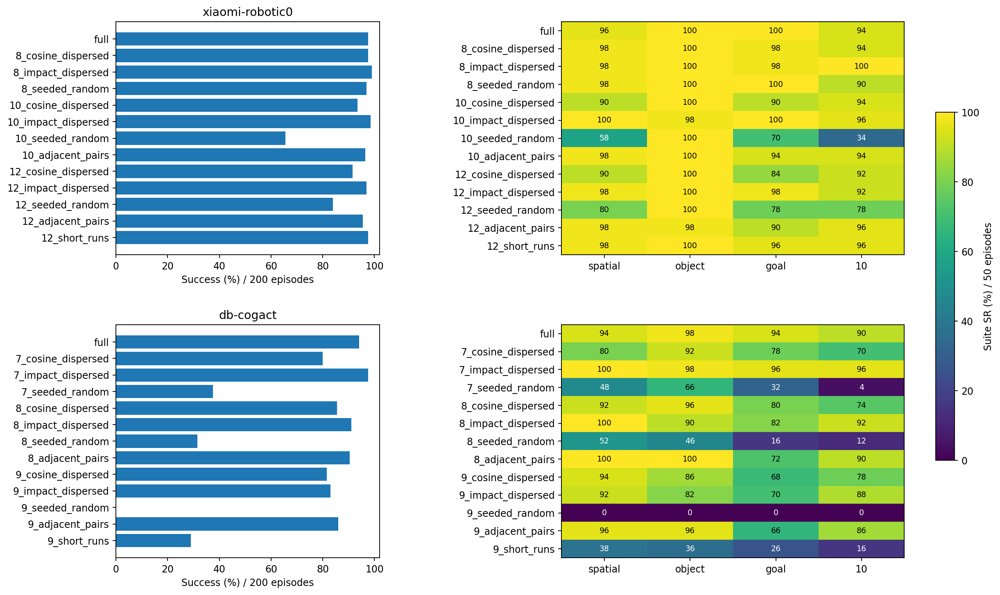
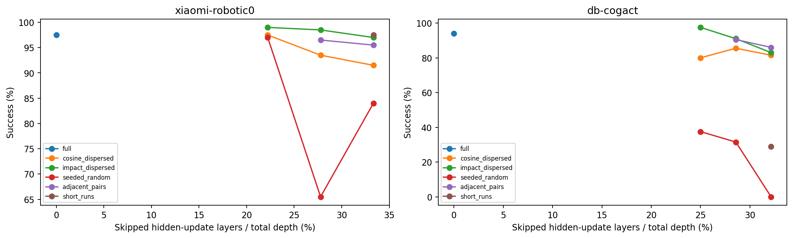
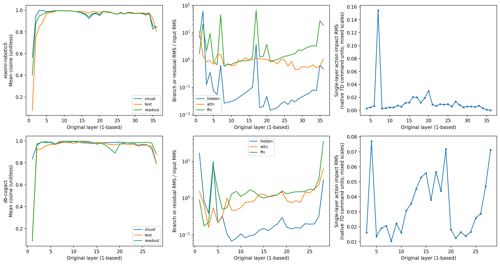
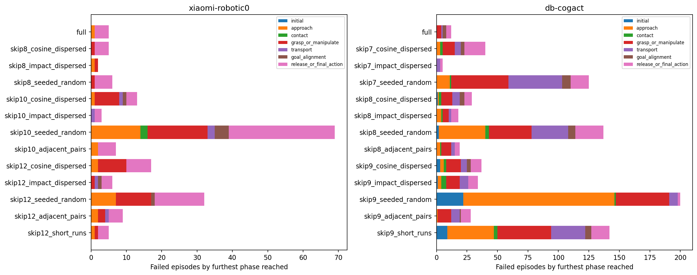
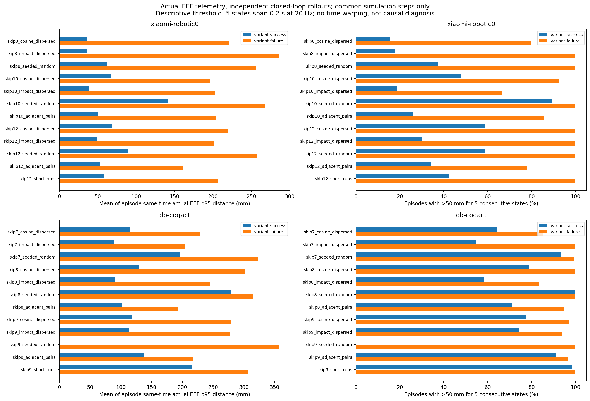
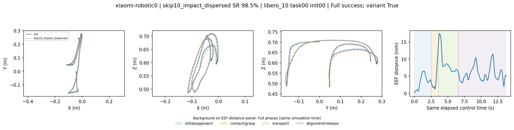
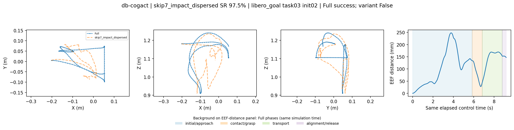
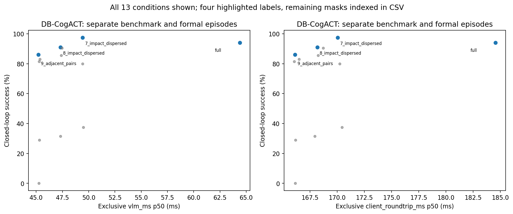
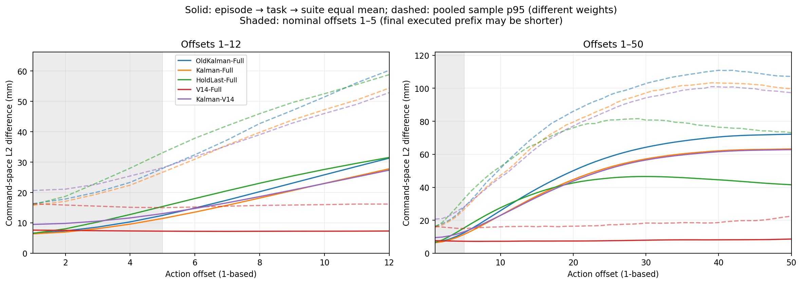
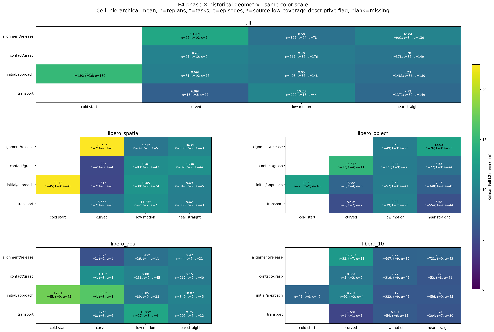

# idea1 v2.1 实验最终结果分析报告

> 文档导航：[实验文档索引](README.md)。

日期：2026-10-17。对应方案：[v2.1 实验方案](idea1_v2_1_experiment_plan.md)。本轮运行标识：`run_20261016T045100Z`。

本报告汇总 **E1：两个深层 VLA 的 VLM 跳层闭环评测**，以及 **E4：π0 命令空间 Kalman 的进一步调参与误差分析**。E2 周期交替、E3 阶段路由属于上一轮 v2，本轮没有重新评测，旧成绩不并入下面的成功率分母。报告中的 L 编号均为原模型的 **1-based 层号**。

## 1. 主要结论与完成状态

**深层模型确实存在可用的较大比例跳层方案，而且选哪些层比仅看跳层数量更关键。** Xiaomi 的 36 层文本主干跳过 8/10/12 层 hidden 更新后，最好方案分别达到 99.0%/98.5%/97.5%；自身 Full 为 97.5%。DB-CogACT 的 28 层主干跳过 7/8/9 层后，最好方案分别为 97.5%/91.0%/86.0%；自身 Full 为 94.0%。这支持“这两个模型存在跳过约 22%–33% hidden 更新、仍有较高成功率的方案”。模型的训练、宽度、动作头和执行协议同时不同，现有比较不能把原因单独归于网络深度。

**余弦相似度适合提供线索，不能单独判定层可以删除。** 本轮按同观测单层跳过的动作影响选层，在多数同预算比较中优于按 hidden 余弦选层。DB-CogACT 跳 7 层时，两种方法分别为 97.5% 和 80.0%。随机方案也并不稳定：Xiaomi 跳 8 层的随机方案为 97.0%，跳 10 层的随机方案只有 65.5%；DB-CogACT 一个跳 9 层的随机方案为 0/200。

**相邻层可以一起跳，但可行性取决于具体位置与组合。** Xiaomi `skip12_short_runs` 包含四组连续三层，成功率仍为 97.5%；`skip10_adjacent_pairs` 实际最长连续跳 5 层，成功率 96.5%。DB-CogACT 的连续分组方案差异更大，不能把“禁止相邻”或“相邻更好”当成普遍规律。

**准确率保留与加速需要分别验收。** DB-CogACT 已有固定观测独占微基准，优先候选 `skip7_impact_dispersed` 的 VLM p50 从 64.40 ms 降到 49.43 ms，约快 23.3%；客户端往返 p50 从 184.57 ms 降到 170.04 ms，约快 7.9%。Xiaomi 缺少同口径独占微基准，本轮可以确定其成功率，尚不能确定可靠的加速比。

**Kalman 调参有稳定的小幅收益，但平均短前缀误差仍高于 V14，长时外推仍明显变差。** 实际可执行前缀内，新 Kalman 对 Full 的平移命令误差从旧版 9.030 mm 降到 8.478 mm，改善 6.12%；同观测 V14 为 7.446 mm。时间对齐诊断后仍有较大残差，不能把问题全解释成统一的“预测过早或过晚”。

| 项目 | 已有结果 | 完成状态与边界 |
| --- | --- | --- |
| Xiaomi E1 正式闭环 | Full + 12 个 mask，各 200 条，共 **2600/2600** | 四套件、每任务 5 个初始状态完整；账本 invalid=0 |
| DB-CogACT E1 正式闭环 | 同上，**2600/2600** | 同上；账本 invalid=0 |
| E1 校准 / 原生参考 | 每模型 8 条校准 + 4 条参考，共 24 条 | 合计 **5224 条有效环境 episode**，正式成功率只使用其中 5200 条 |
| E1 数值探针 | Xiaomi 77 个、DB-CogACT 71 个真实观测 | 已完成；没有用随机初始化观测代替真实任务数据 |
| DB-CogACT 独占性能测试 | 32 个观测 × 13 条件 × 50 次测量 = 20800 次；另有 4160 次预热 | 已完成；保留诊断记录开销 |
| Xiaomi 独占性能测试 | 未找到 benchmark 目录及完成产物 | **尚缺这项测量** |
| E4 调参 / 评估 / 分解 | 208 个候选，634 个校准点，6345 个评估点 | CPU 数值分析和 AI 视频抽帧一致性检查完成 |
| E4 阶段标签 | 检查 8 组固定样例、24 帧 | 仍缺独立人工语义标注认证；标签保留不确定性 |
| GR00T / 原版 CogACT | 资格调查 | GR00T backbone 访问权限不足；原版 CogACT 缺可核验 LIBERO 专用权重，均未计入正式成绩 |

所以，**本报告给出了本轮完整的主模型闭环成功率与 Kalman 分析结果；整套方案的全部验收项还没有齐备**，主要缺口是 Xiaomi 独占性能数据和独立人工阶段标注。补充模型的条件性阻塞也保留在案。

## 2. E1：实验如何进行，全部变体表现怎样

### 2.1 评测与跳层口径

每个模型使用自己的 Full 作为 control。每条件覆盖 Spatial、Object、Goal、LIBERO-10 四套件，每套件 task0–9 × 官方 init0–4，共 50 条；每条件总体 200 条。各套件分母相等，因此总体成功率等于四套件成功率的等权平均。一个任务包含多个动作、抓取与放置步骤，不能把 200 条理解为 200 次单步动作。

| 协议 | Xiaomi-Robotics-0-LIBERO | DB-CogACT-LIBERO |
| --- | --- | --- |
| 实际文本主干深度 | 36 | 28 |
| 预测 H / 执行 R / 去噪 D | **H10 / R10 / D5** | H16 / D10；R：Spatial12、Object16、Goal16、LIBERO-10为15 |
| 图像与状态 | agentview + wrist，使用状态 | agentview，不使用状态 |
| 数值 / 硬件 | bfloat16，RTX 4090 | bfloat16，RTX 4090 |
| 其他原生选项 | Flash Attention 2，连续夹爪命令 | SDPA，CFG1.5，夹爪按零阈值离散 |
| 候选固定保留 | 前三层视觉融合路径及最终层 | 前两层及最终层 |

Xiaomi 配置里的 `action_length=30` 与发布处理器的实际 mask 长度不同；本轮实测输出为 `10×7`，冻结的是 H10/R10/D5。没有把名义的 30 写成实际预测长度。两模型之间的 H/R/D 差异属于各自原生协议，不能直接用模型间延迟差解释跳层收益。

本轮的“跳 k 层”表示绕过这些层的 **attention/FFN hidden 更新**。实际适配路径保留 K/V 投影或缓存壳；parity 中两模型的被跳层都记录到 Q/O/MLP 调用为 0、K/V 调用仍为 1。因此，k/L 是 hidden 更新的跳过比例，不能当作同等比例的全部计算或参数消失。Xiaomi 的动作头还依赖原层号的 KV，尤其需要保持索引。

两模型均通过空 mask 与原生 Full、重复 Full、快速跳层与慢参考的一致性检查，保存动作最大差均为 0。四套件 task0/init0 的原生与适配 Full，也保存了完全一致的动作与实测 XYZ。证据见各模型的 `readiness/parity.json` 和 `native_reference_comparison.json`；这证明相应检查路径通过，不等价于对所有输入的形式化证明。

### 2.2 Xiaomi：全部 13 个条件

下表 suite 列均为百分比，每格分母 50；总体分母 200。Δ 是相对本模型 Full 的百分点差。`cosine`=按高 hidden 余弦排序；`impact`=按低单层动作影响排序；`seeded_random`=固定种子随机；`adjacent_pairs`=相邻组；`short_runs`=短连续段。所有 12 个候选都进入了闭环，没有按早期得分淘汰。

| 条件 | 跳过比例 | Object | Spatial | Goal | LIBERO-10 | 总体 | Δ pp |
| --- | ---: | ---: | ---: | ---: | ---: | ---: | ---: |
| full | 0% | 100 | 96 | 100 | 94 | 195/200，97.5% | 0.0 |
| skip8_cosine_dispersed | 22.2% | 100 | 98 | 98 | 94 | 195/200，97.5% | 0.0 |
| skip8_impact_dispersed | 22.2% | 100 | 98 | 98 | 100 | 198/200，99.0% | +1.5 |
| skip8_seeded_random | 22.2% | 100 | 98 | 100 | 90 | 194/200，97.0% | −0.5 |
| skip10_cosine_dispersed | 27.8% | 100 | 90 | 90 | 94 | 187/200，93.5% | −4.0 |
| skip10_impact_dispersed | 27.8% | 98 | 100 | 100 | 96 | 197/200，98.5% | +1.0 |
| skip10_seeded_random | 27.8% | 100 | 58 | 70 | 34 | 131/200，65.5% | −32.0 |
| skip10_adjacent_pairs | 27.8% | 100 | 98 | 94 | 94 | 193/200，96.5% | −1.0 |
| skip12_cosine_dispersed | 33.3% | 100 | 90 | 84 | 92 | 183/200，91.5% | −6.0 |
| skip12_impact_dispersed | 33.3% | 100 | 98 | 98 | 92 | 194/200，97.0% | −0.5 |
| skip12_seeded_random | 33.3% | 100 | 80 | 78 | 78 | 168/200，84.0% | −13.5 |
| skip12_adjacent_pairs | 33.3% | 98 | 98 | 90 | 96 | 191/200，95.5% | −2.0 |
| skip12_short_runs | 33.3% | 100 | 98 | 96 | 96 | 195/200，97.5% | 0.0 |

Xiaomi 的 12 个变体中有 **11 个达到总体 ≥75%**。8 层和 10 层动作影响方案适合优先保效果；12 层短连续段方案适合研究更高跳层预算。12 层同样的数量下，短连续段 97.5%、余弦方案 91.5%、随机方案 84.0%，差异来自具体组合。

### 2.3 DB-CogACT：全部 13 个条件

| 条件 | 跳过比例 | Object | Spatial | Goal | LIBERO-10 | 总体 | Δ pp |
| --- | ---: | ---: | ---: | ---: | ---: | ---: | ---: |
| full | 0% | 98 | 94 | 94 | 90 | 188/200，94.0% | 0.0 |
| skip7_cosine_dispersed | 25.0% | 92 | 80 | 78 | 70 | 160/200，80.0% | −14.0 |
| skip7_impact_dispersed | 25.0% | 98 | 100 | 96 | 96 | 195/200，97.5% | +3.5 |
| skip7_seeded_random | 25.0% | 66 | 48 | 32 | 4 | 75/200，37.5% | −56.5 |
| skip8_cosine_dispersed | 28.6% | 96 | 92 | 80 | 74 | 171/200，85.5% | −8.5 |
| skip8_impact_dispersed | 28.6% | 90 | 100 | 82 | 92 | 182/200，91.0% | −3.0 |
| skip8_seeded_random | 28.6% | 46 | 52 | 16 | 12 | 63/200，31.5% | −62.5 |
| skip8_adjacent_pairs | 28.6% | 100 | 100 | 72 | 90 | 181/200，90.5% | −3.5 |
| skip9_cosine_dispersed | 32.1% | 86 | 94 | 68 | 78 | 163/200，81.5% | −12.5 |
| skip9_impact_dispersed | 32.1% | 82 | 92 | 70 | 88 | 166/200，83.0% | −11.0 |
| skip9_seeded_random | 32.1% | 0 | 0 | 0 | 0 | 0/200，0.0% | −94.0 |
| skip9_adjacent_pairs | 32.1% | 96 | 96 | 66 | 86 | 172/200，86.0% | −8.0 |
| skip9_short_runs | 32.1% | 36 | 38 | 26 | 16 | 58/200，29.0% | −65.0 |

DB-CogACT 有 **8/12 个变体达到总体 ≥75%**。首选是跳 7 层的动作影响方案；提高到 9 层预算仍有 86.0% 的相邻组方案，但相对 Full 的下降已经明显。最差随机方案 0/200 属于已验证有效 episode 的任务失败，账本没有把它标成技术 invalid；现有数据支持该具体 mask 严重破坏行为，不能外推为所有 9 层方案都会失败。





图中连线用于连接同一方法的离散候选；不同预算的 mask 不保证相互包含，尤其不能把随机方案的曲线解读为对同一组层逐层追加删除的结果。

### 2.4 配对比较：高于 Full 的分数该怎样理解

以 suite 分层，在各 suite 内重采样 task，并整体保留该 task 的五个 init，做 2000 次配对 bootstrap，seed=1701。区间衡量任务簇变化下的均值差不确定性；这些区间没有对 12 个候选的多重比较和“选最好方案”校正。

| 候选 | 相对 Full Δ pp | 95% 配对区间 pp | Full 成功→变体失败 | Full 失败→变体成功 |
| --- | ---: | --- | ---: | ---: |
| Xiaomi skip8_impact_dispersed | +1.5 | [−0.5, +4.0] | 1 | 4 |
| Xiaomi skip10_impact_dispersed | +1.0 | [−1.5, +4.0] | 2 | 4 |
| Xiaomi skip12_short_runs | 0.0 | [−2.5, +2.0] | 4 | 4 |
| DB skip7_impact_dispersed | +3.5 | [+0.5, +6.5] | 3 | 10 |
| DB skip8_impact_dispersed | −3.0 | [−9.5, +2.5] | 16 | 10 |
| DB skip8_adjacent_pairs | −3.5 | [−10.0, +2.5] | 19 | 12 |
| DB skip9_adjacent_pairs | −8.0 | [−15.5, −1.5] | 26 | 10 |

Xiaomi 的两个高分方案可以说“在本次样本上保住了成功率”，还不足以证明跳层提升了模型能力。DB 的 7 层动作影响方案出现了更明确的正向信号，但仍是在同一批候选评测中发现，应在新的初始状态上确认。总体同分也不等于逐条行为一致：Xiaomi 12 层短连续段与 Full 都是 195/200，但交换了 4 个失败与 4 个成功。

完整配对区间、成功率比及 Full 已成功样例的保留比例见 [逐条件汇总](../../../reports/idea1_v2_1_final_20261017/e1_summary.csv)。成功率比可能超过 100%；“Full 成功样例保留率”分母为 Full 的成功数，是另一项指标。

## 3. E1：层特征、任务类型、失败阶段和真实轨迹

### 3.1 层特征究竟用什么数据测量

每模型另取四套件的 task0、task5、init5，共 8 条 **Full 真实仿真轨迹**。每条最多选 10 个真实重规划观测，在已出现的阶段间轮流选取，并在阶段内均匀取点。最终 Xiaomi 77 点、DB-CogACT 71 点；它们与正式评测的 init0–4 分开。样本不是全任务分布的随机样本，也不是随机初始化图像/向量。模型使用固定的发布权重，观察的是激活和动作变化，未训练或修改权重。

| 样本阶段 | Xiaomi 观测数 | DB-CogACT 观测数 |
| --- | ---: | ---: |
| initial | 13 | 10 |
| approach | 31 | 27 |
| contact | 7 | 10 |
| grasp_or_manipulate | 5 | 9 |
| transport | 15 | 13 |
| goal_alignment | 6 | 2 |
| 合计 | **77** | **71** |

保存了 visual/text/readout 三类有效 token 的统计，排除 padding。需要区分下列量：

| 指标 | 实际含义 | 能提供的证据 |
| --- | --- | --- |
| hidden 输入/输出余弦 | 单个 block 前后 token 特征方向相似度 | 方向改变小；不能保证幅值、关键 token 或最终动作不变 |
| hidden update RMS | `RMS(h_out−h_in)` | residual 更新有多大，单位是该模型的激活单位 |
| attn / FFN RMS | 对应分支输出的 RMS | 分支数值输出规模；并非直接测量删除该分支的闭环影响 |
| relative RMS | 更新或分支 RMS / 对应输入 RMS | 同模型内辅助比较；各分支 hook 输入不同，不能直接当作可互换的贡献率 |
| attn / FFN 余弦 | 各 hook 的输入/输出余弦 | 与整个 residual block 前后余弦定义不同，不能混为一条指标 |
| 单层动作影响 | 固定真实观测及生成噪声，只绕过一层，与 Full 的原生解码后 7D 动作命令做 RMS 差 | 更接近“该层绕过后动作变多少”；混合平移、旋转、夹爪等尺度，不能直接写成毫米 |

Xiaomi 前三层、DB 前两层固定保留，对它们的单层跳过影响没有测量，缺失值不能解释为 0。候选还固定保留最终读出层。候选生成时，hidden 余弦对观测及 token 类别记录做等权平均；`dispersed` 先按非相邻规则贪心选层，再补足预算，名称不保证所有情况下最终完全不相邻。



### 3.2 数值上最值得留意什么

**高余弦与低动作影响并不一一对应。** 在可选层的层均值上，hidden 余弦与动作影响的 Spearman 相关分别约为 Xiaomi **−0.170**、DB-CogACT **−0.202**。这只是 32/25 个相关层点的描述统计，不能据此建立普遍的显著性结论；但它足以提醒我们不要把接近 1 的余弦直接翻译成“冗余层”。

**少数层的动作影响是明显离群的。** Xiaomi L7 单层绕过的动作命令 RMS 均值约 0.1544，L4 约 0.00274、L35 约 0.00114。DB-CogACT 中 L4、L19 较敏感，约 0.0771、0.0718，而 L8、L21 约 0.01045、0.01245。这些数值用于同一模型内部排序，不宜跨架构比较大小。

**attention 分支的相对输出规模值得继续看。** 本次 attention relative RMS 与单层动作影响的 Spearman 相关约为 Xiaomi **0.671**、DB **0.558**，比 hidden 余弦更强。FFN 对应相关约 0.200/0.163。这里删除的是整层 hidden 更新，尚未直接删除 attention 或 FFN 单个模块，因此现有结果能提出模块级候选，不能宣布某些 attention/FFN 已被验证可以独立剪掉。

**多层组合存在交互，不能简单把单层影响相加。** DB 的 cosine 7 层方案增加 L25 后成为 cosine 8 层方案，成功率反而从 80.0% 升到 85.5%；动作影响 7 层方案增加 L12 后变成 8 层方案，从 97.5% 降到 91.0%。这说明层的边际作用会随当前 mask 改变。后者只证明“在这组已跳层的上下文中加跳 L12 有损”，没有证明 L12 对任意组合都同等重要。

详表：[按 token 类别的层特征](../../../reports/idea1_v2_1_final_20261017/probe_features.csv)、[单层动作影响](../../../reports/idea1_v2_1_final_20261017/probe_impacts.csv)、[相关性](../../../reports/idea1_v2_1_final_20261017/probe_correlations.csv)、[真实样本覆盖与来源](../../../reports/idea1_v2_1_final_20261017/probe_coverage.json)。

### 3.3 不同任务类型的表现确实不同，但还不能定位为某类专用层

最直观的例子是 Xiaomi `skip10_seeded_random`：Object 仍为 **100%**，Spatial/Goal/LIBERO-10 却为 **58%/70%/34%**。DB `skip8_adjacent_pairs` 的 Object 和 Spatial 都是 **100%**，Goal 只有 **72%**。DB `skip9_adjacent_pairs` 则是 Object/Spatial **96%/96%**，Goal **66%**。

这支持“同一跳层组合对不同 suite 的损伤不同”。它还不能直接证明被跳的某一层编码了 Goal 特征：套件也改变了物体、指令、初始分布、接触序列与任务难度。本轮没有在每个 suite 上分别选择与独立验证专用 mask，也没有做单个 attention/FFN 的任务类型消融。

按每个 suite **≥90%** 的原定口径，Xiaomi 的 8 层 impact、10 层 impact、12 层 impact、12 层 short-runs 等候选都覆盖四套件；DB 的 7 层 impact 也是四套件全部 ≥90%。DB 的 8 层 adjacent 则适合 Object/Spatial 而不适合维持 Goal 表现。全清单见 [suite ≥90% 候选表](../../../reports/idea1_v2_1_final_20261017/suite_at_least_90.csv)。

### 3.4 失败是否都发生在精细操作

先按失败 episode 的**最远到达阶段**统计；下表仅展示几个重点条件。早期=initial/approach；接触抓取=contact/grasp_or_manipulate；后期=goal_alignment/release_or_final_action。搬运独立列出。

| 条件 | 失败总数 | 最远早期 | 最远接触/抓取 | 最远搬运 | 最远后期 |
| --- | ---: | ---: | ---: | ---: | ---: |
| Xiaomi Full | 5 | 1 | 0 | 0 | 4 |
| Xiaomi skip8_impact | 2 | 1 | 1 | 0 | 0 |
| Xiaomi skip10_impact | 3 | 0 | 0 | 1 | 2 |
| Xiaomi skip12_short_runs | 5 | 1 | 1 | 0 | 3 |
| Xiaomi skip10_random | 69 | 14 | 19 | 2 | 34 |
| DB Full | 12 | 0 | 4 | 1 | 7 |
| DB skip7_impact | 5 | 0 | 0 | 3 | 2 |
| DB skip8_adjacent | 19 | 3 | 9 | 3 | 4 |
| DB skip9_adjacent | 28 | 1 | 11 | 7 | 9 |
| DB skip9_random | 200 | 146 | 45 | 7 | 2 |

**失败没有统一集中在精细阶段。** 比较好的 DB 7 层方案，5 个失败都已经到达搬运或更后阶段；严重退化的 DB 9 层随机方案，有 146/200 个失败最远只到 initial/approach。这表明不同 mask 会破坏不同程度的行为链路。

最远阶段不能用作致败时刻。机械臂可能早已走偏，后来仍被阶段规则标为抓取或释放；进入 release 也不等于完成了正确放置。夹爪抓取真值变为假还可能是正常放下物体，单次变化不能直接归因为“意外松手导致失败”。



全条件计数见 [最远阶段 CSV](../../../reports/idea1_v2_1_final_20261017/failure_furthest_phase.csv)。另外重新读取了全部 5200 条正式 episode 的 telemetry，计算 **4800 对** Full/变体的实际末端距离。持续偏离规则固定为同仿真步的末端距离严格大于 **50 mm**、连续出现 **5 个状态**；20 Hz 下这 5 个状态首尾相隔 0.20 s。这里只比较两条轨迹共同存在的时间段，记录首次触发时 Full 和变体各自的阶段，未触发保留为空。

| 变体 | 成功 episode 中触发持续偏离 | 失败 episode 中触发 | 成功组：每条轨迹位置差 p95 的均值 mm | 失败组：同指标 mm |
| --- | ---: | ---: | ---: | ---: |
| Xiaomi skip8_impact | 35/198，17.7% | 2/2 | 36.3 | 285.9 |
| Xiaomi skip10_impact | 37/197，18.8% | 2/3 | 38.5 | 202.8 |
| Xiaomi skip12_short_runs | 83/195，42.6% | 5/5 | 57.9 | 206.8 |
| DB skip7_impact | 107/195，54.9% | 5/5 | 88.6 | 204.4 |
| DB skip8_adjacent | 129/181，71.3% | 18/19，94.7% | 102.1 | 193.0 |
| DB skip9_adjacent | 157/172，91.3% | 27/28，96.4% | 137.6 | 216.7 |

这里按**变体最终成功/失败**分组，未要求 Full 同时成功；p95 先在每个 episode 内计算，再对 episode 等权平均，不是所有时间点合并后的 p95。

这组数据说明，50 mm 规则能定位路径分叉，但不能直接用作失败分类器。DB 的成功策略也经常触发；Xiaomi skip10_impact 还有一个失败在共同时间段内未触发。**高闭环成功率不保证每一时刻都贴着 Full 路线，因此 E1 本身不能保证推测执行所需的前缀动作可直接接受。**

DB skip7_impact 的 5 个失败，虽然最远阶段都到了搬运或释放，但首次持续偏离按 Full 阶段分别出现在 initial 1 条、approach 2 条、transport 1 条、goal_alignment 1 条。也就是说，部分最后在后段失败的轨迹，前段已经分叉。DB skip9_adjacent 的 28 个失败中有 27 个触发，其中 16 个触发时 Full 尚在 initial/approach。现有数据不支持把这两组失败统一归因为精细操作时才出错。



抓取事件也做了全量统计，其定义是 `robot_grasps` 中从“至少一个对象记录为 True”变为“没有对象记录为 True”，属于状态转移候选。Xiaomi skip8_impact 的成功轨迹 121/198 出现该事件，两条失败却均未出现；DB skip7_impact 的成功轨迹 120/195 出现，5 条失败也都出现。正常放置和释放会触发同一事件，所以这个标记无法单独证明意外掉落或解释失败原因。

数据：[全部配对轨迹指标](../../../reports/idea1_v2_1_final_20261017/pair_trajectory_metrics.csv)、[失败轨迹的首次偏离](../../../reports/idea1_v2_1_final_20261017/failure_first_deviation.csv)、[首次偏离阶段分布](../../../reports/idea1_v2_1_final_20261017/first_deviation_phase_counts.csv)、[抓取转移分组表](../../../reports/idea1_v2_1_final_20261017/grasp_event_by_success.csv)。

### 3.5 XYZ 与视频：看真实末端轨迹，也看任务最终是否成功

下面使用仿真器保存的真实末端 `eef_pos`。Full 为蓝色半透明点线，变体为橙色半透明虚线；左侧是 XY/XZ/YZ 投影，右侧是同仿真时间的实际末端位置差，背景色与竖线标记 **Full 的合并阶段及其切换**。两边各自闭环执行，同初始状态配对，路径分叉后观测也会不同；变体此时的阶段不一定与背景一致。这与 E4 沿 Full 路线做同观测预测比较的含义不同。

选图规则固定为：每模型三个代表候选，各取按 suite/task/init 字典序排序的第一个“双成功”与第一个“Full 成功、变体失败”配对，共 **12 对**。不是按图是否好看或误差是否最大挑选；这个规则较多选到 LIBERO-10/task0，因此不能把图例频率当作总体分布。

**成功例：Xiaomi 跳 10 层动作影响方案，LIBERO-10 task0/init0，两边都成功。** 共同时间段的末端距离 p95 约 11.2 mm。



**新增失败例：DB 跳 7 层动作影响方案，Goal task3/init2，Full 成功而变体失败。** 同时间位置差可以达到较大规模，但仅凭位置差不能定位是抓取、路径选择还是节奏变化导致。



也有“双成功但同时间轨迹差很大”的例子：DB `skip9_adjacent_pairs` 的 LIBERO-10 task0/init0，位置差 p95 约 **408 mm**。这说明 Full 路径并非唯一可成功的轨迹；同时间 XYZ 差既包括空间路线差，也包括执行节奏不同，不宜设置一个通用距离阈值就判失败。

全部图和成对完整视频：[视频与轨迹索引 Markdown](../../../reports/idea1_v2_1_final_20261017/media_index.md)、[成对视频图库 HTML](../../../reports/idea1_v2_1_final_20261017/gallery.html)、[案例来源 CSV](../../../reports/idea1_v2_1_final_20261017/trajectory_index.csv)。图像和索引使用相对路径，适用于工作区内 Markdown Preview Enhanced 预览；视频没有复制到报告目录，路径仍指向原始实验 episode。

## 4. E1：实际加速有多少

### 4.1 DB-CogACT 的固定观测独占微基准

使用 RTX 4090、32 个真实校准观测。Full 和 12 个条件对每个观测使用相同生成噪声，按轮换顺序各预热 10 次、测量 50 次。共有 20800 条测量记录，每条件 1600 条。下表为 **p50**；VLM 是 GPU 分项时间，server total 是服务端墙钟时间，client roundtrip 还包括客户端往返。三列各有自己的计时边界，不能直接相加。

| 条件 | 成功率 | VLM p50 ms | 服务端 p50 ms | 客户端往返 p50 ms | VLM 降幅 | 往返降幅 |
| --- | ---: | ---: | ---: | ---: | ---: | ---: |
| Full | 94.0% | 64.40 | 170.77 | 184.57 | — | — |
| skip7_impact_dispersed | 97.5% | 49.43 | 156.05 | 170.04 | 23.3% | 7.9% |
| skip8_impact_dispersed | 91.0% | 47.32 | 154.00 | 168.16 | 26.5% | 8.9% |
| skip8_adjacent_pairs | 90.5% | 47.47 | 154.29 | 168.70 | 26.3% | 8.6% |
| skip9_adjacent_pairs | 86.0% | 45.22 | 151.71 | 166.11 | 29.8% | 10.0% |

同预算的不同层组合，其性能差异远小于成功率差异。例如 DB 跳 9 层的 adjacent 和 random，VLM p50 都约 45.2 ms，但成功率分别 86% 和 0%。因此不能为多省几毫秒就忽略 mask 的功能影响。



Full 的分项 p50 中，视觉塔约 12.43 ms、VLM 64.40 ms、Action Expert 53.29 ms，另有输入处理、适配与随机状态设置、服务和 RPC 开销。跳 VLM 不会同比缩减这些部分，且保留 K/V 计算。因此跳过约四分之一 hidden 更新，往返耗时只缩短约 8%，是计时范围和剩余开销共同作用的结果。

微基准保留了诊断 hook、随机状态与噪声记录等实现开销。这里是当前实验实现的实测结果，尚未代表去掉诊断和进一步编译优化后的生产性能。完整 mean/p50/p95 见 [独占分项表](../../../reports/idea1_v2_1_final_20261017/db_exclusive_benchmark.csv)，[测试完成核查](../../../reports/idea1_v2_1_final_20261017/benchmark_audit.json)。

### 4.2 Xiaomi 和并行闭环时间的边界

Xiaomi 没有对应独占微基准，不能用 parity 的少量冷启动时间或与其他 GPU 并行时的时间，给出确定加速结论。已保留每模型 13 条件 × 四套件 task0/init0 的固定 episode 抽样，共 52 条/模型；其 [并行闭环耗时表](../../../reports/idea1_v2_1_final_20261017/parallel_latency_sample.csv) 可用于运行成本排查。不同策略各自闭环后观测和 episode 长度不同，这张表不构成同观测严格加速对照。

现阶段推荐优先候选：**DB 的 7 层动作影响方案兼顾效果与实测速度；Xiaomi 的 8/10 层动作影响、12 层 short-runs 先作为效果候选，待补性能后排序。** 本轮没有随跳层改变 Action Expert 层数或去噪步数。

## 5. E4：Kalman 进一步调参和误差分解

### 5.1 数据、状态和参数如何确定

E4 复用了 π0、D3、预测 50/只执行 Full 前 5 的四套件 Shadow 数据。参照源身份为 `Full18_D3_R5_FORMAL`，变体是 π0 的 **V14_A03**；它与本报告 Xiaomi/DB 的新跳层条件不是同一个模型。完整源数据为 6979 个 replan、200 个 episode；task0/init0–4 为校准集 634 点/20 个 episode，task1–9 为评估集 6345 点/180 个 episode、36 个 suite-task 身份。旧 Kalman 的全部均值与协方差复现最大差为 0，另核查 6276 个旧 CSV 数值单元。

每轮只能同化已执行的三轴平移命令。主状态为 `x=[u,w]`，u 是归一化命令，w 是每个动作周期的命令变化量；不是机器人真实位置或真实速度。预测时复制状态和协方差，并且不使用本轮尚未执行的 Full/V14 预测块、未来 XYZ 或阶段标签。

```text
F_update   = [[I, I], [0, beta I]]
F_forecast = [[I, g I], [0, beta I]]
Q = blockdiag(q_u S_Q, q_w S_Q),  R = S_R
```

物理动作周期固定 0.05 s，即 20 Hz；前 5 步对应 0.25 s，50 步对应 2.5 s。预测强度通过 g、beta 调整。单独改 dt 在旧实现中会被状态和噪声的单位变换抵消，因此没有把扫描 dt 当作有效调前瞻性的方法。

先比较 49 组各向同性噪声比，再将校准中前三组扩展 g/beta/矩阵形状，总上限 211 槽，去重后 **208 个候选**。校准内部按 init 做 5 折；协方差形状只用当前训练折拟合，最终赢家用全部校准集拟合后冻结，评估 task1–9 不再挑参。候选同时检查短前缀 L2 p95 和横向代理误差 p95，不允许在任一校准折比旧参考恶化超过 5% 后仍优先获选。

最终参数为：

| 参数 | 结果 | 解释 |
| --- | ---: | --- |
| q_u | 0.0001 | 命令值过程噪声相对尺度，落在网格下界 |
| q_w | 100 | 趋势过程噪声相对尺度，落在网格上界 |
| g | 0.5 | 预测副本外推趋势乘 0.5 |
| beta | 1.0 | 本次赢家没有选择趋势衰减 |
| 矩阵形状 | q_full | Q 使用校准二阶命令差分估出的正定三轴形状；R 为单位阵 |

```text
S_Q = [[ 0.86682, -0.00464, 0.47396],
       [-0.00464,  0.76373, 0.04575],
       [ 0.47396,  0.04575, 1.36945]]
```

S_Q 特征值约为 0.578/0.766/1.656，条件数 2.867，R=I；这些是命令模型的失配/平滑超参数，不能称为传感器真实噪声精度。校准均值从 9.2089 降到 8.6048 mm，赢家五折均值范围为 8.147–9.179 mm。参数在边界获胜，说明本轮网格内有改进，尚不能宣称已经找到全局最优。

此外，这次联合改变了噪声比、形状和 g。现有评估不能把全部收益单独归给“非对角 Q 矩阵”；需要匹配其他参数的消融才能做这种归因。校准只覆盖四个 suite-task 身份，噪声形状对其他任务的泛化也有限。数据在 v2 时已被看过，本轮是冻结候选后的复用数据确认，仍有研究者选择偏差。

### 5.2 前 1–5 步到底改善多少

单步平移命令误差定义为：`e_h=50 mm × [clip(u_pred,h)−clip(u_Full,h)]`，主指标是其三维 L2。**它是控制目标增量差，尚不是执行后的真实末端位置误差。** 均值按 replan→episode→task→suite 等权汇总；p95 将有效动作样本汇集后计算，与均值的权重不同。

| 对 Full 的比较 | 实际可执行前缀均值 mm | 名义前 5 步均值 mm | 实际前缀样本 p95 mm |
| --- | ---: | ---: | ---: |
| 旧 Kalman | 9.030 | 9.085 | 21.691 |
| **新 Kalman** | **8.478** | **8.513** | **20.917** |
| HoldLast | 10.576 | 10.617 | 25.536 |
| V14 | 7.446 | 7.446 | 15.575 |

实际前缀在 episode 提前结束时截断，共 31401 个有效动作样本；名义前 5 步一律计满，共 31725 个。旧报告约 9.08 mm 与本报告主值 9.03 mm 的差别来自这个分母定义，不能把它算作调参收益。

新减旧为 **−0.552 mm**，配对层级 bootstrap 95% 区间 **[−0.744, −0.367] mm**；新减 V14 为 **+1.032 mm**，区间 **[+0.433, +1.624] mm**。相对 HoldLast 改善约 2.098 mm，区间 [−2.393, −1.793] mm。因此，本轮找到的是对旧 Kalman 的有限改进，尚未得到平均短前缀优于 V14 的结果。

### 5.3 1–12 步与第 50 步：差异随预测长度如何变化

下表为每个 offset 的层级等权命令 L2 均值，单位 mm；不是前 h 步累计误差。逐 offset 诊断保留全部 6345 个预测块，曲线灰区标记名义可执行 offset1–5；最后一个 chunk 实际执行不足 5 步的情况，只在上一节“实际可执行前缀”汇总中截断。

| offset | 旧 Kalman | 新 Kalman | HoldLast | V14 |
| ---: | ---: | ---: | ---: | ---: |
| 1 | 6.621 | 6.403 | 6.568 | 7.625 |
| 2 | 7.362 | 6.988 | 8.055 | 7.541 |
| 3 | 8.635 | 8.112 | 10.293 | 7.433 |
| 4 | 10.336 | 9.600 | 12.769 | 7.349 |
| 5 | 12.469 | 11.461 | 15.400 | 7.283 |
| 6 | 14.902 | 13.559 | 18.033 | 7.232 |
| 7 | 17.521 | 15.807 | 20.594 | 7.216 |
| 8 | 20.286 | 18.184 | 23.072 | 7.243 |
| 9 | 23.066 | 20.602 | 25.426 | 7.266 |
| 10 | 25.844 | 23.024 | 27.613 | 7.269 |
| 11 | 28.602 | 25.424 | 29.639 | 7.287 |
| 12 | 31.326 | 27.808 | 31.559 | 7.333 |
| 50 | 72.170 | 63.226 | 41.533 | 8.623 |



新 Kalman 在第 1、2 步均值低于 V14，但从第 3 步起更高，第 5 步已是 11.46 对 7.28 mm。它很快丢失未来动作变化的信息；V14 在这批同观测数据上更稳定，但也没有与 Full 完全一致，第 50 步均值为 8.62 mm、样本 p95 约 22.46 mm。

第 50 步新 Kalman 的 63.23 mm 已高于 HoldLast 的 41.53 mm。它相对旧版减缓了预测差异增长，不能据此声称长时外推已经稳定。beta=1 也不支持“衰减机制抑制了发散”的解释。第 6–50 步都未作为 Kalman 策略真实执行，本轮不能给出相应真实机器人漂移或成功率。

### 5.4 是前后偏移，还是横向走岔

除单步命令误差，还构造 `C_h=50 mm×Σ clip(u_j)` 作为控制目标路径代理，把新旧 Kalman 与 Full 的**累计代理差**沿 Full 局部切线分解。下表前两项由累计代理计算，后两项由单步动作向量计算，数值层级不同。

| 实际前缀内指标 | 旧 Kalman | 新 Kalman | 解释 |
| --- | ---: | ---: | --- |
| 有符号沿程代理差均值 mm | +0.795 | −2.878 | 有正负抵消；不能直接等同时间超前/滞后 |
| 横向代理距离均值 mm | 15.933 | 15.175 | 累计路径代理的横向差，因此可以大于单步 L2 |
| 单步幅值差均值 mm | +1.967 | +0.505 | 有符号幅值差，接近零也可能有个体正负误差 |
| 单步方向夹角均值 | 0.276 rad，约 15.8° | 0.265 rad，约 15.2° | 排除方向无定义的低动作样本 |

新 Kalman 对幅值偏大有改善，方向和横向误差仍明显存在。不能仅因沿程均值为负就宣称只要再“调快一点”能解决。全量保存了三轴有符号/绝对误差、符号比例、方向有效掩码和尾部分布；总样本中方向无定义约 3.46%，代理切线无定义约 0.84%，没有用 0 填补。

另做固定重叠的时移诊断：在预测 1–12 步内，允许预测序列相对 Full 平移 −3…+3 步；所有候选平移都比较相同 Full offset4–9。逐样本用评估数据挑最优平移，是一个事后 oracle，不能直接作为可部署校正方法。

| 对 Full 比较 | 零平移均值 mm | oracle 后残差 mm | 改善 mm | oracle 后横向残差 mm |
| --- | ---: | ---: | ---: | ---: |
| 旧 Kalman | 16.430 | 12.868 | 3.562 | 8.832 |
| 新 Kalman | 14.869 | 13.111 | 1.758 | 8.984 |
| V14 | 7.265 | 5.572 | 1.693 | 3.964 |
| HoldLast | 19.216 | 19.216 | 0 | 12.547 |

这张表比较固定 Full offset4–9，与前 1–5 步主指标的窗口不同，不能直接把两个表的数值相减当作校正收益。HoldLast 预测序列恒定，任意平移都相同，因此其时移全部不可辨认。

新 Kalman 平移后仍剩约 **13.11 mm**，并且有约 **8.98 mm** 的横向残差；单纯时序错位解释不了主要差异。旧版经 oracle 后的残差甚至略低于新版，表明新调参在零平移均值上的收益不能解释成所有形状/方向误差都改善。

新 Kalman 最优平移落在 −3 或 +3 边界的样本共 4348/6345，约 **68.5%**；正负方向都大量出现。它既提示窗口边界，也表明不存在一个从本表就能确定的统一“前瞻太强/太弱”修正量。幅值失配同样能使时移看起来更好，不能把最优 shift 直接读成真实系统延迟。

数据：[误差各分量全表](../../../policies/realtime-vla-flash/results/idea1_v2_1_multimodel_kalman/run_20261016T045100Z/e4_revision3/e4_kalman/supplemental/full_error_metrics.csv)、[时间对齐汇总](../../../reports/idea1_v2_1_final_20261017/e4_oracle_summary.json)。

### 5.5 阶段与直线度：简单搬运是否更容易外推

语义阶段取 Full 当前 replan 的遥测标签。几何分组独立使用过去 5 个真实末端步长：路径长度 <20 mm 为 low-motion；否则直线度 `端点位移/路径长度 ≥0.95` 为 near-straight，余下为 curved；历史不足归 cold-start。另保留过去 10 步、阈值 0.90/0.98 的敏感性表。未来预测 offset 沿用当前 replan 标签，不声称未来每一步仍处于该阶段。

| 阶段 × 历史几何 | 新 Kalman 前缀均值 mm | replan | task | episode |
| --- | ---: | ---: | ---: | ---: |
| 接近 × 近直线 | 8.232 | 1483 | 36 | 180 |
| 接触/抓取 × 近直线 | 8.776 | 378 | 35 | 149 |
| 搬运 × 近直线 | **7.722** | 1371 | 32 | 149 |
| 对齐/释放 × 近直线 | 10.037 | 901 | 34 | 139 |
| 搬运 × 低运动 | 10.233 | 122 | 18 | 44 |
| 搬运 × 弯曲 | 6.892 | 13 | 8 | **11，覆盖不足** |
| 接近 × 冷启动 | 15.084 | 180 | 36 | 180 |



**近直线搬运确实是误差较小的一组，但接触时没有普遍突增。** 同为近直线，搬运到接触/抓取约增加 1.05 mm，对齐/释放约增加 2.32 mm。描述性回归同时调整动作幅值、clipping、历史长度、过渡窗口、suite-task 后，对应近直线组的预测均值为接近 8.979、接触/抓取 8.166、搬运 6.913、对齐/释放 8.463 mm。调整后排序不完全一样，说明任务组成与动作特征影响较大；这仍是关联分析。

**“近直线一定比弯曲容易”本轮没有得到充分验证。** 弯曲搬运只有 13 个点/11 个 episode，低于预定 20 个 episode 的覆盖门槛；其均值反而更小，不能据此下结论。过去的 EEF 近直线也不保证未来命令继续匀速：突然停下、转弯、改变夹爪目标都可能发生。

**套件之间也有差异。** 在近直线搬运组，Object 为约 5.58 mm，LIBERO-10 约 5.94 mm，Goal/Spatial 约 9.75/9.62 mm。这些不是新 Kalman 在各套件的成功率，且分组任务覆盖不同；它们提示用 suite 和几何共同分析比单看阶段标签更有信息。

冷启动组误差较高也有明确建模限制：没有已执行命令历史时，命令滤波器缺少趋势信息。不能把“初期误差”全部归因为平移任务更困难。低运动阶段也不代表未来命令接近零，不能直接视为最容易预测。

阶段标签做了 8 组固定抽帧的 AI 视觉一致性核查，其中 Goal 搬运例仍有歧义，其余也有遮挡与时间对齐限制；没有独立人工认证。详见 [视觉审阅记录](../../../policies/realtime-vla-flash/results/idea1_v2_1_multimodel_kalman/run_20261016T045100Z/e4_revision3/e4_kalman/supplemental/visual_review_findings.json)。

E4 的全部原始图例、Full 真实 EEF 与控制目标路径代理、对应视频见 [案例图库](../../../policies/realtime-vla-flash/results/idea1_v2_1_multimodel_kalman/run_20261016T045100Z/e4_revision3/e4_kalman/decomposition/gallery.html)。其中 Kalman/V14 的代理曲线不是这两种策略执行后的真实末端轨迹。

## 6. 对研究主线的建议与结论边界

**优先把深层模型的高成功率跳层作为后续推测执行的候选来源。** DB 的 7 层动作影响方案已经同时有成功率与独占性能证据；Xiaomi 的 8/10 层动作影响、12 层短连续段也有很好的闭环表现。先补 Xiaomi 同口径性能，再对优先方案用新的官方初始状态确认，例如 init6–10；init5 已用于校准，不应包装成全新验证集。为了用于推测执行，还需要在各新模型的原生 H/R 下沿 Full 路线做同观测 Shadow，验证前缀质量。后续选择应同时看新增失败、速度和前缀动作一致性。

**继续用动作影响指导候选，保留余弦与分支相对幅值作为辅助。** 本轮直接评测每个预登记 mask，已经比只看几百个离线组合的分数更有说服力。下一步可以研究给定 mask 下的边际层影响、关键 token 的变化、attention 与 FFN 独立绕过；本轮的数据尚未完成这些模块消融。

**阶段/任务类型有差异信号，在线路由还需要专门验证。** suite 结果可用于提出候选，但 suite 是事先已知的任务集合，在线决策还需要当前观测中的可用信号。不能拿事后未来阶段或最远阶段直接做部署时的门控输入。若要验证“精细操作更敏感”，应沿 Full 路线统计候选的前缀误差与接触/夹爪事件，并另做受控接管闭环。

**Kalman 可保留为极短前缀的低成本参考，现有证据不足以优先替代 V14。** 新版前两步均值略小于 V14，但 1–5 步整体已更差；平均命令接近也不能保证抓取安全或任务成功。当前 E4 只分析平移命令，并未验证 Kalman 的旋转/夹爪生成、接管成功率或整体推测执行收益。

**几毫米不能直接宣布可接受，也不能归为噪声。** L2 非负是距离定义，完全相同向量的 L2 仍是 0；平方不会凭空产生非零差异。当前尚未测定重复推理/控制器的独立噪声底限，也没有把命令偏差映射为接触裕量。E1 中实际 XYZ 的大幅分叉、E4 中同观测的单步命令差，回答的是不同层次的问题，报告均保持了各自单位与执行条件。

## 7. 具体跳层表、数据索引与验收缺口

### 7.1 Xiaomi 的 12 个实际 mask

下面列的是跳过层，不是保留层。未列出的层按原路径保留；候选编号没有复用 π0 的 V13/V14，避免混淆。

| 条件 | 跳过的原层号 |
| --- | --- |
| skip8_cosine_dispersed | [6, 8, 10, 12, 14, 21, 23, 28] |
| skip8_impact_dispersed | [4, 8, 11, 13, 26, 29, 32, 35] |
| skip8_seeded_random | [6, 9, 12, 14, 16, 24, 26, 27] |
| skip10_cosine_dispersed | [6, 8, 10, 12, 14, 19, 21, 23, 26, 28] |
| skip10_impact_dispersed | [4, 6, 8, 11, 13, 22, 26, 29, 32, 35] |
| skip10_seeded_random | [5, 13, 14, 15, 18, 19, 28, 31, 33, 34] |
| skip10_adjacent_pairs | [4, 5, 6, 8, 9, 10, 11, 12, 34, 35] |
| skip12_cosine_dispersed | [6, 8, 10, 12, 14, 19, 21, 23, 26, 28, 31, 34] |
| skip12_impact_dispersed | [4, 6, 8, 11, 13, 15, 22, 24, 26, 29, 32, 35] |
| skip12_seeded_random | [4, 8, 10, 11, 14, 15, 17, 21, 22, 25, 33, 35] |
| skip12_adjacent_pairs | [4, 5, 6, 8, 9, 10, 11, 12, 29, 30, 34, 35] |
| skip12_short_runs | [4, 5, 6, 8, 9, 10, 29, 30, 31, 33, 34, 35] |

### 7.2 DB-CogACT 的 12 个实际 mask

| 条件 | 跳过的原层号 |
| --- | --- |
| skip7_cosine_dispersed | [5, 8, 11, 13, 16, 21, 23] |
| skip7_impact_dispersed | [3, 5, 8, 10, 21, 23, 25] |
| skip7_seeded_random | [5, 9, 11, 12, 19, 20, 21] |
| skip8_cosine_dispersed | [5, 8, 11, 13, 16, 21, 23, 25] |
| skip8_impact_dispersed | [3, 5, 8, 10, 12, 21, 23, 25] |
| skip8_seeded_random | [3, 4, 9, 11, 12, 15, 24, 27] |
| skip8_adjacent_pairs | [5, 6, 8, 9, 21, 22, 23, 24] |
| skip9_cosine_dispersed | [3, 5, 8, 11, 13, 16, 21, 23, 25] |
| skip9_impact_dispersed | [3, 5, 8, 10, 12, 16, 21, 23, 25] |
| skip9_seeded_random | [3, 4, 9, 14, 15, 17, 18, 23, 24] |
| skip9_adjacent_pairs | [5, 6, 8, 9, 21, 22, 23, 24, 25] |
| skip9_short_runs | [3, 4, 5, 8, 9, 10, 21, 22, 23] |

`adjacent_pairs` 的相邻小组可能合并成长段，所以实际最长连续长度可到 4/5；`short_runs` 才专门限制连续段不超过 3。所有 mask 都没有覆盖固定保护层。完整数值与最长连续长度见 [汇总 CSV](../../../reports/idea1_v2_1_final_20261017/e1_summary.csv)。

### 7.3 可复核的数据入口

| 内容 | 文件 |
| --- | --- |
| 正式逐 episode 明细（5200 条） | [e1_episodes.csv](../../../reports/idea1_v2_1_final_20261017/e1_episodes.csv) |
| 全条件成功率、区间与配对增损 | [e1_summary.csv](../../../reports/idea1_v2_1_final_20261017/e1_summary.csv) |
| suite / task 成功率 | [suite 表](../../../reports/idea1_v2_1_final_20261017/e1_by_suite.csv)、[task 表](../../../reports/idea1_v2_1_final_20261017/e1_by_task.csv) |
| 层探针 | [features](../../../reports/idea1_v2_1_final_20261017/probe_features.csv)、[impacts](../../../reports/idea1_v2_1_final_20261017/probe_impacts.csv)、[覆盖](../../../reports/idea1_v2_1_final_20261017/probe_coverage.json) |
| 配对轨迹、完整视频与 telemetry | [媒体索引](../../../reports/idea1_v2_1_final_20261017/media_index.md)、[图库](../../../reports/idea1_v2_1_final_20261017/gallery.html) |
| E1 完整键覆盖与媒体存在性核查 | [audit.json](../../../reports/idea1_v2_1_final_20261017/audit.json) |
| E1 核心源文件 hash | [source_hashes.json](../../../reports/idea1_v2_1_final_20261017/source_hashes.json) |
| 本报告离线统计与作图脚本 | [E1 汇总与图](../../../reports/idea1_v2_1_final_20261017/analyze.py)、[全部轨迹统计](../../../reports/idea1_v2_1_final_20261017/trajectory_metrics.py)、[E4 重绘及 oracle 汇总](../../../reports/idea1_v2_1_final_20261017/e4_figures.py) |
| 全量实际轨迹指标与覆盖审计 | [4800 对指标](../../../reports/idea1_v2_1_final_20261017/pair_trajectory_metrics.csv)、[trajectory_metric_audit.json](../../../reports/idea1_v2_1_final_20261017/trajectory_metric_audit.json) |
| 输出数值核查与代表图 hash | [output_verification.json](../../../reports/idea1_v2_1_final_20261017/output_verification.json)、[trajectory_render_hashes.json](../../../reports/idea1_v2_1_final_20261017/trajectory_render_hashes.json) |
| E4 原始最终分析 | [report.md](../../../policies/realtime-vla-flash/results/idea1_v2_1_multimodel_kalman/run_20261016T045100Z/e4_revision3/e4_kalman/report.md) |
| E4 参数及矩阵 | [winner.json](../../../policies/realtime-vla-flash/results/idea1_v2_1_multimodel_kalman/run_20261016T045100Z/e4_revision3/e4_kalman/winner.json) |
| E4 完成审计 | [completion_audit.json](../../../policies/realtime-vla-flash/results/idea1_v2_1_multimodel_kalman/run_20261016T045100Z/e4_revision3/e4_kalman/completion_audit.json) |
| E4 条目级验收与限制 | [requirements_audit.json](../../../policies/realtime-vla-flash/results/idea1_v2_1_multimodel_kalman/run_20261016T045100Z/e4_revision3/e4_kalman/requirements_audit.json) |
| 补充模型资格与阻塞依据 | [supplementary_qualification.md](../../../policies/realtime-vla-flash/results/idea1_v2_1_multimodel_kalman/run_20261016T045100Z/protocol/supplementary_qualification.md) |

本次从账本和逐 episode `validated.json` 重新汇总成功率，精确检查两个模型的 2600 个正式键各出现一次、没有缺失/多余键，ledger 与 validated 的成功字段一致。5200 条正式 episode 的 video/telemetry/infer 文件均存在且非空；原逐 episode 验证中，video decode 与 audited 均为 2600/模型。本报告复用原验证证据并检查文件存在性，没有重新解码和重算全部媒体 hash。

E4 原数据与旧值全部复现，208 候选的 1040 折、2080 个正定形状矩阵、6345 个唯一评估键和 265 项保存数组 L2 汇总检查均有 receipt。revision3 是对中断 revision2 的独立报告续算，旧目录保留。E4 没有新增模型调用、仿真动作或 GPU 任务。

**剩余验收项：** Xiaomi 独占固定观测微基准尚缺；阶段标签的独立人工认证尚缺。GR00T 的模型访问权限和原版 CogACT 的可复现 LIBERO checkpoint 仍是条件性阻塞。上述内容没有被写成已完成实验，也没有混入主模型的成功率分母。

## 8. 后续重点跟踪的连续跳层变体（2026-10-17 决定）

后续变体研究聚焦以下两个已完成闭环评测的具体 mask；这里记录的是研究对象，不代表已在新初始状态上复验，也不启动新实验。

| 模型与变体 | 跳过的原层号 | 本轮总体成功率 | 跟踪重点 |
| --- | --- | ---: | --- |
| Xiaomi `skip12_short_runs` | `[4, 5, 6, 8, 9, 10, 29, 30, 31, 33, 34, 35]` | 195/200，97.5%；Full 195/200，97.5% | 四组连续三层、共跳 12/36 层；核对新初始状态上的成功率与实际延迟，并分析哪些连续段可共同跳过 |
| DB-CogACT `skip9_adjacent_pairs` | `[5, 6, 8, 9, 21, 22, 23, 24, 25]` | 172/200，86.0%；Full 188/200，94.0% | 共跳 9/28 层，最长连续五层；分析 Goal 66% 与 Object/Spatial 各 96% 的差异，以及成功与失败轨迹 |

这两个结果表明“相邻层一律不能跳过”不适合作为硬约束；它们只证明相应**具体组合**在本轮任务上可运行，不能推出任意连续层都冗余。Xiaomi 方案与 Full 虽然总体同为 195/200，但彼此交换了 4 个成功和 4 个失败。后续应使用未参与本轮选层与评测的新初始状态独立复验；Xiaomi 还需补齐同观测独占测速，DB 方案则需关注 Goal 的明显性能损失。
