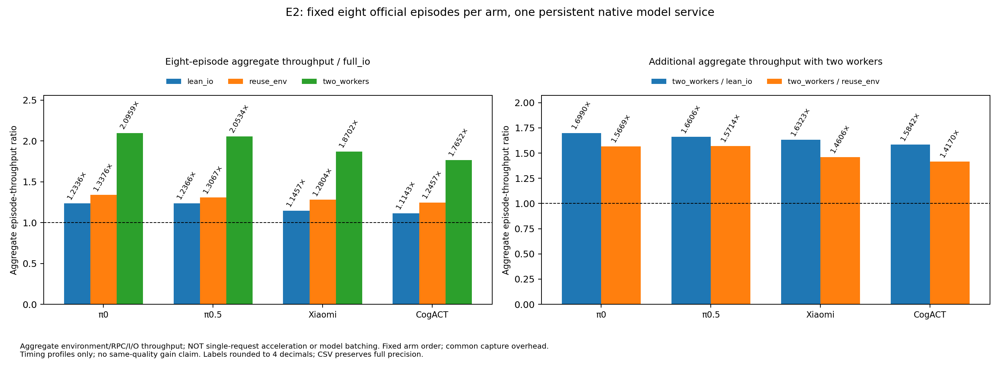
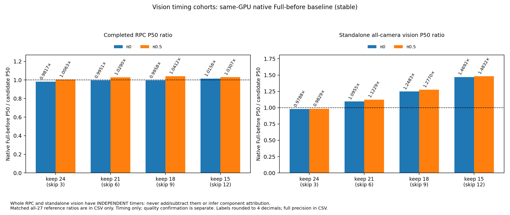
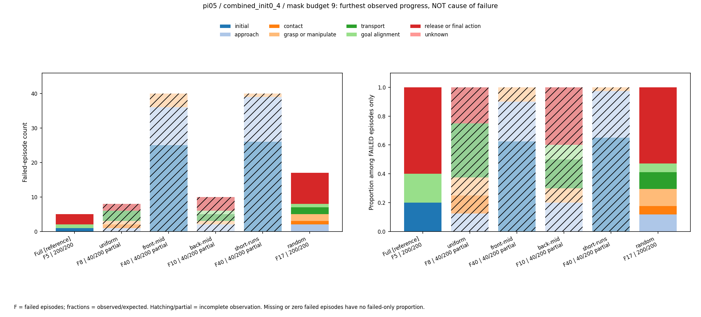
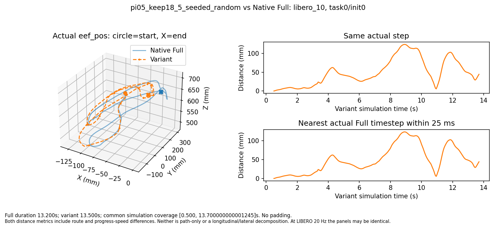
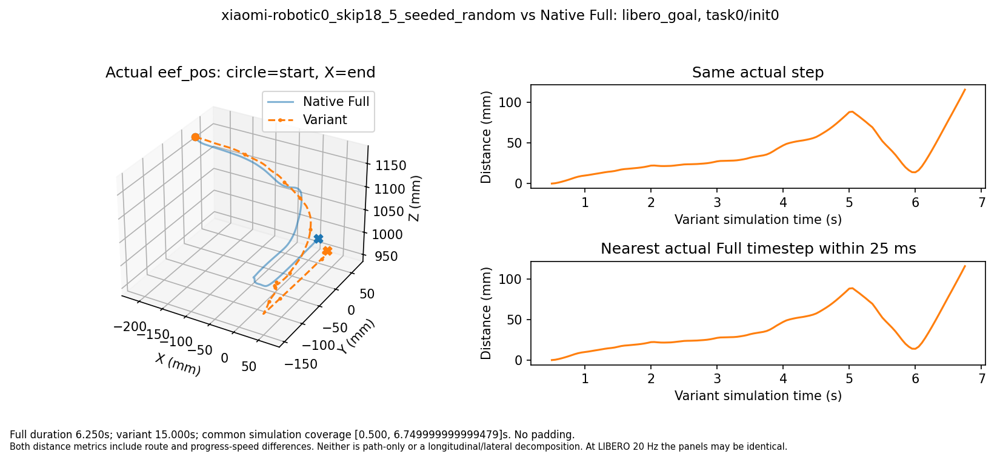

# idea1 v3.1 最终实验报告

日期：2026-10-21。实验范围为用户 `idea1.md` 的 v3.1 三项主线，与 idea2 分开。报告只解释本轮数据，不把 v3／v2 历史结果混进新的成功率分母。

## 先看结论

1. **评测系统优化有效**：少存非必要文件、环境复用、同卡双 rollout worker，在四模型的固定小批验证中，相对全量录像／观测保存配置得到 **1.77–2.10×评测吞吐**。这不是机器人或模型单请求快了两倍。
2. **vision确实可跳层，但整体收益小**：π0.5保留18/27层仍有 **91.5%** 成功率，vision为 **1.277×**，完整策略RPC只有 **1.041×**。保留15层虽然vision达到1.483×，成功率却降至20%，不值得采用。
3. **小米找到新的较高裁剪点**：跳18/36层达到 **69.5%** 成功率，保留Full成功数的 **71.28%**，满足原定相对70%门槛；完整RPC为 **1.085×**。更适合后续研究的高质量点是跳15层：**91.5%成功率、1.119×RPC**，但这两个速度来自各自独立同卡批次，不能把差值解释成“少剪3层反而必然更快”。
4. **CogACT新布局没有胜过已有方案**：新跳9层最佳仅19/40；历史跳9方案仍为33/40，对照Full同40场景为37/40。两条路径各约1.25×RPC，但都没有新变体200条质量确认，不能宣传为已确认等质量加速。
5. **失败不全在一开始**：若只看Full成功而变体失败的配对，π0 vision Keep21有25/32、π0.5 Keep18有14/15、小米跳18有44/57最远进入接触或之后阶段。但“到过后期”不等于“后期操作导致失败”，还没有夹爪致败的因果结论。

导航：[方案与边界](idea1_v3_1_experiment_plan.md) · [执行过程](idea1_v3_1_execution_status.md) · [60组固定XYZ与双侧视频](../../../results/idea1_v3_1/final_artifacts_20261021_0524/media.md) · [全部已存视频HTML](../../../results/idea1_v3_1/final_episode_inventory_20261021_0545/videos.html) · [全部episode与原始XYZ索引CSV](../../../results/idea1_v3_1/final_episode_inventory_20261021_0545/episodes.csv)。在Markdown Preview Enhanced中，图片可直接预览；视频建议用浏览器打开HTML，或通过链接在系统播放器中打开MP4。

## 1. 本轮到底测了什么

### 1.1 预算、场景与对照

使用LIBERO Spatial、Object、Goal、LIBERO-10四个标准套件，每套件10个任务，不是仅在LIBERO-10上评测。每条件先用官方init0，共40条；按冻结规则选出的条件补init1–4，最终每条件200条、每套件50条。**这是5个初态的快速探索，不是每任务50初态的完整官方大评测。**

| 范围 | 首筛条件 | 最终200条条件 | 唯一质量episode |
| --- | ---: | ---: | ---: |
| π0 vision：Full＋4档×5布局 | 21 | 5 | 1640 |
| π0.5 vision：Full＋4档×5布局 | 21 | 5 | 1640 |
| 小米VLM：Full＋历史参照＋5档×5布局 | 27 | 4 | 1720 |
| DB-CogACT VLM：Full＋历史参照＋4档×5布局 | 22 | 1 | 1040 |
| 合计 | **91** | **15** | **6040** |

6040＝91×40＋15×160。首40重复包含在最终200中，没有重复计成新样本。E2采用验证另有128条，旧跨进程π0.5 profile另存，不混入6040。两个all27 matched参考只用于计时，不伪造它们的质量episode。

选型是**每档5个预先固定布局直接闭环评测**，不是离线粗筛后只测极少数。vision每档最高分补量，包括失败的Keep15代表；E1新mask达到冻结补量条件才扩到200。历史参考不参与新mask竞争。完整组合与四套件数据见[首40表](../../../results/idea1_v3_1/final_artifacts_20261021_0524/quality_screen_init0.csv)、[确认覆盖表](../../../results/idea1_v3_1/final_artifacts_20261021_0524/quality_combined_init0_4.csv)、[完整skip/keep层号](../../../results/idea1_v3_1/final_artifacts_20261021_0524/layout_masks.csv)。

确认覆盖表为每个条件列出200条的覆盖情况，未入选者仍是40/200；这些是**按规则只做首筛**，不是遗漏了应做的160条。最终合格覆盖由冻结promotion决定。

### 1.2 固定的模型协议

| 模型 | 本轮裁剪对象 | D／预测H／执行R | 保持不变 |
| --- | --- | --- | --- |
| π0 | 27层vision blocks | D10／H50／R5 | VLM、AE、空间token数 |
| π0.5 | 27层vision blocks | D10／H10／R5 | VLM、AE、空间token数 |
| Xiaomi-Robotics0 | 36层VLM hidden更新 | D2／H10／R10 | 16层action expert及原生均匀flow日程 |
| DB-CogACT | 28层Qwen2 VLM hidden更新 | **DDIM D10**／H16／R按suite为12、16、16、15 | action生成与原生scheduler |

所有层号为原始1-based编号。小米保护L1–3，CogACT保护L1–2；π系vision没有预先保护开始两层。

E1采用保留原层索引的hidden-update bypass，**仍计算所需K/V投影、RoPE并保留cache槽位**，不是整层物理移除，也没有证明参数／显存同比下降。AE不剪。这里的CogACT是本地实际加载的DB-CogACT后端，不把其他CogACT论文实现的结构直接套过来。

成功率来自真实闭环；速度来自同卡100个真实观测重放、每项20次预热。bank取自16条历史轨迹，四suite各25条真实观测，**不是随机初始化输入**，也不是100条独立任务。变体自由闭环XYZ与bank上的固定输入延迟是两种不同证据。

## 2. E2：评测为什么变快，能快多少

### 2.1 四种设置的实际结果

同模型使用同一持续Full服务，各设置固定8个官方场景，成功数均8/8。模型RPC仍串行，共享服务不是batch；两个worker交叠环境／CPU／I/O与推理等待。四组依次为：全录像及观测保存、精简非必要I/O、再加同task环境复用、再加2 worker。

| 模型 | full_io秒 | lean_io秒 | reuse秒 | two_workers秒 | 双worker对full_io吞吐 | 对reuse的增量 |
| --- | ---: | ---: | ---: | ---: | ---: | ---: |
| π0 | 110.63 | 89.68 | 82.71 | 52.78 | **2.096×** | 1.567× |
| π0.5 | 113.87 | 92.08 | 87.14 | 55.45 | **2.053×** | 1.571× |
| 小米 | 92.34 | 80.59 | 72.11 | 49.37 | **1.870×** | 1.461× |
| CogACT | 97.35 | 87.37 | 78.15 | 55.15 | **1.765×** | 1.417× |

2.096×这类数字包含I/O、复用和并发的合并收益；只看双worker相对lean为1.585–1.699×，相对reuse为1.417–1.571×，不能全部归功于并发。

### 2.2 为什么允许上线，而不是只看GPU利用率

每模型独立核对官方初态、初始真实相机与state、相同输入／显式噪声下decoded动作、成功结果和实际吞吐。各优化arm分别有246／254／119／98个配对请求；每模型前后共40次固定控制动作最大差均0，原冻结采用门槛通过。因此四模型各自在完整condition边界切换，不重跑已有有效episode，不修改D/H/R。

原RPC没有提供独立raw动作时明确记为不可用，不由decoded动作反推。自由闭环观测不同后不强求逐请求相同，而在同input/noise条件下核对数值。策略必需的两个真实相机一直渲染，**没有通过关闭视觉输入获得加速**。

多卡按独立模型／任务分片执行，NN、环境与端口隔离；不把不同卡延迟相除。所有优化切换等完整condition结束，不抢占他人卡或热改在途科学配置。

边界：固定顺序、每模型仅8场景，未反平衡缓存／环境预热顺序，计时还包括共同的首场景输入保存。它证明这轮配置值得采用，不证明所有任务、所有主机都稳定快2倍。质量首筛每task仅1init时，环境复用本身通常不会触发，不能声称单靠复用实现同样收益。

原跨进程π0.5 Full即使input/noise相同也出现约0.001–0.0027动作变化，旧数据和不采用结论保留。新同服务验证消除这一跨进程混杂，而不是调大容差。最终[128条独立复核](../../../results/idea1_v3_1/final_e2_recheck_20261021_0526.json)全部通过。

**结论：本轮最快验证idea的实用改进是评测流水线，不是新增NN结构优化。** 没有本轮新增CUDA Graph／torch.compile／batch推理的部署收益；不能把idea2固定输入Graph微基准搬来冒充v3.1闭环优化。额外“跳过中间不用的相机帧”仅准备了CPU测试，未真实验证或采用，列为未开展可选项，不算既定实验缺失。

## 3. E3：vision跳层的质量与速度

### 3.1 完整200条结果

Keep表示**vision保留层数**，不是VLM保留层数。四套件列均为成功率，每列分母50；总体分母200。

| 模型／vision方案 | Spatial | Object | Goal | LIBERO-10 | 总体成功数／率 | 相对自身Full成功数 |
| --- | ---: | ---: | ---: | ---: | ---: | ---: |
| π0 Full27 | 92% | 96% | 90% | 74% | 176/200，88% | 100% |
| π0 Keep24 random | 98% | 98% | 90% | 82% | **184/200，92%** | 104.55% |
| π0 Keep21 uniform | 88% | 96% | 66% | 62% | 156/200，78% | 88.64% |
| π0 Keep18 uniform | 74% | 78% | 74% | 40% | 133/200，66.5% | 75.57% |
| π0 Keep15 uniform | 4% | 14% | 12% | 2% | 16/200，8% | 9.09% |
| π0.5 Full27 | 100% | 100% | 98% | 92% | 195/200，97.5% | 100% |
| π0.5 Keep24 uniform | 100% | 100% | 96% | 98% | **197/200，98.5%** | 101.03% |
| π0.5 Keep21 uniform | 100% | 100% | 96% | 92% | **194/200，97%** | 99.49% |
| π0.5 Keep18 random | 96% | 100% | 94% | 76% | **183/200，91.5%** | 93.85% |
| π0.5 Keep15 uniform | 44% | 6% | 28% | 2% | 40/200，20% | 20.51% |

关键mask：π0 Keep24跳`[2,4,25]`；π0.5 Keep24跳`[5,14,23]`；两模型Keep21均跳`[3,7,12,16,21,25]`；π0.5 Keep18跳`[2,4,9,13,17,18,19,22,27]`，其中含连续L17–19，说明相邻跳层不是统一禁忌。完整列表见前述mask CSV。

Keep24比Full点估计更高，**不足以证明剪枝提高泛化正确率**。π0配对中Full成功变体失败6条、反向14条，净+4个百分点；40个suite/task聚类bootstrap的探索区间约[-0.5,+9.0]个百分点。π0.5净+1个百分点，约[-1.0,+3.0]。两者统一用seed1701、20000次重采样，每个task保留其5个配对初态；候选由首40选出，最终200含选型样本，区间未校正选型与多重比较。

### 3.2 布局比“只删几层”更重要

下表为各布局首40成功数；同一行预算相同、场景相同，不能只看最后赢家。

| 模型／保留层数 | uniform | front-middle | back-middle | short-runs | seeded-random |
| --- | ---: | ---: | ---: | ---: | ---: |
| π0 Keep24 | 36 | 35 | 34 | **1** | 38 |
| π0 Keep21 | 33 | 3 | 26 | 1 | 30 |
| π0 Keep18 | 30 | 0 | 8 | 1 | 15 |
| π0 Keep15 | 5 | 1 | 2 | 1 | 2 |
| π0.5 Keep24 | 40 | 37 | 40 | **0** | 40 |
| π0.5 Keep21 | 39 | 11 | 38 | 0 | 37 |
| π0.5 Keep18 | 32 | 0 | 30 | 0 | 35 |
| π0.5 Keep15 | 7 | 0 | 1 | 0 | 3 |

Keep24 short-runs恰好联合跳L1–3，π0为1/40、π0.5为0/40；但π0.5连续跳L8–10为37/40、L17–19为40/40。支持“早期这组联合删除很危险”，**不支持“所有连续删除都坏”或“已定位L2单层必要性”**。同样，seeded random仅是固定种子的候选生成法，不是用随机输入测模型。

### 3.3 同卡速度：局部快，完整请求变化很小

主比率统一用新cohort的native Full-before P50。matched all27参考另存，不能挑较慢的参考放大主收益。

| 模型／方案 | 完整RPC P50 ms | RPC加速 | 独立vision P50 ms | vision加速 |
| --- | ---: | ---: | ---: | ---: |
| π0 Full-before | 100.91 | 1.000× | 12.25 | 1.000× |
| π0 Keep24 | 102.79 | 0.982× | 12.52 | 0.979× |
| π0 Keep21 | 101.41 | 0.995× | 11.19 | 1.095× |
| π0 Keep18 | 101.33 | 0.996× | 9.82 | 1.248× |
| π0 Keep15 | 99.36 | 1.016× | 8.34 | 1.469× |
| π0.5 Full-before | 107.28 | 1.000× | 12.60 | 1.000× |
| π0.5 Keep24 | 106.60 | 1.006× | 12.82 | 0.983× |
| π0.5 Keep21 | 104.26 | 1.029× | 11.22 | 1.123× |
| π0.5 Keep18 | 103.03 | **1.041×** | 9.86 | **1.277×** |
| π0.5 Keep15 | 104.09 | 1.031× | 8.49 | 1.483× |

π0 Full前后RPC漂移2.60%、vision3.26%，小收益与该漂移同量级，不宣称稳定完整加速；π0.5对应0.60%／0.69%，但仍是单批固定bank证据。两批均低于预定10%不稳定阈值，该阈值不是统计显著性检验。P95/P99和matched比率见[全精度表](../../../results/idea1_v3_1/diagnostics/performance_figures_20261021_0434/vision_native_and_matched_raw_ratios.csv)。

原因边界：只删除vision block，没有减少256个空间token、VLM或AE的工作量；3路编码分支中，LIBERO仅两个真实相机，另一路为原生零填充并masked的分支，不能称三个物理相机。独立vision计时约12ms、完整RPC约100ms只是规模比较；两者独立测量，不能直接相减得到其他模块精确成本。selected-scan实现本身也有开销，跳3层未必能超过native27层。

**结论：π0.5 Keep21是保质量的vision候选，Keep18是更激进的研究候选；Keep15不推荐。π0没有本轮明确的整体性能赢家。**

## 4. E1：小米／CogACT最多能跳多少VLM层

### 4.1 小米：跳18达到原门槛，但跳15更值得跟踪

| 方案 | Spatial /50 | Object /50 | Goal /50 | LIBERO-10 /50 | 总体 | 相对Full成功数 |
| --- | ---: | ---: | ---: | ---: | ---: | ---: |
| Full D2 | 48 | 50 | 50 | 47 | 195/200，97.5% | 100% |
| 新skip12 short-runs | 47 | 48 | 46 | 44 | 185/200，92.5% | 94.87% |
| 新skip15 seeded-random | 47 | 50 | 44 | 42 | **183/200，91.5%** | **93.85%** |
| 新skip18 seeded-random | 38 | 44 | 31 | 26 | **139/200，69.5%** | **71.28%** |

原门槛是Full成功率×70%＝97.5%×70%＝**68.25%绝对成功率**。skip18的69.5%通过点估计门槛，不是声称置信下界也超过门槛。补入160条后的113/160与首40的26/40分列保存，不把选型集当独立验证。

| 小米跳层数 | uniform | front-middle | back-middle | short-runs | seeded-random |
| --- | ---: | ---: | ---: | ---: | ---: |
| 12 | 32 | 0 | 1 | 38 | 31 |
| 15 | 2 | 0 | 0 | 0 | 36 |
| 18 | 14 | 0 | 0 | 0 | 26 |
| 21 | 0 | 0 | 0 | 0 | 0 |
| 24 | 0 | 0 | 0 | 0 | 0 |

以上均每格40条。历史skip12另为40/40，优于新skip12首筛38/40；保留这条反例，不假装本轮搜索全面优于历史。skip21/24的已测布局均失效，因而没有触发跳27/30等条件扩展；**未测skip19/20或其他组合，不称18为全空间最优**。

三个新mask分别为：

- skip12：`[4,5,6,13,14,15,22,23,24,31,32,33]`。
- skip15：`[5,6,8,9,10,12,13,18,21,23,25,31,32,33,36]`。
- skip18：`[5,9,10,12,14,15,18,21,22,25,26,29,30,31,32,33,34,35]`。

### 4.2 CogACT：没有新的高裁剪质量赢家

| 方案／仅首40 | Spatial /10 | Object /10 | Goal /10 | LIBERO-10 /10 | 总体 |
| --- | ---: | ---: | ---: | ---: | ---: |
| Full，同40场景 | 9 | 10 | 9 | 9 | 37/40，92.5% |
| 历史reference skip9 | 10 | 9 | 6 | 8 | **33/40，82.5%** |
| 新skip9 seeded-random | 7 | 7 | 5 | 0 | **19/40，47.5%** |

Full随后确认为188/200，94%：四套件45／50／48／45。不能把首40变体直接除以Full200来冒充严格同场景保留率。

新skip9五布局成功数为`1,0,0,2,19`，跳12／15／18各五布局全为0/40；最佳新mask的19/37≈51.35%低于冻结近阈值补量线，因此没有新变体200条确认，也没有触发更高预算扩展。历史mask跳`[5,6,8,9,21,22,23,24,25]`，新mask为`[3,8,13,14,18,20,22,25,28]`。结果说明**现有历史组合明显更好**，不能归因某个单层或认为相邻跳层必然有利。

### 4.3 两模型的完整请求速度与模块规模

| 独立同卡cohort | Full-before P50 ms | 变体P50 ms | RPC加速 | 对应质量证据 |
| --- | ---: | ---: | ---: | --- |
| 小米，主目标skip18 | 148.85 | 137.21 | **1.085×** | 139/200，达到相对70%门槛 |
| 小米，高质量参考skip15 | 152.53 | 136.25 | **1.119×** | 183/200，事后高质量展示档 |
| CogACT，历史skip9 | 189.66 | 151.84 | **1.249×** | 33/40，尚无本轮200条变体确认 |
| CogACT，新skip9 | 同一189.66 | 152.24 | **1.246×** | 19/40，未达质量门槛 |

每批各自Full-before为分母，Full-after仅查漂移；RPC漂移分别0.92%、1.82%、4.58%，均未超过10%。不能跨批直接比较绝对毫秒，把skip15更好的点比率归因为层数或质量。高质量参考在查看主批速度前按已完成200条且绝对成功率≥90%的最高skip数选定，不改变原promotion／70%主目标。

为何剪很多层仍没大幅提速？下列是各批100输入中**独立计时字段的P50**，只显示数量级，不是可相加的RPC时间分账：

| 路径 | vision ms | VLM ms | action generation ms |
| --- | ---: | ---: | ---: |
| 小米主批Full → skip18 | 20.53 → 21.09 | 58.20 → 42.77 | 43.66 → 44.36 |
| 小米高质量批Full → skip15 | 20.97 → 20.68 | 59.87 → 44.20 | 44.46 → 43.96 |
| CogACT Full → 历史skip9 | 12.31 → 12.61 | 64.48 → 45.76 | 68.27 → 68.36 |

视觉和动作生成基本未减少，且跳层仍留有KV计算，所以不是把36层的一半工作全部清零。外层RPC还包含输入转换、适配检查、调度和解码；部分CUDA事件可能包含CPU调度间隙，不是纯kernel忙时。源码发现适配器在部分上下文进行源码哈希校验，但**未单独profile，不能声称它就是瓶颈或擅自给出优化后速度**。原始P95/P99及每批复核见[完整计时证据](../../../results/idea1_v3_1/final_analysis_20261021_0536/fresh_cohort_rechecks_and_stage_medians.json)。

**结论：原“最大跳层且保留70%”目标，小米的最高已确认点是18；实际高质量候选优先15。CogACT暂时保留历史skip9研究线索，本轮新布局没有找到合格替代。**

## 5. 失败进展、任务差异与真实XYZ

### 5.1 失败是否集中在精细操作

“早期”指最远标签为initial/approach；“接触及以后”包含contact、grasp/manipulate、transport、alignment、release/final。这是**最远观察到的进展**，不是首次错误或失败危险率。

| 变体，均200条 | 全部失败 | 最远早期／接触以后 | Full成功而变体失败 | 其中早期／接触以后 |
| --- | ---: | ---: | ---: | ---: |
| π0 vision Keep21 | 44 | 10／34 | 32 | 7／25 |
| π0.5 vision Keep18 | 17 | 2／15 | 15 | 1／14 |
| 小米VLM skip18 | 61 | 13／48 | 57 | 13／44 |

这比直接数所有变体失败更有意义：例如π0 Keep21总成功数比Full少20条，但实际有**32条新增失败、12条反向恢复**，不是只有20条失败受影响。小米skip18的57条新增失败中，release/final为22、grasp为13、approach为13，其余9在contact／transport／alignment。

它支持“相当多变体失败并非根本无法靠近目标”，但**不足以证明剪枝专门破坏精细操作**：早期错误会延迟显现，阶段时长不同，后期标签也可能含运输／最终确认。没有用可靠阶段暴露量计算条件失败率，没有逐次Full接管恢复或夹爪受控反事实实验；不可把后期进展直接说成夹爪错误致败。

原始[失败阶段计数](../../../results/idea1_v3_1/final_artifacts_20261021_0524/failure_progress_phases.csv)及[Full配对新增失败进展](../../../results/idea1_v3_1/final_analysis_20261021_0536/confirmed_quality_and_paired_progress.json)完整保留。阶段图左侧为失败条数，右侧为**仅失败episode内部比例**；不是所有任务失败率。斜线柱表示该200覆盖视图仅有首40，不代表少做了必需确认。

### 5.2 有没有任务类型差异

有可观察到的差异，但不能一步跳到“某层专管某任务”：

- π0.5 Keep18：Object 100%，LIBERO-10 76%；Full对应100%／92%。成功率损伤并不平均。
- π0 Keep21：Object 96%、Goal66%；Keep18反而Object78%、Goal74%。两mask存在排名交叉，但预算不同且非嵌套，不能做单层归因。
- 上述π0两方案的Goal点差+8个百分点、Object点差−18个百分点。探索性suite/task bootstrap中Goal差区间约[-6,+24]，交互差约+26个百分点、区间[4,50]；新增160的交互区间为[0,50]。这仅是进一步研究任务交互的线索，不是已确认Goal改善或定位了“Goal专用层”。

没有本轮新做的按阶段attn/FFN余弦／动作影响profile，不能拿旧轮余弦结论冒充这轮mask选择原因。v3.1的证据主要是直接闭环消融。

### 5.3 轨迹图怎么选、怎么读

固定四suite的task0/init0，不按图漂亮或成功与否挑scene。展示所有11个已确认非Full候选、两个历史参照，再加两个vision早期L1–3失败mask，共15变体×4场景＝**60组对比**。变体集合含事后诊断点，所以图是诊断展示，不是随机抽样的总体失败率估计。

左侧来自仿真真实`eef_pos`，蓝色Full、橙色半透明点虚线variant，坐标单位mm，不是相机截图或归一化动作；右侧分别为相同步与最近真实仿真时间配对的欧氏距离。轨迹长度不同不补零、不外推、不做动态时间扭曲；20Hz条件下两种配对图可能相同。两种距离都混合路线与进度快慢，**不是纯横向误差分解**。

例如第二图Full覆盖6.25秒、variant15秒，距离只比较双方共有的实际时间区间，不能把Full结束后的variant轨迹当成不存在或误差为0。已经人工检查这些图和对应视频帧；视频是否有效另外通过全帧解码验收，不由截图代替。

完整入口：[60组图、距离CSV与双侧视频MD](../../../results/idea1_v3_1/final_artifacts_20261021_0524/media.md)、[浏览器HTML](../../../results/idea1_v3_1/final_artifacts_20261021_0524/media.html)。每条链接可回到Full／variant的原始`telemetry.jsonl`，其中保存真实XYZ和仿真时间。不是所有6040条都录像，未录像episode仍保留末端telemetry。

另已生成[全部已存视频MD](../../../results/idea1_v3_1/final_episode_inventory_20261021_0545/videos.md)／[可折叠播放HTML](../../../results/idea1_v3_1/final_episode_inventory_20261021_0545/videos.html)，覆盖364条质量视频、32条采用验证视频，并把8条旧未采用profile视频单列归档。全量[CSV](../../../results/idea1_v3_1/final_episode_inventory_20261021_0545/episodes.csv)／[JSON](../../../results/idea1_v3_1/final_episode_inventory_20261021_0545/episodes.json)索引6040质量＋128采用验证＋32旧归档＝6200条记录，每条带真实XYZ原文件链接与SHA；不是把6200当质量样本数。目录清单／哈希检查不替代科学或全帧解码审计，8条旧归档未混入新采用验收。

## 6. 完成验收、限制与后续优先级

### 6.1 已完成的要求

| 要求 | 当前证据／结果 |
| --- | --- |
| 两轮分开，先idea2 | idea2先完成；112条最终复核再次通过，独立[报告](../idea2/idea2_exploratory_report.md)与[复核](../idea2/artifacts/final_audit_recheck_20261021_0524.json) |
| E2真实优化及采用门槛 | 四模型各32条，合计128条原始配对／输入／噪声／动作／视频复核通过，配置选择和退化观察保留 |
| E3每档5布局、Full、质量及vision/整体速度 | 两模型各21个首40条件；各5个条件补至200；每档代表同卡20＋100齐全 |
| E1两模型跳层、相对门槛和四suite | 小米27条件、CogACT22条件首40齐全；入选Full／小米三mask200齐全；最高预算失败未触发扩展 |
| 数据完整与冻结选型 | 6040唯一episode，91首筛及15确认；原promotion重算一致，原mask／D/H/R／NN身份保持 |
| 最远失败进展、真实XYZ及视频 | 60固定成对XYZ、原始轨迹／距离CSV与视频入口；阶段图42张，解释分母与因果边界 |
| 性能来源与负结果 | 5新cohort均独立复核原始100行与同GPU证据，均满足10%漂移界；旧跨进程差异与失败质量不删除 |

最终[科学与视频审计](../../../results/idea1_v3_1/final_scientific_audit_20261021_0527.json)：`passed=true`、errors=0、missing=0、`video_decoding_enabled=true`，核对91条件的6040条原始记录。新性能cohort另行逐项复核，弥补旧总审计不强制E1候选计时的覆盖不足，不把总审计一个绿色标志当所有证据。

主代理最后复跑 `CUDA_VISIBLE_DEVICES= JAX_PLATFORMS=cpu JAX_PLATFORM_NAME=cpu policies/openpi/.venv/bin/python -m unittest discover -s preparations/idea1_v3_1 -t . -p 'test_*.py'`，**102项通过**（41.119秒，仅已有JAX／Flax弃用警告）；新增全量索引的5项负例／去重／覆盖测试也独立通过。CPU测试不替代上述真实实验审计。显式扫描全部6040个实际quality目录，没有未完成、invalid或technical_error episode；启动端口preflight等技术事件仍保留在执行日志，不计策略失败。

总审计检查记录、真实轨迹、请求、来源和存储视频；它不重新执行NN，也不再次逐字节重哈希所有GB级权重（加载身份用原冻结校验凭据及文件大小验证）。精简I/O路径只保留输入hash而未保存每帧NPZ时，无法事后重建所有图像内容；20次warmup由冻结循环及header验证，没有逐项保存warmup输出。初态hash是跨组核对，不是脱离原记录另行重建完整仿真状态。

成功率表是探索性point estimate；mask选择与确认共用init0，未做选型／多重比较校正。任务阶段为heuristic，负接触／负抓取不具备独立完整availability证明，不能据此把“没有正证据”当可靠真阴性。同步LIBERO推理等待通常不推进物理世界，不能将墙钟更快直接宣称为动态机器人任务更稳。

### 6.2 哪些没有开展，为什么不算遗漏

- 未做每任务50init全量官方评测：按用户快速研究要求限定5init。
- 未对所有失败mask补200：按冻结选型规则首筛后不入选；不是事后隐去失败。
- 未扩展小米skip27/30、CogACTskip21/24：最高预算全部0/40，条件扩展未触发。
- 未新训练、未剪AE、未再改D2日程、未启动v3.2；不将未授权方向塞入本轮。
- 可选中间相机优化只有CPU实现／测试，没有真实GPU采用验证；停止扩范围，不把它写成已上线加速。

### 6.3 建议保留什么

1. **先保留评测系统优化**：在本轮环境实际节省时间，后续模型或后端变化仍需重新过同输入／初态／输出门槛。
2. **vision优先π0.5 Keep21／Keep18**：前者保97%质量，后者91.5%且局部更快；应按真实完整请求收益决定是否采用，不为“剪得多”牺牲质量。
3. **小米优先skip15，skip18留作激进draft候选**：两者质量差22个百分点，skip18的单请求收益只有约8.5%，不值得不加选择地替代Full。
4. **CogACT回到已有skip9组合附近做受控探索**：历史33/40明显胜过新最佳19/40；不继续凭层数或随机布局宣称能发现更优点。
5. 若以后要解释任务专属层或精细操作退化，应固定预算做mask交叉、分阶段配对和受控恢复；本轮只提出方向，**没有启动追加实验**。

一句话总结：**工程吞吐优化最实用；vision跳层有冗余但整体收益有限；小米找到跳18的相对门槛点与跳15的高质量点；CogACT新搜索没有胜过历史方案。**
