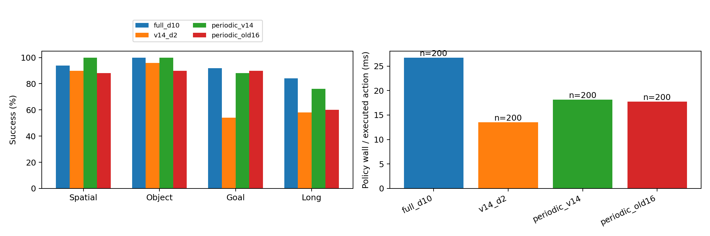
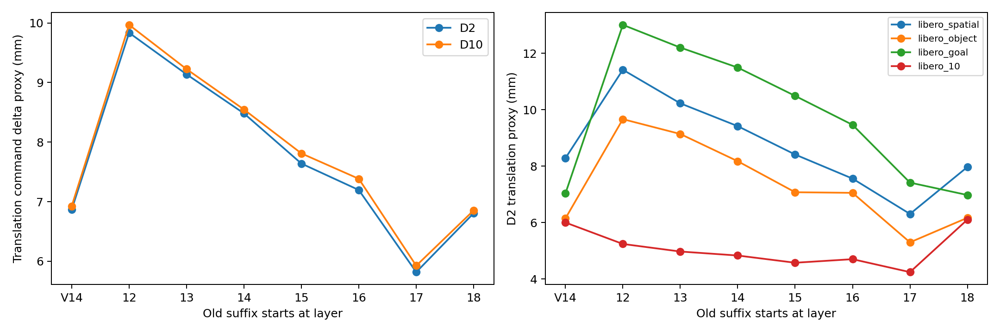
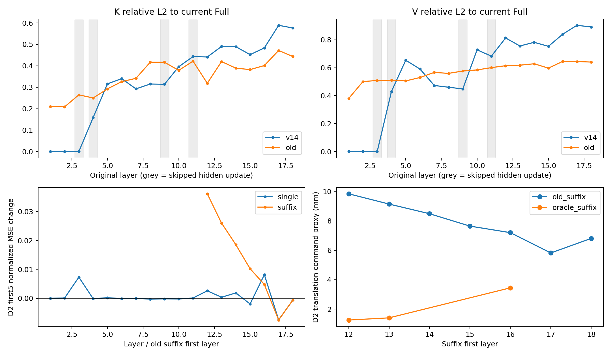

# idea1 v3.4 E1：旧 Full KV 的闭环质量、真实速度与逐层机制

本轮固定920条E1闭环和160对真实相邻观测的D2/D10消融已完成。主比较周期V14与L16后缀复用相对成功率差为 **-9.00个百分点**，按suite分层task聚类bootstrap95%探索区间 **[-16.50,+0.00]**；恢复10例、损失28例。Spatial为50→44/50。区间触及零，不能把这次净下降当作总体下降的确定证明。这些是探索结果，不是总体非劣保证。

本次160对的全任务平均没有复现临时探针的L16–18误差改善。D2前5步平移代理为6.867→7.196mm，细化网格中最低均值是old_suffix_L17。原临时网格只测L10/L13/L16，不足以得出“只有L16–18有效”的结论。单层干预与当前Full oracle进一步说明，层数值偏差、动作敏感度、修正方向与旧观测时效性必须分别判断。

## 闭环比较

| 路径 | Spatial | Object | Goal | Long | 总成功 | 策略ms/动作 | 平均动作数 | 回合/小时/worker |
| --- | --- | --- | --- | --- | --- | --- | --- | --- |
| full_d10 | 47/50 | 50/50 | 46/50 | 42/50 | 185/200 | 26.75 | 169.2 | 320.2 |
| full_d2 | 10/10 | 9/10 | 10/10 | 7/10 | 36/40 | 19.79 | 175.3 | 313.5 |
| v14_d2 | 45/50 | 48/50 | 27/50 | 29/50 | 149/200 | 13.55 | 216.8 | 353.6 |
| periodic_v14 | 50/50 | 50/50 | 44/50 | 38/50 | 182/200 | 18.15 | 179.1 | 364.0 |
| periodic_old16 | 44/50 | 45/50 | 45/50 | 30/50 | 164/200 | 17.74 | 205.3 | 329.5 |
| periodic_old13 | 5/10 | 10/10 | 7/10 | 5/10 | 27/40 | 20.29 | 242.9 | 253.2 |
| periodic_old12 | 7/10 | 9/10 | 7/10 | 5/10 | 28/40 | 21.37 | 238.0 | 251.9 |

四主条件各200条，其他诊断条件各40条。init14初筛与init14–18最终分母分开保存在CSV中，不把40与200直接做配对比较。周期路径每3次重规划为Full-D10、draft-D2、draft-D2；没有verify或夹爪保护。V14与hybrid的区别为尾部KV来源与对应真实计算截断。旧Full由各自自由闭环历史计算并独立保存，实际缓存年龄为5/10控制步。Full刷新、输入输出变换与被执行请求全部计入策略时间。

在相同200个case上，**基线周期V14的累计策略wall/动作 ÷ L16复用的累计策略wall/动作**为 **1.023×**，即候选每执行动作的策略耗时减少约 **2.27%**。自由闭环观测和回合长度会分叉，因此这个比值与同输入推理加速分别解释。旧KV回合平均动作数更长，实际回合吞吐为364.0→329.5回合/小时/worker，没有获得完整评测吞吐提升。该吞吐包含环境、RPC和必要I/O；Full初筛额外保存模型观测，不能把该I/O差全部算成算法加速。逐case、逐task、配对恢复/损失和终止动作数见analysis目录CSV。

## 真正停止后层计算后的同输入速度

| 路径 | 请求wall均值ms | P50 ms | vision ms | VLM ms | AE ms |
| --- | --- | --- | --- | --- | --- |
| full_d10 | 109.746 | 109.352 | 13.114 | 20.085 | 70.331 |
| full_d2 | 53.755 | 53.487 | 13.231 | 20.120 | 14.139 |
| old12 | 42.112 | 41.723 | 13.075 | 8.599 | 14.250 |
| old13 | 42.302 | 41.950 | 13.132 | 8.663 | 14.267 |
| old16 | 45.818 | 45.482 | 13.163 | 12.157 | 14.256 |
| v14 | 49.508 | 49.248 | 13.281 | 15.757 | 14.111 |

同卡、同真实输入、同noise、相同计时边界，预热后交替AB/BA三次；三个服务沿固定task分片，在每个服务内比较各路径。L16相对V14请求wall均值加速 **1.081×**，VLM模块 **1.296×**。Vision保持完整，AE保持18层D2。单个hybrid请求表不含建立旧Full的成本；上面的周期闭环包含刷新成本。Full-D10和Full-D2单独列出，不能用不同D的AE成本声称KV截断收益。加载/真实输入门耗时保存在各worker loaded_protocol.json。

| GPU | 模型服务构建秒 | 进程加载＋真实输入门秒 |
| --- | --- | --- |
| 0 | 83.30 | 97.04 |
| 2 | 83.23 | 98.05 |
| 3 | 83.31 | 98.05 |

主实验队列从启动到三个worker退出共81.86分钟，包含960条闭环、160对机制重放、加载/门检查与各阶段切换。噪声补充在空闲卡并行完成。这是本次执行工期，不是某条策略的部署吞吐；逐条件动作/秒、请求/秒、reset/环境/RPC/物理/I/O分解保存在quality_summary.csv。

## 为什么不是所有后层都适合换旧KV

| KV条件 | D2 全套件mm代理 | D10 全套件mm代理 | D2 Spatial | D10 Spatial |
| --- | --- | --- | --- | --- |
| v14 | 6.867 | 6.924 | 8.284 | 8.350 |
| old_suffix_L12 | 9.835 | 9.969 | 11.420 | 11.302 |
| old_suffix_L13 | 9.138 | 9.226 | 10.229 | 10.196 |
| old_suffix_L14 | 8.482 | 8.547 | 9.420 | 9.392 |
| old_suffix_L15 | 7.640 | 7.810 | 8.414 | 8.411 |
| old_suffix_L16 | 7.196 | 7.384 | 7.560 | 7.685 |
| old_suffix_L17 | 5.817 | 5.925 | 6.307 | 6.241 |
| old_suffix_L18 | 6.806 | 6.853 | 7.971 | 8.063 |
| all_old | 12.490 | 12.625 | 15.189 | 14.998 |
| oracle_suffix_L12 | 1.257 | 1.298 | 1.304 | 1.376 |
| oracle_suffix_L13 | 1.406 | 1.435 | 1.434 | 1.489 |
| oracle_suffix_L16 | 3.447 | 3.608 | 3.531 | 3.562 |

新160对数据中，L16尾部替换的D2前5步平移代理为6.867→7.196mm，配对差+0.329mm，task聚类探索区间[-0.175,+0.869]mm；改善比例52.5%。本次后缀网格的最低均值为old_suffix_L17（5.817mm），因此“只有L16–18可能改善”不是结构定律。该最小值是探索网格内描述，不把事后最佳后缀当作已确认的闭环候选。

Spatial在本轮shadow中的L16代理由8.284降至7.560mm，闭环成功数却由50降至44/50。短期动作接近程度不足以预测自由闭环成功率。shadow固定age5控制步，闭环使用age5/10并累积自身轨迹分叉；本轮未单独操控age，不能把退化唯一归因于缓存年龄。

表中mm为前5步clip后平移控制命令差×50mm，仅是控制目标增量差代理，不是真实EEF位置差。160对来自四套件40条Full轨迹，每条按索引预选4点，每对上一重规划相隔5个真实控制步；D2/D10使用同一批观测。机制轨迹与候选自由闭环成绩独立。oracle使用当前Full对应尾层，只作条件干预，不能作为可部署加速路径。

临时探针覆盖各suite的task0/task5、init0/1；本轮覆盖全部task、init14。两批都使用π0 Full轨迹，但当前状态/选点不同，属于扩展覆盖，不能把总体均值变化唯一归因于某个实现因素。为检查任务覆盖的作用，按**既有探针的task集合**对当前数据做以下事后诊断；它不改变主样本、参数或候选选择。

| 当前数据子集（事后诊断） | D | n | V14 mm | L16旧KV mm | 差值mm |
| --- | --- | --- | --- | --- | --- |
| all | 2 | 160 | 6.867 | 7.196 | 0.329 |
| prior_tasks_current_init14 | 2 | 32 | 6.971 | 6.221 | -0.750 |
| other_tasks_current_init14 | 2 | 128 | 6.841 | 7.440 | 0.599 |
| all | 10 | 160 | 6.924 | 7.384 | 0.460 |
| prior_tasks_current_init14 | 10 | 32 | 6.928 | 6.007 | -0.921 |
| other_tasks_current_init14 | 10 | 128 | 6.923 | 7.728 | 0.805 |

在同一本轮backend/init规则下，原task集合与其他task的平均方向不同，支持任务覆盖/状态分布会改变平均收益。旧集合在本轮只有32对，不把它与原64对当成同一批重测；全160对仍是主要口径。该分组也没有独立操控任务语义与运动状态，不能称唯一因果解释。

| 层 | V14 K相对L2 | 旧Full K相对L2 | V14 V相对L2 | 旧Full V相对L2 |
| --- | --- | --- | --- | --- |
| 12 | 0.441 | 0.318 | 0.813 | 0.614 |
| 13 | 0.490 | 0.420 | 0.755 | 0.618 |
| 14 | 0.489 | 0.389 | 0.781 | 0.628 |
| 15 | 0.452 | 0.382 | 0.753 | 0.597 |
| 16 | 0.483 | 0.401 | 0.839 | 0.645 |
| 17 | 0.589 | 0.471 | 0.903 | 0.644 |
| 18 | 0.576 | 0.443 | 0.891 | 0.640 |

上述KV偏差与动作误差来自不同量纲。即便L12–15的旧KV更接近当前Full，换入这些层后仍需检查AE动作响应。相同位置的当前Full oracle将L12起的前缀误差代理降至1.257mm，而旧Full L12起为9.835mm；这表明用当前正确特征修复跳层偏差与用陈旧特征替换是不同干预，不能按KV相似度直接等同。

| 替换 | D2动作响应RMS | 误差交叉项均值 E[e·Δ] | E[Δ²] | MSE变化 | 组合交互RMS |
| --- | --- | --- | --- | --- | --- |
| single12 | 0.024677 | 0.000600 | 0.001393 | 0.002593 | — |
| single13 | 0.025490 | -0.000357 | 0.001092 | 0.000377 | — |
| single14 | 0.034538 | -0.000136 | 0.002133 | 0.001862 | — |
| single15 | 0.063966 | -0.004238 | 0.006532 | -0.001945 | — |
| single16 | 0.060032 | 0.000727 | 0.006710 | 0.008165 | — |
| single17 | 0.120139 | -0.013036 | 0.018627 | -0.007445 | — |
| single18 | 0.016952 | -0.000517 | 0.000457 | -0.000578 | — |
| suffix12 | 0.214414 | -0.011811 | 0.059752 | 0.036130 | 0.100564 |
| suffix13 | 0.200418 | -0.012847 | 0.051696 | 0.026003 | 0.088097 |
| suffix16 | 0.149740 | -0.011602 | 0.027980 | 0.004777 | 0.030402 |

这里e是原V14相对当前Full的normalized前5步前6维误差，Δ是替换造成的动作变化。MSE变化严格分解为2E[e·Δ]+E[Δ²]。旧KV在数值上更接近Full，并不保证AE响应方向能抵消原误差：动作敏感度、修正方向和旧观测缺失的信息都要同时考虑。单层与整段响应之差量化跨层组合的非线性；不能把整段效果当作逐层误差简单相加。当前Full尾层oracle与旧Full尾层的差异用于区分同位置跳层特征误差和时效性，不据此声称识别了唯一内部因果机制。

单独替换L15、L16、L17的D2平移代理分别为6.419、7.740、5.846mm。L15单层也可能改善，L16单层反而变差；整段L15起为7.640mm，进一步说明不能仅按“位于跳层之后”给各层统一判定可靠性。

逐层K/V、token区域、范数与余弦统计在mechanism_layers.csv；逐对单层/整段响应在mechanism_layer_effects.csv。Spatial及其他suite分别统计，不以总体均值掩盖相反方向。相机RGB变化和EEF位移仅为观测变化代理，保存在observation_changes.csv，不是对象语义或失败原因真值。

## 可复现边界

原π0 checkpoint、BF16 Triton、V14原始1-based mask[3,4,9,11]、H50/R5、20Hz、官方初态、10步settling和固定request seed。每服务真实四套件输入的截断KV与“完整计算再替换”逐位一致，原始/decoded动作差0；跨服务参考24个数组差0。三项针对性CPU测试与q=1 warm-start原生D2等价检查通过。详见[冻结方案](idea1_v3_4_experiment_plan.md)、[manifest](../../../results/idea1_v3_4/manifest.json)、[最终验收](../../../results/idea1_v3_4/final_audit.json)及各worker gate/cross_service/qk收据。未修改原idea1.md，不使用历史临时探针充当新闭环数据。
