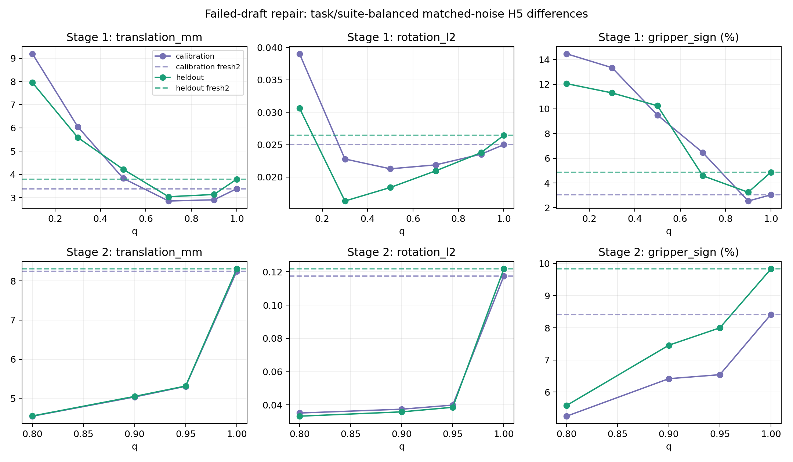

# E3：噪声强度与失败draft一步修复

两阶段已按顺序完成，均使用127个实际被拒请求、当前Full KV与双噪声Full-D10参考。偶数task的65请求仅用于选参，奇数task的62请求作为留出；结果是离线动作差，不是修复策略闭环成功率。

均值先平均每请求双噪声，再按task、suite等权；区间为suite分层task聚类bootstrap2000次，探索性逐点区间，未作多重比较校正。

阶段一在调参组选择q=0.9；夹爪均值不高于fresh D2的候选存在：True。

阶段二在第一阶段结束后冻结q网格[0.8, 0.9, 0.95, 1.0]，用调参组选择q=0.8；夹爪均值不高于fresh D1的候选存在：True。该条件只是点估计筛选，不是统计非劣结论。

## 阶段1 / all / 前五步匹配噪声参考

|候选|请求|平移mm代理|旋转L2|夹爪符号差|AE ms|候选wall ms|
|---|---|---|---|---|---|---|
|draft|127|9.753|0.0539|13.00%|0.000|0.000|
|fresh2|127|3.595|0.0257|3.96%|14.427|14.939|
|q010|127|8.567|0.0348|13.25%|14.487|14.971|
|q030|127|5.819|0.0195|12.31%|14.469|14.948|
|q050|127|4.029|0.0198|9.88%|14.444|14.922|
|q070|127|2.954|0.0214|5.52%|14.377|14.857|
|q090|127|3.029|0.0237|2.90%|14.444|14.936|
|q100|127|3.595|0.0257|3.96%|14.377|14.862|

## 阶段1 / heldout / 前五步匹配噪声参考

|候选|请求|平移mm代理|旋转L2|夹爪符号差|AE ms|候选wall ms|
|---|---|---|---|---|---|---|
|draft|62|9.109|0.0499|11.79%|0.000|0.000|
|fresh2|62|3.800|0.0265|4.87%|14.176|14.686|
|q010|62|7.947|0.0306|12.04%|14.323|14.803|
|q030|62|5.589|0.0163|11.29%|14.308|14.780|
|q050|62|4.223|0.0184|10.25%|14.201|14.674|
|q070|62|3.046|0.0210|4.58%|14.182|14.654|
|q090|62|3.143|0.0238|3.25%|14.273|14.760|
|q100|62|3.800|0.0265|4.87%|14.216|14.690|

## 阶段1 / calibration / 前五步匹配噪声参考

|候选|请求|平移mm代理|旋转L2|夹爪符号差|AE ms|候选wall ms|
|---|---|---|---|---|---|---|
|draft|65|10.396|0.0579|14.21%|0.000|0.000|
|fresh2|65|3.391|0.0250|3.04%|14.667|15.180|
|q010|65|9.186|0.0390|14.46%|14.644|15.132|
|q030|65|6.049|0.0228|13.33%|14.623|15.108|
|q050|65|3.835|0.0213|9.50%|14.675|15.159|
|q070|65|2.862|0.0219|6.46%|14.563|15.050|
|q090|65|2.915|0.0235|2.54%|14.606|15.104|
|q100|65|3.391|0.0250|3.04%|14.530|15.026|

## 阶段2 / all / 前五步匹配噪声参考

|候选|请求|平移mm代理|旋转L2|夹爪符号差|AE ms|候选wall ms|
|---|---|---|---|---|---|---|
|draft|127|9.753|0.0539|13.00%|0.000|0.000|
|fresh1|127|8.279|0.1196|9.12%|7.274|7.767|
|fresh2|127|3.595|0.0257|3.96%|14.386|14.891|
|q080|127|4.545|0.0342|5.42%|7.230|7.711|
|q090|127|5.041|0.0366|6.94%|7.275|7.764|
|q095|127|5.310|0.0392|7.27%|7.265|7.738|
|q100|127|8.279|0.1196|9.12%|7.265|7.737|

## 阶段2 / heldout / 前五步匹配噪声参考

|候选|请求|平移mm代理|旋转L2|夹爪符号差|AE ms|候选wall ms|
|---|---|---|---|---|---|---|
|draft|62|9.109|0.0499|11.79%|0.000|0.000|
|fresh1|62|8.308|0.1217|9.83%|7.218|7.704|
|fresh2|62|3.800|0.0265|4.87%|14.173|14.667|
|q080|62|4.548|0.0333|5.58%|7.189|7.660|
|q090|62|5.048|0.0358|7.46%|7.197|7.667|
|q095|62|5.314|0.0386|8.00%|7.209|7.679|
|q100|62|8.308|0.1217|9.83%|7.217|7.685|

## 阶段2 / calibration / 前五步匹配噪声参考

|候选|请求|平移mm代理|旋转L2|夹爪符号差|AE ms|候选wall ms|
|---|---|---|---|---|---|---|
|draft|65|10.396|0.0579|14.21%|0.000|0.000|
|fresh1|65|8.250|0.1174|8.42%|7.327|7.826|
|fresh2|65|3.391|0.0250|3.04%|14.590|15.104|
|q080|65|4.543|0.0351|5.25%|7.269|7.760|
|q090|65|5.034|0.0375|6.42%|7.349|7.855|
|q095|65|5.306|0.0399|6.54%|7.319|7.795|
|q100|65|8.250|0.1174|8.42%|7.310|7.788|

## 留出组主候选配对差

|阶段/候选|对照|指标|均值差|95%区间|
|---|---|---|---|---|
|1/q090|fresh2|translation_mm|-0.65687|[-0.83568, -0.47739]|
|1/q090|fresh2|rotation_l2|-0.00268|[-0.00392, -0.00174]|
|1/q090|fresh2|gripper_sign|-0.01625|[-0.02875, -0.00500]|
|2/q080|fresh1|translation_mm|-3.76018|[-4.09993, -3.41133]|
|2/q080|fresh1|rotation_l2|-0.08846|[-0.09661, -0.08227]|
|2/q080|fresh1|gripper_sign|-0.04250|[-0.06793, -0.02125]|
|2/q080|fresh2|translation_mm|+0.74785|[+0.41357, +1.06045]|
|2/q080|fresh2|rotation_l2|+0.00680|[+0.00491, +0.00871]|
|2/q080|fresh2|gripper_sign|+0.00708|[-0.02125, +0.02708]|

q是动作/噪声线性混合系数，并同时改变积分起点和步长；不等同于只增加独立噪声方差。draft锚点始终为实际ε0生成动作，e1分析分支只是把同一动作对另一个参考作比较。q=1与fresh同NFE输出逐元素一致，不能将其结果当成失败动作信息带来的收益。

候选wall包含加噪/AE/解码，当前Full视觉/VLM准备成本另存每请求metrics.json；原已付draft/verify成本没有被抵扣。所有候选先预热后AB/BA三次，次数一致。当前状态/条件保持一致，NFE1/D1与NFE2/D2明确区分。全50步与未clip/raw误差、跨噪声参考结果见逐请求CSV。

[冻结方案](idea1_v3_4_E3_refine_sweep_plan.md) · [阶段一逐请求](../../../results/idea1_v3_4_E3_refine_sweep/stage1_requests.csv) · [阶段二逐请求](../../../results/idea1_v3_4_E3_refine_sweep/stage2_requests.csv) · [配对结果](../../../results/idea1_v3_4_E3_refine_sweep/paired_effects.csv)
