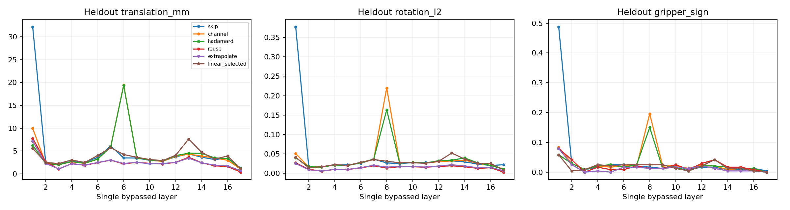

# E4：五种单层补偿与输入分布检查

17层分别独立跳过，其余层Full；共160个真实观测，80校准、32验证、48留出，按完整task隔离。没有新闭环、多层动作策略或E1/E3重跑。

以下是留出组中17个单层条件等权的描述性汇总，不是一条模型的闭环成绩，也没有用留出组选层。平移为前5步控制命令差代理，夹爪为相对同输入Full-D2的符号差。

|方法|平移mm代理|旋转L2|夹爪差|平移降低的层数|平移/旋转降低且夹爪不增的层数|额外模型ms/请求|
|---|---|---|---|---|---|---|
|无补偿|4.931|0.0460|4.34%|0/17|0/17|+0.000|
|通道配准|4.501|0.0379|3.09%|11/17|5/17|+0.030|
|Hadamard配准|4.368|0.0345|2.65%|9/17|4/17|+0.350|
|历史残差复用|2.493|0.0144|2.03%|16/17|11/17|+0.035|
|残差外推|2.465|0.0153|1.42%|17/17|15/17|+0.012|
|闭式低秩（验证组选rank）|3.765|0.0277|1.91%|4/17|3/17|+0.015|

上述成本为四suite固定真实输入的热态FP32 PyTorch完整VLM+两步AE/FM路径，固定视觉嵌入提取、RPC和仿真不在其中。未专门将KV shell的未用Q投影消除；它是功能参考后端的测量，不是优化过的部署kernel。历史方法仍需要周期Full刷新；full_refresh成本另有记录，不能将patch请求成本直接解释为部署加速。

## 相同SVD种子的输入分布检查

同一Full轨迹观测分别经Full和V14上游跳层生成该层输入。以下仅统计受上游skip影响的L4–17，将每层hidden MSE除以该输入域的无补偿MSE后，再对14层等权；低于1表示改善。两组拟合的rank、ridge、随机SVD种子相同，只改变校准输入。

|评估输入|rank|Full输入拟合 / 无补偿|偏移输入拟合 / 无补偿|
|---|---|---|---|
|full|8|0.608|2.678|
|full|32|0.609|2.901|
|shifted|8|0.801|0.533|
|shifted|32|0.801|0.532|

尚未受上游skip影响的L1–3为负对照：相同随机数下，两组拟合的均值与rank8/32线性算子一致，控制验收通过。原先不同种子的诊断原样保存，主解释使用matched_shift结果。

这是固定观测上的hidden输入鲁棒性检查；没有在V14自身闭环状态分布上评测，也不能从hidden误差推出多层动作或任务成功率。历史残差同样来自Full参考历史，不是候选自身闭环缓存。

[共同冻结方案](idea1_v3_4_E2_E4_single_plan.md) · [逐层完整结果](idea1_v3_4_E2_E4_single_report.md) · [主验收](../../../results/idea1_v3_4_E2_E4_single/audit.json) · [匹配随机数控制](../../../results/idea1_v3_4_E2_E4_single/matched_shift/audit.json)

复用与外推的直接配对比较（留出任务、17个单层条件等权）：

|指标|外推−复用|探索95%区间|
|---|---|---|
|translation_mm|-0.028500|[-0.159508, +0.103616]|
|rotation_l2|+0.000899|[+0.000456, +0.001312]|
|gripper_sign|-0.006127|[-0.010294, -0.001961]|
|raw_rms6|+0.000883|[-0.001258, +0.003053]|

留出48请求中，36个有第二次历史Full，其余回退到复用。外推没有在平移、旋转、夹爪三个维度上一致胜过复用。几种轻量方法之间0.01–0.04ms的测量差只作为点估计，不据此排序谁更快；Hadamard约0.35ms的额外开销单列。
