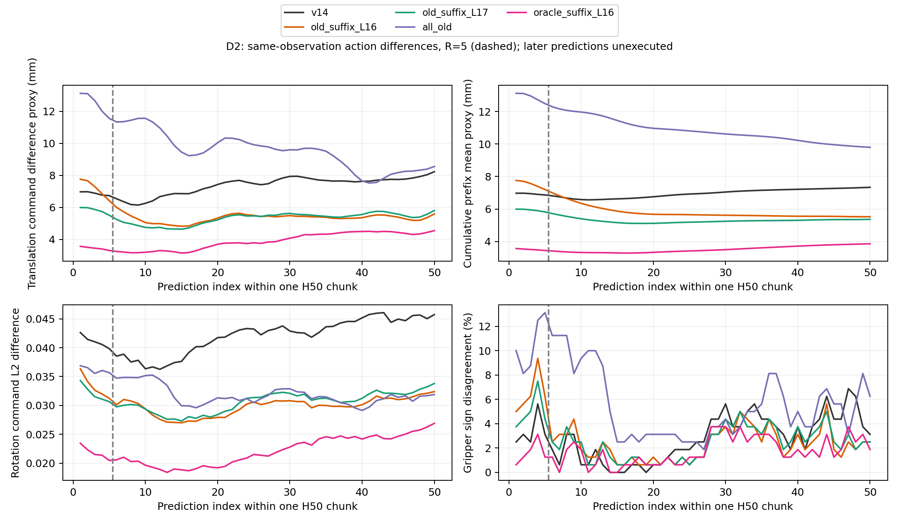
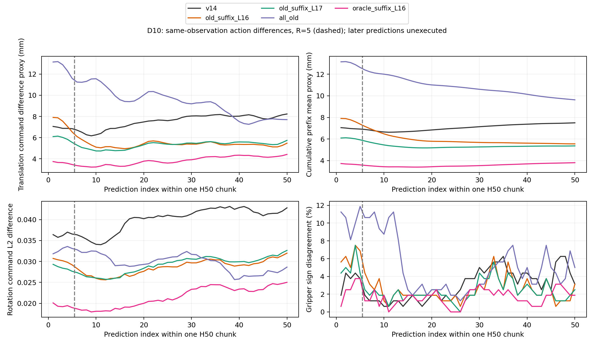
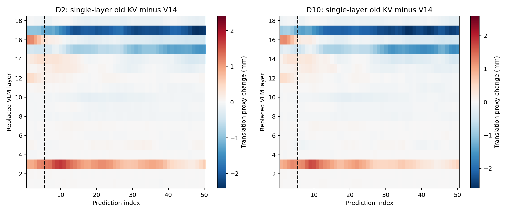

# v3.4 E1：完整H50预测误差重新统计

复用原160对同观测、同生成噪声的存档；四套件各10task，每task一条init14 Full轨迹、4个预选请求。D2/D10均为相同160对。CPU读取完整raw/decoded动作重算，无新推理或闭环，无修改旧结果。

**这里是一次预测chunk内第1–50步相对同输入Full的动作差，不是未来实际EEF轨迹误差。实际R=5，只执行前五步；第6–50步是未执行的预测后缀。此bank缓存年龄固定为5个已执行控制步，不是age10，也不能直接当成B/C自由闭环轨迹的误差。**

## 主要发现

前五步的结论不能推广到整个H50。D2中，复用L16–18前五步平均比V14高0.329mm，但第6–50步低2.051mm（27.8%）；复用L17–18前五步低15.3%，第6–50步低28.1%。D10后段分别低29.3%和29.9%，方向一致。

曲线也不是单调增加：V14从第6–10步的6.293mm升到第41–50步的7.834mm；两种尾层复用先降到约4.8–5.0mm，再回到约5.4–5.6mm。L16–18与L17–18的第6–50步均值已很接近，分别为5.337和5.313mm。

单层L16也呈现前后段反转：前五步比V14高0.874mm，第6–50步低0.240mm；单层L17后段改善更大（低1.976mm）。因此“L16总是有害”同样需要限定为这里的近端预测表现。

后段平移差降低在四个套件中都能看到，旋转差也降低；这不是仅由平移clip指标造成的，未clip平移和raw前六维误差方向一致。夹爪则需单独看：L16–18前五步符号不一致率6.50%，高于V14的3.38%，后段降为2.26%，低于V14的2.79%。

这些结果说明误差集中在哪些预测位置，尚不能识别其成因。后段未执行，不能用H50平均误差替代前五步质量或闭环成功率，也不能据此直接认定延长执行窗口会改善成功率。

## 相对V14的配对分段平移差

负值表示更接近同输入Full；95%区间沿用suite分层、task聚类bootstrap。以下为探索性分段比较，未校正多重比较。

|D|条件|预测段|均值差 mm|95%区间 mm|
|---|---|---|---|---|
|2|old_suffix_L16|1–5|+0.329|[-0.178, +0.864]|
|2|old_suffix_L16|6–50|-2.051|[-2.461, -1.657]|
|2|old_suffix_L16|41–50|-2.437|[-3.074, -1.839]|
|2|old_suffix_L16|1–50|-1.813|[-2.204, -1.439]|
|2|old_suffix_L17|1–5|-1.050|[-1.518, -0.540]|
|2|old_suffix_L17|6–50|-2.075|[-2.438, -1.720]|
|2|old_suffix_L17|41–50|-2.233|[-2.821, -1.669]|
|2|old_suffix_L17|1–50|-1.973|[-2.314, -1.637]|
|10|old_suffix_L16|1–5|+0.460|[-0.149, +1.092]|
|10|old_suffix_L16|6–50|-2.216|[-2.802, -1.652]|
|10|old_suffix_L16|41–50|-2.720|[-3.612, -1.928]|
|10|old_suffix_L16|1–50|-1.948|[-2.476, -1.447]|
|10|old_suffix_L17|1–5|-0.999|[-1.531, -0.409]|
|10|old_suffix_L17|6–50|-2.262|[-2.803, -1.744]|
|10|old_suffix_L17|41–50|-2.512|[-3.377, -1.767]|
|10|old_suffix_L17|1–50|-2.136|[-2.627, -1.680]|

## D2 平移控制指令误差代理（mm）

|条件|1–5|6–10|11–20|21–30|31–40|41–50|6–50|1–50|
|---|---|---|---|---|---|---|---|---|
|v14|6.867|6.293|6.927|7.628|7.713|7.834|7.389|7.336|
|old_suffix_L12|9.835|8.340|6.945|7.322|6.635|6.291|6.970|7.256|
|old_suffix_L13|9.138|7.857|6.477|6.808|6.356|6.080|6.589|6.844|
|old_suffix_L15|7.640|6.232|5.252|5.510|5.178|5.198|5.390|5.615|
|old_suffix_L16|7.196|5.499|5.002|5.499|5.370|5.397|5.337|5.523|
|old_suffix_L17|5.817|4.978|4.836|5.501|5.482|5.601|5.313|5.364|
|old_suffix_L18|6.806|6.240|6.814|7.467|7.579|7.693|7.261|7.215|
|all_old|12.490|11.450|9.969|9.921|9.039|8.093|9.499|9.798|
|oracle_suffix_L16|3.447|3.198|3.337|3.835|4.360|4.439|3.904|3.859|

## D10 平移控制指令误差代理（mm）

|条件|1–5|6–10|11–20|21–30|31–40|41–50|6–50|1–50|
|---|---|---|---|---|---|---|---|---|
|v14|6.924|6.383|7.026|7.741|8.075|8.007|7.565|7.501|
|old_suffix_L12|9.969|8.153|6.964|7.148|6.366|5.990|6.788|7.106|
|old_suffix_L13|9.226|7.658|6.494|6.690|6.135|5.848|6.443|6.722|
|old_suffix_L15|7.810|6.224|5.342|5.510|5.165|4.990|5.360|5.605|
|old_suffix_L16|7.384|5.574|5.107|5.471|5.418|5.286|5.349|5.552|
|old_suffix_L17|5.925|4.981|4.921|5.434|5.523|5.494|5.303|5.365|
|old_suffix_L18|6.853|6.331|6.909|7.583|7.961|7.852|7.438|7.379|
|all_old|12.625|11.381|10.016|9.793|8.749|7.586|9.297|9.629|
|oracle_suffix_L16|3.608|3.265|3.437|3.745|4.183|4.252|3.833|3.811|

## D2 分套件：前段与后段

|suite|条件|1–5 mm|6–50 mm|41–50 mm|
|---|---|---|---|---|
|libero_spatial|v14|8.284|7.790|7.292|
|libero_spatial|old_suffix_L16|7.560|5.874|5.797|
|libero_spatial|old_suffix_L17|6.307|5.819|5.885|
|libero_object|v14|6.147|5.583|5.352|
|libero_object|old_suffix_L16|7.055|4.266|4.307|
|libero_object|old_suffix_L17|5.300|4.017|4.198|
|libero_goal|v14|7.033|9.111|10.543|
|libero_goal|old_suffix_L16|9.466|6.883|6.885|
|libero_goal|old_suffix_L17|7.418|6.828|7.182|
|libero_10|v14|6.002|7.070|8.148|
|libero_10|old_suffix_L16|4.703|4.328|4.599|
|libero_10|old_suffix_L17|4.244|4.589|5.139|

## 单层复用：D2前后段平移对比

|条件|1–5 mm|6–50 mm|41–50 mm|
|---|---|---|---|
|v14|6.867|7.389|7.834|
|old_single_L15|6.419|6.508|6.521|
|old_single_L16|7.740|7.148|7.402|
|old_single_L17|5.846|5.413|5.685|
|old_single_L18|6.806|7.261|7.693|

## 旋转与夹爪分段（D2）

|条件|旋转L2 1–5|旋转L2 6–50|夹爪符号差1–5|夹爪符号差6–50|
|---|---|---|---|---|
|v14|0.0411|0.0421|3.38%|2.79%|
|old_suffix_L12|0.0340|0.0290|7.75%|3.56%|
|old_suffix_L13|0.0328|0.0285|7.62%|3.40%|
|old_suffix_L15|0.0315|0.0276|5.75%|2.71%|
|old_suffix_L16|0.0333|0.0298|6.50%|2.26%|
|old_suffix_L17|0.0321|0.0306|5.00%|2.33%|
|old_suffix_L18|0.0391|0.0410|3.63%|2.56%|
|all_old|0.0361|0.0317|10.50%|5.36%|
|oracle_suffix_L16|0.0218|0.0221|1.62%|1.75%|

平移mm代理=clip后平移控制命令差的L2×50mm控制缩放；rotation为decoded旋转命令坐标L2，不是SO(3)角距离。逐点CSV包含均值/中位数/P90；累计前缀先对每请求的前h步平均，再跨请求聚合。raw_rms6排除夹爪和padding维。

translation_mm_proxy逐点区间及相对V14的配对区间按suite分层task聚类bootstrap2000次；为逐点探索区间，非50步同时置信带，未作多重比较校正。单层/后缀最优均为描述性，不据此重选闭环策略。

[逐点结果](../../../results/idea1_v3_4_horizon/per_step.csv) · [累计前缀](../../../results/idea1_v3_4_horizon/cumulative_prefix.csv) · [分段结果](../../../results/idea1_v3_4_horizon/segments.csv) · [相对V14逐点配对差](../../../results/idea1_v3_4_horizon/paired_vs_v14_per_step.csv) · [重算核对](../../../results/idea1_v3_4_horizon/verification.json)
