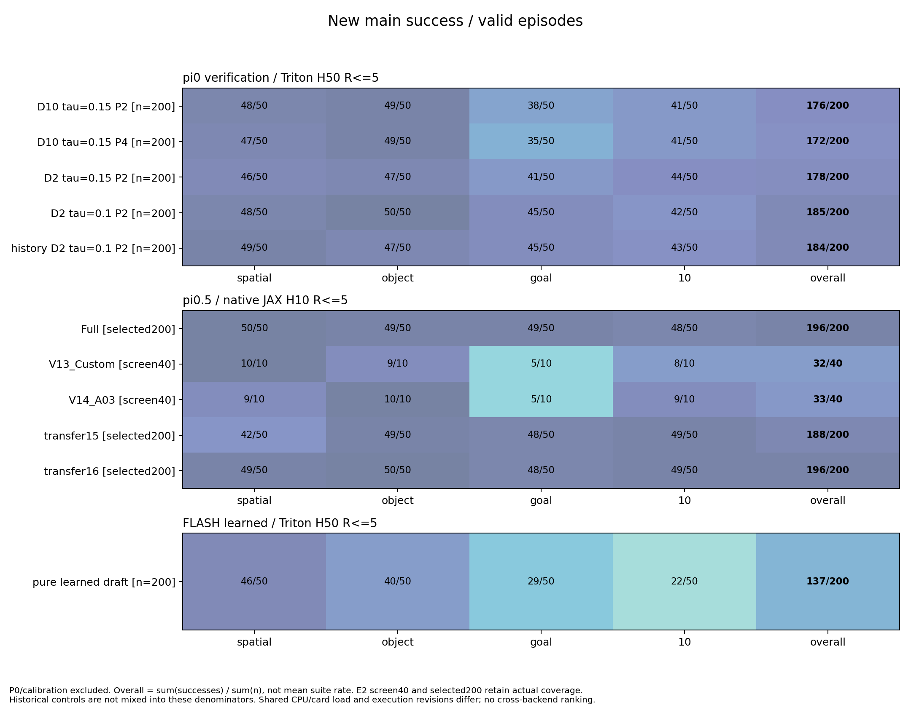
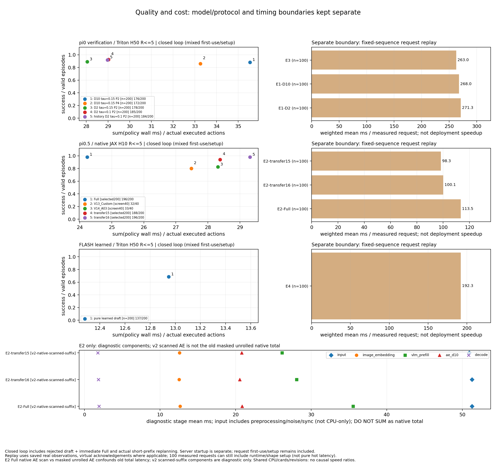

# idea1 v3 最终实验报告

更新：2026-10-20（Asia/Shanghai）。本轮既定范围完成：**1976条唯一有效episode**＝校准96＋E1主样本800＋E2 680＋E3 200＋E4 200；另有有界P0的8闭环、100微基准，以及7个新增代表条件各20setup＋100测量。技术invalid保留且只恢复原key一次，不混入成功率分母；已有π0基线全部复用。联合分析、两图与固定88个新视频检查已完成，运行进程均已退出。

结论：E1-D2选中配置185/200，较历史纯V14有较高成功数，但含周期／拒绝Full接管，不能单归verify；**E3首40的提升未在完整200维持**（184对父185）；π0.5跳2层保持196/200，跳3层188/200；纯learned draft为137/200且Full／AE验证均0。质量、实际每动作成本、重放测速分开报告。

**后续补充（2026-10-20）：** 本报告第7节汇入已完成的参数／跳层补充实验（1680条）和π0.5跳n层＋D2搜索（1280条），以及Spatial／Object任务差异的讨论。正文第1–6节及下方两张总览保留原v3的1976条统计口径；新增数据分别列出，不混入原分母。详细结果见[补充实验报告](idea1_v3_supplement_report.md)和[π0.5跳n层＋D2报告](idea1_pi05_d2_search_report.md)。

来源：[联合1976摘要](../../../policies/realtime-vla-flash/results/idea1_v3/final_joint_1976_20261020/report.md)、[完整覆盖](../../../policies/realtime-vla-flash/results/idea1_v3/final_joint_1976_20261020/coverage.json)、[执行状态](idea1_v3_execution_status.md)、[衍生表与计算口径](idea1_v3_derived_metrics.md)。

## 1. P0：实际瓶颈与工程选型

P0只比较合并NPZ压缩／不压缩两配置，共8条原生闭环、4条共同任务，并完成20次setup＋100次固定真实观测序列微基准；累计测量少于10分钟，没有为用满60分钟扩大搜索。保留A压缩配置，**不宣称提速**：首用成本偏在A，且spatial同输入首Full输出存在小BF16差异（normalized最大绝对差.015625）；没有发现明显KV泄露，cold编译只是候选解释，不当已证根因。

8条episode墙钟126.647s中，RPC62.834s（49.6%）、环境创建14.980s（11.8%）、reset13.387s（10.6%）、step＋capture32.052s（25.3%）、保存0.988s（0.8%）、未归属2.406s（1.9%）；服务启动30.020s另列。RPC含cold setup，不能等同GPU计算。P0为init0、不写MP4，video_drain=0表示未覆盖视频，不代表视频零成本；此存储占比也不能泛化为旧v2.2全视频／hash流程。CPU/GPU活动与disk-wait未采样。

微基准mean247.883ms、p50 63.096ms、p95 1003.561ms，使用四suite首5个真实重规划点、每段reset，仍含prompt／runtime／shape切换；不是纯热态延迟，也不是闭环平均或实际吞吐。没有测试全部graph／compile／并发方案。后续可考虑同task相邻init和单活跃环境复用，当前队列不为此改动。

证据：[选型与限制](../../../policies/realtime-vla-flash/results/idea1_v3/p0_20261019T143600Z/profiling/optimization_selection.md)、[非重叠分解与残差](../../../policies/realtime-vla-flash/results/idea1_v3/p0_20261019T143600Z/profiling/episode_wall_decomposition.csv)、[微基准摘要](../../../policies/realtime-vla-flash/results/idea1_v3/p0_20261019T143600Z/profiling/micro_summary.json)。

## 2. E1：V14＋验证的成功率与真实总成本

校准96/96有效（12条件各8条）已完成，按成功数、policy毫秒／实际动作、较小tau／P依次选型。D2选tau=.10/P2，D10选tau=.15/P4；各自另保留tau=.15/P2参考，共4条件。校准与init6–10主样本分母分开，选中不称统计最优。

主样本800/800有效，各条件四suite×50。成本为全episode累计policy wall／实际执行动作，包含冷形状准备、被拒draft＋verify＋Full；服务启动另列，不能当纯热态或受控因果加速。

| 条件 | 首init6 | 完整init6–10 | ms/实际动作 | Full调用/请求 |
| --- | ---: | ---: | ---: | ---: |
| D2参考 τ=.15/P2 | 37/40 | 178/200（89%） | 28.04 | 38.9% |
| D2选中 τ=.10/P2 | 37/40 | 185/200（92.5%） | 29.03 | 42.3% |
| D10参考 τ=.15/P2 | 36/40 | 176/200（88%） | 35.55 | 38.5% |
| D10选中 τ=.15/P4 | 35/40 | 172/200（86%） | 33.26 | 26.6% |

D2选中相对参考恢复11／新增失败4，净＋3.5个百分点，探索性task聚类bootstrap区间[-1,8]个百分点；D10选中净−2个百分点（恢复7／新增失败11，区间[-6.5,2.5]）。校准排名不是稳定最优，未据正式样本继续改阈值。

Full verifier KV为最近一次Full独立clone，V14不会覆盖；P按draft轮计数，Rmax5。零接受的draft不执行，客户端只执行最终Full动作；真实成本包含被拒draft、verify、Full和实际输入输出处理，不能只计成功接受请求。调用counter是累计且Full／draft／verify可在同请求并存，汇总用末值或差分。

分阶段夹爪表表示“符号切换触发检查／接管事件”：verify检查任一重建分支未来≤5步相对上一夹爪／相邻预测的切换并强制零接受；post检查draft已接受前缀中的切换并截断到首次切换前。它们不是重建与draft夹爪不一致率，不能据此断言失败由夹爪预测错误造成。

归一化重建误差也不等于真实EEF距离：例如goal task0、D2 tau=.10/P2对历史Full-D2的固定XYZ图，同模拟时间距离峰约8cm且轨迹形状有差异；不能由小模型空间误差宣称实际轨迹仅差几毫米。

future误差是旧Full KV verifier端点重建减当前draft，既不是fresh Full在同观测下的动作差，也不是真值。t=.10/.05的误差还受加噪／端点重建t缩放影响，不能把t=.05较小解释为独立准确性更高；phase／future趋势仅描述代理一致性，须与成功率／接管率一起看，不证明可执行安全。

历史D2共同init6–8各120条：纯V14为85/120、Full为109/120；新E1参考107/120、选中110/120、E3 110/120。四格顺序为双成功／旧成功新失败／旧失败新成功／双失败：

| 新D2条件 | 对历史纯V14四格 | 对历史Full四格 |
| --- | --- | --- |
| E1参考 | 82/3/25/10 | 98/11/9/2 |
| E1选中 | 83/2/27/8 | 102/7/8/3 |
| E3 | 81/4/29/6 | 102/7/8/3 |

这支持整套验证＋周期／夹爪／拒绝接管系统相对旧纯V14的描述性质量恢复，不证明verify单独贡献。历史mixed revision／limits／后端计时限制保留，不作正式因果CI／速度比。旧D10纯V14为148/200、Full为180/200（init0–4），与新init6–10**不配对**，仅列历史参照。

证据：[校准冻结选择](../../../policies/realtime-vla-flash/results/idea1_v3/e1_calibration_20261019T1442Z/summaries/e1-select.json)、[完整成功率](../../../policies/realtime-vla-flash/results/idea1_v3/final_joint_1976_20261020/success_by_condition.csv)、[真实成本／吞吐](../../../policies/realtime-vla-flash/results/idea1_v3/final_joint_1976_20261020/latency_and_throughput.csv)、[蓝历史Full-D2／橙E1 XYZ](../../../policies/realtime-vla-flash/results/idea1_v3/e1_main_init6_20261019T1514Z/summaries/init6_with_history_20261019/xyz_index.md)。D2重放100测量仍含20 startup/runtime、55 verified、20 periodic、5 zeroaccept，不称全热态或代替闭环频率。

## 3. E3：实际历史动作约束是否有用

父条件冻结为E1-D2 tau=.10/P2。H50历史前缀使用上一轮执行前state作锚，实际执行r步经原decoder可逆重锚；保存sent及controller input clip后的effective命令，历史不重复执行、不计入未来误差。

CPU的r1–5／拒绝不入历史／部分执行／reset／真实output_transform逆映射通过；真实首条history请求中，step5、anchor0、r5，history_commands与遥测前5个clip后命令精确一致，接受距离为2×5未来窗口。

完整200为**184/200（92%）**：spatial49/50、object47/50、goal45/50、libero_10 43/50。父E1-D2选中为185/200；同key恢复8／新增失败9，净−0.5个百分点，探索性bootstrap区间约[-3.5,2.5]个百分点。首40的39对37提升没有在完整200维持，本轮未证明这套历史前缀方案有净质量收益。

完整每实际动作成本E3 28.97ms、父29.03ms，启动／共享负载／执行revision混杂下近似相同，不能称加速。Full调用/请求却从42.3%升至52.7%，零接受/verify从20.3%升至38.2%。

未来窗口episode等权距离如下（模型归一化L2/√6，非EEF；每格200 episode，每future/branch观测数父5146、E3 5350）：

| 未来步 | 父 t=.10 | 父 t=.05 | E3 t=.10 | E3 t=.05 |
| --- | ---: | ---: | ---: | ---: |
| 1 | .06666 | .03498 | .08716 | .04876 |
| 2 | .05351 | .02775 | .05841 | .03100 |
| 3 | .04917 | .02593 | .05066 | .02793 |
| 4 | .04736 | .02506 | .04755 | .02647 |
| 5 | .04649 | .02470 | .04616 | .02589 |

先在同episode按观测数合并各phase，再跨episode等权，校准排除。E3第1步误差更大，后部接近父条件；没有普遍降低代理误差。t=.05较小受重建缩放影响，不能解释成更准确。

关键phase以“父／E3”并列：误差选t=.10、合并未来1–5后episode等权；V/E为verify请求/有误差观测episode数，零接受率分母V，Full率分母该phase全部请求，后两率均request-weighted。

| phase | 误差 父/E3 | V/E 父；E3 | 零接受率 父/E3 | Full率 父/E3 |
| --- | --- | --- | --- | --- |
| 接近 | .05145/.05262 | 1191/199；1230/200 | 14.3%/34.2% | 40.0%/49.9% |
| 接触 | .05213/.05181 | 262/126；282/129 | 38.5%/50.7% | 53.1%/59.9% |
| 抓取/操作 | .04839/.05317 | 465/181；440/186 | 8.6%/20.9% | 33.0%/39.8% |
| 搬运 | .05846/.05796 | 1336/167；1354/174 | 23.5%/37.4% | 43.3%/51.6% |
| 对齐 | .05581/.06320 | 1333/153；1527/158 | 26.6%/47.5% | 44.1%/57.5% |

E3各列阶段均更常拒绝和Full接管，误差不一致下降。两条件路由phase_unknown均0，不代表负contact/grasp可靠；availability_unknown分母仍保留。上述是关键阶段子集，不把episode数相加；完整分子分母与聚合规则见[衍生表](idea1_v3_derived_metrics.md)。

此方案同时改变历史输入、state锚点和混合噪声分布，任何收益仅归完整方案，不能单独归因“历史信息”。重放测速中的virtual ack不是实际闭环执行历史。

证据：[完整200父配对](../../../policies/realtime-vla-flash/results/idea1_v3/final_joint_1976_20261020/paired_new_conditions.csv)、[逐episode未来误差](../../../policies/realtime-vla-flash/results/idea1_v3/final_joint_1976_20261020/future_error_by_phase_step_branch_per_episode.csv)、[阶段路由分母](../../../policies/realtime-vla-flash/results/idea1_v3/final_joint_1976_20261020/phase_routing.csv)、[8张父配对XYZ](../../../policies/realtime-vla-flash/results/idea1_v3/e3_parent_d2_init6_20261019T1515Z/summaries/first40_parent_snapshot/xyz_index.md)。

## 4. E2：π0.5跳层与AE编译诊断

真实π0.5 LIBERO checkpoint保留原生H10、D10、Rmax5；18层prefix跳层保留original-index KV shell，AE层完整。首筛5×40及选中3条件新增480均有效完成，共680唯一episode。分段结果如下；init6参与选型，init7–10没有参与这次选择。

| 条件／skip | init6选型 | 新增init7–10 | 合计 |
| --- | ---: | ---: | ---: |
| Full | 40/40 | 156/160 | 196/200 |
| transfer16 `[3,9]` | 39/40 | 157/160 | 196/200 |
| transfer15 `[3,9,11]` | 39/40 | 149/160 | 188/200 |
| V14 `[3,4,9,11]` | 33/40 | 未扩展 | 33/40 |
| V13 `[3,4,7,12,15]` | 32/40 | 未扩展 | 32/40 |

新同key配对200：transfer16相对Full净差0个百分点（恢复3／新增失败3，最终联合探索CI[-2,2]个百分点）；transfer15净差−4个百分点（恢复3／新增失败11，CI[-7.5,-.5]个百分点）。transfer15的spatial为42/50、Full50/50，提示suite差异；不由多个mask的差定位单层因果，也不能拿不同checkpoint绝对成绩断言π0.5比π0更耐剪。

当前masked服务的suffix执行完整18层Python展开JAX trace，Full使用native scan；数值parity不代表相同编译性能，因此端到端差混合AE实现开销，不能全归VLM剪枝。独立bench v2仅对诊断suffix显式调用原native scan，prefix跳层不变；旧native fused总量与新diagnostic分项保留各自边界，不拼成部署加速。E2的`counts.full`表示该mask native policy调用，报告使用native_policy_calls，Full fallback为N/A。

真实闭环policy ms/实际动作为Full24.23、transfer16 29.32、transfer15 28.38；不能从下述固定重放请求较快推论完成整轮评测更快。

首代表Full重放测速20setup＋100测量已完成：native total mean113.452ms、p50 115.000ms、p95 123.068ms，模型加载25.835s，重复动作／路由／长度精确一致。v2诊断的input／image／VLM／AE／decode均值为51.28／12.67／35.56／20.87／1.93ms，decoded与native最大差.003234，在预先规定的.02绝对／相对容差内；分项和不替native总量，input也非纯CPU时间。共享CPU/NFS未控制、JAX重编译未独立计数。

transfer16代表也完成20＋100：native total mean100.064ms、p50 96.758ms、p95 110.153ms，model load26.479s，重复输出／路由／长度一致。v2分项均值51.281／12.520／28.090／20.553／1.852ms，decoded最大差.003173、容差通过；20个setup请求均值约3446ms，首次编译成本显著。Full与transfer16来自不同卡／共享负载，旧native AE编译结构也不同；不把这两列差值全归少2层，也不据此给部署加速结论。其余mask的GPU诊断不能由此推定通过。

transfer15代表同样完成20＋100，native mean98.28ms、p50 95.83ms、p95 111.77ms；v2最大decoded差.004042、容差通过，重复动作／路由／长度一致。分项均值50.91／12.57／26.16／20.82／1.78ms，load24.63s。至此仅这三个已选E2代表的GPU诊断通过；V14/V13未作独立测速，不外推。

证据：[680条结果](../../../policies/realtime-vla-flash/results/idea1_v3/e2_expand_init7_10_20261019T1530Z/summaries/all_680_cpu_20261020/success_by_condition.csv)、[最终联合新条件配对](../../../policies/realtime-vla-flash/results/idea1_v3/final_joint_1976_20261020/paired_new_conditions.csv)、[首筛冻结选择](../../../policies/realtime-vla-flash/results/idea1_v3/e2_screen_200_20261019T1444Z/summaries/e2-select.json)、[Full独立测速](../../../policies/realtime-vla-flash/results/idea1_v3/e2_expand_init7_10_20261019T1530Z/benchmarks/representative_E2_Full_v2_20261019T1556Z/benchmark_summary.json)、[Full v2分项](../../../policies/realtime-vla-flash/results/idea1_v3/e2_expand_init7_10_20261019T1530Z/benchmarks/representative_E2_Full_v2_20261019T1556Z/pi05_stage_summary.json)、[transfer16 v2分项](../../../policies/realtime-vla-flash/results/idea1_v3/e2_expand_init7_10_20261019T1530Z/benchmarks/representative_E2_transfer16_v2_20261019T1602Z/pi05_stage_summary.json)。

本轮Full对四mask的[32张固定真实XYZ对比](../../../policies/realtime-vla-flash/results/idea1_v3/e2_expand_init7_10_20261019T1530Z/summaries/all_680_xyz_20261020/xyz_index.md)已实际交付；same-step距离含路线与快慢差，不与模型归一化误差互换。

## 5. E4：原FLASH纯learned draft

全部200/200有效，**137/200（68.5%）成功**：spatial46/50、object40/50、goal29/50、libero_10 22/50。首40为27/40，扩展仅新增init7–10、未重跑init6。所有episode的Full和AE验证调用均0，D=N/A；四suite使用各自真实draft，H50、Rmax5。released head的meta为use_last_actions=False，原forward也丢弃last_actions，外围history_len6不构成该head实际依赖；没有用Full填历史。

真实闭环policy成本为12.95ms／实际执行动作，非独立单请求延迟。独立20setup＋100测量完成、重复输出／路由／长度一致。100测量仍分为20个runtime/cold请求（均值876.8ms）和80个非setup learned请求（21.14ms），不能把后者冒称全部请求延迟；pure draft没有Full AE QK，安全检查状态为not_exercised，没有为触发检查额外运行Full。

同任务／init6–8共同120条的历史π0 Full-D2为109/120，新E4为84/120；双成功79、旧成功新失败30、旧失败新成功5、双失败6。这是含历史mixed execution revision／limits差的描述参照，非Full-D10、非正式因果配对CI，也不推出速度ratio。新主分母仍200。

证据：[200条成功率表](../../../policies/realtime-vla-flash/results/idea1_v3/e4_expand_init7_10_20261019T1454Z/summaries/with_history/success_by_condition.csv)、[共同120历史参照](../../../policies/realtime-vla-flash/results/idea1_v3/e4_expand_init7_10_20261019T1454Z/summaries/with_history/historical_quality_overlap.md)、[固定8key真实XYZ对比](../../../policies/realtime-vla-flash/results/idea1_v3/e4_expand_init7_10_20261019T1454Z/summaries/with_history/xyz_index.md)、[双侧视频链接](../../../policies/realtime-vla-flash/results/idea1_v3/e4_expand_init7_10_20261019T1454Z/summaries/with_history/media_index.html)。新8视频各一次完整解码且帧数=动作数＋1；历史只复用链接，没有重复全量解码。

## 6. 边界与下一步

既定范围、完整父对照与最终两图均完成。1976条有效数据不含P0及技术invalid；七代表各20setup＋100测量、88新固定视频检查齐，全部科学／bench进程退出。未训练、未扩mask／prefix／初态，也未重测旧π0基线。

成功率、动作与真实XYZ有效；contact/grasp负值缺独立availability证据，不能当可靠真阴性。分析已标unknown步数／request分母，阶段是heuristic标签，最远阶段不是致败阶段。同时间XYZ差混合路径与快慢差，轨迹不补零；同步LIBERO推理等待不额外推进物理世界，不能由墙钟加速直接宣称动态场景收益。

固定8key的事后几何描述规则为same-step EEF距离>5cm持续3控制步，已一次产[首次偏离表](../../../policies/realtime-vla-flash/results/idea1_v3/final_fixed_telemetry_events_20261020/fixed_key_divergence_events.csv)：E1 27/32、E2 22/32、E3 5/8、E4 7/8对照中出现；这不是统计显著阈值、失败率或原因。表保留首次起点／确认点、双方phase与共同／完整覆盖，不补零。另[抓取证据表](../../../policies/realtime-vla-flash/results/idea1_v3/final_fixed_telemetry_events_20261020/fixed_key_grasp_evidence.csv)的108个对象轨迹行均为grasp_loss=undetermined；86行有正grasp观测，但正证据消失不能区分未知／有意释放／真实丢失，不伪造“抓取丢失”结论。

固定新视频均已一次全帧检查：E1四条件32、E2五条件40、E3八条、E4八条，共88条。现有校验索引为[E1](../../../policies/realtime-vla-flash/results/idea1_v3/e1_main_init6_20261019T1514Z/summaries/media_tailcheck_fixed_20261020/media_index.html)、[E2](../../../policies/realtime-vla-flash/results/idea1_v3/e2_screen_200_20261019T1444Z/summaries/media_tailcheck_fixed_20261020/media_index.html)、[E3](../../../policies/realtime-vla-flash/results/idea1_v3/e3_expand_init7_10_20261019T1537Z/summaries/media_tailcheck_fixed_20261020/media_index.html)及前述E4双侧索引；早期索引的decode_checked=false为检查前快照，不覆盖已落receipt。旧Full视频仅复用链接，没有重复解码。

单请求重放、真实闭环每实际动作成本、端到端吞吐分开呈现；不同backend绝对毫秒不作模型优劣排名。本轮按冻结清单完成，技术invalid单列，有效失败保留；执行revision仅在episode边界安全切换，没有热改在途队列。

下一步优先保留E1-D2选中作为研究候选，围绕Full接管总成本做受控工程改进；当前E3整体方案不宜因首40提升而默认采用。π0.5的`[3,9]`值得继续验证，但要先把原生scanned AE用于自然新revision再公平测端到端；纯draft体现质量／成本取舍，不将更快的learned路径误称等质量替代。本轮不再追加这些后续实验。

E1扩展另有一条CUDA illegal-memory技术invalid，原87条有效结果保留；旧QK kernel缺行边界mask已确证。新独立`qk-row-bounds-v1`仅补行mask、合法输出算术不变；原failedkey在新context的一次恢复已有效成功，实际Q408/K571的TF32关Torch FP32参考通过预定容差。旧live worker在episode边界自然停，余key转安全revision续跑，参数／科学key不变、不重跑有效结果；报告保留执行revision差。异步栈仍不足以证明该缺陷是唯一crash根因，旧技术invalid不算任务失败。

## 7. 后续补充实验与任务类型差异

本节记录两轮已完成补充实验的发现。所有层号均为原始1-based索引；跳层针对VLM backbone，action expert保留完整层数。成功率来自真实闭环，速度来自同卡、同输入的策略推理重放；后者包含输入处理、视觉／VLM、动作生成和解码，环境仿真与结果保存不在该加速比内。小样本选型率与扩样后的最终率分别解释。

### 7.1 V14-D2＋verify：放宽接管可以省成本，但未找到90%质量的新加速确认点

共新增960条E1有效episode：16个新配置各先40条，随后两候选各补160条至200。搜索包含tau、周期Full、夹爪保护与仅拒绝接管Full-D2；启动及周期Full仍使用D10。

| 最终配置 | 首40 | 新增160 | 完整成功率 | 对Full-D10重放加速 | 对Full-D2重放加速 |
| --- | ---: | ---: | ---: | ---: | ---: |
| Q：τ=.10／P2，confirmed夹爪规则，拒绝D2 | 38/40 | 141/160 | 179/200（89.5%） | 1.500× | 0.744× |
| F：τ=.40／P4，关闭夹爪接管，拒绝D2 | 33/40 | 140/160 | 173/200（86.5%） | **1.588×** | 0.788× |

主要发现：

- 严格夹爪规则下，将周期延至P8或取消周期Full的首40成功率为75%–77.5%；减少Full并未自动带来可用质量和更低完整成本。
- 放宽夹爪规则未改变两个父配置的首40成功数，但不能据此认定保护规则始终冗余。Q首40的95%在扩样后降至89.5%，首批排名不能替代完整确认。
- 在两个正式测速的新确认点中，85%／80%质量档最高为F的1.588×于Full-D10；两点均低于90%。原严格配置的92.5%作为既有质量参照单列。
- **相对Full-D2，两点均没有加速。** 同输入参照Full-D2本身约为Full-D10的2.016×；验证开销和Full介入仍是整套方法的成本。
- F在完整200条中的5965次draft请求全部通过空间验收，未触发拒绝接管；其`rejectD2`设置实际上没有发挥作用。因此1.588×不能独立归于廉价回退，现有F更接近“宽松接受＋周期Full”的混合策略，尚未展示验证器实际筛掉错误动作的价值。

来源：[完整参数补充报告](idea1_v3_supplement_report.md)、[同卡E1比率](../../../policies/realtime-vla-flash/results/idea1_v3_supplement/summaries/e1_same_card_ratios.csv)。同卡比率仅覆盖两入选点，其他14个探索配置没有正式比率，不称全参数空间最优。

### 7.2 π0.5＋D10：跳4层比跳5层的质量—速度取舍更好

共新增720条E2有效episode：10种新mask各40条，跳4／5层各选一个补至200。此次masked AE使用真实native scanned suffix，避免原轮masked AE展开带来的测速混杂。

| 跳过层 | Spatial | Object | Goal | LIBERO-10 | 总体 | 对同卡Full-D10重放加速 |
| --- | ---: | ---: | ---: | ---: | ---: | ---: |
| `[3,9,11,15]`（4层） | 45/50（90%） | 50/50（100%） | 46/50（92%） | 46/50（92%） | 187/200（93.5%） | 1.121× |
| `[3,9,11,14,17]`（5层） | 46/50（92%） | 50/50（100%） | 43/50（86%） | 38/50（76%） | 177/200（88.5%） | 1.125× |

跳5相对跳4只快约0.4%，总体成功率低5个百分点；当前优先保留跳4方案。连续跳层不是统一禁忌，但本次早段／中段连续跳5层的两个方案均仅8/40成功。分散方案也有明显失败者，说明具体层组合比“是否连续”这一条规则更重要。

来源：[D10补充结果与全部10种mask](idea1_v3_supplement_report.md)、[逐suite原始汇总](../../../policies/realtime-vla-flash/results/idea1_v3_supplement/summaries/final_1680/success_by_condition_suite.csv)。

### 7.3 π0.5跳n层＋D2：总体65%门槛下，确认可用的最高层数为6

进一步直接评测20种配置，覆盖Full-D2、跳2–6层、跳8／10／12／14／16层及一个跳7层边界方案。首筛800条，加Full-D2与两个候选各160条，共1280条有效episode。**65%仅约束四suite总体，各suite单独汇报，不要求每suite达到65%。** 原生D2实际积分节点为`1→.5→0`，H10／R5保持。

| 完整确认条件 | 跳过层 | Spatial | Object | Goal | LIBERO-10 | 总体 | 对Full-D10／Full-D2重放加速 |
| --- | --- | ---: | ---: | ---: | ---: | ---: | ---: |
| Full-D2 | 无 | 50/50（100%） | 50/50（100%） | 50/50（100%） | 46/50（92%） | 196/200（98%） | 1.186×／1.000× |
| n6b＋D2 | `[3,6,9,12,15,18]` | 37/50（74%） | 47/50（94%） | 30/50（60%） | 35/50（70%） | **149/200（74.5%）** | **1.394×／1.176×** |
| n6a＋D2 | `[3,6,9,11,14,17]` | 32/50（64%） | 46/50（92%） | 24/50（48%） | 16/50（32%） | 118/200（59%） | 1.435×／1.211×，质量不合格 |

n6b是本次已测范围内的最高确认跳层数，也是正式测速中满足总体65%的最快剪枝点。更快的n6a首筛为26/40（恰65%），完整200降至59%，已排除。跳7边界仅17/40，跳8的三方案分别11／2／7成功（各40）；已测跳10层以上方案接近或完全失效。上述结果不证明其他未测的跳7层以上组合必然失败。

来源：[完整D2搜索报告](idea1_pi05_d2_search_report.md)、[20条件总体汇总](../../../policies/realtime-vla-flash/results/idea1_pi05_d2_search/summaries/final_1280/overall_quality_cost.csv)、[四suite汇总](../../../policies/realtime-vla-flash/results/idea1_pi05_d2_search/summaries/final_1280/success_by_condition_suite.csv)、[同卡比率](../../../policies/realtime-vla-flash/results/idea1_pi05_d2_search/summaries/same_card_ratios.csv)。D2与D10两轮测速分别有各自同卡Full参照，不能把不同轮绝对毫秒直接横排。

### 7.4 Spatial／Object反向表现：存在弱线索，尚无强证据证明层的任务专属功能

n6b＋D2的Object为94%、Spatial为74%，相差20个百分点；其Full-D2参照两者均为100%。因此可以确认这个mask对Spatial的成功率损伤更大（下降26个百分点，对Object下降6个百分点）。现有汇总尚不能区分空间关系表征、动作控制或其他因素，也不能直接称为删掉了“Spatial专用层”。

复查π0.5已测D2及既有D10变体后，D2轮尚未找到具有实用成功率、且Spatial明显高于Object的反向方案。D10中有下列迹象：

| π0.5方案（均D10） | 跳过层 | Spatial | Object | 样本范围 |
| --- | --- | ---: | ---: | --- |
| V13_Custom | `[3,4,7,12,15]` | 10/10（100%） | 9/10（90%） | 每suite仅10条 |
| 早段连续跳5层 | `[3,4,5,6,7]` | 5/10（50%） | 2/10（20%） | 每suite10条，总体8/40 |
| 中段连续跳5层 | `[8,9,10,11,12]` | 3/10（30%） | 4/10（40%） | 每suite10条，总体8/40 |

后两者在相同模型、D、跳层数与初态覆盖下出现**排名交叉**：早段方案的Spatial比中段方案高20个百分点，但Object低20个百分点。这是层组合与任务类型相互作用的探索线索。不过，两方案总体都只有20%，各suite仅10条，差异可能受少数任务、低成功率及抽样波动影响；V13_Custom的100%对90%更只差一条任务。当前还没有“Spatial保持高成功率、Object明显下降”的充分确认案例，不能据这些小样本声称任务专属层已被定位。

后续若专门验证此假设，应固定模型、D、跳层数、任务／初态，主动寻找Spatial／Object排名交叉的两个mask，再在相同新增初态上确认。既要比较相对各自Full的退化，也要检查是否由少数任务或低成功率造成表面交叉；层级／attn／FFN归因需要进一步受控消融。

证据：[V13_Custom逐suite原表](../../../policies/realtime-vla-flash/results/idea1_v3/final_joint_1976_20261020/success_by_condition_suite.csv)、[早段／中段连续方案逐suite原表](../../../policies/realtime-vla-flash/results/idea1_v3_supplement/summaries/final_1680/success_by_condition_suite.csv)。本节为已有结果补记，没有启动新实验。
