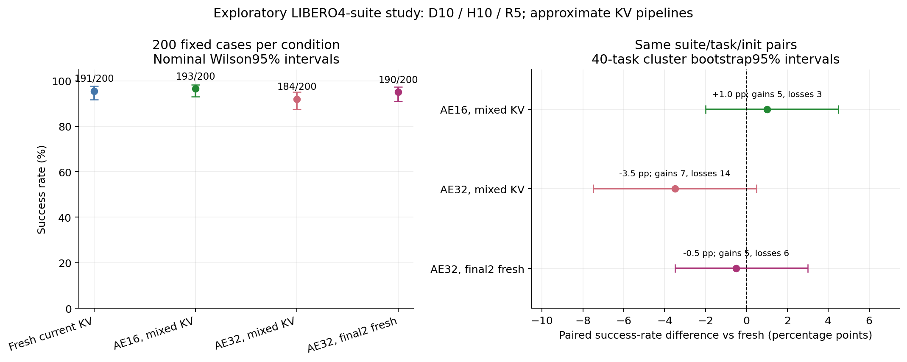

# π0.5 混合 KV 流水线：200 场景闭环扩样

**状态：800/800 回合完成，统计、成本汇总及终态独立审计全部通过，无待补项；两张 GPU 均已释放。**

**主结论：SM16 在这 200 个场景上最稳妥，SM32 无修正观察到质量与任务效率退化，最后两轮刷新能缩小差距，但目前不能证明任何近似方案严格无损。** 本轮也没有出现明显的闭环完成时间加速：SM16 工作墙钟约持平，两个 SM32 配置更慢。

## 要回答的问题

此前每配置 8 个场景不足以证明闭环质量。本轮固定每配置 200 个场景，比较完整当前 KV 与三种渐进混合 KV 流水线。重点是配对成功率及其不确定性，不预设流水线无损。

| 配置 | 计算条件 |
|---|---|
| `fresh18` | 当前观测的完整 18 层 KV，全卡参考 |
| `sm16_tail0` | VLM 领先 3 层启动 AE；AE16 / Prefix112 SM；未就绪层使用旧 KV |
| `sm32_tail0` | 同样领先 3 层；AE32 / Prefix96 SM；未就绪层使用旧 KV |
| `sm32_tail2` | 同 SM32，最后两轮 AE 等当前 18 层 KV-ready |

混合 KV 是近似推理；双缓冲和 Event 正确只保证读取安全，不保证动作与完整新 KV 一样。各轮使用原实现的 frontier 快照，不能把它描述为 AE 在每一层执行瞬间随意切换 KV。末两轮全新也不能抹去早轮不同条件形成的去噪状态。

## 固定协议与对照

- 完整 π0.5 LIBERO，BF16 主体、B1、D10、H10、R5；权重、采样日程和种子规则不变。
- `libero_object/spatial/goal/10` 四套件，各 task0–9 × 官方 init0–4，共 200 个场景/配置、800 回合。
- 环境 seed7，settling10；原生任务上限分别 280/220/300/520 步。真实任务失败保留在分母，不重试到成功。
- 每个场景的四配置在同一物理 GPU 执行；配置顺序按 task 轮换、第二 GPU 反序。自由闭环轨迹可以分叉，后续必须使用各自环境产生的观测。
- 复用此前经过 provenance 审查的 32 回合，新增 768 回合。复用数据只计成功率和步数，旧计时不混入本次成本；另报排除 pilot 后每臂新增 192 场景的敏感性分析。
- 每个 episode 仍独立创建/关闭环境、reset/settle 并执行 fresh bootstrap。批量 client 仅节省 Python 导入；不复用 episode 环境，不改变原 episode 逻辑。
- 旧 runtime、adapter、Pool/Lease/epoch/generation/Event 协议冻结。本轮只有评测编排与 CPU 汇总代码，无新算法修改。

本轮是同步 LIBERO：推理期间仿真暂停，`next_encoder=False`。它检验混合 KV 调度的闭环质量，不能替代真实摄像头持续到帧时的观测年龄、下一帧 Encoder 重叠或机器人 SLO 测量。`fresh18` 是本实现的全新 KV 质量参考，本轮不重测原始 π0.5 推理性能基线。

## 统计口径

预先固定的统计方案见 [prospective_statistics.md](../../../results/idea2/closedloop200_20261025/prospective_statistics.md)。

总体及分套件报告成功数和 Wilson95% 描述区间；同场景报告候选救回数 b、相对参考损失数 c，以及成功率差。主要不确定性为按 40 个 task 聚类、保留 task 内 init 的 10,000 次 bootstrap95% 区间；另提供 episode 重采样敏感性。三项总体候选对参考的精确 McNemar 检验作 Holm 校正，任务内相关性仍限制其总体解释。

用户未预设非劣界限，因此不把不显著称为无损。固定任务、单一 seed 和每任务五个 init，也不足以保证官方全量 LIBERO 或真实机器人总体质量。候选曾参考小样本选择，新增 192 分析是敏感性分析，不是另一项独立盲测。

## 最终结果

### 总体成功率与配对结果

每行均为相同的 200 个场景。pp 表示百分点；配对差的区间按 40 个 task 聚类重采样。

| 配置 | 成功/200 | 成功率 [Wilson95%] | 相对 fresh18 | 差值的 task 聚类95%区间 | 救回 b / 损失 c |
|---|---:|---:|---:|---:|---:|
| fresh18 | 191 | 95.5% [91.67, 97.61] | — | — | — |
| sm16_tail0 | 193 | 96.5% [92.95, 98.29] | +1.0 pp | [−2.0, +4.5] pp | 5 / 3 |
| sm32_tail0 | 184 | 92.0% [87.40, 95.02] | −3.5 pp | [−7.5, +0.5] pp | 7 / 14 |
| sm32_tail2 | 190 | 95.0% [91.04, 97.26] | −0.5 pp | [−3.5, +3.0] pp | 5 / 6 |



SM16 的 +1 pp 不是已证明的质量提升，区间仍覆盖约 2 pp 的退化。tail2 虽然只比参考少成功一次，区间仍覆盖约 3.5 pp 的退化。200 场景支持继续保留它们研究，不能满足“保证不下降 1 pp”这样的更严格要求。

三项主要比较的精确 McNemar p 分别为 0.7266 / 0.1892 / 1.0000，Holm 后为 1.0000 / 0.5677 / 1.0000。**SM32 无修正的 −3.5 pp 是观察到的风险信号，不是已经通过主要统计检验的总体退化证明；不显著也不能替它证明无损。**

直接比较 tail2 与 SM32 tail0：13 个场景由失败变成功、7 个反向变化，净多成功 6 次（+3 pp），聚类95%区间 [−1.5, +7.5] pp。修正方向有希望，但没有逐场景保证。SM32 tail0 相对 SM16 少成功 9 次（−4.5 pp，区间 [−9.0, −0.5] pp），未校正 p=0.0490；这是探索比较，不能当作另一个预先确认的主要结论。

排除已知 pilot 后，新增 192 场景的成功数为 183 / 185 / 176 / 182，成功率 95.31% / 96.35% / 91.67% / 94.79%；相对参考差 +1.04 / −3.65 / −0.52 pp。三组 b/c 完全不变，聚类区间分别 [−2.07, +4.57] / [−7.89, +0.51] / [−3.67, +3.11] pp。主线结论不依赖那 8 个全成功的旧场景。

### 分套件与具体损失

| 配置 | Object /50 | Spatial /50 | Goal /50 | Long（libero_10）/50 |
|---|---:|---:|---:|---:|
| fresh18 | 50 | 48 | 47 | 46 |
| sm16_tail0 | 48 | 50 | 49 | 46 |
| sm32_tail0 | 48 | 47 | 45 | 44 |
| sm32_tail2 | 50 | 49 | 47 | 44 |

SM16 总体多成功两次，但 Object 从 50 降到 48；tail2 的 Long 从 46 降到 44。不能用总体平均数声称每类任务都无影响。

相对 fresh18，SM16 的三条损失是 `object/task1/init3`、`object/task9/init0`、`libero_10/task8/init0`。tail2 的六条损失是 `spatial/task3/init0`、`goal/task6/init4`、`goal/task9/init3`、`libero_10/task2/init3`、`libero_10/task8/init0`、`libero_10/task9/init3`。

完整 [配对差异清单](../../../reports/idea2_closedloop200_20261025/discordant_cases.csv) 包含六组比较共 84 条 discordance（同一个场景可以出现在不同比较中，不是 84 个独立场景），带双方原始目录；[全部配对结果](../../../reports/idea2_closedloop200_20261025/paired_case_outcomes.csv) 共 1,200 行。42 个有效任务失败均保留于 [失败列表](../../../reports/idea2_closedloop200_20261025/valid_failures.csv)，未重试到成功。没有在本轮为失败回合补录视频或改变输入。

### 更快的单次请求没有变成更快的任务

成功率/步数使用全 200 场景；耗时仅使用新增 192 场景。稳态 RPC 排除 bootstrap 和含 Graph 准备的请求，分位数由原始请求合池计算。episode 工作墙钟包含原始 episode 工作与必要 bootstrap/准备，不含共享服务加载，包含有效失败。

| 配置 | 200例总执行步数 | 成功回合平均步数 | steady RPC mean/P50/P95 ms | 新192例 episode 工作 mean/P50/P95 s | 新192例工作总和 s |
|---|---:|---:|---:|---:|---:|
| fresh18 | 32,685 | 153.22 | 106.45 / 105.60 / 111.13 | 15.64 / 11.96 / 31.03 | 3,003.40 |
| sm16_tail0 | 33,379 | 157.72 | 102.40 / 100.75 / 116.02 | 15.57 / 12.43 / 28.61 | 2,989.48 |
| sm32_tail0 | 38,656 | 178.35 | 93.42 / 91.10 / 107.36 | 16.90 / 13.56 / 31.47 | 3,244.25 |
| sm32_tail2 | 36,254 | 168.49 | 100.12 / 98.32 / 113.88 | 16.37 / 13.03 / 30.47 | 3,143.67 |

相对 fresh18：SM16 请求均值约少 3.8%，但总步数多 2.1%，episode 工作总和仅少 0.46%；SM32 tail0 请求均值少 12.2%，总步数多 18.3%，工作反而多 8.0%；tail2 请求均值少 5.9%，总步数多 10.9%，工作多 4.7%。这些来自自由闭环、不同长度轨迹，属于描述性观察，不能将均值比当作同输入推理的因果加速比，也不能把 0.46% 当成稳定收益。

即便只看各自成功回合，SM32 的平均执行步数仍较多；但四臂成功集合不同，不能据此替代固定共同成功集合的因果比较。以完成任务为目标，需要同时优化动作质量和请求延迟。

按各臂工作时间之和归一化的有效回合/小时为 230.14 / 231.21 / 213.05 / 219.87，这不是实际双 GPU makespan 吞吐。全轮新增 768 回合共 136,002 个执行动作、27,499 次请求，观察窗口约 2小时18分44秒，双卡实际完成率约 332.16 有效回合/小时，含交卡等待、准备和任务组成影响。

每臂 40 个请求含 Graph 准备，记录的准备均值约 4.55 / 4.76 / 4.61 / 4.67 秒，包含预热/捕获/初始化，不能称纯 capture API 耗时，也不表示有 40 次稳态重捕获。各臂分别有 192 次 episode bootstrap。纯权重加载与纯 shutdown 未单独计时；[分片/批次成本](../../../reports/idea2_closedloop200_20261025/runtime_chunks.csv) 给出服务级代理区间，不能与嵌套的 episode/RPC/准备时间简单相加。

### 机制分析与下一步取舍

新增 192 场景中，按 episode 等权得到的十轮平均新 KV 层数约为：

| 配置 | AE 迭代1→10的新层数（最大18） |
|---|---|
| SM16 tail0 | 3, 5, 7, 9.01, 11.99, 14, 16.01, 18, 18, 18 |
| SM32 tail0 | 3, 4, 5.03, 7, 8.02, 10, 11.01, 13, 14.01, 16 |
| SM32 tail2 | 3, 4, 5.03, 7, 8.02, 10, 11.02, 13, 18, 18 |

**给 AE 更多 SM 会让 AE 更快追上甚至跑完，但也会让它在更少的新 KV 条件下完成更多去噪。** SM16 自然留下末三轮完整新条件；SM32 tail0 到最后一轮仍平均只有 16 层新条件。tail2 强制最后两轮新鲜，与这次质量改善方向一致；早轮条件仍不同，所以未完全恢复 fresh 轨迹。这里是调度机制与闭环结果的一致性解释，不是每次失败的已证实单一根因。

本轮建议保留 **SM16 + lead3 + tail0 作为近似流水线主线对照，SM32 + tail2 作为候选**；不采用 SM32 tail0 替换，不修改生产默认。下一步若继续优化，应优先利用尾部窗口提高早轮 KV 新鲜度，例如另立固定实验测试更大 lead；本次没有测 lead6 组合，不能外推其质量或速度。已经在观察到的任务步数退化下，仅压缩 AE 毫秒数不够。

## 完整性与执行记录

完整网格为四臂各 200，无缺失/重复，所有实际任务失败保留。十个有效分片 runner/server 均 exit0、source unchanged；dispatcher 和统计进程 exit0。先前首批门禁已核对新批量 client 与原 episode 路径；终态独立审计完成 **874,589 项检查**，核验 800 回合、28,507 次请求、160 个通过的批次、77 份冻结源码和环境/render/reset/epoch/slot 协议。600 组首帧 bootstrap 配对初始输入与 seed 相同，normalized/decoded 动作 max/MAE 均为 0，预定 max1e-5、MAE1e-6 容差未放宽。

[终态审计摘要](../../../results/idea2/closedloop200_20261025/final_audit.md) 与 [完整审计JSON](../../../results/idea2/closedloop200_20261025/final_audit.json) 均为 passed、pending 为空。保存的输入/动作文件 SHA 均核验，初始观测内容摘要重算；checkpoint 使用已记录的路径/大小/mtime 身份，未重新哈希完整权重，也没有声称逐字节核验 GPU 噪声。600 组首帧一致性证明 bootstrap/状态隔离路径正确，不证明后续混合 KV 动作等于 fresh。

两次纯编排异常保留：最早 dispatcher 读取未启动分片缺少 output 字段，未影响已经运行的首块；chunk1 首次启动遇端口 TIME_WAIT，零 episode，保留原目录，后用每块唯一端口续跑。没有用技术重试替换有效失败。另一次终态审计字段适配错误（旧 pilot 的 arm 为数字、label 才是配置）属于 CPU 审计程序错误，修复后核验，不影响推理或重跑病例。

GPU3 在 11:35 UTC 前后释放，GPU2 在 11:51 UTC 释放，租约均已置 inactive 并通知资源协调会话。

## 数据与复现入口

- [固定方案](idea2_closedloop200_plan_20261025.md)、[manifest](../../../results/idea2/closedloop200_20261025/manifest.json)、[case universe](../../../results/idea2/closedloop200_20261025/case_universe.json)。
- [逐回合标准化数据](../../../results/idea2/closedloop200_20261025/normalized_cases.json)、[分片执行记录](../../../results/idea2/closedloop200_20261025/dispatch_execution.json)。
- [旧 32 回合复用审查](../../../results/idea2/closedloop200_20261025/reuse32.md)、[首批路径核验](../../../results/idea2/closedloop200_20261025/first_chunk_gate.md)。
- [runner](../../../results/idea2/closedloop200_20261025/runner.py)、[统计实现](../../../results/idea2/closedloop200_20261025/statistics.py)、[成本汇总](../../../results/idea2/closedloop200_20261025/summarize_runtime.py)。
- [成功率CSV](../../../reports/idea2_closedloop200_20261025/success_rates.csv)、[配对统计CSV](../../../reports/idea2_closedloop200_20261025/paired_comparisons.csv)、[完整统计JSON](../../../reports/idea2_closedloop200_20261025/statistics.json)。
- [新增192敏感性CSV](../../../reports/idea2_closedloop200_20261025/new192_success_rates.csv)、[成本CSV](../../../reports/idea2_closedloop200_20261025/runtime_summary.csv)、[GPU分组成本](../../../reports/idea2_closedloop200_20261025/runtime_by_gpu.csv)、[逐轮新鲜度CSV](../../../reports/idea2_closedloop200_20261025/runtime_frontiers.csv)。

GPU2/EGL1 与 GPU3/EGL0 为此次已授权资源；实际唯一端口、task 分配、完整命令及退出状态以分片执行记录为准。复现应选择当时可独占的 GPU 和新输出目录，不直接重复占用历史端口。性能统计与历史 nsys 分开，本轮不对 800 回合开启 profiler。

最终 CPU 产物可独立重建：

```bash
cd /root/nfs/embodied/benchmark
python3 results/idea2/closedloop200_20261025/statistics.py \
  --input results/idea2/closedloop200_20261025/normalized_cases.json \
  --output /tmp/idea2_closedloop200_statistics.json
python3 results/idea2/closedloop200_20261025/write_case_comparisons.py
python3 results/idea2/closedloop200_20261025/plot_results.py
```

重新运行 GPU 评测应使用 runner 的 `--execute --shard 0|1 --port 新端口 --task-ids 任务ID --output 新目录`，并沿用执行记录中的环境变量、CUDA UUID/EGL 映射和 CPU 亲和设置；当前报告保存的是本次完整实测记录。
