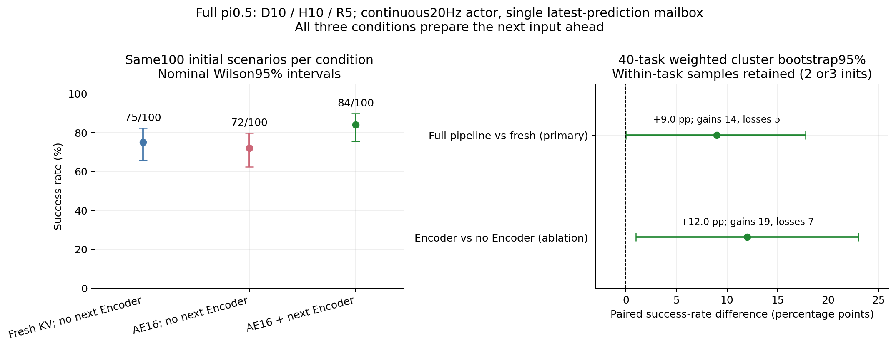

# 完整 lead3 混合 KV / D10 / 下一 Encoder：连续闭环成功率

**状态：300/300条全部完成，统计与终态审计通过，两张GPU均已释放。**

**完整组合成功84/100；相同在线规则下，fresh参考75/100，SM16关闭下一Encoder为72/100。开启下一Encoder有积极证据，但不能宣称相对原始同步路径无损：同批场景旧同步fresh为96/100。** 本轮观察到的输入时效改善，还没有补回连续执行引入的全部质量损失。

## 本轮验证的完整路线

完整 π0.5 LIBERO、BF16主体、B1、D10/H10/R5。SM16分支固定AE16 SM、VLM/Encoder112 SM；本帧VLM前三层KV-ready后启动第一轮AE，共10轮，每轮冻结当时新KV frontier，其余层用完整旧KV；下一真实观测的Encoder与剩余AE重叠。原权重、采样schedule和两槽/Lease/epoch/generation/Event保持，不做Draft/Verify或动作重定时。

本次直接测连续闭环，不能把此前[离线重放约1.12×](idea2_progressive_kv_report_20261025.md)与[关闭下一Encoder的200例成功率](idea2_closedloop200_report_20261025.md)拼成完整组合无损。原[250ms整块缓冲接法](idea2_online_encoder_report_20261025.md)的下一观测到得太晚，本轮不沿用。

## 固定设计

三臂各100个相同初始场景：

| 配置 | KV / 资源 | 下一Encoder |
|---|---|---|
| fresh18_no_encoder | 完整当前KV，全卡参考 | 关闭 |
| sm16_no_encoder | lead3，逐轮新旧KV，AE16/Prefix112 | 关闭 |
| sm16_encoder | lead3，逐轮新旧KV，AE16/Prefix112 | 开启，完整组合 |

三臂都提前执行同样的backend.prepare，Encoder开关只改变下一Vision Graph的提前replay；不把CPU输入准备差异混入GPU消融。四套件Object/Spatial/Goal/Long，各task0–9/init0、1，偶数task0/2/4/6/8另加init2，各25场景。环境seed7、settling10，原OSC20Hz及280/220/300/520步上限不变。有效任务失败不重试。

与原同步基准不同，本轮环境主线程按墙钟20Hz执行，网络线程持续推理已经采集的真实较新帧。只在实际R5应用边界选取下一目标块的最新完成候选，mailbox容量1，不中途替换、不执行H10后5步。缺结果就等待并记录控制gap，不添加noop或额外动作。不同预测request_id可对应相同target_chunk_id；实际消费块i严格使用原model_seed(suite,task,init,i)，未选候选共享该target的显式noise，避免推理速度改变实际消费噪声序列。

每次接受的下一Prepared及输入hash/step必须被下一请求原样消费；Pool始终由服务端唯一Host管理。终止时未消费的ahead先drain Event、再reset并记账。控制gap期间仿真暂停，因此这里是有明确过期/等待规则的模拟在线评测，不是机器人硬实时保证。

首次v2六条接入数据的no_encoder未提前prepare，存在准备协议混杂，全部原样保留作初步记录；v3统一准备后重跑六条并计入固定300格。排除依据是协议差异，不是成功率，原始有效失败不覆写。v3门禁967预测/1236动作核验通过，三臂首帧输入/seed/动作max与MAE均0；355次下一Encoder中353次有正的AE×Encoder Event包围区间，均值11.127ms。

## 统计与最终结果

### 成功率和配对差异

| 配置 | 成功/100 | 成功率的Wilson95%描述区间 |
|---|---:|---:|
| fresh18_no_encoder | 75 | [65.70%, 82.45%] |
| sm16_no_encoder | 72 | [62.51%, 79.86%] |
| sm16_encoder | 84 | [75.58%, 89.90%] |

| 对比（候选减参考） | 救回 / 损失 | 成功率差 | 40-task聚类95%区间 | 双侧精确McNemar p |
|---|---:|---:|---:|---:|
| 完整组合 − 在线fresh（唯一主要比较） | 14 / 5 | +9 pp | [0.00, +17.76] pp | 0.0636 |
| 开启 − 关闭下一Encoder（消融） | 19 / 7 | +12 pp | [+0.98, +23.00] pp | 0.0290 |
| SM16无下一Encoder − 在线fresh（探索） | 8 / 11 | −3 pp | [−10.20, +4.00] pp | 0.6476 |



主要比较的点估计正向，但p未低于0.05，task聚类区间触及0；不能称已经确认总体提升，也不是预先设定界限的非劣证明。消融支持保留下一Encoder重叠方向，但属于次要/探索分析。各类case都有反向变化：完整组合有5条参考能成功、它失败的case，不能说逐场景无影响。

这5条相对在线fresh的损失为 `libero_spatial/task1/init0、init1`、`libero_goal/task6/init2`、`libero_10/task2/init1`、`libero_10/task6/init1`。完整[救回/损失CSV](../../../reports/idea2_continuous_encoder_20261026/discordant_cases.csv)带双方原始目录；[全部配对CSV](../../../reports/idea2_continuous_encoder_20261026/casewise_comparisons.csv)保留成功/失败与执行步数。

| 配置 | Object /25 | Spatial /25 | Goal /25 | Long /25 |
|---|---:|---:|---:|---:|
| fresh18_no_encoder | 19 | 20 | 21 | 15 |
| sm16_no_encoder | 20 | 17 | 18 | 17 |
| sm16_encoder | 22 | 21 | 23 | 18 |

### 在线时效、GPU窗口与实际执行

请求统计排除bootstrap和重复使用初始frame0的首个在线请求，取真实后续帧的原始请求合池，未平均各回合P95。实际应用年龄排除bootstrap动作块，计入后续R5中的全部动作；块中后面的动作自然比第一动作更旧。

| 指标 | 在线fresh | SM16无下一Encoder | SM16完整组合 |
|---|---:|---:|---:|
| RPC均值 / P50 / P95 ms | 71.29 / 71.04 / 73.33 | 67.21 / 66.50 / 69.28 | 57.71 / 57.43 / 59.74 |
| 观测capture→response均值 / P95 ms | 162.27 / 187.02 | 154.90 / 182.42 | 136.37 / 159.98 |
| capture→实际动作应用均值 / P95 ms | 298.02 / 423.68 | 291.41 / 421.66 | 262.95 / 377.29 |
| 实际动作应用时输入年龄均值 / P95（控制步） | 5.46 / 8 | 5.33 / 8 | 4.77 / 7 |
| 预测/KV更新服务率（每回合均值）Hz | 13.95 | 14.79 | 17.21 |
| 实际控制步率（每回合均值）Hz | 19.92 | 19.91 | 19.91 |
| 未消费在线候选比例 | 71.97% | 73.55% | 77.23% |
| 100回合总执行动作 | 23,780 | 23,924 | 22,059 |
| episode工作墙钟均值 s（含冷启动准备等） | 25.79 | 25.82 | 25.14 |

完整组合相对在线fresh的RPC均值少约19%，但不能把71→58ms当作“观测到动作只需58ms”：capture→返还仍为136ms，全部后续实际动作的输入年龄均值263ms。当前规则中，提前接纳的下一帧要等待轮到本次推理，返回后的结果又要等R5边界及块内动作顺序。更高的服务率也不等于执行了更多动作：控制仍约20Hz，大量候选未消费。

完整组合使用旧KV时，其源观测到实际动作的年龄均值322.10ms、P95为429.34ms；关闭下一Encoder时为356.96/477.45ms。它是旧源的总年龄，不是旧KV相对当前输入又额外旧了322ms；完整组合当前输入自己已平均263ms，旧源相对它多约59ms。fresh的实际旧KV使用年龄记null，bootstrap不虚构旧源。

| GPU Event跨度均值 ms（真实后续帧） | 在线fresh | SM16无下一Encoder | SM16完整组合 |
|---|---:|---:|---:|
| 本帧Vision（可能已在前一请求提前完成） | 10.38 | 11.27 | 11.27 |
| VLM | 31.57 | 39.25 | 39.36 |
| AE十轮 | 25.87 | 47.50 | 49.86 |
| AE×VLM Event包围区间交集 | 0 | 34.78 | 34.88 |
| AE×下一Encoder Event包围区间交集 | — | — | 11.23 |

完整组合19,098次实际下一Encoder提交中，19,066次有正的AE×下一Encoder Event区间，收到帧时AE均未完成，完成prepare后19,069次仍未完成。32次零窗口如实保留。Event区间含间隙/等待，这里不称真实Kernel busy交集；独立nsys对同一冻结Graph已经验证两段真实Kernel重叠。各模块跨度跨请求重叠，不能简单相加为单次端到端。

AE在SM16上比全卡更慢，开启下一Encoder后又略慢，但整条服务链更快。这与“将AE放进VLM/Encoder窗口”的机制一致；同时观测和动作应用的时间规则仍决定闭环质量。自由闭环轨迹和请求数量不同，上表时间均为描述性结果，不是固定输入的因果加速比。episode墙钟包括记录I/O和冷准备，也不能作为纯部署推理速度。

统计见[预定方案](../../../results/idea2/continuous_encoder_20261026/prospective_statistics.md)：唯一主要比较为完整组合对同在线规则fresh参考；下一Encoder开关为消融。Wilson描述区间、同case配对b/c、精确McNemar、40task按样本数2/3做ratio-weighted bootstrap10000次（seed20261026），另报episode敏感性。无非劣门槛，不把p>0.05称为无损；100例不保证1pp以内安全。

### 与旧同步路径的差距

与本轮100个初始场景对应的旧同步fresh参考是96/100。完整组合相对它救回3例、损失15例，净少成功12次；在线fresh为75/100，相对旧同步也下降21次。**不能把所有差距归因于KV复用：即使全部使用当前KV，连续控制协议下也出现明显的观察到的质量差距。**

旧同步客户端在推理期间停止仿真，本轮机器人继续执行已有动作，源观测到应用已过去若干控制步，且仍严格执行预测的前5步，没有做延迟动作重定时。这是本轮质量差异的重要时序解释，与年龄记录一致，但不是逐个失败的已证实单一根因。

历史对照单列描述，观测/动作时间规则不同，不并入主300格、不混用旧耗时，不把跨协议差异伪装成GPU重叠的纯因果效应。当前结论是：**完整组合值得作为连续推理候选保留；还不能作为“相对原始同步π0.5无损”的替换方案。** 下一步应优先约束观测→实际应用年龄、研究动作交接时序，不能只追求更多AE被隐藏。本次不擅自引入动作重定时/RTC或改变模型算法，不修改生产默认。

## 完整性和资源

终态独立CPU审计通过：300唯一回合、53,928次预测、69,763个实际动作；100组跨三臂bootstrap对照在预定max1e-5/MAE1e-6容差内，实际max为0。动作/target/种子/R5/真实观测链/未选候选/两槽和终态drain-reset均核验，69个有效失败保留，主实验无技术回合重试。十个主分片及两次v3门禁均正常退出、模型源码身份未变。

客户端14项CPU状态机自测和统计27项CPU自测通过。两张RTX4090各运行独立模型/环境分片，同case三臂同卡；顺序按task轮换、另卡反序。权重路径/大小/mtime与起始manifest相同，未重复哈希整份权重；不能把源码/输入/动作审计夸大成全部GPU噪声字节验证。

GPU3于04:39 UTC、GPU2于04:45 UTC释放（本地分别12:39/12:45，2026-10-26），资源协调会话已通知。最终统计、审计与文档均为CPU工作。

## 数据和实现入口

- [固定计划](idea2_continuous_encoder_plan_20261026.md)、[manifest](../../../results/idea2/continuous_encoder_20261026/manifest.json)、[300cell网格](../../../results/idea2/continuous_encoder_20261026/case_universe.json)。
- [调度/完整命令](../../../results/idea2/continuous_encoder_20261026/dispatch_execution.json)、[逐例标准化输入](../../../results/idea2/continuous_encoder_20261026/normalized_cases.json)、[实时进度](../../../reports/idea2_continuous_encoder_20261026/progress.json)。
- [policy](../../../results/idea2/continuous_encoder_20261026/policy.py)、[server](../../../results/idea2/continuous_encoder_20261026/server.py)、[client](../../../results/idea2/continuous_encoder_20261026/client.py)、[runner](../../../results/idea2/continuous_encoder_20261026/run.py)。
- [六条门禁审计](../../../results/idea2/continuous_encoder_20261026/gate_audit/summary.md)、[初步准备协议修订说明](../../../results/idea2/continuous_encoder_20261026/preparation_protocol_revision.json)、[历史同步100例来源](../../../results/idea2/continuous_encoder_20261026/historical_synchronous_reference.json)。
- [成功率CSV](../../../reports/idea2_continuous_encoder_20261026/success_rates.csv)、[配对统计CSV](../../../reports/idea2_continuous_encoder_20261026/paired_comparisons.csv)、[完整统计JSON](../../../reports/idea2_continuous_encoder_20261026/statistics.json)。
- [终态审计摘要](../../../results/idea2/continuous_encoder_20261026/full_audit/summary.md)、[审计JSON](../../../results/idea2/continuous_encoder_20261026/full_audit/audit.json)、[运行汇总JSON](../../../results/idea2/continuous_encoder_20261026/full_audit/runtime_summary.json)。
- [逐回合成本CSV](../../../results/idea2/continuous_encoder_20261026/full_audit/episodes.csv)、[逐预测CSV](../../../results/idea2/continuous_encoder_20261026/full_audit/requests.csv)、[逐动作/年龄CSV](../../../results/idea2/continuous_encoder_20261026/full_audit/applications.csv)。

原模型与runtime未修改，只新增实验适配/评测/汇总代码。正式质量评测不采nsys，GPU Event正区间只表示可用窗口；同一冻结runtime的真实Kernel双段交集已有[独立nsys见证](../../../nsys/idea2_experiment/online_sm16_prepared_witness_20261025_v1.nsys-rep)，不能把两种时钟的数值混作同一场测量。

复现单case用新结果目录和空闲端口（必须先确认GPU/EGL归属）：

```bash
cd /root/nfs/embodied/benchmark
python3 -m results.idea2.continuous_encoder_20261026.run \
  --output results/idea2/continuous_encoder_20261026/reproduction_new \
  --shard 0 --port 19520 --case-keys libero_object/0/0
```

整轮各分片的完整命令、环境变量、CPU亲和、源hash和退出码保存在调度/执行记录。连续控制的候选完成相位依赖真实运行时间，固定seed并不保证重跑时每次选到同一frame；输入、时间和实际动作均落盘以便复核。统计可纯CPU重建：

```bash
python3 results/idea2/continuous_encoder_20261026/statistics.py \
  --input results/idea2/continuous_encoder_20261026/normalized_cases.json \
  --output /tmp/idea2_continuous_statistics.json --csv-dir /tmp/idea2_continuous_csv
```
