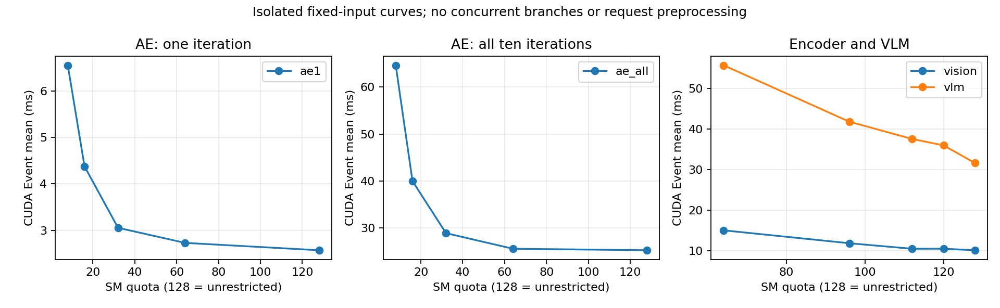
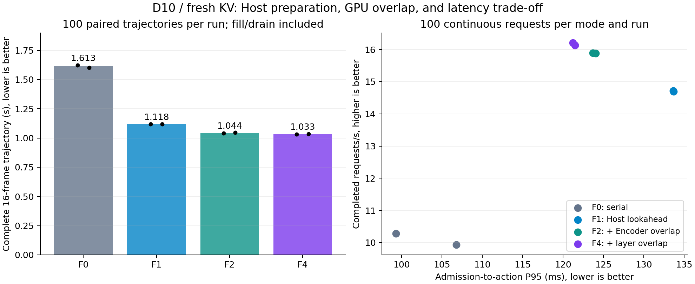
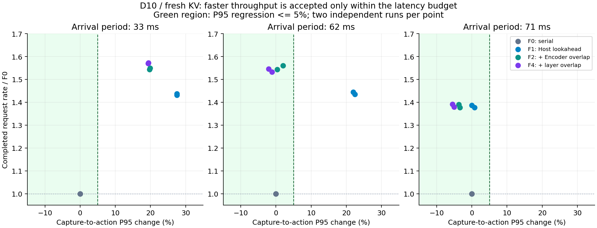

# idea2：十轮 AE、逐层流水线与阶段 SM 分配实验报告

本轮实验已完成。本报告研究完整 π0.5 的 D10 推理调度，不使用 idea1 V14，不改变模型、精度、动作数量、噪声规则或时间递推。正式计时、独立复测、nsys、SLO和24例有限闭环均已完成，GPU已释放。设计及历史执行过程见[方案](idea2_d10_dynamic_sm_plan_20261024.md)、[执行记录](idea2_d10_dynamic_sm_status_20261024.md)。

## 1. 先看结论

1. **动态 SM 的机制有效，但当前逐层路径没有净收益。** 将 AE 后九轮从 16 SM 恢复到全卡，把模型跨度从约 85.1 ms 降至 72.0 ms；普通全卡路径约 65.9 ms。8 SM 的恢复方案约 70.5 ms，也未胜出。问题不在 Event 没有生效，而是为了重叠约 2.6 ms 的 AE1，限制 VLM 资源付出了更大的代价。
2. **D10 下值得保留 AE × Encoder。** 当前帧 KV 路线在相同 Host 提前准备策略下，Encoder 重叠使完整轨迹快约 7.1%；再加逐层 KV-ready，合计约 8.2%。两轮各100组独立确认。逐层机制的额外收益仅约1%。
3. **要修正对旧 KV 1.59× 的解释。** 原串行接口等全部 Prefill 完成才返回。补充“同样提前返回、但 GPU 串行”的公平控制后，Encoder 重叠的连续吞吐增益为 **8.52% / 8.20%**；独立请求的动作返回反而慢 **4.32 / 4.86 ms**。因此存在明确的吞吐—动作延迟取舍。
4. **SLO 取决于输入速率。** 33 ms 到达下，流水方案的 capture→action P95 比常规串行高约19–28%，不满足预设5%预算；62 ms 下 Encoder 和组合方案均满足5%；71 ms 下已受输入速率限制，复杂调度主要降低延迟，吞吐基本不再增加。
5. **旧 KV 出现明显质量风险。** 相同8个闭环案例，新KV串行8/8成功，旧KV串行/并行均4/8；两种旧KV调度动作逐位一致。小样本不能估计总体成功率，但足以否定“数值对照通过就能默认旧KV无损”。后续优先当前帧KV路线，旧KV暂不推荐部署。

## 2. 实验边界与计时口径

| 项目 | 固定条件 |
|---|---|
| 模型 | 完整 `pi05_libero`，`shared/checkpoints/openpi/pi05_libero_pytorch_idea2` |
| 计算 | BF16，H=10，D=10，原 FP32 `dt=-1/10` 递推；不减步、不复用中间残差 |
| 设备 | 正式性能全部 GPU1 RTX 4090，UUID `GPU-599477fb-0507-40dc-14df-d491f7a7b202`；driver 580.95.05，PyTorch 2.7.1/cu126 |
| 运行 | `CUDA_DEVICE_MAX_CONNECTIONS=32`；OMP/MKL/OpenBLAS各2线程；同一调度Host拥有Pool |
| 输入 | 13个同任务真实变化观测；固定noise映射；此bank来自idea1实验数据，不代表使用V14模型路径 |
| 数值门限 | 事先确定 max≤1e-5、MAE≤1e-6；本轮正式结果均为0 |
| 缓冲区 | 两份完整持久KV、Slot/Lease/epoch/generation/Event协议；Graph可写scratch分离；无第三份完整KV规避约束 |
| 测量 | 预热/捕获/编译/nsys排除；正式100对交替顺序，独立反向复测；连续组计入最后后台排空与reset |

`prepare_cpu_ms` 是 Host 墙钟，包含 deepcopy、输入 transform、NumPy→Torch/H2D、observation 预处理，**不是纯 CPU 算术时间**。普通单帧约30 ms的准备与约1.7 ms的总提交开销是不同指标。本轮没有给准备函数内部每项单独打标，不能猜测其中图像处理、tokenizer、拷贝各占多少。

CUDA Event 的分支跨度含 GPU 排队和等待；`both_completion_event_ms` 的计时起点还包含 Host 输入准备。补充 `gpu_scheduling_span_ms` 取最早分支开始到最后分支完成，仍包含调度空洞，不能称为 Kernel busy。Kernel busy/重叠使用 CUPTI 真实区间并集/交集。`Vision` 标签含 Encoder、projector 和 embedding/metadata。

输出间隔、请求 admission→action、相机 capture→action 分别报告。**每61 ms输出一次，不等于该帧只用了61 ms。** 当前帧 KV 与旧完整 KV 分开排名，不能跨语义把延迟差算成保持同等输入条件的加速。

## 3. 路线与实现

| 路线 | GPU调度与KV含义 |
|---|---|
| F0 | 当前帧完整KV，常规串行；无下一帧Host提前准备 |
| F1 | 当前帧完整KV，Host提前准备下一帧，GPU仍串行 |
| F2 | 当前帧完整KV；当前AE剩余阶段与下一帧Encoder重叠，下一帧VLM等当前AE结束 |
| F3 | 单请求逐层KV-ready：本帧VLM每层KV完成后，放行本帧AE1对应层 |
| F4 | F3加跨帧Encoder重叠 |
| O0 | AE消费旧完整KV，串行执行新Prefill；接口等两分支全部完成 |
| O_async_serial | 同样旧KV、动作就绪即返回；GPU依次AE→Vision→VLM |
| O1 | 同样旧KV、动作就绪即返回；AE×Vision，之后新VLM |
| O2 | 同样旧KV；AE×完整新Prefill |

动态 SM 用预创建 Green Context 和独立 Graph 实现阶段切换：AE1在小配额、VLM在互补配额；两个完成Event都到达后，后九轮在不限配额主Context重放。**不是运行中修改SM分区，也不是把已捕获Graph随意迁移到另一资源域。** 主Context表示没有该配额限制，不表示每个Kernel实际占满128 SM。

本轮修改集中在 `preparations/idea2/`：

- `layer_graphs.py`：D10的1+9阶段、可选尾段Stream/完整Prefix门禁、独立Vision Stream；保留默认路径。
- `layer_bench.py`、`layer_crossframe_bench.py`：配对/连续测量、资源选项、真实到达重放、Host/Event/NVTX与生命周期审计。
- `sm_sensitivity_bench.py`、`sm_trace_audit.py`、`d10_iteration_audit.py`：隔离曲线、greenContext归属及逐轮数值诊断。
- `cewp_bench.py`：在已有排空/reset边界切换同一Graph的选择性等待规则，避免比较不同捕获配置。
- `gpu_guard.py`：同时检查计算和EGL图形进程。
- `results/idea2/d10_dynamic_sm_20261024/async_serial_control.py`：仅用于实验的提前返回串行控制；在Vision开始前等AE，复用相同Graph/槽位，不改模型或生产默认配置。
- 同目录的矩阵、闭环包装、离线汇总脚本保存实际命令、源码hash、原始结果与分析。

不需要双Python提交进程。Graph路径提交开销较小，已有真实Kernel重叠；没有证据支持以增加Host Worker作为当前主修复。正式队列期间冻结运行时源码，不在测量中改实现。

## 4. 逐层与动态SM：为什么没有净收益

隔离模块使用20次预热、30次测量，输入已就绪。单位ms，CUDA Event均值：

| AE / Prefix配额 | Encoder | VLM | AE1 | AE10 |
|---|---:|---:|---:|---:|
| 全卡 / 全卡 | 10.111 | 31.608 | 2.569 | 25.232 |
| 8 / 120 | 10.486 | 35.963 | 6.558 | 64.644 |
| 16 / 112 | 10.477 | 37.538 | 4.377 | 39.963 |
| 32 / 96 | 11.836 | 41.793 | 3.053 | 28.877 |
| 64 / 64 | 15.015 | 55.695 | 2.728 | 25.549 |

| 初筛配置 | 并发模型跨度P50 ms | CPU→CPU P50 ms |
|---|---:|---:|
| G0 全卡整图 | 65.888 | 96.104 |
| G1 全卡1+9，同形门禁 | 65.915 | 96.355 |
| G2 固定16/112 | 85.087 | 114.964 |
| G3 16/112→尾段全卡 | 72.026 | 103.321 |
| G2 固定8/120 | 105.711 | 135.603 |
| G3 8/120→尾段全卡 | 70.469 | 103.880 |

各行20对加每臂20次连续运行，跨配置独立进程，属于筛选，不能包装成正式同进程配对加速比。两组配额都失败后停止扩大搜索。动态回收确实消除了后九轮受限的损失，但不能补偿VLM在第一阶段已经付出的代价。

只有AE1约2.6 ms可与本帧VLM大幅重叠。假设完全隐藏它、其他模块不变慢，相对约67 ms模型路径仅约3.9%；这只是量级估算，不是所有调度的严格上界，普通路径可能还有少量AE2与VLM尾部重叠。十轮不会把“同帧逐层窗口”变成十倍；增加的是适合覆盖下一帧Encoder的尾段。

普通全卡逐层路径完成两轮100对正式确认：整图CPU→CPU均值为96.737→95.851、97.321→96.525 ms；模型跨度约67.0→66.0 ms。1+9同形对照结论接近。**单帧收益约1%，不是完全隐藏十轮AE。**

Encoder固定输入配对微基准：全卡双流29.942 ms、64/64为28.332 ms、32/96为31.747 ms，复测全卡30.024 ms。仅64/64进入集成，并让VLM回主Context。整轨迹初筛改善只约1.16%，仍略慢于普通F4，故不扩大切点/三段回收搜索，不作为部署推荐。[SM CSV](../../../reports/idea2_d10_dynamic_sm_20261024/sm_sensitivity.csv)、[初筛CSV](../../../reports/idea2_d10_dynamic_sm_20261024/g0_g3_screening.csv)、[单帧正式CSV](../../../reports/idea2_d10_dynamic_sm_20261024/formal_request_summary.csv)。

## 5. 当前帧KV：完整轨迹与SLO

两轮各100组×4臂×16帧，加各臂100次连续运行，共13,600条请求；计入fill/drain。下表“正序/反向”均为独立运行：

| 路径 | 16帧整轨迹均值ms | 轨迹内部平均输出间隔ms | 连续admission→action P95 ms |
|---|---:|---:|---:|
| F0 | 1623.671 / 1602.659 | 100.421 / 98.518 | 106.782 / 99.293 |
| F1 | 1117.281 / 1119.200 | 67.050 / 66.979 | 133.693 / 133.642 |
| F2 | 1042.092 / 1045.494 | 62.137 / 61.959 | 123.710 / 124.046 |
| F4 | 1032.019 / 1034.673 | 61.117 / 60.918 | 121.483 / 121.235 |

F0→F1配对速度比1.4534 / 1.4322，来自提前准备覆盖等待；相同Host策略下F1→F2为1.0723 / 1.0707，F1→F4为1.0828 / 1.0820。F4相对F2只约1%。例如F4/F1的95% bootstrap区间为1.0791–1.0865及1.0775–1.0865，抽样单位是完整配对轨迹，不把相关帧冒充独立样本。该区间反映固定bank重复测量，不代表不同任务泛化。

SLO采用latest-available到达重放，固定33/62 ms，以及预先冻结公式 `ceil(1.05×F1周期)` 得到71 ms。每条件/每臂100请求、反向重复，共2,400请求；默认延迟和KV来源年龄预算5%，另报告0/2/10%。当前帧KV的来源capture→动作年龄等于capture→action，帧数年龄是量化诊断，不能替代毫秒预算。

| 到达周期 | F0 P95 ms（两轮） | F2 P95 ms（两轮） | F4 P95 ms（两轮） | F2 / F4 吞吐范围 | 结论 |
|---|---:|---:|---:|---:|---|
| 33 ms | 128.51 / 128.07 | 153.83 / 153.60 | 153.35 / 152.94 | 15.91–15.97 / 16.19–16.20 Hz | 两者均不满足5%，也不满足10% |
| 62 ms | 157.42 / 156.62 | 157.96 / 159.82 | 155.58 / 153.32 | 15.75–15.92 / 15.63–15.77 Hz | 两者均满足5%；F2略快，F4延迟更低 |
| 71 ms | 162.94 / 162.73 | 156.93 / 157.22 | 153.97 / 154.58 | 约13.96–13.97 / 13.98–13.99 Hz | 输入速率限制，F1已约13.93–13.96 Hz |

62 ms下F2反向复测P95增加2.04%，不满足严格2%预算；F4两轮都低于F0。33 ms时F0丢193/194帧，F2丢90/89，F4丢87/87；更高消费率伴随更大的单帧停留时间，不能只报吞吐。每组100 Prefill/100消费，KV偏移恒0，无饿死Prefill。最后一个未处理缓存帧单独记账，完整到达/丢弃数见CSV。

[完整指标](../../../reports/idea2_d10_dynamic_sm_20261024/crossframe_formal_summary.csv)、[配对差与区间](../../../reports/idea2_d10_dynamic_sm_20261024/crossframe_formal_paired.csv)、[SLO全表](../../../reports/idea2_d10_dynamic_sm_20261024/slo_summary.csv)。这些是观测重放和合成到达时钟，尚未验证F4在真实相机/机器人上的实时闭环收益。

## 6. 旧完整KV：公平控制改变了收益解释

O0/O1/O2两轮各700条正式请求，另补O_async_serial/O1两轮各400条。每个配对组复用同一Graph engine，所有模式年龄恒1、每请求一次Prefill、稳态零重捕获，数值均0误差。年龄1指一个已服务请求，并非恒定一帧相机时间；毫秒年龄也保留在原始记录/CSV。

最初 O0→O1 的动作接口均值100.468→63.128、100.777→63.438 ms，平均配对速度比1.594×/1.592×。但O0内部AE约55–56 ms已经就绪，只是接口等新Prefill完成。补充控制保持同样提前返回，结果如下：

| 相同提前返回语义 | 第一轮串行→重叠 | 反向复测串行→重叠 |
|---|---:|---:|
| 配对动作CPU→CPU均值 ms | 57.519 → 61.839 | 56.120 → 60.976 |
| 配对动作P50 ms | 56.936 → 61.260 | 55.746 → 60.621 |
| 配对动作P95 ms | 60.942 → 64.880 | 58.492 → 63.452 |
| 双分支完成Event均值 ms | 97.438 → 91.685 | 96.184 → 90.847 |
| GPU调度跨度均值 ms | 66.693 → 61.050 | 66.751 → 61.147 |
| AE Event跨度均值 ms | 25.471 → 30.011 | 25.494 → 30.051 |
| 连续吞吐（含最终排空）Hz | 14.522 → 15.760 | 14.518 → 15.708 |
| 连续请求CPU→CPU P95 ms | 67.599 → 63.291 | 67.646 → 63.500 |

独立请求里Encoder竞争让动作晚约4–5 ms；连续运行时，串行控制的下一请求需等旧后台Prefill，重叠减少这个反压，输出更快。**低负载、动作最早返回优先选GPU串行提前返回；持续有请求且能接受旧KV时，O1吞吐更高。** 该判断仍需通过旧KV质量门槛。

O2完整重叠的配对动作返回约92.364/94.010 ms，O1约63.562/64.693 ms；O1双分支全完成却比O2晚2.449/1.901 ms。进一步证明“动作关键路径最优”和“所有工作最早结束”不是同一目标。ae_first/prefill_first的20对初筛中AE-first略优，后续固定AE-first，不扩大无依据调参。

当前帧正式路径峰值allocated约7.59 GB、reserved约8.14 GB；旧KV公平控制allocated约7.58–7.62 GB、reserved约8.14–8.23 GB。这里是框架分配器十进制GB，不是整张卡的NVML总占用。两槽与稳定地址审核通过，不把暂态算子scratch声称为零分配。

[旧KV正式完整指标](../../../reports/idea2_d10_dynamic_sm_20261024/oldkv_formal_summary.csv)、[配对差与区间](../../../reports/idea2_d10_dynamic_sm_20261024/oldkv_formal_paired.csv)、[同API串行包装源码](../../../results/idea2/d10_dynamic_sm_20261024/async_serial_control.py)。

## 7. nsys：实际重叠、竞争与第一轮耗时

六条当前帧trace各8帧，5个候选各匹配7,738种Kernel signature，无未匹配项。动态16资源审计：AE1共8,432 Kernel在16 SM Green Context，VLM 7,072在112 SM Context，AE2–10共75,888在主Context；8个尾段边界全部满足生产者完成依赖。

| 当前帧trace | VLM busy ms/帧 | AE1 busy ms/帧 | AE2–10 busy ms/帧 | AE×VLM交集 ms/帧 |
|---|---:|---:|---:|---:|
| 全卡串行 | 31.849 | 2.664 | 23.670 | 0 |
| 普通逐层重叠 | 33.399 | 5.733 | 23.583 | 5.896 |
| 固定16/112 | 38.544 | 6.150 | 37.908 | 6.157 |
| 16/112→尾段全卡 | 38.565 | 6.181 | 23.574 | 6.186 |
| F4组合 | 33.924 | 5.719 | 25.563 | 5.863 |

普通逐层AE1匹配GEMM/Attention区域约变慢2.497×/2.463×；VLM FFN GEMM约0.994×，不能笼统说所有FFN都慢。固定16尾段GEMM约2.040×，恢复全卡约1.000×，证明回收机制有效。F4与下一帧Vision实际交集约6.625 ms/机会。64/64候选的next-VLM在7/7机会都等待当前AE，6/7机会有AE×Vision交集；profile扰动Host，不能将此机会率冒充稳态概率。

旧KV三条trace各8请求、103,160个已归属Graph模型Kernel，无归属缺失/歧义。没有以Host返回时刻截断后台GPU尾部：

| 旧KVtrace | AE busy / envelope ms | Vision busy ms | VLM busy ms | AE×Vision / AE×VLM交集 ms |
|---|---:|---:|---:|---:|
| O0 | 25.864 / 28.388 | 9.807 | 31.026 | 0 / 0 |
| O1 | 29.595 / 33.415 | 12.961 | 31.532 | 11.103 / 0 |
| O2 | 34.105 / 61.653 | 12.602 | 34.336 | 10.776 / 10.397 |

O2的AE跨度61.7 ms包含约27.5 ms Kernel之间空洞，不全是AE算术。O1/O2匹配AE GEMM为串行的1.135×/1.390×。O1有6,627个Prefill Kernel在Host返回后执行，已计入分析。追加O_async_serial trace确认8请求AE×Vision/VLM交集严格为0，8/8请求Prefill在返回后继续；与O1的136种Kernel signature及数量完全匹配。

热态每轮velocity计算：串行AE1 busy约2.664 ms，后九轮每轮平均2.630 ms，没有明显“第一轮搬权重所以特别慢”。普通逐层AE1 busy为5.733 ms、envelope为32.299 ms，长跨度主要含逐层等KV；后九轮每轮busy约2.620 ms。每轮时间条件不同，1+9图保留原十轮计算，不能简单把第一轮图原样重放九次。Preparation/Euler等在迭代标签之外另计，约0.054–0.073 ms/帧。

全卡串行trace中90次`cudaStreamSynchronize`累计API时间约0.637 ms，另有8次必要的结果Event等待。未支持“30 ms输入准备主要卡在这些同步”的解释。没有删除CPU读结果或Buffer生命周期所需等待。上述证据能证明重叠和并发减速，**尚不能分辨HBM、L2或具体执行单元谁是根因**；没有用nsys时间线冒充Nsight Compute计数器。

[当前帧分析](../../../results/idea2/d10_dynamic_sm_20261024/trace_analysis/README.md)、[旧KV分析](../../../results/idea2/d10_dynamic_sm_20261024/trace_analysis/oldkv/analysis/README.md)、[同API控制审计](../../../results/idea2/d10_dynamic_sm_20261024/trace_analysis/oldkv/async_control_analysis/README.md)、[逐轮时间](../../../results/idea2/d10_dynamic_sm_20261024/trace_analysis/per_iteration_times.md)。所有profile时间只解释机制，速度排名来自无profiler测量。

## 8. 数值、生命周期与有限闭环

逐轮诊断52请求、520次迭代：time、velocity、中间action及最终action逐位一致；覆盖13输入、两槽各26次、两个epoch、同地址内容更新、reset。独立CPU重读全部NPZ及SHA通过。生命周期覆盖活Lease拒绝reset、在途Encoder排空、旧epoch拒绝和槽位非别名。正式测量的原始/解码动作误差均0，稳态重捕获均0。

两槽结论来自实现、稳定地址与生命周期检查，未采集完整分配器追踪。闭环保留原噪声种子和构造协议，未另存每个原始noise Tensor字节；权重身份核对同一路径及文件元数据，未在本轮重新计算全部权重hash。实际bootstrap动作一致是补充证据，不能扩展为未测配置的保证。

旧KV闭环固定四套件各task0/5、init0，D10/H10/R5、seed7，复用原环境/采样客户端；每模式8例，共16例有效完成。O0和O1各4/8成功、总2137步；428对推理的当前观测、Prefix来源与噪声种子序列一致，动作逐位一致。其中含8对episode bootstrap；排除唯一cold capture为427对，严格排除所有bootstrap为420对稳态旧KV请求。失败也保留，不替换案例。

新KV补充对照在GPU0完成相同8例，全部成功，共1181步。每个案例初始观测hash、原噪声种子及bootstrap动作完全一致；后续因新旧KV语义不同而轨迹分化，不能再强求后续输入相同。GPU0启动晚于GPU1正式配对计时结束；跨卡数据仅比较质量，不排名绝对延迟。

| 套件/任务 | 新KV成功/步数 | 旧KV串行与重叠成功/步数 |
|---|---:|---:|
| object / 0 | 是 / 154 | 否 / 280 |
| object / 5 | 是 / 130 | 是 / 229 |
| spatial / 0 | 是 / 110 | 否 / 220 |
| spatial / 5 | 是 / 101 | 否 / 220 |
| goal / 0 | 是 / 114 | 是 / 204 |
| goal / 5 | 是 / 129 | 否 / 300 |
| libero_10 / 0 | 是 / 262 | 是 / 484 |
| libero_10 / 5 | 是 / 181 | 是 / 200 |

这组结果支持“质量退化与使用旧KV的语义有关，而非两个调度模式之间的数据竞争”的解释。它不是完整评测，仍需更多任务/初始状态确认退化范围。[新旧KV逐案例CSV](../../../reports/idea2_d10_dynamic_sm_20261024/closedloop_fresh_vs_old.csv)、[比较及初始条件审计](../../../reports/idea2_d10_dynamic_sm_20261024/closedloop_fresh_vs_old.json)。

闭环wall time含环境启动、渲染、RPC、磁盘记录、后台排空和非对称首次捕获，不能用于隔离推理加速比；LIBERO在推理时暂停，不证明真实机器人SLO。这是小样本质量检查，不是完整LIBERO评测，不宣称统计质量等价。F4尚未进入闭环部署验证。

[闭环逐案例](../../../reports/idea2_d10_dynamic_sm_20261024/closedloop_pairs.csv)、[旧KV汇总](../../../reports/idea2_d10_dynamic_sm_20261024/closedloop_summary.json)、[独立逐轮审计](../../../results/idea2/d10_dynamic_sm_20261024/iteration_artifacts_independent_audit.json)。

## 9. 保留、停止与复现

**保留**普通全卡F2/F4作为当前KV吞吐候选，按SLO选择；O_async_serial/O1保留为旧KV低延迟/吞吐实验对照，因闭环退化暂不推荐部署。**停止**扩大逐层SM配额搜索、Encoder三阶段切点搜索；目前净收益不足。所有候选以独立开关/实验入口保留，未强行替换默认调度。

下一步若继续研究，优先收集真实相机到达与动作deadline，用测得的服务时间选择是否接纳下一帧Encoder。当前证据支持简单按负载/SLO选模式，尚不需要复杂在线SM重分配器。若继续优化资源竞争，应先用计数器证实共享带宽/缓存或SM驻留瓶颈，再决定Kernel形状或资源隔离实验；不能把Green Context视为HBM/L2硬隔离。

保留的失败/排除项：

| 记录 | 原因与处理 |
|---|---|
| `d10_whole_formal`、`d10_split_full_formal` | 冷加载期间源码变化，标记`excluded_source_drift`；改用`*_formal_stable` |
| `d10_encoder64_vlmfull_profile` / v1 | 用户暂停中断；完整替代为`..._resumed` / v2 |
| `d10_slo_62ms_repeat` | 启动守卫见无进程但利用率残留，0条测量；保存失败，补`..._resumed`。新启动检查等两次稳定空闲，不放宽进程隔离 |
| `trace_audit_historical_check.json` | 历史D2尾段不符合本轮完整Prefix门禁；不把它列为D10证据，也不据此断言历史数值错误 |

[全部实际命令](../../../reports/idea2_d10_dynamic_sm_20261024/reproduction_commands.md)、[原始结果目录](../../../results/idea2/d10_dynamic_sm_20261024/)、[CSV与图表](../../../reports/idea2_d10_dynamic_sm_20261024/)、[完成性审计](../../../results/idea2/d10_dynamic_sm_20261024/requirements_audit.md)。重跑使用新的输出目录，不能覆盖本次原始证据。

建议先看这些trace，目录均为 `/root/nfs/embodied/benchmark/nsys/idea2_experiment/`：

| 要看什么 | 文件 |
|---|---|
| 当前KV组合候选F4 | `d10_combined_profile_20261024_v1.nsys-rep` |
| 同条件完整串行 | `d10_full_serial_profile_20261024_v1.nsys-rep` |
| 动态16 SM恢复到全卡 | `d10_dynamic16_profile_20261024_v1.nsys-rep` |
| 旧KV AE×Encoder | `d10_oldkv_graph_encoder_overlap_20261024_v1.nsys-rep` |
| 旧KV完整重叠的竞争 | `d10_oldkv_graph_ae_first_20261024_v1.nsys-rep` |
| 同样提前返回但GPU串行 | `d10_async_serial_profile_20261024_v1.nsys-rep` |

查看时展开CUDA HW中的实际Kernel轨道，结合NVTX的Vision/VLM/AE及请求编号；不能只比较Host NVTX条的重叠。后台Prefill越过动作返回边界是预期行为，必须一直看到最后完成。
