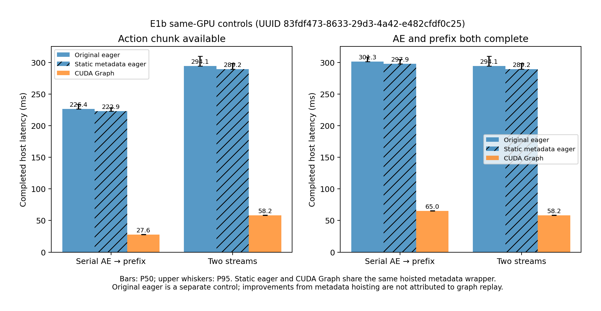
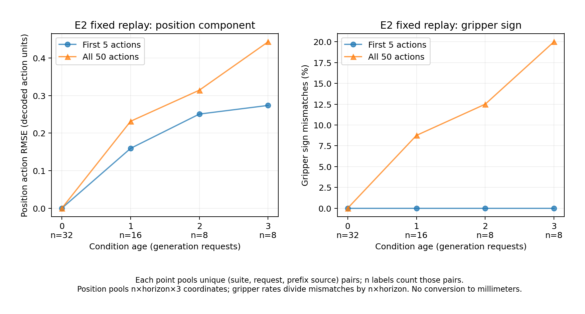
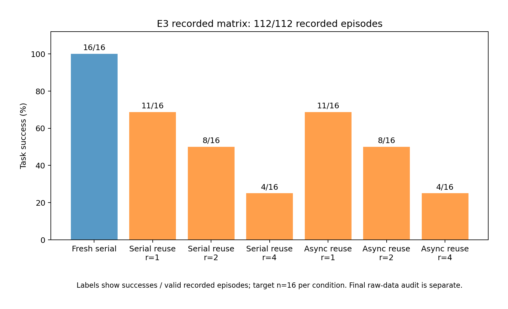
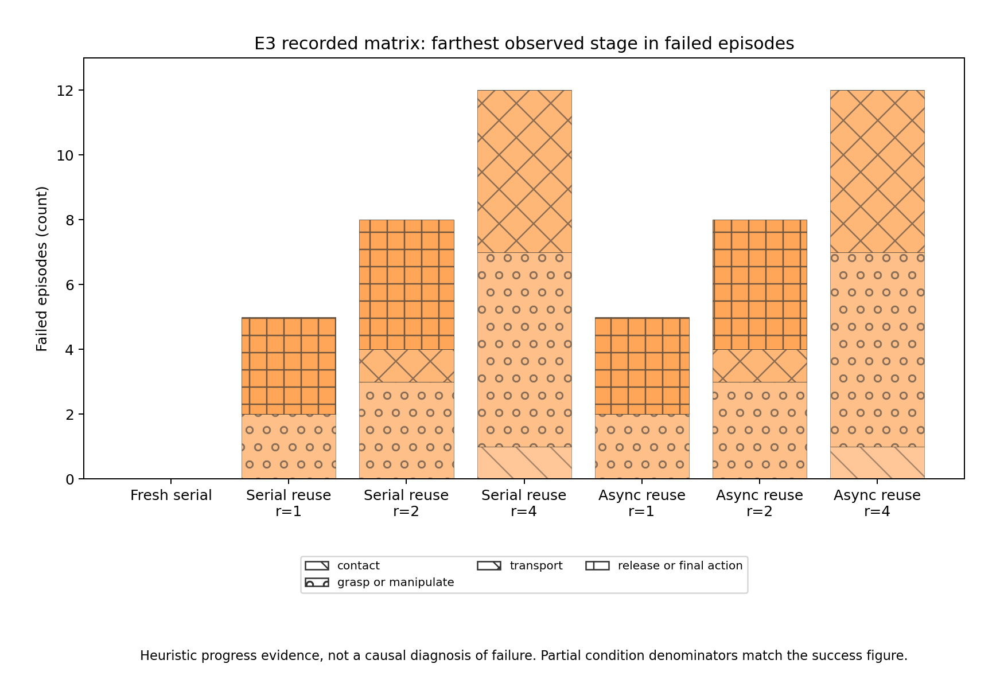

# idea2：单卡 VLM／Action Expert 异步流水线探索最终报告

状态：**idea2本轮完成且审计通过。** 2026-10-20启动、10-21完成；E0/E1/E2、E1b及112个闭环episode齐全，缺失0、错误0。原始数据位于 `results/idea2/run_20261020/`。本实验与idea1 v3.1分别执行和记录；本报告完成不代表v3.1已完成。

## 1. 已确认的结果与尚不能下的结论

1. 完整模型可以拆成独立prefix prefill与完整10步AE：四套件真实观测上的拆分动作误差均为0，缓存未被AE改写。
2. 仅把eager计算放到两个CUDA stream，当前实现**没有获得有用的动作响应加速**。全部任务完成时间只约1.025×，动作响应反而从222.90ms变为290.24ms。
3. 陈旧KV确实改变动作；本批早期观测中，前5步夹爪符号仍一致，但全50步已出现明显不一致。不能把这一点推广到接触阶段，也不能把动作空间差异直接叫作真实末端毫米误差。
4. CUDA Graph显著减少当前实现的CPU提交开销，但没有让双stream同时改善动作响应与全任务时间。匹配静态元数据wrapper的串行eager／graph全部完成P50为297.91／64.95ms，约4.587×；graph串行改并发只从64.95降至58.18ms，约1.116×，且动作响应从27.64变为58.17ms。它是固定输入微基准，不是闭环端到端加速。
5. 112条闭环中，Full新KV为16/16；串行与异步复用在间隔1／2／4均分别为11/16、8/16、4/16，逐场景成功／失败也一致。本批没有看到异步改善质量，延长刷新间隔的质量代价明显。样本仅16个固定场景，不是完整LIBERO总体成功率。

## 2. 模型与严格对照边界

使用现有OpenPI π0 LIBERO完整模型：27层vision、18层VLM、完整AE；D10、H50，每轮至多执行5个动作。eager、batch1、单张RTX4090 GPU0，两个stream共享只读权重；没有跳层、draft、verify、去噪步数缩减或精度／输入分辨率变化。

官方JAX checkpoint通过本地仓库转换脚本生成独立PyTorch权重，commit为 `215abfb217dbac7d5f1273282331b9b1866c0479`。torch2.7.1+cu126，transformers4.53.2及该仓库自带replacement。映射审计覆盖776个训练张量，无缺失／形状错误；这**不是JAX／PyTorch逐值一致性证明**。E0的原始参考是该转换模型的原始PyTorch `sample_actions`。

代码位于 `preparations/idea2/`。每份cache最多两个快照，ready event完成才发布，reader结束才回收；全部10步固定同一版本，reset有epoch与generation隔离。π0当前state仍走原suffix，动作转换使用当前reference state。

## 3. E0：拆分正确性

四套件各用一条真实观测，同观测、同显式噪声比较原始入口与拆分入口：归一化动作、实际7维输出及velocity的max-abs均为0，原始路径确实执行10次denoise；全部18层K/V内容及长度保持不变。8项CPU协议与采样测试也通过。

这证明已测试输入上的拆分与所有权协议可行，不等于任意后端／任意checkpoint都已验证。

E0只读性诊断会复制KV用于逐值比较；这些调试副本不是生产调度槽，E0的总内存不能拿来证明物理上仅存两份张量。生产双槽上限由scheduler协议、reader／producer生命周期和E3实际live-snapshot日志独立检查。正式E1测速前释放诊断临时量。

## 4. E1：eager双任务微基准

固定旧KV、AE输入与初始噪声，同时计算另一条真实观测的完整prefix。主参考为**AE优先、动作取回后再prefill**的串行顺序，而不是在AE前人为增加刷新等待。两组都是相同的AE10步＋完整prefix；20次预热、各100次正式测量，交替两组顺序。计入输出取回和全部后台任务完成。

| 指标，P50 ms | 串行 | 双stream |
| --- | ---: | ---: |
| 当前动作可读取 | 222.90 | 290.24 |
| 两任务全部完成 | 297.56 | 290.24 |
| AE事件区间 | 222.62 | 223.20 |
| prefix事件区间 | 74.56 | 73.66 |

同KV并发／串行动作误差为0；两组峰值allocated均约6.95GiB。全部完成时间比约1.025×，当前动作响应比0.768×，即响应变慢约30%。不能将前者写成端到端部署加速。

单独profile窗口中，两个stream确有kernel，但同时运行仅0.0167ms，kernel时间并集66.09ms，重叠约0.025%。CPU提交了大量细粒度算子；当前host先提交完整prefix，推迟了AE开始。CUDA event区间包含kernel间空隙／调度等待，**不是各模块纯GPU忙碌时间**。profile本身有开销，不能用它替代上表无profile测速。

因此当前结果更接近「两个stream仍基本串行」，不能据此断言单卡模块流水线没有潜力。独立E1b已测试固定地址、独立pool的两个CUDA Graph；其结果与本节分列，不替换eager数据。该补充利用空闲GPU2并行开展，并在GPU2重新测eager参考，所有速度比仅在相同物理卡、相同输入配置内计算，不以GPU0／GPU2跨卡比值证明graph效果。

首个原始入口直接capture尝试失败，原因是sampler在capture期间用CPU数据创建CUDA scalar。错误及已完成eager参考完整保留在 `attempts/e1b_graph_gpu2_attempt1/`。第二次用独立适配器预计算固定元数据，并以原始／预计算eager／graph分列对照；首次失败属于实现兼容性问题，不是策略失败。

### 4.1 E1b：Graph减少提交开销，双stream仍有资源竞争

第二次尝试已正常exit0。独立适配器仅提前准备固定mask、位置与时间元数据，原NN计算、10次velocity和CUDA FP32时间递推不变。真实GPU检查：原始／wrapper的归一化动作、解码动作及全部velocity误差均0；旧／新prefix KV一致，10个时间节点逐位一致。捕获后的输出独立拥有存储，两份完整KV地址固定且内容符合参考，两个graph使用独立memory pool。

GPU2同一进程完成六臂，均20次预热＋各100次正式测量；相同旧KV、当前输入、下一观测及显式seed0噪声。按无profiler测量的P50报告：

| 实现 | 调度 | 当前动作可读取 ms | AE＋prefix全部完成 ms |
| --- | --- | ---: | ---: |
| 原始eager | 串行AE优先 | 226.43 | 301.30 |
| 原始eager | 双stream | 294.14 | 294.15 |
| 静态元数据eager | 串行AE优先 | 222.87 | 297.91 |
| 静态元数据eager | 双stream | 289.20 | 289.20 |
| 同wrapper CUDA Graph | 串行AE优先 | 27.64 | 64.95 |
| 同wrapper CUDA Graph | 双stream | 58.17 | 58.18 |

Graph相对**同wrapper eager**：串行动作响应8.063×、全部完成4.587×；并发分别4.971×、4.971×。预计算元数据的收益与graph收益分开，不能将原始eager与graph之差全称为捕获收益。

| 测量作用域 | 串行峰值allocated，GiB | 并发峰值allocated，GiB | 峰值reserved，GiB |
| --- | ---: | ---: | ---: |
| GPU0原始E1 | 6.949 | 6.947 | 两臂均12.818 |
| GPU2静态元数据eager | 6.945 | 6.942 | 两臂均12.855 |
| GPU2同wrapper graph | 6.840 | 6.840 | 两臂均7.467 |

峰值含权重、激活、KV及测速工作集；不是KV本身大小。reserved受此前allocator历史、清理与graph pool影响，不能仅由这张表宣称graph节省了固定比例的模型显存。E3服务继承前面微基准的累计峰值，未按条件reset，故不用于各闭环条件显存排名。

只看graph的调度对照：全部完成64.95→58.18ms，约1.116×；但动作响应27.64→58.17ms，约慢2.10倍。AE事件区间27.40→57.07ms、prefix37.23→43.16ms，表明此实现两模块共享资源时任务区间变长。独立trace中真实kernel重叠约5.976ms／63.033ms并集＝9.48%，明显多于eager，但仍远非理想全重叠。trace时间不能替代上表正式延迟。

捕获setup约3.069秒，单列而未摊进稳态延迟；固定输入两模块的graph replay不等于动态双槽生产策略已部署。此实验没有改写E3后台调度、没有测graph闭环成功率、没有证明动态观测的KV换绑与capture复用已经安全。下一阶段若采用graph，必须补动态输入地址、槽轮换及新旧读写完整审计。

证据：[六臂原始结果](../../../results/idea2/run_20261020/e1b_graph_gpu2/e1b.json)、[真实GPU wrapper一致性](../../../results/idea2/run_20261020/e1b_graph_gpu2/graph_safe_e0.json)、[kernel trace](../../../results/idea2/run_20261020/e1b_graph_gpu2/trace.json)。



## 5. E2：陈旧条件对动作的影响

输入来自旧V14＋verify实验保存的**真实LIBERO观测**：四套件各task0/init7的前8次请求，不是随机图像或随机初始化特征。每条观测分别运行完整模型的新KV与旧KV，固定当前state、reference state和噪声；它们并不沿变体自由执行，所以此处没有轨迹累计误差。

共96个刷新配置请求。不同间隔重复了部分相同新旧配对；下表按 `(suite, request, prefix_source)` 去重为64对，不能把重复配对当独立样本。

| KV年龄：请求差 | 唯一配对数 | 前5步平移指令RMSE¹ | 全50步平移指令RMSE¹ | 前5步夹爪符号不一致 | 全50步夹爪符号不一致 |
| --- | ---: | ---: | ---: | ---: | ---: |
| 0 | 32 | 0 | 0 | 0/160 | 0/1600 |
| 1 | 16 | 0.1358 | 0.1992 | 0/80 | 70/800（8.75%） |
| 2 | 8 | 0.2262 | 0.2821 | 0/40 | 50/400（12.5%） |
| 3 | 8 | 0.2461 | 0.4003 | 0/40 | 80/400（20.0%） |

¹ 实际输出的平移控制指令单位，对每请求三个位置分量与所选预测范围计算RMSE，再对配对求均值；不是归一化latent、也不是末端XYZ距离。实际OSC还会限幅并缩放，不能直接把这些数当米或毫米。夹爪以输出符号比较，不代表仿真中已经抓住／松开物体。

下图对相同去重配对先合并所有坐标平方误差再开方（pooled RMSE），不是上表的「逐请求RMSE再平均」；因此年龄1/2/3的前5步分别为0.1594／0.2508／0.2738，全50步为0.2317／0.3144／0.4433。夹爪分子和分母与上表完全相同，两种聚合方式明确分列，不暗中混用。



本批可以看到陈旧程度增加时指令差异总体增大，但各年龄的观测构成不同，不是独立的年龄因果实验；样本集中在每条轨迹早期，不支持「精细阶段也安全」结论。所有预定同KV版本的串行／并发回放误差为0。

E2中刷新间隔1规定使用当前KV，因此误差0是身份对照。E3异步开始时只能选最近已完成的KV，常消费上次观测；**两者不能仅按同名间隔直接等同**，应看实际source ID与年龄。

## 6. E3：112条小规模闭环

计划四套件×task0/5×init0/1，共16个场景。条件为fresh_serial，以及serial_reuse／async_reuse各刷新间隔1/2/4，共7组、112个唯一episode。先用四套件task0/init0做28个smoke，再补齐其余键，不重复已完成episode。

此处保留三种时间：内部动作就绪、RPC实际响应、episode含后台drain总时间。serial_reuse在RPC返回前串行完成刷新，因此实际controller延迟应以RPC而非提前的内部ready为准。记录的条件墙钟年龄来自host接收观测时间，不冒充相机采集时间。

LIBERO在推理时暂停。本轮可以回答陈旧条件下的成功率及推理系统效率，不能证明在持续运动的真实环境中反应速度改善。失败最远阶段是遥测启发式，不是致败因果证据。

首轮28条smoke通过后补齐全部112条；没有重跑已有有效键。每条件16条，四套件各4条（task0/5×init0/1）：

| 条件 | 总体 | Spatial | Object | Goal | LIBERO10 |
| --- | ---: | ---: | ---: | ---: | ---: |
| fresh_serial | 16/16（100%） | 4/4 | 4/4 | 4/4 | 4/4 |
| serial_reuse，间隔1 | 11/16（68.75%） | 2/4 | 3/4 | 4/4 | 2/4 |
| async_reuse，间隔1 | 11/16（68.75%） | 2/4 | 3/4 | 4/4 | 2/4 |
| serial_reuse，间隔2 | 8/16（50%） | 1/4 | 1/4 | 4/4 | 2/4 |
| async_reuse，间隔2 | 8/16（50%） | 1/4 | 1/4 | 4/4 | 2/4 |
| serial_reuse，间隔4 | 4/16（25%） | 0/4 | 0/4 | 3/4 | 1/4 |
| async_reuse，间隔4 | 4/16（25%） | 0/4 | 0/4 | 3/4 | 1/4 |

每个间隔的串行／异步在16个键上结果逐一一致；相对本批Full分别少5、8、12条成功。间隔增大时明显退化，支持当前条件复用有显著质量代价的探索结论。Goal本批更耐受，但每suite只有2task×2init，不能泛化为该suite或所有Goal任务的性质，也不是定位任务专属层。



### 6.1 实际控制器延迟与条件年龄

以下为各自由闭环所产生请求的描述统计，包含初始化。轨迹／请求数不同，不能把两组P50直接当同输入因果加速比；正式同任务性能归因见E1／E1b。每动作成本为总RPC毫秒／实际执行动作数，不是请求延迟。

| 条件 | 请求数 | RPC P50／P95／P99 ms | RPC ms／实际动作 | 16episode含drain墙钟 s |
| --- | ---: | --- | ---: | ---: |
| fresh_serial | 511 | 351.01／387.31／415.61 | 71.49 | 364.46 |
| serial_reuse r1 | 728 | 338.46／358.27／375.28 | 68.52 | 462.23 |
| async_reuse r1 | 733 | 329.51／348.46／368.47 | 66.62 | 459.04 |
| serial_reuse r2 | 822 | 315.99／346.29／359.43 | 59.96 | 474.46 |
| async_reuse r2 | 822 | 306.25／344.20／359.65 | 59.65 | 478.62 |
| serial_reuse r4 | 926 | 262.56／343.50／363.27 | 56.36 | 510.84 |
| async_reuse r4 | 926 | 265.28／340.15／357.04 | 56.24 | 512.10 |

复用组更多失败、更多走到步数上限，故总episode墙钟反而更长。这不能反推单请求必定更慢，也不能只挑其较低请求延迟而忽略任务质量。内部AE ready不一定是RPC已经返回，表格采用controller实际往返时间。

从遥测的仿真时钟派生条件年龄（首／末动作是执行后快照，包含该控制步推进），与host接收年龄分开：

| 条件 | 生成时仿真年龄P50／P95 ms | chunk首／末执行后仿真年龄P50 ms | 末执行后host接收年龄P50 ms |
| --- | --- | --- | ---: |
| fresh | 0／0 | 50／250 | 482.80 |
| serial r1／async r1 | 250／250 | 300／500 | 997.85／987.91 |
| serial r2／async r2 | 250／500 | 300／500 | 1075.46／1082.68 |
| serial r4／async r4 | 500／1000 | 550／750 | 1532.18／1505.57 |

50ms来自已核验20Hz仿真控制频率，不是把请求差直接假定成毫秒。每条实际source/request与执行步均保存在[派生年龄表](artifacts/simulation_ages.csv)。图像真实采集时间未记录，host接收时间不能冒充相机时钟。闭环源request差在两种调度下分布相同；r1非初始化请求都使用上一轮KV，r2／r4最老分别到2／4轮，而非离线E2中的0／1／3轮。

日志观察点没有无空槽或pending覆盖事件，说明本批未遇到明显背压；不代表在持续摄像头输入下这些机制不会触发。reset、慢reader和pending压力分支另有CPU协议测试。运行期间最多两个逻辑生产槽，且每条episode退出时排空后台工作。

### 6.2 失败最远进展

每种调度在相同间隔的计数一致，以下**每行只指单个16条条件**，不把两种模式合并成独立重复样本：

| 刷新间隔 | 失败数 | 最远接触 | 最远抓取／操作 | 最远搬运 | 最远释放／后期 |
| --- | ---: | ---: | ---: | ---: | ---: |
| 1 | 5 | 0 | 2 | 0 | 3 |
| 2 | 8 | 0 | 3 | 1 | 4 |
| 4 | 12 | 1 | 6 | 5 | 0 |



许多失败确实已经进入操作或搬运，但这里只能说明最远进展，不能认定「陈旧KV专门损害精细操作」或「夹爪不一致导致失败」。E2只观察了早期固定输入，E3没有沿Full轨迹做逐阶段同状态配对动作诊断；这些因果问题仍未验证。

### 6.3 已观察到的渲染不完全确定性

在task0/init0、间隔1的Spatial串行／异步配对中，前5轮完整动作chunk相同，KV来源编号也相同；但第4轮输入的腕部图像出现3个通道值相差1（uint8）的像素，其他保存的数值数组相同。第5轮输出开始出现小差异，后续自由闭环逐渐放大，导致请求数不同。

这说明「官方初始状态与种子配对」不保证跨episode每张渲染图像逐位相同。E2固定输入／版本回放误差仍为0，所以不能把上述自由闭环差异直接当成并发数值错误，也不能只凭两条自由轨迹不同证明异步调度有特殊质量收益。原始证据保留于两组Spatial的 `inputs/replan0004.npz` 与各轮chunk；后续按实际输入和版本区分来源。

## 7. XYZ、视频及复现索引

真实末端 `eef_pos` 按仿真步保存于各episode的 `telemetry.jsonl`，动作与cache版本在 `infer.jsonl`。蓝色Full新条件参考、橙色复用组，半透明线＋不同点标记；固定展示task0/init0，不按结果挑好看的案例。共同时间步距离同时包含空间偏移与执行节奏差。

图表输出到本目录 `artifacts/`。112视频与24张固定XYZ图均有索引；视频完整解码后才写 `video_verified.json` 与 `complete.json`；中断的目录保留在 `attempts/`，不混入有效分母。

- [执行进度](idea2_execution_status.md)
- [执行方案](idea2_execution_plan.md)
- [当前机器可读汇总](artifacts/summary.json)
- [可读的全部视频与XYZ索引](artifacts/media_index.md)
- [浏览器视频播放器](artifacts/media_index.html)（本地HTML在浏览器打开；MPE中也可使用上面MD的相对链接）
- [机器可读视频索引](artifacts/video_index.json)
- [XYZ图索引](artifacts/plot_index.json)

## 8. 复现入口

以下从benchmark根目录执行。先确认目标卡空闲；主模型服务与闭环客户端分开终端启动。`run_reproduce`是新目录，不覆盖本轮原始结果。服务进入READY后再启动客户端。

```bash
CUDA_VISIBLE_DEVICES=0 JAX_PLATFORMS=cpu OMP_NUM_THREADS=4 \
OPENPI_DATA_HOME=/root/nfs/embodied/benchmark/shared/checkpoints/openpi \
PYTHONPATH=.:policies/openpi/src \
policies/openpi/.venv/bin/python -m preparations.idea2.run_micro \
  --checkpoint shared/checkpoints/openpi/pi0_libero_pytorch_idea2 \
  --bank-root policies/realtime-vla-flash/results/idea1_v3_supplement/e1_expand_init7_10_20261020T0431Z/episodes/E1/supp_E1_D2_tau0.1_P2_Gconfirmed_disagreement_rejectD2/A \
  --output results/idea2/run_reproduce/micro --serve-port 9012
```

```bash
CUDA_VISIBLE_DEVICES=0 MUJOCO_EGL_DEVICE_ID=0 MUJOCO_GL=egl \
PYOPENGL_PLATFORM=egl OMP_NUM_THREADS=1 \
LIBERO_CONFIG_PATH=/root/nfs/embodied/benchmark/policies/realtime-vla-flash/.libero \
PYTHONPATH=.:LIBERO:policies/realtime-vla-flash/packages/openpi-client/src \
policies/libero-eval-v21/.venv/bin/python -m preparations.idea2.libero_runner \
  --output results/idea2/run_reproduce/episodes --port 9012
```

独立E1b（使用另外一张空闲卡时也必须在其本卡重新测全部参考臂；不要与生产服务共享物理卡）：

```bash
CUDA_VISIBLE_DEVICES=2 JAX_PLATFORMS=cpu OMP_NUM_THREADS=4 \
OPENPI_DATA_HOME=/root/nfs/embodied/benchmark/shared/checkpoints/openpi \
PYTHONPATH=.:policies/openpi/src \
policies/openpi/.venv/bin/python -m preparations.idea2.graph_bench \
  --checkpoint shared/checkpoints/openpi/pi0_libero_pytorch_idea2 \
  --bank policies/realtime-vla-flash/results/idea1_v3_supplement/e1_expand_init7_10_20261020T0431Z/episodes/E1/supp_E1_D2_tau0.1_P2_Gconfirmed_disagreement_rejectD2/A/libero_spatial/task00/init07/real_predict_inputs_first25.pkl \
  --output results/idea2/run_reproduce/e1b_graph --eager-reference --trace
```

CPU协议／统计测试与本轮最终数据审计入口：

```bash
policies/openpi/.venv/bin/python -m unittest \
  preparations.idea2.test_scheduler preparations.idea2.test_sampling \
  preparations.idea2.test_analysis_stats -v
policies/openpi/.venv/bin/python -m preparations.idea2.final_audit \
  --root results/idea2/run_20261020 --require-graph \
  --output docs/experiments/idea2/artifacts/final_audit.json
policies/openpi/.venv/bin/python -m preparations.idea2.analyze \
  --root results/idea2/run_20261020 \
  --output docs/experiments/idea2/artifacts --plots
```

`final_audit`检查转换映射receipt；在全新复现目录中先通过 `preparations.idea2.audit_weights --help` 使用其实际CLI生成自己的receipt，不直接复制旧通过结果。权重与源bank哈希保存在各micro identity，原始权重SHA256为 `d755904758c1d5eca6abec9a1d2308d27dbd4e0cc3cf216794619632973c1c0c`。

## 9. 尚未测量的内容

没有部署动态输入的graph双槽流水线，没有第三槽、层级流水线、训练、跳层或D2。本轮没有持续推进的真实时钟控制器；队列耗尽、真实deadline miss、真实相机采集年龄均不属于已验证指标，不能写成0或从RPC耗时直接推定。当前可报告host接收年龄与仿真推进年龄，分别解释，不混用时钟。

## 10. 完成审计与后续判断

[最终审计receipt](artifacts/final_audit.json)：`passed=true`、validated112、missing0、errors0，且 `graph_required=true`。全部112视频再次完整解码，帧数＝实际动作数＋1，20fps；输入NPZ、预测chunk、实际执行命令及遥测XYZ逐条对应。48个串行／异步同场景结果配对无成功标记分歧。可读媒体索引184个相对链接均已检查目标存在。

| 要求 | 证据与结果 |
| --- | --- |
| 原始完整模型／state／动作转换 | 原始PyTorch `sample_actions`可运行；四suite E0动作max-abs0；当前suffix／reference ID逐请求检查 |
| 拆分数值与N10 | 四suite E0通过；Graph wrapper另有真实GPU全velocity／时间节点检查，误差0 |
| 固定完整KV、只读、两生产槽 | 源码生命周期、8项协议／采样测试、E1/E2固定版本配对及E3槽／epoch／source日志；E0调试副本不冒充生产槽证据 |
| 同任务串行／并发成本 | E1两臂各100；E1b六臂各100，均20warmup；计动作取回与后台完成，另有kernel trace |
| 陈旧条件影响 | 四suite×8真实输入×3间隔＝96配置；去重64对，位置／旋转／夹爪原始分量齐全 |
| 小规模闭环 | 7条件×16场景＝112唯一键，全有完成标记、真实XYZ、动作、KV来源及含drain墙钟 |
| 失败与年龄边界 | 启发式最远阶段与因果区分；host与sim时钟分列；真实相机年龄／deadline记未测量而非0 |
| 图表、视频与复现 | 28张图（24XYZ＋4汇总）、112视频；MD／HTML／JSON索引；上节复现命令与原始身份 |
| 资源退出 | 闭环客户端与E1b exit0；9012服务收到shutdown、排空后exit0，无本轮残留GPU任务 |

结论：**优先做静态图／提交开销优化，比仅增加stream更有价值；旧KV不能默认视为近似无损。** Graph已经显示当前backend的大量时间不是真正的GPU计算，但并发在现有提交顺序下仍牺牲动作响应；未搜索stream优先级、所有提交顺序或动态graph调度，不能称流水线最优。若继续idea2，下一步应分别验证动态输入graph的安全性与低陈旧度策略，而不是同时叠加跳层、D2和新缓存规则。本轮按原约定先收束，再单独执行idea1 v3.1。
