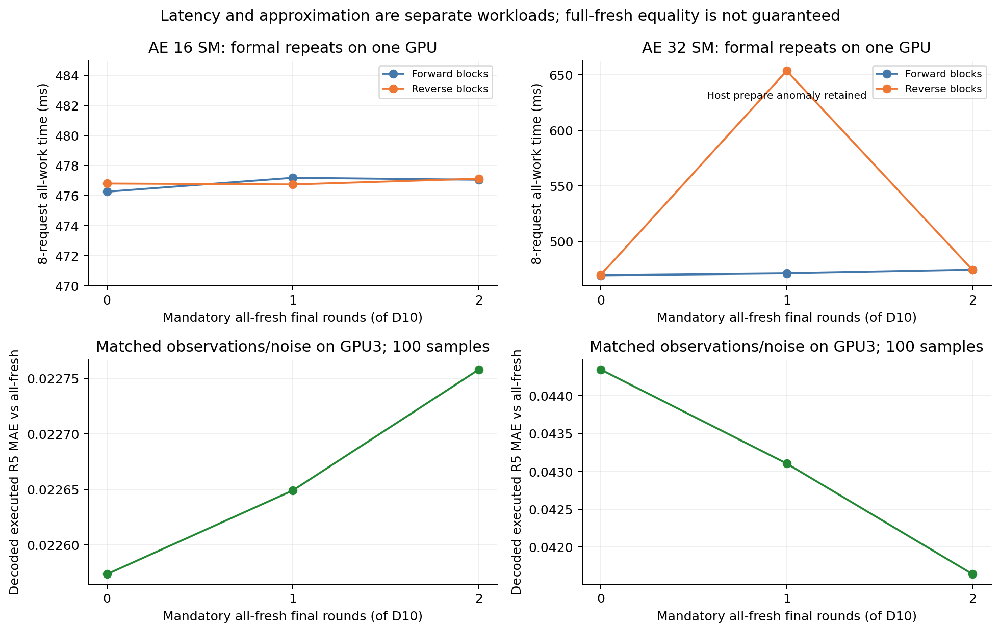

# π0.5 D10：最后1–2轮强制全新KV

状态：全部GPU数据及最终独立CPU审计已完成，GPU已释放；79,253项检查通过，无待补项。对应[方案](idea2_fresh_tail_plan_20261025.md)与[上一轮报告](idea2_progressive_kv_report_20261025.md)。

## 实验问题

在lead3逐层新旧KV兜底基础上，最后1/2轮AE等全部当前KV就绪，能否用少量等待修正早轮旧条件带来的动作偏差？保持完整π0.5 LIBERO、BF16主体、B1/H10/D10/R5、权重、噪声、采样日程与输入不变。

六配置：AE16/Prefix112或AE32/Prefix96 × fresh-tail 0/1/2。完整新KV的fresh18为对照。GPU2测SM16族，GPU3测SM32族，同族两轮独立进程按正反顺序比较；不能跨物理GPU宣称哪一种SM配额更快。

## 最小实现

旧runtime未修改，新增[adapter](../../../results/idea2/fresh_tail_20261025/adapter.py)。仅在捕获AE Graph时，于step9（tail1）或step8（tail2）的frontier snapshot之前插入对现有 `slot.layer_ready[-1]` 的external Event等待；后续同一AE stream上的轮次自然全部新鲜。

全新指18层K/V projection均完成，不要求最后VLM Attention/FFN完成。Pool仍使用独立的完整prefix_done Event负责发布与回收；两槽/Lease/epoch/generation、原子frontier和单层scratch保持不变。没有第三份完整KV、没有新增Host Worker或生产默认切换。

尾部等待计入该轮iteration跨度，单列 `fresh_tail_wait_ms` 是轮起点到等待后Event的跨度，包含少量Event/调度开销，不称纯硬件wait成本。tail0直接沿用旧捕获路径；force_old与非零tail互斥；末K轮frontier不是18则失败。

## 固定输入动作对照：已完成

从同任务真实轨迹收集100条唯一当前观测，每条绑定其实际上一观测和显式noise。六配置完全共用输入/噪声，参考为当前观测的全fresh串行输出；不拿自由闭环不同输入作数值对照。

| SM配额 | tail0执行R5 MAE | tail1 | tail2 | tail1/2相对改善 |
|---|---:|---:|---:|---:|
| AE16 / Prefix112 | 0.022574 | 0.022649 | 0.022758 | 未改善 |
| AE32 / Prefix96 | 0.044343 | 0.043104 | 0.041643 | 2.80% / 6.09% |

SM32 tail1/2分别有89/100、94/100输入的R5 MAE改善。平均偏差改善不保证最坏偏差改善；夹爪维仍出现约2的绝对差异，原动作范围约[-1,1]，没有自造事后阈值将其包装成一致。

SM16最后三轮原本已全部新鲜，因此新增最后1/2轮等待基本不改变读取条件。SM32 tail0最后两轮平均frontier约14.91/16，强制尾部有实际作用。前8/9轮积累的去噪状态仍不同，不能期望末轮全新等于整个fresh轨迹。

六配置共600条输出，48次matched-frontier串行oracle max/MAE均为0，预定实现容差max1e-5、MAE1e-6未放宽。该oracle只验证同一实际KV调度的实现，不证明fresh算法等价。原始输入/旧输入/noise SHA、decoded七维误差、H10/R5误差、frontier和资源分配全部留存。

固定早轮frontier的因果对照已完成：复用tail0实际十轮选择，只把最后1/2轮改18，排除并发时序造成的早轮frontier变化。其结果不作为实际并行延迟。

## 正式测量口径

每配置每轮100组×8请求、100连续请求、20预热，并含fresh18内部对照与实现oracle；反序复测。CPU→CPU为已准备runtime输入至解码CPU动作，完整组耗时另含准备/fill/drain；预热、捕获、加载不算稳态。真实闭环56case按配置分组，保持四suite×task0/5×init0×seed7和原client，禁止未来观测Encoder lookahead。

## 正式性能：末轮等待能否被遮住

正式进程中的fresh18内部对照仍使用该进程相同SM配额；闭环质量的fresh18则不限制SM。每臂每轮100组×8请求+100连续请求，两个lead共1800个测量输出/进程；12个有效进程合计21,600个测量输出、48个正式oracle。下表只比较lead3。A/B为正向与反向独立进程块，不是同capture逐请求切换tail；所有比较限制在同一资源族、同一物理GPU。

| 配额 / tail | 8请求总耗时 ms A/B | 连续Hz A/B | tail边界等待 ms A/B | AE结束−下一Encoder结束 ms A/B |
|---|---:|---:|---:|---:|
| SM16 / 0 | 476.258 / 476.802 | 18.008 / 17.985 | 0.000 / 0.000 | 3.569 / 3.534 |
| SM16 / 1 | 477.186 / 476.742 | 18.013 / 17.958 | 0.002 / 0.002 | 3.549 / 3.569 |
| SM16 / 2 | 477.055 / 477.127 | 17.993 / 17.985 | 0.002 / 0.002 | 3.560 / 3.577 |
| SM32 / 0 | 469.750 / 470.186 | 17.993 / 18.008 | 0.000 / 0.000 | -14.238 / -14.269 |
| SM32 / 1 | 471.437 / 653.692 | 17.965 / 12.244 | 3.350 / 3.327 | -10.840 / -37.274 |
| SM32 / 2 | 474.478 / 474.504 | 17.977 / 17.979 | 6.790 / 6.803 | -7.431 / -7.441 |

**SM32 tail2两轮相对tail0的8请求总耗时分别增加1.01%/0.92%；连续吞吐变化约−0.09%/−0.16%。** 其AE仍在下一Encoder结束前约7.4ms完成。SM16三者变化在约0.2%内，不能把这个量级当作稳定优化。

**首请求与稳态不同。** SM32配对短序列中，已准备输入至解码CPU动作的均值/P50/P95：tail0为54.41/54.43/54.87ms，tail2为55.14/54.52/60.73ms。按序号分解，第一个请求53.87→60.70ms，随后请求约54.5ms；流水线尚未填满时，约6.8ms尾部成本不能被遮住。不能用连续Hz证明单帧延迟无退化。峰值allocated约7.090GiB、reserved约7.61GiB，逐进程精确值见CSV；稳态重捕获0。

### tail1准备路径的异常保留

SM32 tail1的反序正式轮为653.69ms（首轮471.44ms），连续吞吐12.24Hz（首轮17.97Hz）。Host可见lookahead准备wall-time从24.86增至68.50ms（配对段800请求均值，包含每组末请求无lookahead时记0），下一Encoder晚于VLM完成26.02ms才启动；AE39.02/VLM42.71ms与正常轮基本相同。source、bank、配额32/96均相同，无GPU干扰记录。

追加独立进程20组诊断再次得到654.39ms、准备68.60ms，因此不是可以随手丢弃的单次测量。该20组单列，不混入100组正式结果。准备路径包含deepcopy/CPU变换、blocking .to(device)和GPU预处理，现有证据不能确定CPU调度、隐式同步或其他条件中的具体原因；也不能仅凭两次reverse慢就证明顺序因果。本轮保留tail1性能不稳定的结论，不顺带重构这条额外路径。详见[Host异常记录](../../../results/idea2/fresh_tail_20261025/host_anomaly_notes.json)。



## 固定早轮frontier：因果对照已完成

600次串行AE，使用相同100组输入/实际上一观测/noise，只改每个资源族tail0既有frontier的最后1/2项为18。200个tail0重放输出全部通过预定normalized/decoded容差，两份Prefix使用完即释放；它不是性能计时。

| 来源frontier族 | tail0 R5 MAE | 仅改末1轮 | 仅改末2轮 | R5改善输入数 tail1/2 |
|---|---:|---:|---:|---:|
| SM16 | 0.022574 | 0.022574 | 0.022574 | 0/100 / 0/100 |
| SM32 | 0.044343 | 0.042951 | 0.041587 | 92/100 / 96/100 |

SM16的100组输出在三schedule下完全相同；自然并发实验中那点MAE变化来自早轮frontier差异，不是末轮数学改变。SM32固定早轮后仍改善3.14%/6.22%，证明修正有效，但有8/4组R5 MAE变差；不是逐样本质量保证，也没有消除最大约2的夹爪偏差。

## 正确EGL映射下的56个闭环case

实际映射EGL0→GPU3、EGL1→GPU2；有效队列全部使用EGL1、GPU2、port19090、CPU0–15，渲染归属guard均通过。每配置8case按组执行，只捕获一次并在episode间reset，配置切换释放旧Graph，不缓存多份完整KV。共56个有效case、1,782次请求、48组bootstrap动作对照通过，server exit0、source unchanged。

| 配置 | 成功/8 | 总执行步数 | 单次steady RPC均值 ms | episode工作wall之和 s |
|---|---:|---:|---:|---:|
| fresh18 | 8/8 | 1181 | 106.95 | 155.18 |
| sm16_tail0 | 8/8 | 1217 | 103.73 | 164.42 |
| sm16_tail1 | 8/8 | 1210 | 103.12 | 152.54 |
| sm16_tail2 | 8/8 | 1219 | 103.74 | 162.46 |
| sm32_tail0 | 8/8 | 1342 | 93.73 | 165.51 |
| sm32_tail1 | 7/8 | 1381 | 98.93 | 162.23 |
| sm32_tail2 | 8/8 | 1232 | 101.36 | 150.56 |

SM32 tail2相对tail0总步数少8.20%，记录的episode工作wall少9.03%；但同步闭环没有下一Encoder lookahead，steady RPC均值93.73→101.36ms（约+8.1%）。这些是自由轨迹的描述性结果，不是同输入延迟A/B，wall也不含共享服务的一次性加载。小样本不能保证总体成功率无损。

**tail1的libero_spatial/task5/init0失败，220步，作为有效任务失败保留。** 没有重试到成功。平均MAE变好不保证闭环变好。SM32 tail2仍比fresh多51步、比SM16 tail0多15步；不能宣称已恢复原始算法质量，也不能用跨卡固定输入计时选全局最优。

## nsys机制核验

两条profile均通过真实Kernel区间/Graph ancestry归属和Green元数据审查：AE32 SM，VLM/Vision96 SM；ordinary contextId相同不能判断分区。第一个强制fresh轮的snapshot Kernel在当前VLM第18次release-publish完成后约5–9微秒启动，后续强制轮也全部位于该发布之后；每条trace的8/8请求末K轮frontier均18。这核验了所采集请求的当前generation就绪顺序。

| profile | AE×VLM真实Kernel交集 ms | AE最后Kernel−VLM最后Kernel ms | AE×下一Encoder |
|---|---:|---:|---:|
| tail1 | 35.991 | +1.284 | 0 |
| tail2 | 32.224 | +4.391 | 0 |

这里profile的下一Encoder零交集不能外推稳态：nsys将AE Host提交放大至约18–20ms，下一Encoder提交晚约18–24ms，正式无profiler时仅约0.002ms。所有正式速度来自独立计时，不用profile绝对端点替代。nsys未导出可用Event device timestamp；等待数值来自runtime CUDA Event，不伪称独立Event实测。

- [tail1 nsys](../../../nsys/idea2_experiment/fresh_tail_sm32_tail1_lead3_encoder_20261025_v1.nsys-rep)
- [tail2 nsys](../../../nsys/idea2_experiment/fresh_tail_sm32_tail2_lead3_encoder_20261025_v1.nsys-rep)
- [机制JSON](../../../results/idea2/fresh_tail_20261025/trace_analysis/mechanism_summary.json)、[KV-ready顺序CSV tail2](../../../results/idea2/fresh_tail_20261025/trace_analysis/sm32_tail2/fresh_tail_ready_ordering.csv)

## 本轮决策与后续方向

**保留SM32 + lead3 + tail2为研究候选，SM16 + lead3 + tail0继续作为主线对照，不修改生产默认。** 方向1获得了可重复的小幅动作修正，并能利用Encoder窗口减少稳态成本；它没有解决早轮旧条件、最坏动作差异或所有Host准备路径。

下一步比继续堆末轮数更值得验证的是：利用SM32尚有约7ms的窗口余量，将AE启动从领先3层推迟到领先6层，让新KV更早影响去噪。该组合本轮未测，不能先宣称有收益。若要替换主线，应再做同卡SM16/tail0与SM32/tail2或lead6的直接对照，并扩到更多任务/init；本轮8case只能筛选。

附加数据：[固定frontier因果CSV](../../../results/idea2/fresh_tail_20261025/counterfactual_gpu3/summary.csv)、[逐输入因果效果](../../../results/idea2/fresh_tail_20261025/counterfactual_gpu3/paired_tail_effects.csv)、[闭环case CSV](../../../reports/idea2_fresh_tail_20261025/cases.csv)、[episode工作与吞吐口径](../../../reports/idea2_fresh_tail_20261025/quality_work.csv)。

## 结果与复现入口

- [manifest](../../../results/idea2/fresh_tail_20261025/manifest.json)，[CPU设计审查](../../../results/idea2/fresh_tail_20261025/design_audit.md)，[snapshot hook检查](../../../results/idea2/fresh_tail_20261025/cpu_hook_audit.json)。
- [性能CSV](../../../reports/idea2_fresh_tail_20261025/performance.csv)，[逐轮含等待跨度](../../../reports/idea2_fresh_tail_20261025/iterations.csv)，[尾部相对比较](../../../reports/idea2_fresh_tail_20261025/tail_comparisons.csv)。
- [固定100输入摘要](../../../results/idea2/fresh_tail_20261025/matched100_gpu3/quality_summary.json)，[分维动作CSV](../../../results/idea2/fresh_tail_20261025/matched100_gpu3/quality.csv)，[GPU3释放与cleanup凭证](../../../results/idea2/fresh_tail_20261025/MATCHED_READY.json)。

计时环境固定`CUDA_DEVICE_MAX_CONNECTIONS=32`，`OMP_NUM_THREADS=2 MKL_NUM_THREADS=2 OPENBLAS_NUM_THREADS=2`，`JAX_PLATFORMS=cpu JAX_PLATFORM_NAME=cpu`，`PYTHONPATH=.:policies/openpi/src`及原OPENPI_DATA_HOME。JAX必须固定CPU，避免其预分配GPU显存。独占GPU后以新输出目录复现单臂：

```bash
cd /root/nfs/embodied/benchmark
export CUDA_VISIBLE_DEVICES=GPU-555cde36-5e41-bc44-0c69-ea47358fd703
export CUDA_DEVICE_MAX_CONNECTIONS=32
export OMP_NUM_THREADS=2 MKL_NUM_THREADS=2 OPENBLAS_NUM_THREADS=2
export JAX_PLATFORMS=cpu JAX_PLATFORM_NAME=cpu
export PYTHONPATH=.:policies/openpi/src
export OPENPI_DATA_HOME=/root/nfs/embodied/benchmark/shared/checkpoints/openpi
taskset -c 96-111 policies/openpi/.venv/bin/python -u \
  -m results.idea2.fresh_tail_20261025.adapter \
  --checkpoint shared/checkpoints/openpi/pi05_libero_pytorch_idea2 \
  --gpu-uuid GPU-555cde36-5e41-bc44-0c69-ea47358fd703 \
  --output results/idea2/fresh_tail_reproduce_sm32_tail2 \
  --ae-sm-min 32 --fresh-tail-steps 2 \
  --bank results/idea2/progressive_kv_20261025/same_task_bank.pkl \
  --conditions 3/encoder 18/encoder \
  --pairs 100 --length 8 --continuous 100 --warmup 20 --verify-count 2
```

反序加`--reverse`；实际矩阵及父进程执行命令/source snapshots见manifest引用receipt。稳态性能与nsys分开，profile绝对耗时不能替代正式结果。

## 排除项与边界

- GPU0外部进程反复启动：一次preflight拒绝，一次加载期被watchdog终止我方child，均无测量数据；外部进程未被干涉。本轮余下任务排除GPU0，迁到GPU2/3。
- 首次matched gate漏带CPU-JAX环境而OOM，零动作输出；保留原log/receipt，补齐环境以新目录重跑，不能算算法任务失败。
- 旧`closedloop_gpu2`首case虽任务成功，但EGL0实际在GPU3渲染，归属guard未通过，整个旧运行按技术无效排除；改用EGL1后以新目录重跑。该次我方错误映射的渲染还触发GPU3 `formal_gpu3_sm32_tail1_repeat`加载期G进程guard，零测量行，保留排除；有效替代为`formal_gpu3_sm32_tail1_repeat_retry`，其653.69ms慢结果没有排除。
- GPU2/GPU3 grouped质量旧计划均保留；唯一有效质量执行目录为`closedloop_gpu2_eglmap`，不重复计数planned-only输出。
- 固定输入动作MAE与小样本闭环成功是不同证据；56case不是完整LIBERO评估。此次未重测摄像头到达SLO，不能据稳态加速宣称观测年龄无退化。

独立审计：[final_audit.json](../../../results/idea2/fresh_tail_20261025/final_audit.json)、[审计说明](../../../results/idea2/fresh_tail_20261025/final_audit.md)。

完整已执行命令：[复现命令](../../../reports/idea2_fresh_tail_20261025/reproduction_commands.md)、[复现索引](../../../reports/idea2_fresh_tail_20261025/reproduction_index.json)。
