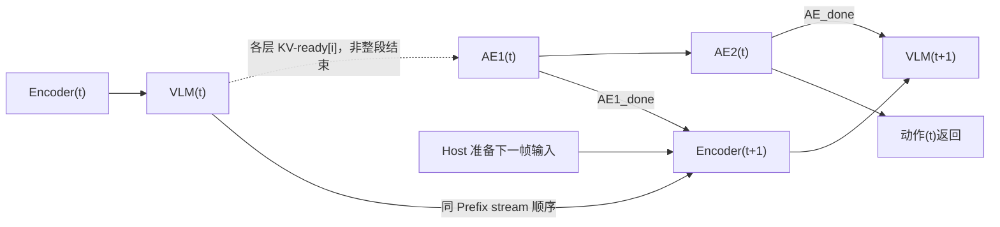
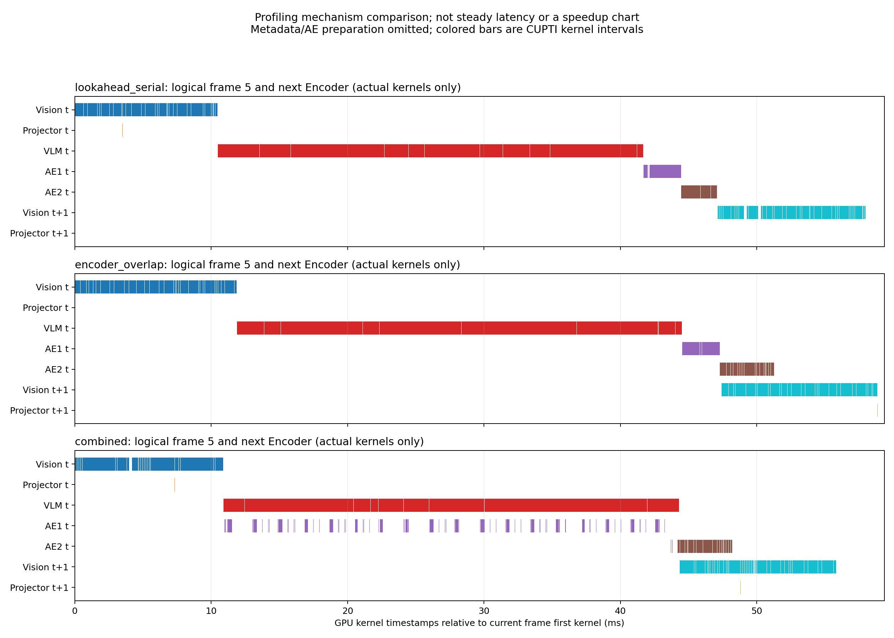
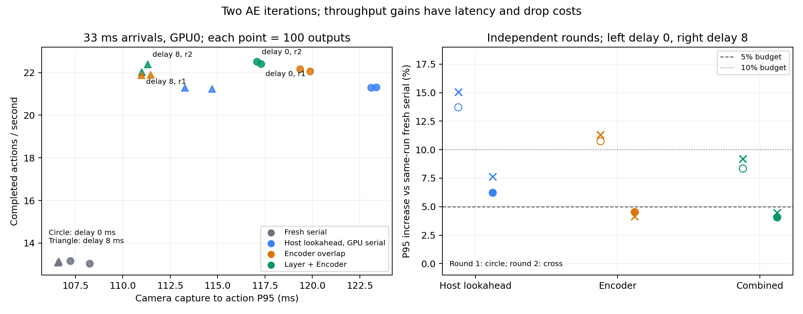

# π0.5 idea2：两步 AE 逐层流水线与跨帧 Encoder 重叠实验报告

实验日期：2026-10-23～2026-10-24。本文整理已完成的代码、正式计时、独立复测和 Nsight Systems 证据；本次文档整理没有重新运行 GPU 实验。

**结论：逐层 KV-ready 和下一帧 Encoder 两条路线都实现了真实 GPU Kernel 重叠，组合后有可重复的小幅净收益，但尚未完全隐藏 AE 开销。** 大幅吞吐提升主要来自提前准备下一帧输入；在相同 Host 准备策略上，Encoder 重叠额外加速约 3%，组合方案约 4.2%～4.5%。

在 33 ms 到达间隔下，组合方案推迟 8 ms 选取下一帧后，两轮独立测试达到 22.03 / 22.38 次动作输出每秒；相对同轮串行的帧延迟 P95 增加 4.09% / 4.47%，均落在预设的 5% 预算内。这是当前工作负载下的候选配置，不是所有帧率和延迟目标下的统一最优解。

## 1. 实验边界与术语

本轮按后续讨论固定为 **两次 AE Flow Matching 迭代**，不把早期 1/5/10 步实验混入本轮加速比。早期运行时优化、compile 消融和旧 KV 路线见[前一轮 CEWP 报告](idea2_cewp_20261021.md)。

| 项目 | 本轮配置或约束 |
|---|---|
| 模型 | π0.5 `pi05_libero`；VLM `gemma_2b`，AE `gemma_300m` |
| 动作 | `action_horizon=10`，模型内部 `action_dim=32` |
| 迭代 | 两次，时间节点 1.0 / 0.5，`dt=-0.5`；保留原时间值、dtype 和更新路径 |
| 精度 | 模型 BF16；保留原有浮点类型与舍入路径 |
| GPU | RTX 4090；GPU1 用于主要单帧/资源消融，GPU0 用于跨帧独立复测 |
| 软件 | PyTorch 2.7.1+cu126、CUDA runtime 12.6、Transformers 4.53.2 |
| 正式匹配配置 | 显式 `CUDA_DEVICE_MAX_CONNECTIONS=32`，OMP/MKL/OpenBLAS 线程数均为 2；连接数消融另行记录 |
| 输入 | 13 个观测交替；后续匹配实验使用与所选观测绑定的噪声种子，周期 13 |
| 允许修改 | 调度、Graph、准备工作、诊断及实验程序 |
| 排除内容 | Draft/Verify、token/残差复用、跳层、额外减少迭代、模型结构/权重修改 |

本文的 **Prefill = Vision Encoder/投影/embedding + VLM 语言模型 Prefill**。为避免混淆，下文“VLM 阶段”专指后半段语言模型计算，不包含 Vision Encoder。“AE1/AE2”分别指第一次、第二次完整去噪迭代，不是两个 Transformer layer。

新旧路线的语义必须分开：

| 路线 | AE 使用的 KV | 正确性参考 |
|---|---|---|
| 保留的旧路线 O | 上一观测的完整 KV，后台构建下一份 | 相同旧 KV、当前 state/noise 的串行输出 |
| 新路线 A/B/组合 | 当前所选观测的 KV | 相同当前观测、state/noise 的 eager 串行输出 |

新路线没有把不同帧的层 KV 混在一起。固定到达测试允许不同调度选择不同 `source_id`，每个输出按其实际来源验证；不能把选中了不同图像的两个输出直接做误差比较。

## 2. 技术路线：从完整快照到两段重叠

### 2.1 路线 O：保留完整旧 KV + 下一份 Prefill

旧路线继续由 AE 读取已完成的旧快照，另一槽构建新快照。此前效果较好的配置是：AE 与 Vision 重叠，VLM 等 AE 完成；下一请求消费前等待上一份完整 Prefill，防止反复消费更老的快照。

这条路线能提早返回动作，但动作所依赖的视觉条件有一帧偏移。因此本文将它单列，不以其约 43.68 ms 的响应时间证明同帧推理也达到了该延迟。

### 2.2 路线 A：同帧逐层 KV-ready → AE1

VLM 第 `i` 层完成用于缓存的 K/V 计算、位置处理和原有 cache update 后，该层 KV 已可交给 AE；无需等待这一 VLM block 的剩余计算或全部 VLM 层结束。

实现位于 [layer_graphs.py](../../../preparations/idea2/layer_graphs.py)：

1. 冷捕获期间，在原始 `DynamicCache.update()` 返回后记录对应层的外部 CUDA Event；原始计算照常执行。
2. AE1 通过只读 `WaitingCache` 在首次读取该层 KV 前插入 GPU Event wait；同一层的第二次读取不重复插入等待。
3. AE1 始终持有同一 `(slot, epoch, generation)` 的部分 Lease；未完成的层不能提前读取。
4. AE2 等 AE1 完成动作更新后执行，此时所需各层 KV 已生成，继续使用同一份 KV。

对照包括完整 Prefix gate、block-ready、KV-ready，以及每 1/2/4 层成组放行。逐层等待在 GPU 上执行，没有在每一层调用 CPU `synchronize()`。

AE2 的第一个 layer 仍依赖 AE1 最后一个 layer 及 Euler 更新，不能因为两轮模型相同就越过这条数据依赖。短诊断中，预热后的串行 AE1/AE2 Event 跨度约 2.58 / 2.52 ms；第二轮并不免费。该诊断样本较少，只用于解释迭代成本，正式排名使用后文的 100 对测量。

### 2.3 路线 B：AE2 与下一帧 Vision Encoder 重叠

在当前 AE 已提交后，Host 可以提前准备下一帧。下一帧 Encoder 放在 Prefix stream 上，等待当前 `AE1_done`；下一帧 VLM 则等待当前 `AE_done`。最多提前接收一帧。

这利用的是 **AE2(t) × Encoder(t+1)** 的窗口。若下一帧尚未到达，或 CPU 准备来不及赶上窗口，就不会发生这段重叠；调度器不能凭空创造未来输入。

为分离 CPU 准备与 GPU 重叠收益，设置四个实验模式：

| 模式 | 提前准备下一帧 | 当前帧 AE1 | 下一帧 Encoder 等待 |
|---|---|---|---|
| `fresh_serial` | 否 | 完整 Prefill 后执行 | 无跨帧提前提交 |
| `lookahead_serial` | 是 | 完整 Prefill 后执行 | 当前 AE 全部完成 |
| `encoder_overlap` | 是 | 完整 Prefill 后执行 | 当前 AE1 完成 |
| `combined` | 是 | 逐层 KV-ready 后执行 | 当前 AE1 完成 |

后三个模式采用相同 Host 提前准备策略。`lookahead_serial` 是隔离 GPU 重叠贡献的关键控制组。

### 2.4 组合路线的依赖关系



图表示依赖，不表示时间比例。AE1 可以在 VLM 尚未完成时执行；下一帧 Encoder 同时受准备完成、AE1 完成和 Prefix stream 顺序约束。AE2 与当前 VLM 最后部分可能仍有少量尾部重叠，不能把“第二轮主要与下一帧 Encoder 重叠”解释为强制互斥。

实现仍是 **一个 Python 调度 Host + 两条显式 CUDA stream**，不是两个 Python 进程分别发射 Kernel。Graph replay 减少逐算子 Host 提交后，本轮没有证据要求再引入双 Host Worker。

## 3. 正确性、Graph 与 Event 生命周期

Event 的作用是建立先写后读和复用顺序，本身不会预留 GPU 资源，也不保证两个 Kernel 一定同时执行。

| 不变量 | 实现方式 |
|---|---|
| 只有两个完整 KV 槽 | 原 Pool 上扩展部分 Lease；没有隐藏第三份完整 KV |
| Pool 只有一个修改者 | reserve、publish、acquire、release、retire/reset 均由调度 Host 操作 |
| 不混合 KV 版本 | Lease 和 Event 绑定 slot/epoch/generation；replay 前校验提交身份 |
| 不覆写仍被读取的槽 | 读者完成与生产者完成分别记录，均满足后才能复用 |
| Graph 地址正确 | 每槽独立 Graph；输入内容更新后 replay 本槽地址，不复用另一槽旧地址 |
| 不共享可写 Graph scratch | 每槽 Vision/VLM/AE 使用独立静态缓冲与私有 Graph pool |
| 捕获不进入稳态 | 先预热再捕获；正式结果中重捕获计数为 0 |
| reset 安全 | 活跃 Lease 拒绝 reset；Encoder-only 已提交工作也必须排空；旧 epoch 无效 |

整段两步 AE Graph 每槽一份；按迭代拆分的消融为两份。不能直接将第一轮 Graph 原样 replay 为第二轮：两轮的时间条件不同，需要对应的静态条件或正确更新输入。本轮测试了分步 Graph，没有观察到足以替换整段 Graph 的稳定收益。

捕获期临时 hook 会恢复，正常 replay 不再执行这些 Python hook。返回动作使用稳定输出；必要的 D2H、输出前等待、槽回收和关闭等待保留。

相关代码：[external_events.py](../../../preparations/idea2/external_events.py)、[layer_scheduler.py](../../../preparations/idea2/layer_scheduler.py)、[layer_lifecycle.py](../../../preparations/idea2/layer_lifecycle.py)。

## 4. 测量方法：哪些数字可以比较

| 指标 | 定义与使用限制 |
|---|---|
| CPU 提交耗时 | Host 进入/退出提交函数的 wall time；不等同 GPU 计算量 |
| CUDA Event 跨度 | 包含 stream 等待、提交间隙和竞争；AE 跨度可能包含等待 KV 的时间 |
| 模型完成跨度 | 从 Encoder 输入 staging 前到当前帧 AE/Prefill 均完成；不等同 Kernel busy time |
| CPU→CPU 延迟 | 包括输入准备、提交、等待、输出搬运和后处理；跨帧时与所选帧的 admission 相关 |
| capture→action | 相机帧产生到动作返回，包含帧等待/排队；本文 SLO 使用其 P95 |
| 完整轨迹吞吐 | 包含 fill/drain/reset 后的每秒动作输出；其倒数不是逐帧响应延迟 |
| KV source-frame lag | KV 来源相对该动作所选观测的偏移；为 0 不代表图像年龄为 0 |
| Kernel overlap | nsys 中实际 GPU Kernel 时间区间的交集，不使用 NVTX 交集替代 |

单帧正式实验每轮 100 对 AB/BA 交替测量，另做每臂 100 次连续请求。容量实验每轮 100 对四臂轨迹，每轨迹 16 帧，另做每臂 100 次连续请求；固定到达实验每臂 100 次连续请求。关键配置在同一物理 GPU 上独立复测，跨帧复测反转模式顺序，reset 间隔为 50。

预热通常为 10 次，预热/捕获不计入正式延迟。性能与 nsys 分开采集；profile、初筛、失败结果保留，但不用于正式性能排名。GPU0/GPU1 分开统计，不跨卡拼接分子和分母。容量模式没有相机 capture 时间，不参与相机 SLO。

周期相机回放采用“接收前取最新帧”，已接收帧不替换；不同模式可能丢弃不同观测。P95 衡量已返回动作，必须同时看吞吐和丢帧，不能当成所有收到帧的服务保证。

## 5. 按推进顺序看优化与结果

### 5.1 先解决 Host 发射开销，不能只改提交顺序

检查当前后端 `build_prefix()` / `generate()`，正常计算路径没有全设备 `cuda.synchronize()`、`.item()`、`.cpu()` 或 `nonzero`。输入准备和最终输出搬运另有必要同步，未删除。早期双流近似串行不能仅归因于某个显式同步调用。

同 GPU1 的独立模块测量，均为 P50/ms：

| 模式 | AE CPU 提交 | AE Event 跨度 | Prefill CPU 提交 | Prefill Event 跨度 |
|---|---:|---:|---:|---:|
| eager | 51.104 | 51.045 | 65.563 | 78.030 |
| 原 Graph | 0.238 | 6.458 | 1.001 | 41.692 |
| Graph + 固定条件准备 | 0.233 | 5.490 | 1.022 | 41.495 |

这支持“eager 存在明显 Host 提交开销”的判断。Event 跨度变短不全是 Kernel 自身加速，还包含发射间隙被消除；单模块 duty cycle/时钟也可能与连续整请求不同。

原始两步矩阵中的旧 KV 调度对照如下。该矩阵使用 1701…1800 非循环噪声种子，表内规则相同；不要与后续周期 13 的匹配结果混算贡献。

| 模式 | CPU→CPU P50/ms | 每 100 请求的 Prefill 提交数 | 平均 KV 帧偏移 |
|---|---:|---:|---:|
| eager 串行 | 164.692 | 100 | 1.00 |
| eager `ae_first` | 152.511 | 100 | 1.00 |
| eager `prefill_first` | 151.878 | 100 | 1.00 |
| Graph 串行 | 79.580 | 100 | 1.00 |
| Graph 全重叠 `ae_first` | 41.113 | 53 | 2.36 |
| Graph 全重叠 `prefill_first` | 40.994 | 55 | 2.27 |

最后两行虽然动作返回快，但 Prefill 更新覆盖不足、连续运行消耗更老 KV，已从满足时效性要求的收益排名排除。单纯交换提交顺序没有解决这一问题。

证据：[独立模块](../../../results/idea2/layer_pipeline_20261023/d2_isolated/result.json)、[准备后的独立模块](../../../results/idea2/layer_pipeline_20261023/d2_isolated_prepared/result.json)、[原始矩阵](../../../results/idea2/layer_pipeline_20261023/d2_original_and_full_graph/result.json)。

### 5.2 路线 A：单帧逐层流水线收益可重复，但幅度较小

GPU1、相同完整 GPU 资源、整段 AE Graph、显式 connections=32：

| 连续请求指标 | 第一轮串行 | 第一轮 KV-ready | 复测串行 | 复测 KV-ready |
|---|---:|---:|---:|---:|
| 模型完成跨度 P50/ms | 46.752 | 45.913 | 46.723 | 45.880 |
| VLM 阶段跨度 P50/ms | 31.180 | 32.985 | 31.149 | 32.965 |
| CPU→CPU mean/ms | 77.048 | 76.981 | 77.364 | 76.015 |
| CPU→CPU P50/ms | 76.515 | 76.054 | 76.355 | 75.257 |
| CPU→CPU P95/ms | 79.286 | 80.954 | 81.368 | 78.167 |

两轮模型完成跨度 P50 都缩短约 **0.84 ms**，同时 VLM 自身变慢约 1.8 ms。配对结果进一步支持小幅净收益：

| 100 对匹配指标 | 第一轮 | 独立复测 |
|---|---:|---:|
| 模型平均节省/ms | 0.938 | 0.898 |
| 模型平均节省 bootstrap 95% 区间/ms | [0.887, 1.000] | [0.869, 0.928] |
| 逐对模型加速比 P50 | 1.0198× | 1.0196× |
| CPU 平均节省/ms | 1.482 | 1.485 |
| CPU 平均节省 bootstrap 95% 区间/ms | [1.024, 1.997] | [0.492, 2.626] |

配对平均差值、两组总体 P50 之差和连续请求结果不是同一个统计量。第一轮连续 CPU P95 还出现退化，因此不能宣称单帧流水线改善了所有延迟分位数。

证据：[单帧复测 JSON](../../../results/idea2/layer_pipeline_20261023/singleframe_repeat_analysis.json)、[连续指标 CSV](../../../results/idea2/layer_pipeline_20261023/singleframe_repeat_analysis.csv)。

### 5.3 与原生 π baseline 的关系

以下都是两步、当前帧语义的独立运行结果，作为运行时性能参考；各项差值不可相加拆成严格的优化贡献。

| 配置 | CPU→CPU P50/ms | 说明 |
|---|---:|---|
| 原生 OpenPI JAX | 85.261 | P95=88.866 ms，100 次；独立运行时参考 |
| Torch fresh eager | 162.603 | 后续显式周期 13 的匹配输入配置 |
| Torch fresh 原 Graph | 80.188 | 同上 |
| Graph + 准备优化 fresh 串行 | 78.769 | 后续调度的准备基础 |
| 本轮逐层流水线 | 76.054 / 75.257 | 两次独立连续测试 |

相对原生 JAX，当前单帧 CPU P50 的参考加速约 1.12～1.13×，其中包含运行时、Graph 和准备工作的收益；不能全部归于逐层并行。JAX 只检查自身 repeatability，不作为 Torch 的跨框架逐位等价 oracle。原生计时边界不包含预先构造 noise 的成本，详见[原生结果](../../../results/idea2/layer_pipeline_20261023/d2_native_jax/result.json)。

### 5.4 路线 B 与组合：多数吞吐收益来自 Host 提前准备

GPU0 容量实验，两轮各 100 对四臂轨迹。下表加速比先对每条匹配轨迹计算，再取 P50，包含 fill/drain。

| 对照 | 第一轮 | 反向顺序独立复测 |
|---|---:|---:|
| Host 提前准备相对 `fresh_serial` | 约 1.58× | 约 1.58× |
| Encoder 重叠相对 `lookahead_serial` | 1.0297× | 1.0306× |
| 组合相对 `lookahead_serial` | 1.0424× | 1.0449× |

对应每臂 100 次连续输出的吞吐如下：

| 模式 | 第一轮/Hz | 复测/Hz |
|---|---:|---:|
| `fresh_serial` | 13.083 | 12.925 |
| `lookahead_serial` | 21.111 | 21.131 |
| `encoder_overlap` | 21.827 | 21.814 |
| `combined` | 22.256 | 22.455 |

输入准备约 30 ms，有机会在当前 GPU 工作期间完成，因而 Host lookahead 本身贡献很大。约 13→22 Hz 不能全部解释为 AE 与 VLM 在 GPU 上互补；隔离 Host 因素后，GPU 调度的额外收益仍是几个百分点。

证据：[同卡复测汇总](../../../results/idea2/layer_pipeline_20261023/slo_repeat_analysis.json)、[容量配对比值](../../../results/idea2/layer_pipeline_20261023/report_final_20261024/paired_ratios.csv)。

## 6. nsys：为什么确实并行，收益仍然不大

三个匹配的 crossframe profile 各包含 8 帧，性能计时与 profile 分开。下表是实际 Kernel 区间统计，不能当稳态端到端延迟：

| Profiling 指标/ms | Host lookahead、GPU 串行 | 仅 Encoder 重叠 | 逐层 + Encoder 组合 |
|---|---:|---:|---:|
| AE1 × 同帧 VLM，每请求交集 | 0 | 0 | 5.708 |
| AE2 × 下一帧 Vision，每相邻帧机会交集 | 0 | 2.569 | 1.833 |
| AE1 Kernel busy，每请求 | 2.682 | 2.691 | 5.745 |
| AE2 Kernel busy，每请求 | 2.656 | 3.312 | 3.181 |

组合方案的 AE1 Kernel busy 超过串行的两倍；匹配到同一签名的 AE FFN 累计耗时约为串行的 **2.620×**。VLM 自身也变慢，因此重叠区间不能直接作为节省时间相减。

两个重叠 profile 均完成 Graph/帧身份归属校验；三模式匹配到的 2090 种 Kernel 签名调用量一致。所有 7 个相邻帧均满足下一帧 VLM 首 Kernel 晚于当前 AE 末 Kernel。Encoder 重叠出现在 6/7 个机会，组合为 5/7；未宣称每帧必然命中窗口。



这支持三个判断：

- **逐层 Event 已经有效。** VLM 全部完成前 AE 就能执行，问题不再是只有 NVTX 在重叠。
- **负载不同不意味着资源互不干扰。** 相同 Kernel 的持续时间增加，说明竞争成本真实存在。未采集足够的硬件计数器来拆分 SM、cache、DRAM 等贡献，不能精确断言某一种资源占比。
- **选择性重叠比追求最大交集更有意义。** 需要比较两个分支的总完成时间和动作时效，而不是仅最大化 overlap 百分比。

另有一次 Encoder 窗口未命中：下一 Vision 的 Host GraphLaunch 开始时，AE 已结束约 0.480 ms，此例属于提交已晚。nsys 将 AE Host 提交从非 profile 的约 0.26 ms 放大到约 3.8～4.1 ms，因此不能只凭这一 profile 个例决定引入双 Host Worker。

证据：[组合逐帧分析](../../../results/idea2/layer_pipeline_20261023/crossframe_combined_trace_analysis/crossframe_findings.json)、[逐帧依赖](../../../results/idea2/layer_pipeline_20261023/crossframe_combined_trace_analysis/frame_dependency_evidence.csv)、[Host 提交诊断](../../../results/idea2/layer_pipeline_20261023/crossframe_host_submission_diagnostic.json)。这些 trace 是 **delay0 容量实验**，不证明后文 delay8 配置的具体重叠时长。

## 7. 资源划分、启动时机和 Graph 消融

### 7.1 Green Context 改善了部分启动问题，但没有获得全局收益

| 配置 | 并发模型完成跨度 P50/ms | 证据边界 |
|---|---:|---|
| 普通双流、完整 GPU、connections32 | 45.913 | 正式结果，另有独立复测 |
| Green：AE16 / Prefix112，connections8 | 55.748 | 正式结果 |
| Green：AE16 / Prefix112，connections32 | 52.116 | 正式结果 |
| Green：AE32 / Prefix96 | 59.459 | 正式结果，旧运行未记录连接数 |
| Green：AE64 / Prefix64 | 76.146 | 正式结果，旧运行未记录连接数 |
| 仅限制 Prefix 到 120 SM，AE 普通 context | 49.593 | 20 对 + 30 连续，仅初筛 |
| 仅限制 Prefix 到 124 SM，AE 普通 context | 48.927 | 20 对 + 30 连续，仅初筛 |

在 16/112 配额下，显式 32 连接改善了启动和完成时间，但仍比不限额双流慢。旧 Green trace 中 AE 首 Kernel 比 VLM 首 Kernel 晚约 28.506 ms，新 connections32 trace 约为 0.033 ms，Host 提交时点基本相同；说明 GPU 侧启动/排队行为会影响并行。

旧 trace 没有保存连接数，不能把它标成“显式 connections8”。正式 8/32 对照另有记录；具体硬件队列映射尚未被证明。限制 Prefix 的初筛中，AE 使用普通 context，并非独占剩余 8/4 个 SM。

资源限制下的 overlap 必须同时对照不限额方案；只对照一个被限制而变慢的 serial，会夸大资源划分收益。本轮保留普通 stream，Green 配额不作为推荐默认。

### 7.2 分组放行、优先级与分步 Graph

| 配置 | 串行模型 P50/ms | 并发模型 P50/ms | 处理方式 |
|---|---:|---:|---|
| 每层 KV-ready、整段 Graph | 46.752 | 45.913 | 有独立复测，保留 |
| 每两层放行 | 46.773 | 45.874 | 差异小，未确认为稳定优胜 |
| 每四层放行 | 46.749 | 45.788 | 同上 |
| AE 高优先级 | 46.791 | 45.781 | 同上 |
| AE 按两次迭代拆 Graph | 46.737 | 45.885 | 未见实质额外收益 |

block-ready 的独立正式实验约为 46.763→46.282 ms，净收益小于 KV-ready 的观察值，但两者来自不同运行，不应把差值直接当严格配对贡献。没有为了约 0.1 ms 的跨运行差异重写调度器或引入自定义融合 Kernel。

本轮继承既有 Graph/固定条件准备路径。前一轮 compile-only / compile+Graph 曾因数值误差超门而未进入推荐；这些是 1/5/10 步的历史负结果，**不是本轮新增的两步 compile 正式验证**。本轮没有宣称 compile、QKV 打包或自定义融合已取得新收益。

证据：[调度消融 CSV](../../../results/idea2/layer_pipeline_20261023/scheduling_ablation_checkpoint.csv)、[资源比较](../../../results/idea2/layer_pipeline_20261023/formal_resource_comparison.json)、[完整单帧表](../../../results/idea2/layer_pipeline_20261023/report_final_20261024/layer.csv)。

## 8. 吞吐与帧延迟：用到达过程选择调度

### 8.1 四种到达速率

| 到达间隔 | 观察结果 | 对调度的含义 |
|---|---|---|
| 154 ms | 均约 6.52 Hz、零丢帧，无提前接收机会 | 受输入速率限制，重叠没有吞吐优势 |
| 77 ms，window0 | 均约 13 Hz、零丢帧；Encoder 的 P95 两轮波动较大 | 不能声称 Encoder 重叠稳定满足 10% 预算 |
| 62 ms，window15 | 提前准备的三臂约 16.1 Hz、零丢帧，P95 约 105～107 ms；串行约 13 Hz、P95 134～136 ms、约 19% 丢帧 | Host 提前准备很有效，三种 GPU 调度的 P95 名次会翻转 |
| 33 ms，window0 | 串行来不及处理输入；组合可提高输出率，但已接收帧排队更久 | 需要明确吞吐、丢帧和帧延迟预算 |

`lookahead-window-ms=0` 表示立即尝试一次接收，不是禁止提前准备。正 window 允许等待未来帧到达，并在 AE 完成时停止等待；一旦开始预处理，其耗时仍完整计入返回延迟。

### 8.2 8 ms 延迟选帧的作用

高负载时，过早固定下一帧会增加这帧在动作返回时的年龄。新增 `--lookahead-delay-ms 8`，在当前 GPU 工作期间稍后再选取最新帧；它不新增缓冲、不更换已持有 Lease 的观测，也不修改 Graph 依赖。默认值仍为 0。

延迟期间 AE 完成可提前结束等待。8 ms 延迟结束后才开始原有 window 的等待预算；实际延迟、预处理和输出时间全部计入测量。这是 **Host 选帧策略**，不是证明 GPU 竞争被消除了。

33 ms 到达、window0、delay8，两轮各模式 100 次：

| 模式 | 吞吐 Hz：首轮 / 复测 | capture→action P95 ms：首轮 / 复测 | 丢帧比例：首轮 / 复测 |
|---|---:|---:|---:|
| `fresh_serial` | 13.143 / 13.088 | 106.630 / 106.558 | 56.28% / 56.47% |
| `lookahead_serial` | 21.296 / 21.245 | 113.261 / 114.702 | 29.37% / 29.37% |
| `encoder_overlap` | 21.898 / 21.889 | 111.474 / 110.977 | 27.34% / 27.34% |
| `combined` | 22.031 / 22.384 | 110.990 / 111.316 | 26.81% / 25.74% |

组合模式相同轮串行的 P95 增幅为 **4.09% / 4.47%**，两轮满足 5% 预算、不满足 2%。各臂每 100 次动作都完成 100 次 Prefill，Prefill 完成频率与动作输出频率一致，没有靠饿死 Prefill 获取收益。

对照立即选帧的组合方案：

| 33 ms 组合配置 | 吞吐 Hz：首轮 / 复测 | P95 ms：首轮 / 复测 | 相各自串行的 P95 增幅 |
|---|---:|---:|---:|
| delay0 | 22.405 / 22.520 | 117.286 / 117.079 | 8.34% / 9.18% |
| delay8 | 22.031 / 22.384 | 110.990 / 111.316 | 4.09% / 4.47% |

delay8 在对应轮次中 P95 低约 6.30 / 5.76 ms，吞吐略降、丢帧增加 2 / 1。delay0 与 delay8 是独立顺序运行，不是随机交替的配对开关消融；只能按两轮证据描述趋势，不能声称严格估计了单个开关的因果收益。



### 8.3 保守的 SLO 选择

在测试过的 0/2/5/10% 预算中，要求两轮都通过，组合模式结果如下：

| 场景 | 相 `fresh_serial` 的最小通过预算 | 相 `lookahead_serial` 的最小通过预算 |
|---|---:|---:|
| 62 ms、window15、delay0 | 0% | 2% |
| 77 ms、window0、delay0 | 5% | 5% |
| 33 ms、window0、delay0 | 10% | 0% |
| 33 ms、window0、delay8 | 5% | 0% |

“通过”仅表示两轮 100 样本测量满足该相对 P95 门槛，不是线上服务保证。77 ms 场景即使组合通过，吞吐仍受输入限制，不能据此说必须开启组合。33 ms 场景若允许 5% 退化，可考虑 delay8 组合；若允许 10% 且更重视吞吐，可考虑 delay0。更严格预算下，应保留串行或另行验证调度，不把已有结果外推。

证据：[固定到达 CSV](../../../results/idea2/layer_pipeline_20261023/report_final_20261024/arrival.csv)、[全部预算 CSV](../../../results/idea2/layer_pipeline_20261023/report_final_20261024/slo_budgets.csv)、[delay8 独立复测](../../../results/idea2/layer_pipeline_20261023/delay_repeat_analysis.json)。

## 9. 旧路线结果、正确性与限制

保留的旧 KV 最佳配置为 Graph + Vision-only + 等待上一份完整 Prefix + 固定条件准备 + AE 高优先级。两步连续 100 次的 CPU→CPU P50=43.683 ms、P95=44.364 ms；每请求都有 Prefill 提交，消费的 KV 偏移固定为一帧。

该模式的双分支完成 Event P50 仍约 78.808 ms，说明动作提前返回不等于本次后台新 KV 已完成。若调用方要求新 KV 也准备好，不能使用 43.683 ms 作为接口延迟。完整数据见[旧 KV 结果](../../../results/idea2/layer_pipeline_20261023/d2_old_kv_best/result.json)。

本轮验证包括：

- 正式 Torch 数值记录的动作 MAE/max error 均为 0，预定容差分别为 `1e-6 / 1e-5`；首步动作、最终动作、后处理动作及 KV digest 均有检查。
- 交替观测、两槽轮换、相同 Tensor 地址内容更新、episode reset、活跃 Lease 拒绝 reset、真实未完成 Encoder 的 reset 排空、旧 epoch 拒绝均有 CPU/GPU 证据。
- 正式稳态重捕获为 0；代表性组合峰值 Torch allocated 约 7.06 GiB、reserved 约 7.57 GiB。它们不是驱动总显存，逐模式数据保留在 CSV。
- 低负载测试发现并修复检查竞态：第一次 admission 判断后相机帧刚到达，或扫描 Event 时刚完成，可能误报无可回收 Slot。现在再次 retire/检查 FREE 槽后重试，真正无可回收工作仍报错；已有 CPU 回归和 400 次 GPU 请求复验。
- 84 项相关 CPU 检查通过，补报告 delay 字段后另复跑 18 项报告检查；不是 102 项互不重复的测试。

来源审查共 57 份 result，其中 51 份模型结果满足完整性检查；失败、probe 和 profile 依其用途单独处理。48 个 Torch 案例的三个模型源码快照与当前 SHA 一致，6 个旧案例缺少这组快照，保留未知；没有把缺失项当成通过，也没有重新 hash 全部权重文件。

这些结论限定于记录的 4090、输入集、两步推理和到达条件。没有验证真实机器人闭环成功率、任意输入动态 shape、所有 SM 配额或生产异常恢复。当前实现是可选实验 runner，未部署为生产策略服务。

## 10. 代码与实验产物索引

| 代码 | 职责 |
|---|---|
| [layer_graphs.py](../../../preparations/idea2/layer_graphs.py) | 每槽 Graph、KV-ready/block-ready、阶段 Event、只读 cache |
| [external_events.py](../../../preparations/idea2/external_events.py) | 跨 Graph 外部 Event 与运行时语义验证 |
| [layer_scheduler.py](../../../preparations/idea2/layer_scheduler.py) | 部分 Lease、generation/epoch 校验、准备工作和读写回收 |
| [layer_bench.py](../../../preparations/idea2/layer_bench.py) | 单帧匹配对照、提交/等待诊断、GPU 独占检查和数值门 |
| [layer_crossframe_bench.py](../../../preparations/idea2/layer_crossframe_bench.py) | 四臂、相机到达、window/delay、丢帧与时效性 |
| [layer_lifecycle.py](../../../preparations/idea2/layer_lifecycle.py) | 原地址更新、reset、旧 epoch 等真实 GPU 生命周期验证 |
| [green_context.py](../../../preparations/idea2/green_context.py) | SM 配额实验 |
| [layer_trace.py](../../../preparations/idea2/layer_trace.py) | 实际 Kernel 归属、重叠、阶段与签名比较 |
| [layer_report.py](../../../preparations/idea2/layer_report.py) | 完整性门、CSV、图表、SLO 与排除原因 |

既有后端/Graph sampler/CEWP/native baseline 等入口扩展了两步、匹配噪声和诊断兼容。没有为本轮修改模型数学结构；原有其他实验的子仓库改动未回滚。

产物根目录：`results/idea2/layer_pipeline_20261023/`。

| 产物 | 内容 |
|---|---|
| [report_final_20261024/report.json](../../../results/idea2/layer_pipeline_20261023/report_final_20261024/report.json) | 全量结果索引、计时与完成证据 |
| [layer.csv](../../../results/idea2/layer_pipeline_20261023/report_final_20261024/layer.csv) / [capacity.csv](../../../results/idea2/layer_pipeline_20261023/report_final_20261024/capacity.csv) | 单帧/容量结果，含模块与分支完成时间、CPU、内存、重捕获 |
| [arrival.csv](../../../results/idea2/layer_pipeline_20261023/report_final_20261024/arrival.csv) / [slo_budgets.csv](../../../results/idea2/layer_pipeline_20261023/report_final_20261024/slo_budgets.csv) | 帧延迟、吞吐、丢帧、KV 时效与预算 |
| [legacy.csv](../../../results/idea2/layer_pipeline_20261023/report_final_20261024/legacy.csv) / [native.csv](../../../results/idea2/layer_pipeline_20261023/report_final_20261024/native.csv) | 旧 KV 和原生对照，语义分列 |
| [excluded.csv](../../../results/idea2/layer_pipeline_20261023/report_final_20261024/excluded.csv) | 短测/profile/数值或时效性不合格等排除原因 |
| [slo_repeat_analysis.json](../../../results/idea2/layer_pipeline_20261023/slo_repeat_analysis.json) / [delay_repeat_analysis.json](../../../results/idea2/layer_pipeline_20261023/delay_repeat_analysis.json) | 按独立轮次核对预算，避免挑选幸运 P95 |
| [model_provenance_final.json](../../../results/idea2/layer_pipeline_20261023/model_provenance_final.json) | 源码/输入/参数来源、缺失项和原始噪声周期更正 |
| [final_audit.json](../../../results/idea2/layer_pipeline_20261023/final_audit.json) | 最终 24 项证据核对及限制 |
| [reproduction_commands.txt](../../../results/idea2/layer_pipeline_20261023/reproduction_commands.txt) | 完整运行、独立复测、旧路线、原生 baseline、nsys 命令 |

每个 case 的 `measurements.csv` / `result.json` / `source/` 保留逐请求 Event query、提交/等待、原始统计和冻结源码。缺失字段保持空值，不用 0 代替。

## 11. 复现与 trace 下载

在仓库根目录执行。选择当前空闲的单张 GPU，以下示例用 GPU0 的物理 UUID；正式对照和复测保持同一张卡。使用新输出目录，避免覆盖已有证据。

```bash
cd /root/nfs/embodied/benchmark
export IDEA2_GPU_UUID=GPU-c7bded27-f806-bb96-48ac-6c3ca5cf20d1
export CUDA_VISIBLE_DEVICES="$IDEA2_GPU_UUID"
export CUDA_DEVICE_MAX_CONNECTIONS=32
export OMP_NUM_THREADS=2 MKL_NUM_THREADS=2 OPENBLAS_NUM_THREADS=2
export PYTHONPATH=.:policies/openpi/src
export OPENPI_DATA_HOME=/root/nfs/embodied/benchmark/shared/checkpoints/openpi
export JAX_PLATFORMS=cpu JAX_PLATFORM_NAME=cpu
IDEA2_OUT=$(mktemp -d results/idea2/layer_pipeline_20261023/repro_md_XXXXXX)

# 单帧：100 对交替 + 两臂各 100 连续，含生命周期检查。
policies/openpi/.venv/bin/python -m preparations.idea2.layer_bench \
  --checkpoint shared/checkpoints/openpi/pi05_libero_pytorch_idea2 \
  --gpu-uuid "$IDEA2_GPU_UUID" --output "$IDEA2_OUT/layer" \
  --boundary kv_ready --group-size 1 --ae-layout whole \
  --warmup 10 --count 100 --continuous-count 100 --reset-every 50 \
  --hoist-modulation --lifecycle-audit

# 高负载四臂：相同 Host 策略，33 ms 到达，8 ms 延迟选帧。
policies/openpi/.venv/bin/python -m preparations.idea2.layer_crossframe_bench \
  --checkpoint shared/checkpoints/openpi/pi05_libero_pytorch_idea2 \
  --gpu-uuid "$IDEA2_GPU_UUID" --output "$IDEA2_OUT/arrival33_delay8" \
  --modes fresh_serial lookahead_serial encoder_overlap combined \
  --warmup 10 --pairs 0 --continuous-count 100 --reset-every 50 \
  --arrival-period-ms 33 --lookahead-window-ms 0 --lookahead-delay-ms 8 \
  --hoist-modulation
```

独立复测用新进程、新 `--output`，将模式顺序反转为 `combined encoder_overlap lookahead_serial fresh_serial`。容量实验使用 `--arrival-period-ms 0 --lookahead-delay-ms 0 --pairs 100 --pair-length 16`；保留其余一致配置。完整命令和单独的 nsys 采集见上方复现清单，本轮报告不混用 profile 延迟。

| 代表性 trace | 用途 |
|---|---|
| [d2_a2_serial_profile_20261023_v1.nsys-rep](../../../nsys/idea2_experiment/d2_a2_serial_profile_20261023_v1.nsys-rep) | 同帧串行控制 |
| [d2_layer_kv_ready_20261023_v1.nsys-rep](../../../nsys/idea2_experiment/d2_layer_kv_ready_20261023_v1.nsys-rep) | 同帧逐层 KV-ready |
| [d2_crossframe_serial_profile_20261023_v1.nsys-rep](../../../nsys/idea2_experiment/d2_crossframe_serial_profile_20261023_v1.nsys-rep) | 相同 Host lookahead、GPU 串行 |
| [d2_crossframe_encoder_profile_20261023_v1.nsys-rep](../../../nsys/idea2_experiment/d2_crossframe_encoder_profile_20261023_v1.nsys-rep) | AE2 × 下一帧 Encoder |
| [d2_crossframe_combined_profile_20261023_v1.nsys-rep](../../../nsys/idea2_experiment/d2_crossframe_combined_profile_20261023_v1.nsys-rep) | 组合机制，delay0 容量实验 |
| [d2_a2_sm16_conn32_profile_20261023_v1.nsys-rep](../../../nsys/idea2_experiment/d2_a2_sm16_conn32_profile_20261023_v1.nsys-rep) | Green Context 启动诊断 |

在本地机器下载组合 trace 到桌面，SSH host 使用 `smc-gpu`：

```bash
mkdir -p ~/Desktop/nsys
scp smc-gpu:/root/nfs/embodied/benchmark/nsys/idea2_experiment/d2_crossframe_combined_profile_20261023_v1.nsys-rep ~/Desktop/nsys/
```

查看时展开 GPU CUDA Kernel 轨道，用 `submit/vision|vlm|ae/frame/epoch/slot/gen` 找请求，再看 `Prefill/VisionEncoder`、`Prefill/VLM/layer_*`、`AE` 迭代及 FFN/Attention 标签。判断并行应比较 GPU Kernel 的实际 start/end，不仅观察 Host NVTX 条带。

当前保留的是普通双流、每槽独立 Graph、可选逐层/Encoder/组合与 window/delay 开关。后续若继续优化，应围绕当前 SLO 下的关键路径和竞争 Kernel 做局部验证；现有结果不足以支持“最大化重叠就能完全隐藏 AE”的结论。
