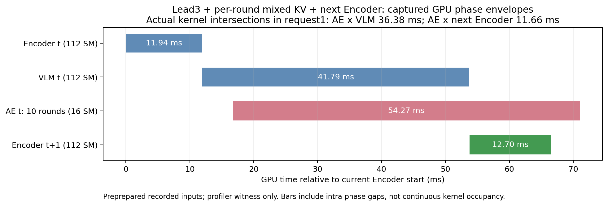

# lead3 + 十轮混合 KV AE + 下一帧 Encoder：完整组合核验

**指定路线确实可运行，已有约1.12×的固定观测重放性能结果。本次新nsys进一步确认AE与本帧VLM、下一帧Encoder都存在真实Kernel重叠。完整组合的真实在线闭环无损性仍未得到证明。**

## 配置及已有性能

本帧 Encoder 完成后启动 VLM；等前三层 KV-ready 后启动 AE，共10轮。每轮开始固定当前新KV frontier，未就绪层用上一被服务观测的完整旧KV。VLM完整producer完成后，下一帧Encoder可在独立旧槽Vision workspace运行，与剩余AE重叠；AE持有的旧KV不覆盖。AE16 SM、VLM/Encoder112 SM，两槽/Lease/epoch/generation/Event及原Graph地址协议不变。不是新增fresh-tail强制刷新版本。

已有正式无profiler测试，同一物理GPU两次独立复测，8请求总耗时：

| 路径 | 复测A/B ms | SM16完整组合相对加速 |
|---|---:|---:|
| 全卡，完整新KV + 下一Encoder | 533.49 / 533.71 | 1.124 / 1.125× |
| 全卡，lead3混合KV + 下一Encoder | 516.44 / 517.11 | 1.088 / 1.090× |
| SM16，lead3混合KV + 下一Encoder | 474.58 / 474.37 | — |

AE相对下一Encoder结束暴露约3.80/3.81ms。完整方法含输入准备、fill/drain，正式稳态不含加载/预热/捕获；并非相对原始eager π0.5的全部加速。数据来自[原逐层流水线报告](idea2_progressive_kv_report_20261025.md)和[性能CSV](../../../reports/idea2_progressive_kv_20261025/performance_summary.csv)，本次不重复已完成的100对实验，也不把新profile的绝对耗时替代该表。

此前[200场景报告](idea2_closedloop200_report_20261025.md)关闭了next_encoder，SM16的193/200不代表这条完整组合也已通过200例闭环。

## 新nsys：实际Kernel两段都能重叠

[新trace](../../../nsys/idea2_experiment/online_sm16_prepared_witness_20261025_v1.nsys-rep)使用同任务13条真实记录，current/future Prepared和显式noise事先准备好，排除旧profile中Host准备future约61ms将Encoder提交推迟的问题。预热20次、两次matched-schedule串行oracle，随后采8请求；最后请求无下一Encoder，所以有效跨帧窗口7个。该见证只核GPU机制，离线输入已知，不代表真实在线未来观测已到达。

Graph ancestry/launch correlation独立归属AE、本帧VLM和下一Encoder，按真实CUDA Kernel时间区间求交集并取并集，不用Host NVTX重叠或CUDA Event跨度冒充Kernel重叠。Green Context资源审查通过，实际资格资源为AE16、VLM/Vision112；不是用普通contextId推断分区，也不把SM配额当实时占用率。

| 指标 | 结果 |
|---|---:|
| 采集请求 | 8 |
| 有下一Encoder的有效请求 | 7 |
| 同时具备AE×VLM、AE×下一Encoder真实Kernel交集 | 7/7 |
| AE×本帧VLM交集均值（全部8请求） | 34.134 ms |
| AE×下一Encoder交集均值（7请求） | 10.885 ms |
| 有下一Encoder的7请求AE Kernel busy均值 | 51.040 ms |
| 这7请求两段Kernel交集之和 / AE busy之和 | 88.31% |
| AE最后Kernel晚于下一Encoder最后Kernel（7请求均值） | 4.645 ms |
| 匹配实际KV选择的串行oracle | 2次，max/MAE均0 |

88.31%描述此profile中AE的Kernel busy时间与另外两分支Kernel区间的交集比例，不能称端到端节省88%。本帧VLM与下一Encoder串行，两段区间不相交；不存在把同一AE交集重复计算的问题。profile对Host/Kernel调度仍有扰动，尾部4.645ms与历史无profiler约3.8ms分别保留。



图中条形是GPU阶段首末Kernel的包围区间，内部有少量间隙；标题中的交集数值来自独立Kernel并集分析。代表请求的AE从前三层KV-ready后启动，并横跨VLM与下一Encoder两个区域，仍有约4.53ms尾部。

证据：[见证摘要JSON](../../../results/idea2/online_encoder_20261025/prepared_witness_analysis/witness_summary.json)、[逐请求Kernel交集CSV](../../../results/idea2/online_encoder_20261025/prepared_witness_analysis/requests.csv)、[Kernel归属CSV](../../../results/idea2/online_encoder_20261025/prepared_witness_analysis/kernels.csv)、[资源审查](../../../results/idea2/online_encoder_20261025/prepared_witness_analysis/resource_audit.json)、[见证运行/数值/cleanup](../../../results/idea2/online_encoder_20261025/prepared_witness_gpu2/result.json)。

## 实际闭环接入门禁：简单R5缓冲不成立

原同步客户端等本轮AE返回后才执行其5个动作，下一策略观测因此依赖AE完成；没有现成的下一帧可送入当前请求。单独打开next_encoder不能产生新观测。本次新增独立实验客户端，执行已返回的前一R5动作块时，并发计算下一AE；将真实执行5步后的观测回传给其lookahead。该接口只用一个GPU调度Host，不并发修改Pool，后续请求必须消费同一Prepared及输入hash。

此最小接法明确增加一块观测延迟：后续动作开始执行时，其输入落后5个控制步，名义250ms。没有使用H10后5步补队列，没有每tick替换动作，却也不能称原同步算法等价。仿真仍按20Hz控制步长运行，未额外宣称真实墙钟20Hz持续采集。

首个固定场景 `libero_object/task0/init0` 四臂都跑到原上限280步，均为有效失败；各56次在线请求，其中55次非终态，最后一次额外预测按协议丢弃，未执行。无失败重试。

| 同一新在线规则下的配置 | 成功/1 | AE均值 ms | VLM均值 ms | 真实下一观测接收等待均值 ms | 接收到观测时AE尚未完成 /55 | AE×下一Encoder Event包围区间交集 /55 |
|---|---:|---:|---:|---:|---:|---:|
| fresh18，无下一Encoder | 0 | 27.88 | 34.59 | 118.17 | 0 | 不适用 |
| fresh18，有下一Encoder | 0 | 27.80 | 34.41 | 113.31 | 0 | 0 |
| SM16 lead3，无下一Encoder | 0 | 51.71 | 43.24 | 112.09 | 0 | 不适用 |
| SM16 lead3，有下一Encoder | 0 | 51.33 | 42.82 | 109.95 | 0 | 0 |

query的时刻是服务端收到/反序列化下一观测后，Event排在AE Graph、输出clone和读结束Event之后；不是物理相机capture时刻。下一Encoder的首末Event区间均晚于AE结束，所以本次闭环无需把正的Event交集误当Kernel证据，也能判定这里不存在目标GPU交集。RPC墙钟含等待环境执行和上传，不能叫纯AE延迟或最早动作ready时间。

四臂首帧与旧同步fresh的输入/种子一致，bootstrap动作max/MAE均0；前5步EEF轨迹max误差0，获得的obs5与旧同步step5的策略输入hash一致，见[接入核验](../../../results/idea2/online_encoder_20261025/gate_bootstrap_checks.json)。接入首帧和第一段环境执行一致，不代表后续250ms延迟的闭环轨迹应当一致。

四臂episode工作墙钟约31–35秒，包含一次性Graph准备及输入/动作记录I/O；每臂只有1例，不能作为可靠速度比较或总体成功率估计。不能据此说所有异步方案都失败，也不能将全fresh在此协议下的失败归因于混合KV。

门禁显示真实下一策略观测来得太晚，且简单动作块缓冲已改变质量。按[方案](idea2_online_encoder_plan_20261025.md)先定位的原则，停止其余28个计划pilot回合，不继续盲目扩200例。四个有效失败全部保留；没有为了追求重叠而改早捕获、延长AE、偷用预录未来帧或换场景重试。

证据：[四臂执行/源码/退出记录](../../../results/idea2/online_encoder_20261025/gate_case0/execution.json)、[逐请求CSV](../../../reports/idea2_online_encoder_20261025/requests.csv)、[逐回合CSV](../../../reports/idea2_online_encoder_20261025/cases.csv)、[汇总JSON](../../../reports/idea2_online_encoder_20261025/summary.json)。

## 结论与边界

用户指定的GPU路线成立：lead3+逐轮新旧KV+D10+下一Encoder，重放约1.12×，新nsys有实际双段Kernel交集，AE仅剩几毫秒尾部。已有200例成功率属于未开启下一Encoder的同步路径，二者必须分开引用。

要把这项收益变成真实在线收益，下一观测必须在AE结束前到达且准备完成；本次按完整R5推进的LIBERO接法没有这个窗口。若进一步尝试连续相机采集/控制与推理解耦，需要另立同规则在线对照、明确观测年龄及动作交接，不能以一个固定250ms延迟缓冲直接替换原客户端。此次不改生产默认，不扩大到RTC/动作重定时算法。

## 修改与复现

仅新增实验目录，不修改旧runtime/模型/200例结果：

- [policy.py](../../../results/idea2/online_encoder_20261025/policy.py)：绑定真实下一输入、复用原runtime和VisionAheadTicket，异常时reset。
- [server.py](../../../results/idea2/online_encoder_20261025/server.py)、[wire.py](../../../results/idea2/online_encoder_20261025/wire.py)：单Host双向请求交互。
- [client.py](../../../results/idea2/online_encoder_20261025/client.py)、[run.py](../../../results/idea2/online_encoder_20261025/run.py)：因果R5环境推进及GPU/EGL占用守卫。
- [witness.py](../../../results/idea2/online_encoder_20261025/witness.py)、[分析器](../../../results/idea2/online_encoder_20261025/witness_analysis.py)：预准备输入GPU机制见证；[summarize.py](../../../results/idea2/online_encoder_20261025/summarize.py)仅CPU汇总。

CPU交互与错误路径检查通过；真实门禁服务正常exit0，源码未变，两个Green Context pair正常清理；nsys见证正常exit0、源码未变、oracle通过、一个pair正常清理。GPU2已释放，C/G均为零，[释放记录](../../../results/idea2/online_encoder_20261025/released.json)。

因果门禁用新目录/空闲端口复现（必须重新选择当时独占GPU并核实EGL映射）：

```bash
python3 -m results.idea2.online_encoder_20261025.run \
  --output results/idea2/online_encoder_20261025/reproduction_new \
  --case-indices 0 --port 19230
```

GPU见证使用原环境变量：CUDA_VISIBLE_DEVICES为所选UUID、CUDA_DEVICE_MAX_CONNECTIONS=32，OMP/MKL/OPENBLAS线程数2，JAX_PLATFORMS=cpu、JAX_PLATFORM_NAME=cpu、XLA_PYTHON_CLIENT_PREALLOCATE=false，PYTHONPATH=.:policies/openpi/src，OPENPI_DATA_HOME为shared/checkpoints/openpi绝对路径。完整实测命令保存在[result.json](../../../results/idea2/online_encoder_20261025/prepared_witness_gpu2/result.json)，nsys关键参数为：

```bash
nsys profile --trace=cuda,nvtx --cuda-graph-trace=node:nvtx-precapture \
  --sample=none --cpuctxsw=none --capture-range=cudaProfilerApi \
  --capture-range-end=stop --force-overwrite=false --output 新trace路径 \
  policies/openpi/.venv/bin/python -u \
  -m results.idea2.online_encoder_20261025.witness \
  --gpu-uuid 所选UUID --output 新结果目录
```

CPU Kernel分析入口：

```bash
python3 -m results.idea2.online_encoder_20261025.witness_analysis \
  --trace nsys/idea2_experiment/online_sm16_prepared_witness_20261025_v1.nsys-rep \
  --profile-result results/idea2/online_encoder_20261025/prepared_witness_gpu2/result.json \
  --output 新分析目录
```
