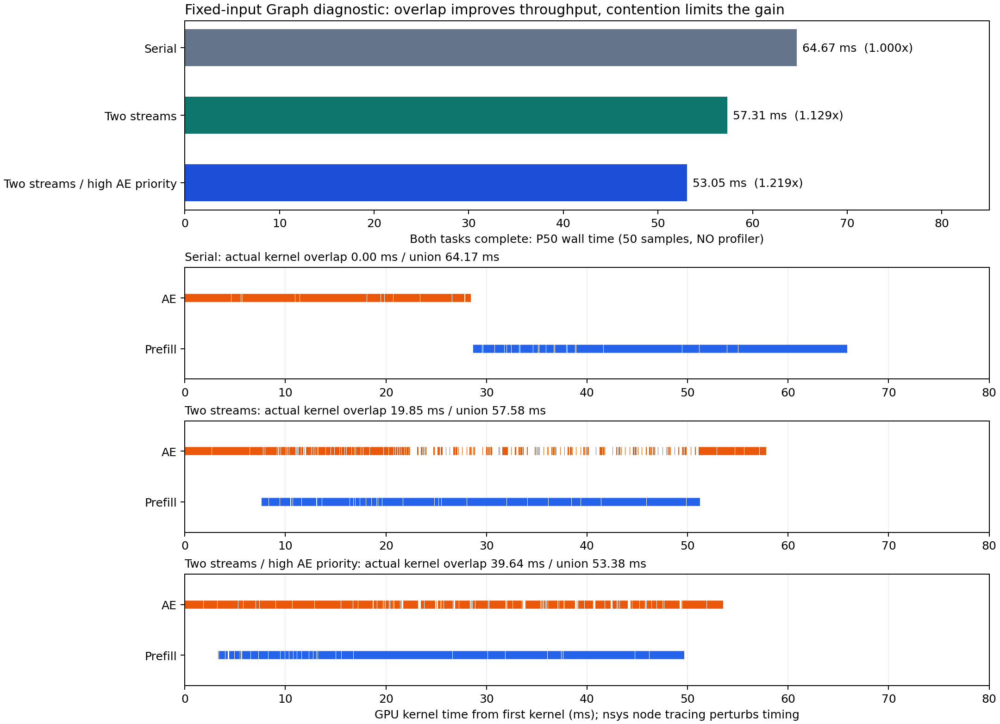

# idea2：AE / VLM 互补负载为何没有充分转化为加速

本轮继续分析上一轮双 Stream / 双 Host Worker 收益小的原因。结论是：**负载互补有依据，但当前 eager 提交方式和 kernel 驻留资源共同限制了并行收益。上一轮约 1.056× 的结果不能用来否定 Pipeline 的并行空间。**

本轮只新增独立诊断程序和结果文件，未改变运行中的 PipelinePolicy、模型、D10、Draft / Verify 或 Pool / Lease 管理。Graph 仅用于隔离提交瓶颈，尚未接入动态观测的生产 Pipeline。

## 1. 先区分三种时间

- CPU 提交时间：Python / PyTorch / CUDA API 调用经过的时间，可能包含局部同步。
- GPU Event 区间：从 stream 中开始 Event 到结束 Event；包含 kernel 间的空隙、等待提交、等待其他工作让出资源。
- CUPTI kernel 活跃区间：Nsight Systems 记录的实际 kernel start / end。两流这些区间的交集才是本文的 kernel 重叠。区间本身仍包含 kernel 内部的停顿，不能当作指令一直在执行，也不能直接推算 Tensor Core 或显存带宽利用率。

上一轮 eager AE 的 CPU 提交约 **222 ms**，但实际 AE kernel 活跃时间约 **31 ms**。每次 D10 AE 有约 **10,590 个 kernel**；Prefill 约 **2,308 个**。单 Python 线程执行完 AE 再提交 Prefill 时，AE 已经结束。100/100 次完成 Event 的查询结果验证了这一点。

双 Host Worker 把 kernel 重叠提高到约 5–6%，但仍有大量提交间隙，两个模块的 CPU 提交时间也一起变长。尚无 CPU 采样来精确拆分 GIL、PyTorch / CUDA 库锁和调度开销，因此不能将这些耗时全部归因于 GIL。

上一轮固定 KV 测量的每对任务：

| 模式 | AE kernel 活跃 ms | Prefill kernel 活跃 ms | 交集 ms | 并集 ms |
| --- | ---: | ---: | ---: | ---: |
| 原始双流 | 31.266 | 39.288 | 0.024 | 70.530 |
| 双 Worker prefill_first | 33.344 | 39.715 | 3.664 | 69.396 |

增加的约 3.64 ms 重叠，被约 2.51 ms kernel 区间膨胀抵消，GPU 活跃并集只减少约 1.13 ms。**不能把全部端到端改善归因于 GPU 重叠。** 原始数据及动态观测回放结果见[上一轮报告](idea2_scheduling_fix_20261021.md)。

## 2. 负载确实不同，但 AE 不是纯粹的单 token 带宽负载

在原始模型上注册 Linear 的只读 shape hook，记录真实 D10 AE 和完整 Prefill 的输入形状；不替换算子。结果如下：

| 组件 | 主要 GEMM 的 M | Transformer / Vision Linear 调用数 | Linear 运算量 GFLOP | 理想冷操作数 FLOP/byte 范围 |
| --- | ---: | ---: | ---: | ---: |
| AE，完整 D10 | 51 | 1,260 | 317.66 | 40.8–48.0 |
| VLM 文本 Transformer | 816 | 126 | 3,234.31 | 177.9–563.4 |
| Vision encoder，三路图像 | 256 | 486 | 631.40 | 177.2–199.7 |

这里的强度估计是 `2*M*N*K / (element_bytes*(M*K+K*N+M*N))`，不包含 attention 等非 Linear 算子，也未计缓存命中、split-K workspace、重复加载等影响，**不是实测 DRAM 流量**。

这支持“AE 更偏向数据搬运 / 短 kernel，VLM 更偏向大 GEMM”的相对判断。但 AE 的 M 是 51，包含 state token 和 50 个 action token，并非自回归 LLM 的 M=1 decode；它同样大量使用 Tensor Core GEMM。旧的独占 trace 中，AE GEMM 约占其 kernel 活跃时间 47%，Vision / VLM GEMM 各约占 83%。两类工作还会共同竞争 SM、寄存器、shared memory、cache 和显存通路。

Shape 明细见 [linear_shapes.json](../../../results/idea2/overlap_diagnosis_20261021/graph/linear_shapes.json)，汇总见 [linear_shape_summary.json](../../../results/idea2/overlap_diagnosis_20261021/linear_shape_summary.json)。

## 3. “计算吞吐没跑满”不等于“能再放进另一个 kernel”

从既有独占 trace 的 `E1/serial/iteration_01` 提取实际 grid、block、寄存器和 static + dynamic shared memory：

| 代表性 kernel | 每次 grid 的线程块数 | 每块线程 | 每线程寄存器 | 每块 shared memory |
| --- | ---: | ---: | ---: | ---: |
| VLM，CUTLASS 64×64 GEMM | 832 / 1,664 / 3,328 | 128 | 88 | 48 KiB |
| VLM，Ampere 128×64 GEMM | 832 | 128 | 230 | 32 KiB |
| AE，CUTLASS 64×64 GEMM | 96 / 128 | 128 | 88 | 48 KiB |
| AE，Ampere 64×64 GEMM | 128 | 128 | 102 | 80 KiB |

本机 GPU 是 128 SM 的 RTX 4090。Ada 每 SM 上限为 100 KiB shared memory、64K 个 32-bit 寄存器。[NVIDIA Ada Tuning Guide](https://docs.nvidia.com/cuda/ada-tuning-guide/index.html)

据此可做以下资源容量推断：

- 两个 VLM 48 KiB block 驻留时已消耗 96 KiB，放不下另一个 48 KiB AE block；还未计每块的保留开销。
- 一个 80 KiB AE block 和一个 48 KiB VLM block，shared memory 总量已经超过单 SM 容量。
- VLM 的高寄存器 GEMM 每块约需 `230*128` 个寄存器；两个块已使用约 59K，无法再容纳需要约 11K 寄存器的 AE block，实际分配还存在粒度取整。
- VLM 大 grid 有多轮 block，足以持续给整个 GPU 提供工作。AE 短 kernel 的后继又依赖前一个 kernel 完成，因此很容易反复等待可用资源。

这解释了互补负载为什么不会自动转化为高收益：**算术强度互补还需要可同时驻留的线程块和足够及时的任务供应。** 以上是基于实际 launch 资源的容量推断，未声称测得每个时刻的实际 occupancy。`sharedMemoryExecuted=102400` 是配置 / carveout 相关字段，不应误读为每 block 都分配 100 KiB；这里使用的是 static + dynamic 两项之和。

资源明细与来源见 [eager_kernel_resources.json](../../../results/idea2/overlap_diagnosis_20261021/eager_kernel_resources.json)。

## 4. 用 CUDA Graph 隔离 host 提交瓶颈

复用已有 `GraphSafeBackend` 和 `GraphPair`。前者仅将固定输入的 metadata / 时间节点准备移出重复执行路径，保留原 NN 和 D10 数学计算；后者为两个 Graph 使用独立 private pool。AE 始终读取固定旧 KV，Prefill 始终写另一份新 KV，每轮排空两者 Event 后才复用。

设备仍为 GPU2，UUID `GPU-83fdf473-8633-29d3-4a42-e482cfdf0c25`，相同 checkpoint / 真实输入 bank、seed1701。比较独占、两个串行顺序、两个并行顺序，以及 AE stream priority=-1。各模式 10 次预热、50 次计时；另用 nsys `--cuda-graph-trace=node` 捕获 kernel 节点。

初始实验每轮轮换模式；由于同一个 AE Graph 在两个 stream 间切换，随后补充 grouped 实验，在每个模式开始后重新预热，以控制 stream 切换因素。两个实验均保留完整逐样本数据。

初始轮换实验、无 profiler 的 P50（ms）：

| 模式 | AE Event | Prefill Event | 两任务全部完成 | 相对 Graph 串行 |
| --- | ---: | ---: | ---: | ---: |
| Graph 串行 AE first | 27.46 | 36.99 | 65.10 | 1.000× |
| Graph 并行 AE first | 56.99 | 43.11 | 57.38 | 1.134× |
| Graph 并行 Prefill first | 56.54 | 42.77 | 57.79 | 1.126× |
| Graph 并行 AE first，高 AE 优先级 | 53.89 | 45.38 | 54.58 | 1.193× |
| Graph 并行 Prefill first，高 AE 优先级 | 52.25 | 45.18 | 53.53 | 1.216× |

这已经证实存在 GPU 并行收益，也表明 AE 在并发下明显变慢。Graph 的主要收益来自压缩提交与 kernel 之间的空隙；不能把从 eager 约 288 ms 降至 Graph 约 54–65 ms 全算成 Pipeline 并行收益。既有同 GPU / 同输入的静态 backend 匹配实验也有 eager serial 297.91 ms → Graph serial 64.95 ms，见 [e1b_graph_gpu2](../../../results/idea2/run_20261020/e1b_graph_gpu2/)。

**指标边界：**本诊断的 `all_done_host_ms` 包含两任务完成、动作 clone / D2H / decode 和数值检查，不含输入准备或 RPC。串行分支在两任务完成后才执行 decode，因此其 `action_ready_host_ms` 不是“AE 结束立即返回”的最优动作延迟，不能用它证明并发改善了动作延迟。若优先单次动作尽快返回，AE 独占约 27 ms 与并发约 52–57 ms 的区别必须单独考虑。周期吞吐、动作延迟、KV 新鲜度是不同指标。

原始结果：[graph/result.json](../../../results/idea2/overlap_diagnosis_20261021/graph/result.json)。

固定模式、重新预热的 grouped 对照结果（无 profiler）：

| 模式 | AE Event P50 | Prefill Event P50 | 全部完成 P50 | 全部完成 P95 | 相对串行 P50 |
| --- | ---: | ---: | ---: | ---: | ---: |
| AE 独占 | 26.90 | — | 27.22 | 27.34 | — |
| Prefill 独占 | — | 37.09 | 37.13 | 37.33 | — |
| 串行 AE first | 27.35 | 36.76 | 64.67 | 65.02 | 1.000× |
| 串行 Prefill first | 27.39 | 36.81 | 64.71 | 65.11 | 0.999× |
| 并行 AE first | 57.02 | 43.12 | 57.31 | 57.76 | 1.129× |
| 并行 Prefill first | 56.72 | 42.95 | 57.80 | 58.03 | 1.119× |
| 并行 AE first，高 AE 优先级 | 52.75 | 45.80 | **53.05** | 53.27 | **1.219×** |
| 并行 Prefill first，高 AE 优先级 | 52.45 | 45.43 | 53.52 | 53.98 | 1.208× |

该对照确认优先级收益仍然存在，AE first 与高 AE 优先级组合最好。高优先级不等于单独保留资源；AE 仍由独占约 27 ms 延长至约 53 ms，Prefill 也由约 37 ms 延长至约 46 ms。Graph replay CPU P50 为 AE 约 **0.03 ms**、Prefill 约 **0.70 ms**，此时不能继续用 222 ms 的 Python 提交解释主要差距。

初始轮换实验中 AE replay 在部分切换模式下的 CPU P50 约 2.4–2.5 ms；固定模式预热后消失，说明不能将该部分计为稳定 Graph replay 开销。两个实验的结论一致：普通双流约 1.12–1.13×，高 AE 优先级约 1.21–1.22×，并非几乎没有 GPU 并行空间。

grouped 原始数据见 [graph_grouped/result.json](../../../results/idea2/overlap_diagnosis_20261021/graph_grouped/result.json)。两次无 profiler 实验合计 800 个样本，其中 700 个有 AE 输出，所有输出最大绝对误差为 0；两次完整 Graph-safe validation 与两槽 audit 均通过。逐节点 trace 另列如下。

grouped nsys 逐节点 trace，每模式 3 次测量的均值（ms），选择 AE first 保持模块启动相对位置的可比性：

| 模式 | AE kernel 活跃 | Prefill kernel 活跃 | kernel 交集 | kernel 并集 | 交集 / 并集 | AE kernel 包络内空隙 |
| --- | ---: | ---: | ---: | ---: | ---: | ---: |
| 串行 AE first | 27.787 | 36.237 | 0.000 | 64.024 | 0.0% | 0.512 |
| 并行 AE first | 35.412 | 41.959 | 19.670 | 57.701 | 34.1% | 22.562 |
| 并行 AE first，高 AE 优先级 | 48.321 | 44.642 | 39.644 | 53.318 | 74.4% | 5.136 |

可直接分解高优先级结果：

```text
串行 kernel 并集                         64.024 ms
并发导致两模块 kernel 活跃区间之和增加   +28.938 ms
真实 kernel 时间交集                    -39.644 ms
并发 kernel 并集                         53.318 ms
```

即：**重叠真实存在，但约 39.6 ms 的重叠，被约 28.9 ms 的区间膨胀抵消，只减少约 10.7 ms 的 kernel 并集。** 不能把 kernel 重叠率当成加速率。普通优先级下，AE 的 kernel 包络内还有约 22.6 ms 空隙；高优先级下空隙减至约 5.1 ms，同时 AE kernel 自身的活跃区间进一步增长。该现象与更多并发驻留、减少等待但增加执行干扰相符；硬件计数器缺失，不能继续精确归因。

分析覆盖全部 **710,864 个 kernel**，其中 266,574 个属于 24 个正式测量 pair，444,290 个属于预热。每个完整 pair 有 AE 10,400、Prefill 2,294 个 kernel；单模块对照仅含对应模块。这里 AE 含输出 clone / cast，Graph-safe 提前准备 metadata，因此数目与原始 eager 不同。未把 memcpy / memset 计入重叠。所有单模块 / 串行对照的交集均为 0（浮点舍入精度内）。



- [grouped .nsys-rep](../../../nsys/idea2_experiment/graph_overlap_grouped_20261021.nsys-rep) / [逐 kernel 汇总](../../../results/idea2/overlap_diagnosis_20261021/graph_grouped_kernel_overlap.json)
- [轮换模式 .nsys-rep](../../../nsys/idea2_experiment/graph_overlap_diagnosis_20261021.nsys-rep) / [逐 kernel 汇总](../../../results/idea2/overlap_diagnosis_20261021/graph_kernel_overlap.json)

在 Nsight Systems GUI 中搜索 `pair/concurrent_ae_first_high_ae/1`，展开 CUDA GPU streams。上图的蓝 / 橙短线都是 kernel 实际区间，并非 NVTX 包络。

## 5. 工具与结论边界

nsys 逐节点 tracing 会扰动 Graph launch，尤其是含上万个节点的 AE Graph 和跨 stream 的交替 replay。Profile 运行只用于核实 kernel 交集和区间变化，速度结论使用无 profiler 的 50 样本。不能把不同运行的 Event、kernel 时长和端到端时间拼成一个精确等式。

grouped profile 中 AE `graph.replay()` CPU P50 约 15–17 ms、Prefill 约 4–6 ms，明显超过无 profiler 的约 0.03 / 0.70 ms；prefill_first 因此让 AE 更晚进入 GPU，trace 的顺序优劣不能代替无 profiler 的性能排名。上述 74.4% 是该 trace 下的实际 kernel 交集，不声称等于未采样运行的精确重叠率。

尝试 Nsight Compute 查询 GPU 性能计数器时返回 `ERR_NVGPUCTRPERM`，见 [counter_access.json](../../../results/idea2/overlap_diagnosis_20261021/counter_access.json)。因此本轮没有 DRAM 带宽、Tensor Core 活跃度或 achieved occupancy 的硬件计数器结果，未更改机器驱动权限。资源竞争的具体比例尚不能进一步拆成带宽竞争、cache 干扰、Tensor Core 竞争和 block 排队。

CUDA stream 优先级仅是调度提示，不能保证执行顺序或预留 SM 容量。[CUDA Asynchronous Execution](https://docs.nvidia.com/cuda/cuda-programming-guide/02-basics/asynchronous-execution.html)

## 6. 下一步应该优化什么

1. **优先消除实际 Pipeline 的逐 kernel Python 提交成本。** 独立 Graph 对照已说明该项收益远大于再切换线程 / stream 顺序。生产接入需要动态输入 staging、与 Pool 两槽对应的稳定 KV 地址、reader 完成后再覆写、独立 workspace / 输出所有权；固定输入 Graph 不能直接替换生产实现后宣称完成。
2. **随后在 Graph 路径上控制资源争用。** AE 优先级可以作为小改动对照；更进一步可按既有层 / denoising step 拆分提交批次，试验有限的 Prefill 提前量，保持原计算及顺序。分段会增加 launch / event 开销，也不保证为 AE 腾出 SM，必须实测。真正限制 GEMM 的资源占用或选择更适合并发的 kernel 属于另一个 kernel 调优任务，本轮不改。
3. **用硬件计数器决定是否继续追求 compute / memory 互补。** 先分别测代表性的 AE / VLM GEMM，再测同时执行，观察 DRAM、Tensor Core、occupancy 和 stall；同时评估 kernel 间隙以及 kernel 区间膨胀。不能仅看 NVTX 重叠率或 GPU utilization。
4. **最终仍需动态真实观测回放。** 验收指标包含 AE 响应 P50 / P95、后台 Prefill 完成、两槽生命周期、实际 KV age 及参考数值一致性。固定输入实验只说明优化方向和可观测并行空间，不是部署后的端到端加速承诺。

若完全无资源干扰，Graph 独占 AE 约 27.4 ms、Prefill 约 37 ms 的理想 makespan 是约 37 ms，即串行的约 1.74×。这是同一工作量下的理想参考，忽略了共享资源约束；目前结果没有达到它的条件。

## 7. 复现入口

新增 [graph_overlap_diagnosis.py](../../../preparations/idea2/graph_overlap_diagnosis.py) 和 [graph_overlap_trace.py](../../../preparations/idea2/graph_overlap_trace.py)。原模型 / 生产调度实现未修改。Graph validation 检查原始 / Graph-safe 的 D10 velocity、time nodes、normalized / decoded 输出、旧新 KV；GraphPair audit 检查两池隔离、两份逻辑 KV、旧 KV 不变、新 KV 等于 eager、返回动作拥有独立存储。

```bash
CUDA_VISIBLE_DEVICES=2 JAX_PLATFORMS=cpu JAX_PLATFORM_NAME=cpu \
OMP_NUM_THREADS=4 MKL_NUM_THREADS=4 OPENBLAS_NUM_THREADS=4 \
OPENPI_DATA_HOME=/root/nfs/embodied/benchmark/shared/checkpoints/openpi \
PYTHONPATH=.:policies/openpi/src policies/openpi/.venv/bin/python \
  -m preparations.idea2.graph_overlap_diagnosis \
  --output results/idea2/overlap_reproduce_NEW --warmup 10 --samples 50 --grouped
```

profile 时使用同一环境，Python 命令前加入：

```bash
nsys profile --trace=cuda,nvtx --cuda-graph-trace=node \
  --sample=none --cpuctxsw=none --capture-range=cudaProfilerApi \
  --capture-range-end=stop --force-overwrite=false \
  --output=nsys/idea2_experiment/overlap_reproduce_NEW
```

runner 加 `--profile`，减为 `--warmup 5 --samples 3`，输出使用新目录。导出 SQLite 后：

```bash
python3 -m preparations.idea2.graph_overlap_trace INPUT.sqlite OUTPUT.json
```

分析器从独占 Prefill 范围识别 stream；用每个已排空的 NVTX pair 只确定样本边界，真正求交使用 CUPTI kernel 时间戳；不含 memcpy / memset，不把预热算入结果，检查捕获的每个 kernel 都归属测量或预热范围。
