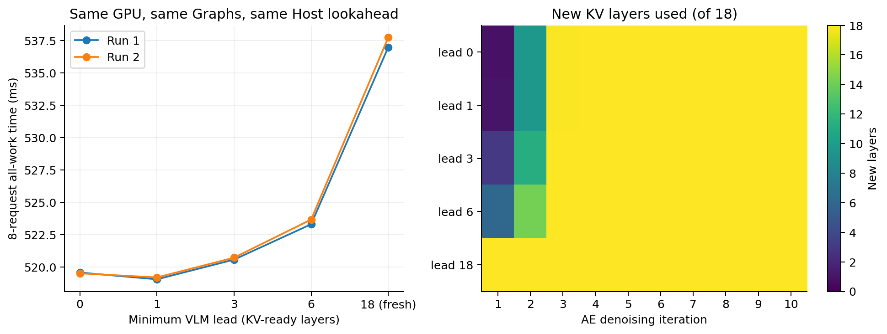
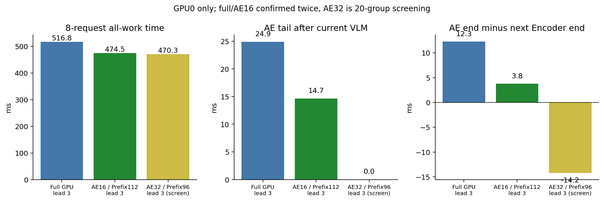
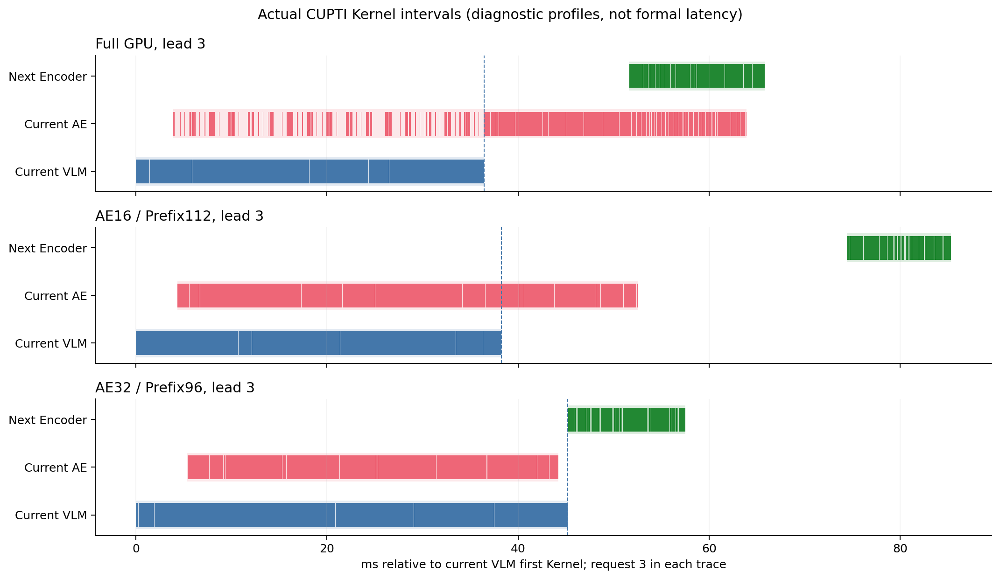
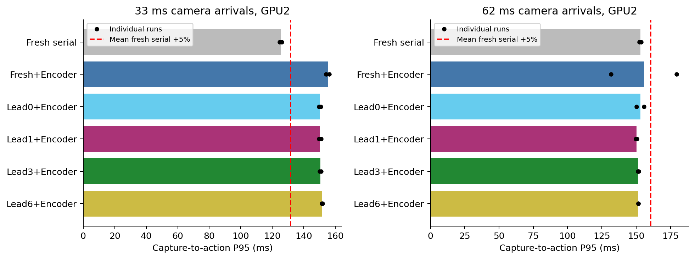

# π0.5：逐层新旧 KV 兜底与跨帧 Encoder 重叠实验

日期：2026-10-25。对应[实验方案](idea2_progressive_kv_plan_20261025.md)。所有计入结果的 GPU 任务已结束，GPU 已释放。

## 1. 先看结论

**你的思路可以实现，也测到了真实收益；但把 AE 藏进去需要付出资源竞争和旧 KV 的代价。**

- 仅加入逐层 KV 兜底、使用普通全卡双流：领先 0/1 层最好，相对已有“完整新 KV + AE/下一帧 Encoder 重叠”再快约 **1.034×**。单纯消除依赖没有消除竞争。
- 更均衡的已重复验证候选：**领先 3 层，AE 固定 16 SM，VLM/Encoder 使用其余 112 SM**。同一 GPU 的两轮实验中，8 请求总耗时 **516.44/517.11 → 474.58/474.37 ms**，加速 **1.088/1.090×**，耗时下降约 **8.1–8.3%**。对完整新 KV + Encoder 重叠基线则为 **1.124/1.125×**。
- 该候选中，AE 比下一帧 Encoder 晚 **3.80/3.81 ms** 完成，已接近你说的末端对齐。普通全卡领先 3 层还暴露约 **12.3 ms**。
- AE 32 SM 的初筛甚至做到 **AE 在 VLM 结束前完成**，nsys 也证实了；但 VLM 变慢、AE 最后几轮仍读旧 KV，动作偏差明显更大。它仅做了 20 组初筛，不能宣称为正式最优。
- 7 个配置各 8 个闭环 case 都成功，但这只是小样本质量筛查。**“同一混合 KV 调度的实现误差为零”不等于“和原始全新 KV 算法输出相同”。**

本轮加速均相对于已经使用 CUDA Graph、固定时间条件准备等优化的 π0.5 路径，**不是相对原始 eager π0.5 的总加速**。未修改生产默认配置。

## 2. 到底在跑什么

完整 π0.5 LIBERO，`pi05_libero`，Gemma 2B VLM + Gemma 300M Action Expert；BF16 模型主体，batch=1，action horizon=10，**10 轮 Flow Matching**，每次执行前 5 个动作（R5）。RTX 4090，128 SM；Torch 2.7.1+cu126、CUDA 12.6、Transformers 4.53.2，原 eager Attention。没有使用 v14、Draft/Verify、跳层、减少步数或更换权重/精度。

固定噪声种子、原时间值与 FP32 dt 更新路径。编译/Graph 捕获与预热不计入稳态。所有正式臂使用相同 Graph、准备与输出解码配置；本轮不额外扫描 compile-only 等已有维度。

这里允许了用户最新提出的**近似语义**：不同层可以来自当前或上一份完整观测 KV。此前“整份 KV 必须同版本”的实验约束在此实验中被明确替换；同一层的 K 和 V 始终来自同一份观测。

## 3. 调度如何工作

1. 先完成当前帧 Encoder，再提交当前 VLM。领先 0 的含义是从此时就可启动 AE，不能在当前 Encoder 之前启动。
2. VLM 每层的 K/V projection 写完就发布 KV-ready frontier，不等整个 Block/整个 VLM 完成。领先 1/3/6 就等待相应层的 KV-ready Event。
3. **每轮 AE 开始时冻结一次 frontier**：该轮已就绪层读取新 KV，其余层读上一个已完成请求的完整旧 KV；轮内不追逐更新。下一轮重新采样 frontier。因此不止第一轮 AE 可以与 VLM 重叠。
4. 当前 VLM 和 AE 第 1 轮都结束后，放行下一帧 Encoder，与剩余 AE 重叠。下一 Encoder 只准备已有观测，不凭空获得未来观测；实时到达限制单独测量。
5. 第一帧没有旧 KV，先完整 bootstrap。每个已接纳请求都构建一份完整 Prefill，不能靠饿死 VLM 换 AE 延迟。

同一进程、单个调度 Host，通过 CUDA Stream/Graph/Event 提交；没有增加两个 Python 进程或 Host Worker。正式测量中 AE 的 10 轮提交平均仅约 **0.39 ms**，SM16 约 **0.42 ms**，无证据支持继续增加 Host 线程。

生命周期保持两份完整 KV：旧槽只读，当前槽逐层写入。选择器只读取已选中的 old 或 new 地址，避免对未完成 new KV 的投机读取。GPU release/acquire 原子保证数据发布顺序，Event 管启动和完成边界；Pool/Lease/epoch/generation 仍由调度 Host 管理。共享 scratch 仅 **一层 K/V，991,232 bytes**，由唯一 AE Stream 顺序使用，没有第三份完整 KV。

下一 Encoder 可以使用旧物理槽中独立的视觉工作区，但不能覆盖仍被 AE 读取的旧 KV；ahead ticket 绑定观测、槽、epoch、下一 generation 和准备 Event。Graph 静态缓冲区/池按分支隔离，输入原地更新、双槽轮换、episode reset 均有验证；稳态重捕获次数为 **0**。

同步检查保留了 bootstrap、结果回 CPU、请求间完整 producer 生命周期以及最终 drain 所需等待。当前请求内部没有逐层 CPU synchronize；lead/frontier 由 GPU Event/原子管理。prepare 中的 CPU 拷贝和输出 `.cpu()` 计入相应 Host 范围，没有作为可随意删除的同步处理。

## 4. 测量与正确性边界

正式数据使用同任务、变化观测的 13 条 bank，源记录索引为 `0,3,4,7,8,11,12,15,16,19,20,23,24`；避免把其他任务 KV 当成上一帧。

- GPU2 主对照两轮：每轮 6 臂，每臂 **100 组 × 8 请求 + 100 连续请求 + 2 oracle**，共 5,412 行；第二轮反转顺序。测量合计 10,800 请求，不含 oracle。
- GPU0 资源确认：全卡三臂与 SM16 单臂按独立进程 ABBA 块运行，两轮每臂各 900 测量请求。它不是同一次 Graph capture 内交替修改 SM 配额。
- 前置 matched-frontier gate 12 请求，覆盖双槽、两 epoch、原地更新和 ahead ticket；实现 oracle 最大误差和 MAE 均为 **0**，预定容差 max `1e-5`、MAE `1e-6` 未放宽。正式验证也全部为 0。
- 固定输入、噪声及实际观测到的每轮 frontier，再以串行方式重放同一新旧 KV 选择，验证的是实现正确性。原始 fresh 算法差异另列在质量表。
- 置信区间以完整 8 请求组为单位做 5,000 次 bootstrap，种子固定；反映这批固定输入的测量变动，不能外推任务总体。

CPU→CPU 指标指**已准备的 runtime 输入至解码后的 CPU action**；8 请求总耗时另含完整输入准备、fill/drain。基础 benchmark 原字段 `admission_to_action_ms` 实际只是循环入口到返回，CSV 已改名为 `loop_iteration_host_ms`。真实 capture/admission 延迟只使用专门 SLO driver。

## 5. 普通全卡：领先多少层合适

GPU2，同卡同配置。下面为两次运行 A/B；总耗时为完整 8 请求序列，Hz 为独立的 100 请求连续段。

| 最小领先 / 路径 | 8 请求总耗时 ms A/B | 连续 Hz A/B |
|---|---:|---:|
| 0 + 下一 Encoder | 519.59 / 519.53 | 16.365 / 16.347 |
| 1 + 下一 Encoder | 519.07 / 519.21 | 16.360 / 16.332 |
| 3 + 下一 Encoder | 520.59 / 520.74 | 16.300 / 16.277 |
| 6 + 下一 Encoder | 523.32 / 523.68 | 16.199 / 16.195 |
| 完整新 KV（18），仅 Host 提前准备 | 578.44 / 579.04 | 14.428 / 14.441 |
| 完整新 KV（18）+ 下一 Encoder | 536.97 / 537.73 | 15.772 / 15.770 |

领先 1 相对完整新 KV + Encoder 的配对加速 95% CI：A **[1.0334,1.0355]**，B **[1.0344,1.0370]**。0 和 1 的差距很小，没有充分理由执着于精确领先一层。

领先 3 的普通全卡典型 frontier 是 `[3,11,18,18,18,18,18,18,18,18]`：第三轮起全部新鲜。竞争仍让 AE 的 Event 跨度约 55 ms，明显长于完整新 KV 后单独运行的约 26 ms；提前开始没有转换成等量收益。



## 6. SM 隔离：这次为什么开始有效

此前强依赖完整新 KV 时，隔离主要损害 VLM 的关键路径。本次旧 KV 兜底让**多轮 AE 可以在 VLM 期间推进**，资源分配的价值发生变化。这里 AE 的 16/32 SM 固定覆盖全部 10 轮，VLM 与 Vision 共用余下 112/96 SM；**不是动态调整 SM，也不是仅第一轮隔离、尾段恢复全卡**。

同一 GPU0，正式两轮结果。模块时间均为配对段 CUDA Event 平均跨度，含该分支被调度延后的空隙，不等于 Kernel busy time。

| 配置 | 8 请求 ms A/B | 连续 Hz A/B | AE ms A/B | VLM ms A/B | AE结束−下一Encoder结束 ms A/B |
|---|---:|---:|---:|---:|---:|
| 全卡，领先 0 | 515.34 / 515.38 | 16.482 / 16.483 | 58.04 / 58.06 | 34.08 / 34.10 | +11.82 / +11.84 |
| 全卡，领先 3 | 516.44 / 517.11 | 16.420 / 16.419 | 54.98 / 55.03 | 33.80 / 33.82 | +12.29 / +12.34 |
| 全卡，完整新 KV | 533.49 / 533.71 | 15.883 / 15.891 | 29.56 / 29.58 | 31.10 / 31.14 | +14.39 / +14.37 |
| **AE16 / Prefix112，领先 3** | **474.58 / 474.37** | **18.084 / 18.102** | **48.82 / 48.79** | **38.58 / 38.55** | **+3.80 / +3.81** |

SM16 确实拖慢 VLM 约 4.8 ms，但减少的 AE 排队/尾段更多，总体获益。相同领先 3 下，连续吞吐约提高 **10.1–10.3%**。

CPU→CPU 均值/P50/P95（ms，A 的配对段）：全卡领先 3 为 **60.43/59.78/70.19**；SM16 为 **55.11/54.01/65.19**。峰值 allocated 为 **7.098/7.090 GiB**，reserved 详见 CSV；这是对应进程 PyTorch allocator 峰值，不是全设备显存占用。

SM32 的 20 组初筛：8 请求 **470.29 ms**，AE 在 VLM 后的暴露时间为 0，典型 frontier `[3,4,6,7,9,10,12,13,15,16]`。它仅比同规模 SM16 初筛约快 **0.7%**，最后轮次仍未全新鲜。按预先记录的“小于 2% 优势时优先更鲜 KV”选择规则，正式确认 **SM16**；没有将 SM32 初筛冒充 100 组正式结论。



也试了推迟下一 Encoder 放行，仅改 Event 从 AE1 移到 AE4/AE7。普通全卡领先 3 的 20 组初筛：默认约 **515.07 ms**，AE4 为 **513.69 ms**，AE7 为 **510.16 ms**；AE7 的 Encoder 比 AE 晚约 **1.02 ms** 结束。虽然末端更齐，完整请求仅约 1% 收益，仍逊于 SM16。**对齐不是目标函数，完整耗时和观测年龄才是。**

## 7. nsys：真的有 Kernel 重叠吗

有。7 条 trace 均以 CUPTI 实际 Kernel 区间并集求交集，通过 GraphLaunch correlation 和 Graph clone ancestry 归属请求，包含实际尾部，不按 Host NVTX 返回时间截断。每条 8 请求；下一 Encoder 可配对 7 次。下一 Encoder 与下一请求的当前 Encoder 是同一份工作，不能重复累计。

GPU0 三条诊断 trace 的均值（ms）：

| 配置 | AE×VLM Kernel交集 | AE×下一Encoder Kernel交集 | AE最后Kernel−VLM最后Kernel |
|---|---:|---:|---:|
| 全卡领先 3 | 9.191 | 7.894 | +25.262 |
| SM16 领先 3 | 34.124 | 0 | +14.458 |
| SM32 领先 3 | 37.484 | 0 | −0.848 |

SM32 的 8 次请求，AE 最后一个 Kernel 均早于 VLM（0.477–1.571 ms）。说明“AE 完全藏进 VLM”在这个近似配置下确实发生了。

全卡→SM16 的 AE Kernel busy **33.145→48.715 ms**，但分支 envelope **56.319→49.177 ms**，间隙 **23.174→0.462 ms**。这支持“AE Kernel 的累计忙碌时间增加，但调度空隙显著减少”的机制。不能仅看到双流同时非空，就断言所有并发都划算。

**profile 明显扰动 Host 提交，不能用其绝对端点代表正式性能。** SM16 profile 的 AE Host 提交约 18.3 ms，正式测量约 0.42 ms；下一 Encoder 在 VLM 后约 31.3 ms 才开始，正式约 0.003–0.009 ms。所以此 trace 的 AE×下一 Encoder=0，不否定正式运行的尾段重叠。主 GPU2 trace 同样出现端点偏移。实际 Kernel 交集用于机制证据，延迟/加速比只用无 profiler 的重复测量。

Green Context 元数据与实际 Kernel 的 `greenContextId` 核对通过：AE16/32，Prefix112/96；普通 `contextId` 相同不能用来判断是否分区。这证明 SM 配额归属，不证明 occupancy；HBM/L2 仍共享，也没有采硬件计数器去归因具体带宽瓶颈。私有 Graph pool 的证据来自冻结源码和构造断言，不是 nsys allocator pool ID。

nsys SQLite 没有导出可用的 CUDA Event device 时间戳；Event 与 Kernel 端点的互校使用运行时 Event 数据，不能表述为第二套独立 nsys Event 实测。



推荐先看这三条：

- [普通全卡领先3](../../../nsys/idea2_experiment/progressive_kv_full_lead3_encoder_gpu0_20261025_v1.nsys-rep)
- [正式候选SM16领先3](../../../nsys/idea2_experiment/progressive_kv_sm16_lead3_encoder_gpu0_20261025_v1.nsys-rep)
- [AE完全藏进VLM的SM32诊断](../../../nsys/idea2_experiment/progressive_kv_sm32_lead3_encoder_gpu0_20261025_v1.nsys-rep)

另有 GPU2 [lead0](../../../nsys/idea2_experiment/progressive_kv_lead0_encoder_20261025_v1.nsys-rep)、[lead3](../../../nsys/idea2_experiment/progressive_kv_lead3_encoder_20261025_v1.nsys-rep)、[lead6](../../../nsys/idea2_experiment/progressive_kv_lead6_encoder_20261025_v1.nsys-rep)、[完整新KV](../../../nsys/idea2_experiment/progressive_kv_lead18_encoder_20261025_v1.nsys-rep)。展开 `Prefill/VisionEncoder+Projector+Metadata`、`Prefill/VLM[release_KV_frontier]` 和 `AE/iteration_*`；同时查看实际 CUDA Kernel 行。

## 8. 动作质量：藏得更多，也可能更旧

原始 LIBERO client，四个 suite 各 task0/5、init0、seed7，共 8 case/配置。所有 episode 有效，共 **56 case、1,708 请求**。真实闭环下没有未来观测可提前算，因此这部分只验证质量，不作为跨帧 Encoder 吞吐证明。

| 配置 | 成功 | 总执行步数 | 与fresh匹配输入的R5动作MAE均值 | R5动作最大绝对偏差 |
|---|---:|---:|---:|---:|
| 全卡完整新 KV | 8/8 | 1181 | 0 | 0 |
| 全卡领先 0 | 8/8 | 1149 | 0.001805 | 0.021647 |
| 全卡领先 1 | 8/8 | 1146 | 0.001774 | 0.020834 |
| 全卡领先 3 | 8/8 | 1200 | 0.001452 | 0.013838 |
| 全卡领先 6 | 8/8 | 1178 | 0.001183 | 0.010839 |
| SM16 领先 3 | 8/8 | 1220 | 0.007214 | 0.097896 |
| SM32 领先 3 | 8/8 | 1340 | 0.023534 | 0.317630 |

上表动作偏差只比较第 2 次请求的匹配当前/旧输入、噪声和模型配置，R5 为实际执行的 `[5,7]` 动作；48 组 bootstrap 动作比较全部精确为 0。后续自由闭环轨迹已不同，不能将不同输入的动作差直接称为算法误差。

SM16/32 的步数比 fresh 多约 **3.3%/13.5%**，提示成功率相同也不代表任务效率相同。8/8 不能替代完整 LIBERO 质量评估，也未设事后放宽的动作误差阈值。resource 闭环在 GPU3、normal 在 GPU0，不作跨卡 RPC 性能排名。噪声验证依据相同 seed/原构造路径，未保存每次原始 noise bytes；权重依据同路径与文件元数据，未重新哈希完整权重文件。

## 9. 摄像头到达频率与 SLO

使用修正的 latest-arrived driver：接纳时选择已经到达的最新观测，最多锁定一份已接纳 lookahead，未接纳旧帧可丢弃，禁止读取未来帧。记录真实 capture/admission/output 时间、源 ID 与丢帧记账；bootstrap 的旧观测年龄记 null，不虚构“上一帧时间”。旧 KV 来自**上一被服务请求**，不是固定 33 ms 前；闭环 R5 时则跨 5 个执行动作。

GPU2：每周期两轮、7 配置、每配置 100 请求，共 2,800 行。以同轮 fresh/no-lookahead 的 capture→action P95 为基准，+5% 只是本轮检视预算。

| 到达周期 | 配置 | Capture→action P95 ms A/B | 旧KV源年龄P95 ms A/B | +5%预算 A/B |
|---|---|---:|---:|---|
| 33 ms | fresh 无lookahead | 125.90 / 124.63 | 不使用旧KV | 基准 |
| 33 ms | fresh + Encoder | 156.21 / 154.22 | 不使用旧KV | 失败/失败 |
| 33 ms | 领先0 + Encoder | 149.59 / 150.65 | 209.33 / 210.91 | 失败/失败 |
| 33 ms | 领先3 + Encoder | 150.08 / 151.00 | 210.15 / 211.20 | 失败/失败 |
| 62 ms | fresh 无lookahead | 153.72 / 152.42 | 不使用旧KV | 基准 |
| 62 ms | fresh + Encoder | **179.54 / 131.76** | 不使用旧KV | **失败/通过** |
| 62 ms | 领先0 + Encoder | 150.29 / 155.70 | 212.29 / 217.79 | 通过/通过 |
| 62 ms | 领先3 + Encoder | 151.30 / 151.80 | 213.37 / 213.82 | 通过/通过 |

62 ms 下 fresh+Encoder 两次 P95 波动大，必须保留。服务周期接近帧到达周期时，lookahead 锁定观测的相位会影响年龄；吞吐接近不保证年龄相同，不能平均后宣称稳定通过。

SM16 在 GPU3 单独做了 400 请求绝对年龄测量：33 ms 到达时吞吐 **18.287/18.273 Hz**、当前年龄 P95 **137.87/138.51 ms**、旧源年龄 P95 **191.84/192.48 ms**；62 ms 时分别 **15.990/15.967 Hz、141.17/140.61 ms、203.17/202.62 ms**。GPU3 没有同卡全卡 SLO 基线，**不能跨 GPU 宣称其通过 +5% 预算**。

每个已接纳请求一次完整 KV 更新；例如 SM16 33 ms 两次均 received166/admitted100/dropped65/buffered1，吞吐改善没有减少 Prefill 更新次数。它仍无法处理每个 30 Hz 观测。下一步若要部署，应先给 current/old KV age 分别设预算，再讨论接纳/丢帧策略。



## 10. 文件、复现和排除项

运行时代码为新增、可独立撤回的 [progressive_kv.py](../../../preparations/idea2/progressive_kv.py)、[kernels](../../../preparations/idea2/progressive_kv_kernels.py)、[pool](../../../preparations/idea2/progressive_kv_pool.py)、[bench](../../../preparations/idea2/progressive_kv_bench.py)、[policy](../../../preparations/idea2/progressive_kv_policy.py) 及相应两个 CPU test 文件。未重写已有模型和旧 Pipeline。资源配额和延迟放行由本实验 [resource_adapter.py](../../../results/idea2/progressive_kv_20261025/resource_adapter.py) 独立开关控制。

正式候选复现（先协调独占 GPU；输出使用新目录，不覆盖原证据）：

```bash
cd /root/nfs/embodied/benchmark
export CUDA_VISIBLE_DEVICES=GPU-c7bded27-f806-bb96-48ac-6c3ca5cf20d1
export CUDA_DEVICE_MAX_CONNECTIONS=32
export OMP_NUM_THREADS=2 MKL_NUM_THREADS=2 OPENBLAS_NUM_THREADS=2
export PYTHONPATH=.:policies/openpi/src
export OPENPI_DATA_HOME=/root/nfs/embodied/benchmark/shared/checkpoints/openpi
export JAX_PLATFORMS=cpu JAX_PLATFORM_NAME=cpu
taskset -c 32-47 policies/openpi/.venv/bin/python -u \
  -m results.idea2.progressive_kv_20261025.resource_adapter \
  --checkpoint shared/checkpoints/openpi/pi05_libero_pytorch_idea2 \
  --gpu-uuid GPU-c7bded27-f806-bb96-48ac-6c3ca5cf20d1 \
  --output results/idea2/progressive_kv_reproduce_sm16 \
  --bank results/idea2/progressive_kv_20261025/same_task_bank.pkl \
  --ae-sm-min 16 --conditions 3/encoder \
  --pairs 100 --length 8 --continuous 100 --warmup 20 --verify-count 2
```

反序增加 `--reverse`；全卡使用 `performance_bench` 不加 `--ae-sm-min`；领先层数使用 `--conditions 0/encoder 1/encoder 3/encoder 6/encoder 18/encoder`。SM16/32 是固定配额，默认 Encoder 在 AE1/VLM 完成后放行，`--encoder-after-step 4|7` 为独立初筛开关。

完整实际命令（含 7 条 nsys 包装）见[复现命令](../../../reports/idea2_progressive_kv_20261025/reproduction_commands.md)。原始 JSON、每次执行 source snapshot、stdout、NVML 监控和 receipt 均保存在 [results 目录](../../../results/idea2/progressive_kv_20261025/manifest.json)。GraphContext 退出顺序修复后，正式资源进程全部 exit0，`cleanup.passed=true`，没有仅凭已写结果文件判成功。

| 保留但不计入排名的结果 | 原因 |
|---|---|
| 初始 gate | warmup 阶段 Event flag 使用错误；修复后重新 gate |
| gate_v2、最初 screen/formal | bank 混入 8 个任务，不能作为跨帧同任务对照 |
| GPU1 formal_same_task 整轮 | 中途出现外部 GPU 进程；未干涉他人进程，迁 GPU2 重做 |
| 初始 GPU0 SM16 screen | 数据写完后 context 销毁顺序错误，进程 exit−6；修复清理后重做 |
| SM32 GPU3 port19086 preflight | 端口占用，零 episode；改19087后8case有效 |

CPU测试包括 Kernel/PTX发布读取路径、Pool协议以及原 LayerPool 回归；GPU gate 检查地址更新和相同 Tensor 地址新内容。独立最终证据审计完成 **85,612 项检查，零失败**，详见[审计记录](../../../results/idea2/progressive_kv_20261025/requirements_audit.md)。

主要结果文件：

- [性能汇总CSV](../../../reports/idea2_progressive_kv_20261025/performance_summary.csv)、[配对加速与CI](../../../reports/idea2_progressive_kv_20261025/paired_trajectories.csv)、[Host提交与重捕获](../../../reports/idea2_progressive_kv_20261025/host_diagnostics.csv)。
- [SLO/年龄/显存CSV](../../../reports/idea2_progressive_kv_20261025/slo_summary.csv)、[闭环配置汇总](../../../reports/idea2_progressive_kv_20261025/resource_quality_configurations.csv)、[匹配输入动作偏差](../../../reports/idea2_progressive_kv_20261025/resource_quality_approximation_delta.csv)。
- [GPU0真实Kernel机制JSON](../../../results/idea2/progressive_kv_20261025/trace_analysis/gpu0_mechanism_summary.json)、[CSV](../../../results/idea2/progressive_kv_20261025/trace_analysis/gpu0_mechanism_summary.csv)。

这次得到的可继续研究候选是 **lead3 + AE16/Prefix112 + Encoder overlap**。它已验证收益和约 3.8 ms 的尾部，但尚未证明完整任务质量无损，也未解决所有输入频率下的年龄 SLO。SM32 则证明“完全隐藏 AE”在机制上可行，同时展示了为什么不能只追求隐藏比例。
