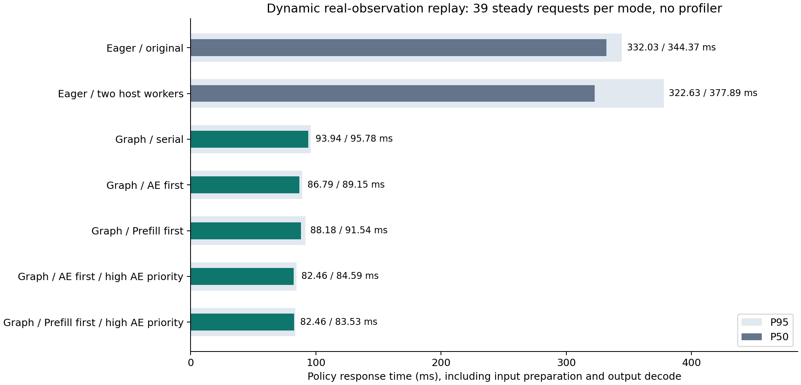

# idea2：动态 Pipeline CUDA Graph 接入与验证

已将 CUDA Graph 提交接入实际 `PipelinePolicy`。动态真实观测回放中，响应 P50 从原 eager 双 Stream 的 **332.03 ms** 降至 **82.46 ms**，约 **4.03×**；P95 从 **344.37 ms** 降至 **84.59 ms**。主要收益来自消除逐 kernel 的 Python 提交，Graph 并行相对 Graph 串行的响应 P50 另有约 **1.14×** 改善。

这是 opt-in 运行路径，启动时加 `--cuda-graphs`；现有 eager 默认配置保持可用。没有改模型权重、结构、D10 递推、attention 算法、Draft / Verify、Pool 状态机或控制器的 H / R。

## 实现与所有权

- 新增 [runtime_graph.py](../../../preparations/idea2/runtime_graph.py)：每个 Pool 槽绑定一份固定地址的完整 KV。每槽各有一个 Prefill Graph 和一个 AE Graph，共四个独立 private graph pool、两份完整 KV；没有第三份 KV staging copy。
- Prefill 只在 Pool 成功 reserve 的 `BUILDING` 槽执行；还会检查没有 lease、reader 或已提交 ready Event。新图像、tokens、image/token mask 拷到该槽固定输入地址，再 replay。发布仍由原 Pool 的 ready Event 完成状态决定。
- AE 根据本次固定的 Lease 选择对应 Graph，直接读取旧槽 KV；只更新当前请求的 state 和 noise，不把当前观测的 mask 错用于旧 KV。AE 输出从 Graph workspace clone，完成 Event 包含这个 copy，controller 获得独立输出。
- 动态 mask、position 和 suffix attention 在 Graph 内按实际数据重算；只将形状、suffix attention 分块规则、dt / 初始 time 等常量固定。神经网络和 CUDA FP32 D10 时间递推复用此前已逐步验证的 Graph-safe 路径。
- 两个模块各用专属 stream，输入准备 Event 控制 staging；Graph 使用 owner 主线程提交，明确拒绝同时开启 Host Workers。Pool / Lease 的 reserve、publish、release 全留在 owner 线程。
- `reset` / 任务切换排空原 Pool 所属事件，保留可复用的捕获；输入 shape / dtype / device 改变时，先 drain / 清空 Pool、释放旧 Graph 两槽，再重新捕获。`close` 排空所属 stream 后释放 Graph buffers。
- 捕获只发生在没有 Pool lease / reservation 的冷启动或布局变化处；构建每槽的临时 warmup KV 在捕获前释放，持续保留的完整 KV 不超过两份。

[policy.py](../../../preparations/idea2/policy.py) 保留原模式和诊断字段，新增 `cuda_graphs`、`ae_priority`、`graph_setup_ms` 与 `graph_kv_buffers`。Graph 的物理两份 KV 在 reset 后仍可保留用于复用；`pool.live_snapshots` 继续表示逻辑有效槽数，两者含义不同。

## 动态真实观测回放，无 profiler

GPU2：RTX 4090，UUID `GPU-83fdf473-8633-29d3-4a42-e482cfdf0c25`；torch 2.7.1+cu126。使用与上一轮相同 checkpoint / 真实 LIBERO 输入 bank；40 个连续请求循环使用 bank 中 17 条观测，seed 为 `1701+i`，每臂 10 次 warmup 后 reset。统计排除 request0，剩余 39 个稳态请求。各臂独立建立 / 关闭 policy，没有跨臂并行 GPU 运行。

基准 `original` 直接加载改动前保存的 [policy.py](../../../results/idea2/runtime_graph_20261021/baseline/policy.py)，即上一轮交付的 eager 单线程 `prefill_first`；未用 Graph 代码模拟基准。观测、noise、旧 KV source 全按真实请求执行。

计时包含输入变换 / H2D、AE、后台 Prefill 提交、D2H / decode 和响应构造；不包含 RPC 网络、仿真或机器人执行。所有模式稳态实际 KV age 均为 1。

| 模式 | 动作内部可用 P50 ms | 响应 P50 ms | 响应 P95 ms | 相对原实现 P50 |
| --- | ---: | ---: | ---: | ---: |
| 原 eager 双 Stream | 331.28 | 332.03 | 344.37 | 1.000× |
| eager 双 Worker，Prefill first | 321.08 | 322.63 | 377.89 | 1.029× |
| Graph serial_reuse | 56.29 | 93.94 | 95.78 | 3.535× |
| Graph AE first | 86.04 | 86.79 | 89.15 | 3.826× |
| Graph Prefill first | 87.53 | 88.18 | 91.54 | 3.766× |
| Graph AE first，AE priority=-1 | 81.82 | **82.46** | 84.59 | **4.027×** |
| Graph Prefill first，AE priority=-1 | 81.86 | **82.46** | **83.53** | **4.026×** |

高优先级下两种提交顺序的 P50 差约 0.002 ms，不能据此认定哪一种稳定更快；本轮使用 AE first 作为建议起点。各臂按固定顺序运行，未做跨进程多轮置信区间估计。



Graph serial_reuse 的动作先产生，但 policy 要等串行 Prefill 完成才返回响应。因此动作内部可用时间不能当作 controller 已收到动作；并发相对串行的“响应变快”和“AE 自身变慢”可以同时成立。

| 模式 | AE CPU 提交 P50 ms | Prefill CPU 提交 P50 ms | AE Event P50 ms | Prefill Event P50 ms |
| --- | ---: | ---: | ---: | ---: |
| 原 eager 双 Stream | 228.720 | 67.056 | 228.648 | 76.023 |
| eager 双 Worker | 275.634 | 106.330 | 275.432 | 106.785 |
| Graph 串行 | 0.332 | 1.251 | 27.322 | 36.894 |
| Graph AE first | 0.323 | 1.226 | 56.971 | 43.252 |
| Graph Prefill first | 0.248 | 1.299 | 56.325 | 42.730 |
| Graph AE first，高优先级 | 0.337 | 1.248 | 52.527 | 45.605 |
| Graph Prefill first，高优先级 | 0.246 | 1.340 | 51.789 | 45.043 |

原 eager / 双 Worker 各 39/39 次 AE 在提交函数返回时已完成；五种 Graph 模式均为 **0/39**，确认主要 CPU 提交瓶颈被移除。Event 区间含资源等待和间隙，不等于 kernel 纯执行时间。

首轮 Graph setup 约 **3.57–4.51 秒**，不包含模型加载；正式测量所有请求 `graph_setup_ms=0`，两槽 KV 地址保持不变。输入布局变化会重新支付捕获成本，任务内容 / mask 变化且布局不变时复用捕获。小样本单臂 smoke 的 allocated peak 约 6.70 GiB，仅作为本机观察值，不是各配置的内存对照。

完整结果：[steady/result.json](../../../results/idea2/runtime_graph_20261021/steady/result.json)。每次运行保存源码快照、SHA256、bank SHA、实际参数和 GPU UUID。原始输出只保留到同源参考验证完成，JSON 记录误差和来源。

## 正确性与生命周期检查

280 个正式回放请求逐个按实际记录的 KV source 重建 eager 参考：normalized / decoded 输出最大绝对误差均为 **0**。所有末尾仍有效的新 KV 与对应观测的 eager 全量 cache hash 一致，稳态 AE 始终读取旧 KV，逻辑槽数不超过 2。

参考校验在对应 Graph policy 完全关闭后执行，避免为了校验在两份 captured KV 之外额外保留第三份 GPU KV。额外生命周期审计与 nsys 结果单独记录，不污染性能数据。

独立 GPU 生命周期审计覆盖 33 个请求、33 次完整 prefix hash 校验，normalized / decoded 最大误差均为 **0**。覆盖内容：

- `async_reuse` 的 interval=1/2/4、`serial_reuse`、`fresh_serial`。
- 交替屏蔽一幅图像及有效 token，检验动态 prefix/suffix mask 和 position。
- 指令变化时复用原捕获，但 reset epoch / request 并生成当前任务 KV。
- token 序列长度变化时排空并重建两槽 Graph，恢复任务标识后发布新 KV。
- Prefill graph 已 replay 后注入异常，确认 AE / Prefill stream 排空、lease 释放、Pool 清空；随后同一 engine 恢复预测。
- 普通 reuse 前后旧 KV hash 不变、两槽存储不重叠、reset 后逻辑有效槽数为 0。

审计见 [lifecycle_final/result.json](../../../results/idea2/runtime_graph_20261021/lifecycle_final/result.json)。28 项 CPU 回归测试通过，包含动态 mask 的原始 D10 数学一致性、非法槽覆写 / stale lease 拒绝，以及布局 reset 的任务标识恢复；见 [tests.log](../../../results/idea2/runtime_graph_20261021/tests.log)。

稳态性能测量之后，布局变化审计发现并修复了 reset 清空 task 导致新前缀被拒绝发布的问题。最终生产代码相比稳态测量快照仅在该分支增加 `self.pool.task = instruction`，见 [layout_fix_diff.txt](../../../results/idea2/runtime_graph_20261021/layout_fix_diff.txt)。稳态测量所有请求布局不变、`graph_setup_ms=0`，未进入该分支；最终代码另通过完整生命周期审计和最终 nsys 回放。Graph 核心、原始模型后端、scheduler、提交逻辑与稳态测量源码一致。

## nsys：实际动态 Pipeline 的 kernel 重叠

另用最终代码运行每臂 5 次 warmup + 5 个 profile 请求。每个 capture 对应一臂；统计排除 request0，保留 4 个稳态请求。使用 `--cuda-graph-trace=node`，通过 kernel 的 correlationId 关联实际 `cudaGraphLaunch` / kernel launch，再由该 API 所处的模块 NVTX 归属 AE / Prefill。交集使用同 GPU / context、不同 stream 的真实 kernel start/end，不用 CPU NVTX 或 Event 包络代替。

| 模式 | AE kernel 活跃 ms/次 | Prefill kernel 活跃 ms/次 | 真实 kernel 交集 ms/次 | kernel 并集 ms/次 | 交集 / 并集 |
| --- | ---: | ---: | ---: | ---: | ---: |
| 原 eager | 31.347 | 39.406 | 0.001 | 70.752 | 0.002% |
| eager 双 Worker | 33.621 | 39.960 | 4.431 | 69.150 | 6.408% |
| Graph 串行 | 27.789 | 36.126 | 0.000 | 63.915 | 0.000% |
| Graph AE first | 35.192 | 42.071 | 19.652 | 57.611 | 34.112% |
| Graph Prefill first | 30.539 | 37.750 | 5.656 | 62.634 | 9.030% |
| Graph AE first，高优先级 | 43.843 | 43.454 | **32.388** | **54.910** | **58.984%** |
| Graph Prefill first，高优先级 | 41.055 | 39.819 | 22.238 | 58.637 | 37.925% |

7 份 capture 共 **447,560 个 kernel 全部关联 launch**；另有每请求 13 个输入准备 kernel（共 455 个）不归属 AE / Prefill，未计入上述重叠率。memcpy / memset activity 不计入 kernel 交集；以 kernel 实现的数据拷贝仍属于实际 kernel。每个 Graph capture 有 10 次 Graph launch，**没有 BeginCapture，也没有 cudaDeviceSynchronize**，说明稳态测量没有重新捕获或新增全设备屏障。35 个 profile 请求也全部通过同源输出数值校验，误差为 0。

node tracing 会显著增加 Graph launch 的 CPU 开销并改变两模块启动间距，因此这里的重叠率只描述已记录 trace，不是无 profiler 运行的精确重叠率；顺序优劣和加速比以前面的无 profiler 测量为准。GPU 并发仍有干扰：高优先级 AE first 相对 Graph 串行增加了约 23.4 ms 的两模块 kernel 活跃时间之和，再用约 32.4 ms 交集抵消，kernel 并集净减少约 9.0 ms。不能把全部 4.03× 归因于重叠。

- [trace_summary.json](../../../results/idea2/runtime_graph_20261021/trace_summary.json)：全部汇总，逐请求结果位于同目录 `trace_*.json`。
- [原实现 .1.nsys-rep](../../../nsys/idea2_experiment/runtime_graph_20261021.1.nsys-rep)
- [Graph 串行 .3.nsys-rep](../../../nsys/idea2_experiment/runtime_graph_20261021.3.nsys-rep)
- [Graph AE first .4.nsys-rep](../../../nsys/idea2_experiment/runtime_graph_20261021.4.nsys-rep)
- [Graph Prefill first .5.nsys-rep](../../../nsys/idea2_experiment/runtime_graph_20261021.5.nsys-rep)
- [Graph AE first，高优先级 .6.nsys-rep](../../../nsys/idea2_experiment/runtime_graph_20261021.6.nsys-rep)
- [Graph Prefill first，高优先级 .7.nsys-rep](../../../nsys/idea2_experiment/runtime_graph_20261021.7.nsys-rep)

在 GUI 搜索 `runtime/graph_ae_first_high/2` 并展开 GPU streams。`.2.nsys-rep` 为双 Worker 对照。Profile 参数、逐样本结果和最终源码快照见 [profile/result.json](../../../results/idea2/runtime_graph_20261021/profile/result.json)。

## 启动与复现

```bash
CUDA_VISIBLE_DEVICES=2 JAX_PLATFORMS=cpu JAX_PLATFORM_NAME=cpu \
OMP_NUM_THREADS=4 MKL_NUM_THREADS=4 OPENBLAS_NUM_THREADS=4 \
OPENPI_DATA_HOME=/root/nfs/embodied/benchmark/shared/checkpoints/openpi \
PYTHONPATH=.:policies/openpi/src policies/openpi/.venv/bin/python \
  -m preparations.idea2.server \
  --checkpoint shared/checkpoints/openpi/pi0_libero_pytorch_idea2 \
  --cuda-graphs --no-host-workers --submission-order ae_first \
  --ae-priority -1 --diagnostics
```

配置 RPC 可传 `cuda_graphs=True, host_workers=False, ae_priority=-1` 及原有 `mode`、`interval`、`submission_order`。当前 Graph 实现限定原始 pi0 / D10；不支持 pi05 或其他采样步数时明确报错，不静默改变计算。

相同环境下，用 [runtime_graph_bench.py](../../../preparations/idea2/runtime_graph_bench.py) 重跑：

```bash
policies/openpi/.venv/bin/python -m preparations.idea2.runtime_graph_bench \
  --output results/idea2/runtime_graph_reproduce_NEW --warmup 10 --requests 40
```

使用 [runtime_graph_audit.py](../../../preparations/idea2/runtime_graph_audit.py) 进行独立生命周期审计：

```bash
policies/openpi/.venv/bin/python -m preparations.idea2.runtime_graph_audit \
  --output results/idea2/runtime_graph_audit_NEW
```

nsys 使用上述相同环境，在 benchmark 的 Python 命令前加以下前缀，将 benchmark 参数改为 `--warmup 5 --requests 5 --profile` 并使用新的结果目录：

```bash
nsys profile --trace=cuda,nvtx --cuda-graph-trace=node \
  --sample=none --cpuctxsw=none --capture-range=cudaProfilerApi \
  --capture-range-end=repeat:7 --force-overwrite=false \
  --output=nsys/idea2_experiment/runtime_graph_reproduce_NEW
```

依次导出 7 个 SQLite：`nsys export --type sqlite --output NEW.N.sqlite NEW.N.nsys-rep`，再用 [scheduling_trace.py](../../../preparations/idea2/scheduling_trace.py) 分析；本轮汇总脚本为 [analyze_traces.py](../../../results/idea2/runtime_graph_20261021/analyze_traces.py)。

本轮未重跑 LIBERO 成功率，未宣称机器人闭环 4×；4.03× 是指定真实观测 bank 的进程内推理响应改善。Graph 并发仍存在前一轮识别的 GPU 资源竞争，详细分析见[上一轮根因报告](idea2_overlap_root_cause_20261021.md)。
