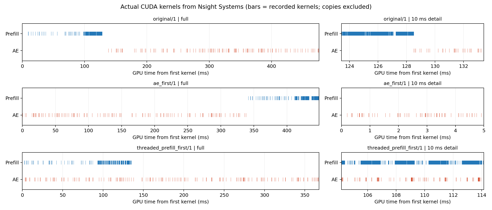

# idea2 Pipeline 调度修复与实验结果（2026-10-21）

本次只修改 Pipeline 调度与诊断；未修改模型结构、原始 `build_prefix()`／`generate()` 数学计算、D10 采样、Draft／Verify、Pool／Lease 协议或已有 CUDA Graph 实现。

## 结果与采用方式

两个 Host Worker 已让实际 AE／Prefill kernel 发生重叠，但重叠仍有限。单线程仅更换提交顺序未解决问题。正式无 profiler 测量中，双 Worker `prefill_first` 的固定 KV 全任务 P50 为 **270.13 ms**，原始双 Stream 为 **288.01 ms**（**1.066×**）；真实观测回放的响应 P50 从 **324.15 ms** 降到 **306.84 ms**（**1.056×**）。

双 Worker `ae_first` 的真实回放响应 P50 为 332.78 ms，比原始版本慢；最佳 P50 配置的 P95 也从 330.22 ms 增至 359.93 ms。不能把“出现重叠”解释为稳定、全面加速。因此保留单线程默认设置，双 Worker 通过明确开关启用。推荐根据吞吐／尾延迟需要选择，不能宣称硬实时收益。

## 根因与同步审计

1. **主要瓶颈是 host 提交。** 原实现由一个 Python 线程先执行完整 `build_prefix()`，再执行完整 `generate()`；两个 CUDA Stream 并不会让 Python 同时执行两个调用。正式测量中，单线程 AE 的 CPU 提交约 222 ms；`ae_first` 的 100/100 次 AE 完成 Event 在 `generate()` 返回后已经就绪。再提交 Prefill 时已经没有 AE 工作可重叠。
2. **存在局部隐式同步，但没有发现两模块之间的全设备屏障。** 后端两函数没有 `cuda.synchronize()`／`wait_stream()`。原始模型创建 CUDA 时间标量及 attention mask 的 H2D 过程中，每次 AE 有 12 次 `cudaStreamSynchronize`，Prefill 有 1 次。trace 的 API 累计等待很小，不能把 222 ms 全归因于同步。这些是局部 stream 等待，不是 Prefill 等待 AE 完成。
3. **正常路径只等待必要依赖。** 输入准备／noise 的 ready Event 是两个 worker 的共同依赖；AE 完成 Event 控制输出和 reader 释放；Prefill ready Event 完成后才允许发布。初始化、serial 模式和 reset 保留自身所需的 Event 等待。异常路径只排空所属 Stream，避免输入或租约提前释放。
4. **共享权重／缓存没有造成强制串行化。** 本次 Pipeline 是 eager，没有 Graph replay 或共享 Graph 输出 Buffer。原替换版 Gemma 在 `use_cache=False` 时只拼接旧 KV，不调用 cache.update。新 KV 写入已 reserve 的另一槽，旧 KV 的 Lease 在全 D10 与输出取回期间固定。固定 KV 全量 hash、新 KV hash、地址隔离及数值检查全部通过。已有独立 Graph 微基准及其 private pools 完全未改。
5. **仍有 host 争用与少量 GPU 竞争。** 双 Worker 下两模块的 CPU 提交／Event 区间反而变长；下表的真实 kernel 忙碌时间远小于这些区间，表明仍有大量提交空隙。AE kernel 忙碌时间小幅增加与 GPU 资源竞争相符，但没有硬件 occupancy／CPU 采样证据，不能把线程开销精确拆成 GIL、驱动锁或抢占比例。

## 改动

- [policy.py](../../../preparations/idea2/policy.py)：增加 `submission_order`、`host_workers`、`diagnostics`；worker 只提交 NN 任务，Pool 的 reserve／submitted／publish／release 仍全部由 owner 主线程完成。两任务先固定旧 Lease，再提交；收集 Future 仅等待 host 提交，GPU 完成仍由 Event 管理。
- [submission.py](../../../preparations/idea2/submission.py)：每模块独立的持久 Host Worker 与显式 Stream；记录 CPU 提交起止、Event 提交后／检查时完成状态、完成后的 Event 区间。未完成的 Prefill 诊断延后收集，仅保留 Event，不额外持有 KV；reset 会返回排空后的诊断。
- [server.py](../../../preparations/idea2/server.py)：提供 CLI 开关；shutdown／异常退出关闭 worker 并 drain。配置 RPC 同样支持这些参数。
- [scheduling_bench.py](../../../preparations/idea2/scheduling_bench.py)、[scheduling_trace.py](../../../preparations/idea2/scheduling_trace.py)：原始版本／两顺序／双 Worker 对照、真实观测回放、数值与新旧 KV 检查、nsys kernel 交集分析。
- [test_submission.py](../../../preparations/idea2/test_submission.py)：提交顺序、旧 KV 固定、主线程 Pool 所有权、并发 barrier、异常清理、未完成 Event 诊断及 kernel 区间统计。共 22 项回归测试通过。

## 无 profiler：固定旧 KV 同任务对照

GPU2：RTX 4090，UUID `GPU-83fdf473-8633-29d3-4a42-e482cfdf0c25`；torch 2.7.1+cu126。相同已加载 checkpoint、两条真实观测、显式 seed1701、完整 Prefill＋D10 AE。各臂 20 warmup＋100 正式样本；每轮轮换臂顺序。所有输入／noise 在计时前准备；计入动作 D2H／decode，所有后台任务在每臂返回前完成。`original` 直接调用未修改的原始 `experiments.pair()`；原实现每次新建后台 Stream，候选复用持久 Stream，实际 policy 本来就使用持久后台 Stream，故不能把微基准的全部改善归于重叠。

| 模式 | AE CPU 提交 | Prefill CPU 提交 | AE Event 区间 | Prefill Event 区间 | 动作可用 P50 | 全部完成 P50 |
| --- | ---: | ---: | ---: | ---: | ---: | ---: |
| 串行参考（AE→输出→Prefill） | 237.19 | 65.30 | 237.20 | 74.33 | 237.46 | 310.86 |
| 原始双 Stream | 221.48 | 64.80 | 221.49 | 74.01 | 288.01 | 288.01 |
| 单线程 ae_first | 221.72 | 64.42 | 221.72 | 73.35 | 286.54 | 295.28 |
| 单线程 prefill_first | 222.41 | 64.28 | 222.42 | 72.98 | 286.80 | 286.81 |
| 双 Worker ae_first | 282.04 | 114.15 | 282.08 | 114.79 | 283.78 | 283.79 |
| 双 Worker prefill_first | 269.32 | 120.97 | 269.33 | 121.59 | 270.12 | 270.13 |

单位均为 ms。CPU 提交耗时包含 CUDA API 的局部等待，不能视为纯 CPU 计算；CUDA Event 区间包含 host 未及时提交导致的空隙与资源等待，不能视为 kernel 纯执行时间。P95／逐样本原始数据见 [steady/result.json](../../../results/idea2/scheduling_fix_20261021/steady/result.json)。

## 无 profiler：真实 PipelinePolicy 观测回放

每模式 20 warmup 后 reset，再回放 40 个请求（循环使用 17 条真实观测）；汇总排除 request0 初始化，剩 39 请求／模式。包含输入变换、H2D、AE、后台 Prefill 提交、D2H、decode 和 policy 响应构造；不含 RPC 网络传输、机器人执行或仿真闭环。所有模式的实际 KV age 均为 1（初始化为 0）。`original` 使用修改前保存的 [policy.py](../../../results/idea2/scheduling_fix_20261021/baseline/policy.py)，没有用新代码模拟旧模式。

| 模式 | 动作可用 P50 | 响应 P50 | 响应 P95 | 相对原始响应 P50 加速比 |
| --- | ---: | ---: | ---: | ---: |
| 原始双 Stream | 323.45 | 324.15 | 330.22 | 1.000× |
| 单线程 ae_first | 319.87 | 320.45 | 332.67 | 1.012× |
| 单线程 prefill_first | 317.81 | 318.51 | 327.06 | 1.018× |
| 双 Worker ae_first | 330.58 | 332.78 | 365.11 | 0.974× |
| 双 Worker prefill_first | 305.93 | 306.84 | 359.93 | 1.056× |

## nsys：实际 kernel 重叠

单独运行 nsys，未将受 profiler 扰动的耗时用于上面的加速比。固定 KV 每模式捕获 3 次，实际 policy 每模式捕获 5 请求（下表 runtime 排除 request0）。以 CUDA launch 的 correlationId＋进程身份关联实际 kernel，通过 launch 所在线程内的模块 NVTX 归属 AE／Prefill；只对同 GPU／context、不同 Stream 的实际 kernel 时间区间求交，排除 memcpy／memset。分母为两模块 kernel 活跃时间并集，不是 NVTX 包络或设备利用率。

| 模式 | 固定 KV：重叠／活跃并集 ms | 固定 KV 重叠率 | runtime 稳态：重叠／活跃并集 ms | runtime 稳态重叠率 |
| --- | ---: | ---: | ---: | ---: |
| 串行参考（AE→输出→Prefill） | 0.0000／211.843 | 0.000% | — | — |
| 原始双 Stream | 0.0730／211.590 | 0.034% | 0.1461／283.900 | 0.051% |
| 单线程 ae_first | 0.0000／211.913 | 0.000% | 0.0000／284.089 | 0.000% |
| 单线程 prefill_first | 0.0974／211.805 | 0.046% | 0.0998／283.977 | 0.035% |
| 双 Worker ae_first | 10.6145／208.544 | 5.090% | 17.5800／277.553 | 6.334% |
| 双 Worker prefill_first | 10.9906／208.187 | 5.279% | 16.3681／278.210 | 5.883% |

| 固定 KV 模式 | AE kernel 忙碌 ms／次 | Prefill kernel 忙碌 ms／次 |
| --- | ---: | ---: |
| 串行参考（AE→输出→Prefill） | 31.356 | 39.258 |
| 原始双 Stream | 31.266 | 39.288 |
| 单线程 ae_first | 31.371 | 39.267 |
| 单线程 prefill_first | 31.387 | 39.247 |
| 双 Worker ae_first | 33.310 | 39.743 |
| 双 Worker prefill_first | 33.344 | 39.715 |

实际时间线（每条短横线均为真实 kernel，不画 NVTX 包络）：



- [固定 KV：scheduling_final_20261021.1.nsys-rep](../../../nsys/idea2_experiment/scheduling_final_20261021.1.nsys-rep)
- [实际 policy：scheduling_final_20261021.2.nsys-rep](../../../nsys/idea2_experiment/scheduling_final_20261021.2.nsys-rep)
- [固定 KV kernel 分析](../../../results/idea2/scheduling_fix_20261021/final_pair_trace.json)／[runtime kernel 分析](../../../results/idea2/scheduling_fix_20261021/final_runtime_trace.json)

用同版或更新版 Nsight Systems GUI 打开 `.nsys-rep`，搜索 `pair/original/1`、`pair/ae_first/1`、`pair/threaded_prefill_first/1`，以及 `runtime/threaded_prefill_first/1`，展开 CUDA GPU 的各 Stream。工具为 CUPTI 软件 tracing，未采集 CPU 调度采样或硬件 occupancy；统计仅代表本次已记录 kernel，不证明没有额外外部干扰。

## 正确性与生命周期验收

- 原始 native 与拆分路径误差为 0；600 个正式固定 KV 配对的 normalized／decoded 误差均为 0。
- 六种调度的 Prefill 新 KV 均与独立串行参考全量 hash 一致；与旧 KV 存储地址无交集；固定旧 KV 运行前后全量 hash 相同。
- 200 个真实 policy 请求均按实际记录的 KV source 单独重建参考，normalized／decoded 误差均为 0；suffix 与 reference state 仍来自当前请求，稳态 AE 始终使用旧 KV，Pool live snapshots 始终不超过 2。
- 同步完成前不发布、reader 完成前不回收、reset epoch／generation 隔离均保留；worker 异常会先 join host 任务并 drain 两个所属 Stream，再释放 Lease／清除 reservation。
- [22 项测试日志](../../../results/idea2/scheduling_fix_20261021/tests.log)；[无 profiler 完整结果](../../../results/idea2/scheduling_fix_20261021/steady/result.json)；[最终 profile 数值凭据](../../../results/idea2/scheduling_fix_20261021/profile_final/result.json)。每次正式运行保存了源码快照、SHA256、GPU UUID、bank SHA 和实际参数。
- 正式测速与最终 profile 使用完全相同的源码。实验结束后仅将默认参数恢复为 `prefill_first`＋`host_workers=False`；各实测候选均显式传入参数，其代码路径没有变化。差异与最终源码 hash 保存在 [final_configuration.json](../../../results/idea2/scheduling_fix_20261021/final_configuration.json)，最终默认值调整后再次通过 22 项测试。
- 固定 KV 捕获的 232164 个 kernel、实际 policy 捕获的 322775 个 kernel 均能关联 CUDA launch。前者全部归属 AE／Prefill；后者另有 325 个输入准备 kernel（每请求 13 个），不计入两模块重叠率。

## 使用与复现

启动优化配置（保留当前模型与 checkpoint）：

```bash
CUDA_VISIBLE_DEVICES=2 JAX_PLATFORMS=cpu OMP_NUM_THREADS=4 \
OPENPI_DATA_HOME=/root/nfs/embodied/benchmark/shared/checkpoints/openpi \
PYTHONPATH=.:policies/openpi/src policies/openpi/.venv/bin/python \
  -m preparations.idea2.server \
  --checkpoint shared/checkpoints/openpi/pi0_libero_pytorch_idea2 \
  --submission-order prefill_first --host-workers --diagnostics
```

单线程对照用 `--no-host-workers --submission-order ae_first` 或 `--no-host-workers --submission-order prefill_first`。配置 RPC 同样接受 `submission_order`、`host_workers`、`diagnostics`；mode／interval 含义不变。

从 benchmark 根目录运行正式对照；输出目录必须是新目录：

```bash
CUDA_VISIBLE_DEVICES=2 JAX_PLATFORMS=cpu JAX_PLATFORM_NAME=cpu \
OMP_NUM_THREADS=4 MKL_NUM_THREADS=4 OPENBLAS_NUM_THREADS=4 \
OPENPI_DATA_HOME=/root/nfs/embodied/benchmark/shared/checkpoints/openpi \
PYTHONPATH=.:policies/openpi/src policies/openpi/.venv/bin/python \
  -m preparations.idea2.scheduling_bench \
  --output results/idea2/scheduling_reproduce_NEW \
  --warmup 20 --samples 100 --threads --runtime-requests 40
```

nsys 使用相同环境，把 Python 命令放在以下前缀后，另选新的 output，并将 runner 参数改为 `--warmup 5 --samples 3 --threads --runtime-requests 5 --profile`：

```bash
nsys profile --trace=cuda,nvtx,osrt --sample=none --cpuctxsw=none \
  --capture-range=cudaProfilerApi --capture-range-end=repeat:2 \
  --force-overwrite=false --output=nsys/idea2_experiment/scheduling_reproduce_NEW
```

两次 capture 分别输出 `.1.nsys-rep`（固定 KV）与 `.2.nsys-rep`（policy）。用 `nsys export --type sqlite --output NEW.sqlite NEW.nsys-rep` 导出，再运行 `python -m preparations.idea2.scheduling_trace NEW.sqlite --output NEW_analysis.json`。使用 OpenPI venv 的 Python。

本轮没有重跑 LIBERO 成功率，没有改变动作算法；上述改善是当前单卡 eager 后端、指定真实输入 bank 的推理调度结果。仍有明显 CPU 提交瓶颈，约几个百分点的 kernel 重叠不能视为充分流水化。
