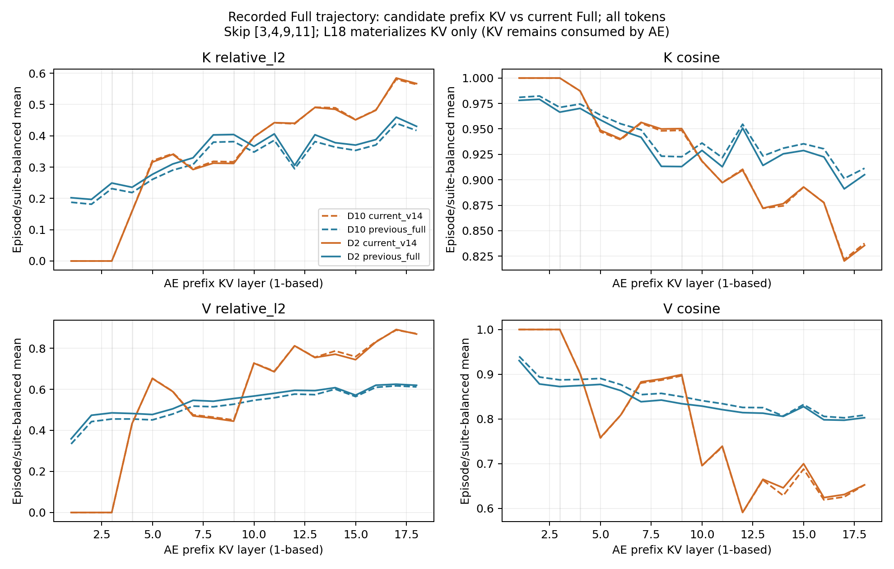
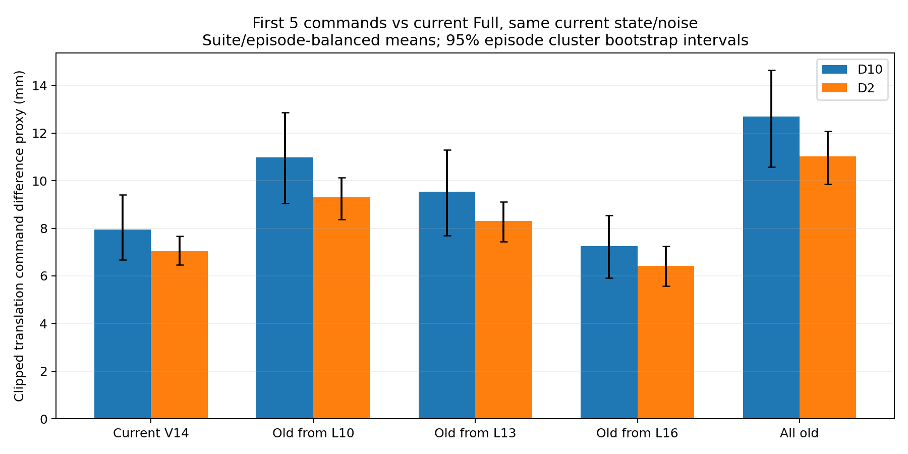

# 临时实验结论：V14 后部 KV 是否不如上一重规划点的 Full KV

日期：2026-10-24。固定探索范围已完成，两个模型进程均实际退出；不继续扩大实验。

**结论：你的猜想有部分数据支持。V14 的后部 KV 相对当前 Full 出现较大偏差，有些层确实不如旧 Full KV 接近当前 Full；但只有替换最后三层 L16–18 出现约 9% 的平均短前缀误差改善信号，大段替换反而更差。该信号有套件差异，均值变化的探索区间跨零，尚未证明闭环成功率或速度改善。**

## 1. 怎么测的

- 模型为既有 π0／LIBERO checkpoint 的 Triton 路径，V14 跳过原始 1-based `[3,4,9,11]` 的 hidden 更新，保留每层供 AE 使用的 KV shell；vision、AE 层数不变。
- 使用已有 Full 真实执行轨迹，四套件各 task00/task05、init00/init01，共 **16 episode、8 个 suite-task**。按轨迹位置预选样本，不使用误差或结果挑点。
- D2 主测试：每条轨迹 4 对，共 **64 对**；D10 确认：每条轨迹最早／最晚各一对，共 **32 对**。后者是前者选样的子集，但本报告跨 D 的总体均值来自不同样本量，不能直接解释为去噪步数效果。
- 每对为相邻重规划点，间隔 **5 个真实执行动作／250 ms**。上一“帧”在本文指上一重规划观测，不是连续相机帧。
- 每个当前观测分别获得 Full 和 V14 的逐层 K/V，以及上一观测的 Full K/V。AE 始终使用 **当前机器人 state、同一当前噪声、相同 D／日程**，比较候选输出与该 D 下当前 Full 输出。
- 六个条件：当前 Full；当前 V14；全部旧 Full KV；V14 L1–9＋旧 Full L10–18；V14 L1–12＋旧 Full L13–18；V14 L1–15＋旧 Full L16–18。

混合只替换 AE 消费的逐层 prefix KV，不将旧 hidden 插回 VLM 后重新传播。本次每个旧缓存都是上一点新算的 Full；不代表实际部署中可以连续很多轮不刷新。

## 2. 后层数值确实受影响，但不是逐层单调恶化

逐层同时测 cosine、relative L2 `||candidate−Full||/||Full||` 与 RMS 比；K、V 分开，保存全部 token／视觉 token／语言 token 三种分组。输入是上述代表性真实轨迹观测，不是随机初始化数据。

下表为 D2 的全部有效 token、episode／suite 等权均值。relative L2 越低越接近当前 Full：

| 原始层 | 当前 V14 K 偏差 | 旧 Full K 偏差 | 当前 V14 V 偏差 | 旧 Full V 偏差 |
| --- | ---: | ---: | ---: | ---: |
| L3 | 0.000 | 0.249 | 0.000 | 0.485 |
| L5 | 0.316 | 0.277 | 0.652 | 0.477 |
| L9 | 0.312 | 0.404 | 0.445 | 0.555 |
| L12 | 0.440 | **0.306** | 0.812 | **0.595** |
| L15 | 0.451 | **0.370** | 0.744 | **0.571** |
| L18 | 0.567 | **0.430** | 0.869 | **0.619** |

L18 的 K cosine：当前 V14 为 **0.835**，旧 Full 为 **0.905**；V cosine：当前 V14 为 **0.652**，旧 Full 为 **0.803**。最后几层上，旧特征虽有 250 ms 的时间差，仍比跳层后的特征更接近当前 Full。

不过，曲线在跳层后跃变，也会在后续层部分恢复。例如 L9 的当前 V14 KV 比旧 Full 更接近参考。因此适合表述为“后部存在更明显的结构偏差”，不能称“越往后每层都更差”。KV 分布偏差也不等同于该层对动作的破坏程度。

L3 的 KV 在该层 hidden 更新之前生成，故首次跳层是 L3，并不要求 L3 的 KV 立即不同。Triton L18 只生成 AE 所需 KV，不更新无后续用途的 prefix hidden；不能据此解释成 L18 不重要。

读图：橙色为当前 V14，蓝色为上一点 Full；左列越低越好，右列越高越好。D2／D10 线的微小差别来自样本集合不同，前缀 KV 本身不依赖 AE 迭代步数。

## 3. 真正换 KV 后，只有最后三层出现改善信号

指标为前 5 步 clip 后三维平移命令差的 L2 均值，乘 50 mm 控制缩放系数。它是 **控制目标增量差代理，不是机器人实际末端位置误差，也不是任务成功率**。

| AE 使用的 KV | D2，64 对 | D10，32 对 |
| --- | ---: | ---: |
| 当前 Full（参考） | 0 | 0 |
| 当前 V14 | 7.047 mm | 7.950 mm |
| V14＋旧 Full L10–18 | 9.298 mm | 10.976 mm |
| V14＋旧 Full L13–18 | 8.300 mm | 9.530 mm |
| **V14＋旧 Full L16–18** | **6.426 mm** | **7.251 mm** |
| 全部旧 Full KV | 11.027 mm | 12.694 mm |

替换 L16–18 的均值分别降低 **8.82%／8.78%**。逐对有 **42/64／21/32（均 65.6%）** 比当前 V14 更接近参考；不是每个点都改善。

按 suite 分层、episode 成簇、2000 次 bootstrap、seed241024，对“混合减 V14”的前缀误差差值：

- D2：**−0.622 mm，95% 探索区间 [−1.515,+0.275] mm**。
- D10：**−0.698 mm，95% 探索区间 [−2.651,+1.100] mm**。

两个均值区间均跨零，当前只能称有希望的信号。这些区间仅按 episode 聚类，未对同 task 多 init 的相关性、比较多个 cutoff 和先前选择 V14 的过程作校正，不是确认性显著性检验。

较大范围替换虽然在后层 KV 数值指标上可能更接近 Full，动作却更差，说明 **逐层 KV 更相似不保证跨层组合和最终动作更好**。旧观测丢失的新信息、层间组合关系及 AE 对各层的不同敏感度都可能参与；本实验不能把各机制单独归因。

## 4. 套件差异：Spatial 是明显反例

| 套件 | D2 当前 V14 → 替换 L16–18 | D10 当前 V14 → 替换 L16–18 |
| --- | ---: | ---: |
| Spatial | 6.286 → **7.192 mm，变差** | 6.986 → **10.475 mm，变差** |
| Object | 8.627 → **7.346 mm** | 10.731 → **7.220 mm** |
| Goal | 7.127 → **5.846 mm** | 7.172 → **5.424 mm** |
| LIBERO-10 | 6.149 → **5.318 mm** | 6.909 → **5.887 mm** |

每套件仅 2 个 task、4 条轨迹，不能扩展为整个套件普遍性质。它已足以反对无条件启用旧 KV：Spatial 的负收益会抵消其他套件收益，可能需要依赖观测变化／任务特征选择复用，而不是固定所有任务复用。

旋转与夹爪也独立保存：

| 前五步指标 | D2 V14 → L16–18 混合 | D10 V14 → L16–18 混合 |
| --- | ---: | ---: |
| 旋转命令坐标 L2 | 0.04077 → 0.03014 | 0.03464 → 0.02754 |
| 夹爪符号不一致率 | 4.06% → 2.50% | 4.38% → 0% |

旋转是原生 decoded 命令坐标差，不是 SO(3) 角距离；夹爪结果样本少，未执行这些混合动作，不能据此保证抓取成功或安全。

## 5. 本轮可以做出的决定

1. **保留“V14＋旧 Full L16–18”作为后续候选。** 数值与动作层面均有值得继续探索的信号。
2. **暂不采用 L10／L13 起整段复用，也不采用全部旧 KV。** 本批动作平均误差更大。
3. **不把后层称为无用或垃圾。** 本批显示的是经过跳层后的特征偏离参考，以及一个小范围混合的局部收益；旧 KV 本身也是完整模型计算的结果。
4. 本次先完成机制判断，不继续运行闭环全套评测。若后续另行实验，优先关注 Spatial 的退化、真实缓存 age1–4、连续复用后的闭环行为，再测真正停止后层计算后的端到端收益。

## 6. 复核与复现资料

两个正式 run 的 96 对样本全部完成；D2/D10 分别使用 GPU2/GPU3，GPU0 被占用的首次尝试在加载模型前终止并保留，GPU1 未使用。模型进程均已自然退出。

检查包括：全部样本 Full/V14 L1–2 KV 逐位一致；首样本同噪声 Full 的 raw 与 decoded 重复逐位一致；同 episode 上一 request／5 step 时间间隔；混合索引与不改写原 context 的 CPU 测试。**576 个 raw 输出数组**的形状、有限值及全部 decoded 动作指标已从 NPZ 重新计算，指标最大绝对差约 **3.55e−15**；主代理另复跑 3 项 CPU 测试通过。检查记录为 [verification.json](../../../results/kv_reuse_probe/analysis_20261024/verification.json)。

- [固定方案](plan.md)、[实验代码](../../../preparations/kv_reuse_probe/probe.py)、[分析代码](../../../preparations/kv_reuse_probe/analyze.py)。
- [D2 manifest](../../../results/kv_reuse_probe/run_20261024_d2_gpu2/manifest.json)、[D2 选样](../../../results/kv_reuse_probe/run_20261024_d2_gpu2/selection.json)、[D10 manifest](../../../results/kv_reuse_probe/run_20261024_d10_gpu3/manifest.json)。每个 run 下含逐层 CSV、动作 CSV 和逐 pair raw／decoded NPZ。
- [逐层汇总](../../../results/kv_reuse_probe/analysis_20261024/layer_summary.csv)、[动作汇总](../../../results/kv_reuse_probe/analysis_20261024/action_summary.csv)、[配对差值与区间](../../../results/kv_reuse_probe/analysis_20261024/action_paired_summary.csv)、[分套件结果](../../../results/kv_reuse_probe/analysis_20261024/action_by_suite.csv)。
- [主代理完成核验](../../../results/kv_reuse_probe/analysis_20261024/root_completion_check.json)：独立核对全部 96 pair／1152 个 raw 或 decoded 数组的形状与有限值、配对时间、源代码 hash 不变、首层及重复 sanity，并重新汇总两组动作均值。所有报告本地链接可访问；两次实际执行 session 均 exit0。

结果只回答沿真实 Full 路线的同状态动作／特征问题，不是混合策略的闭环评测；也未测实时缓存失效规则与性能加速。本轮探索已停止。
