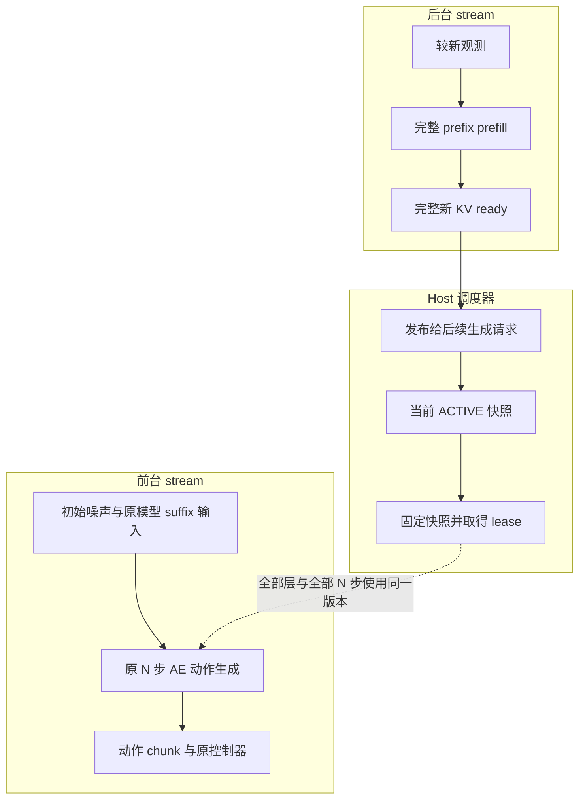
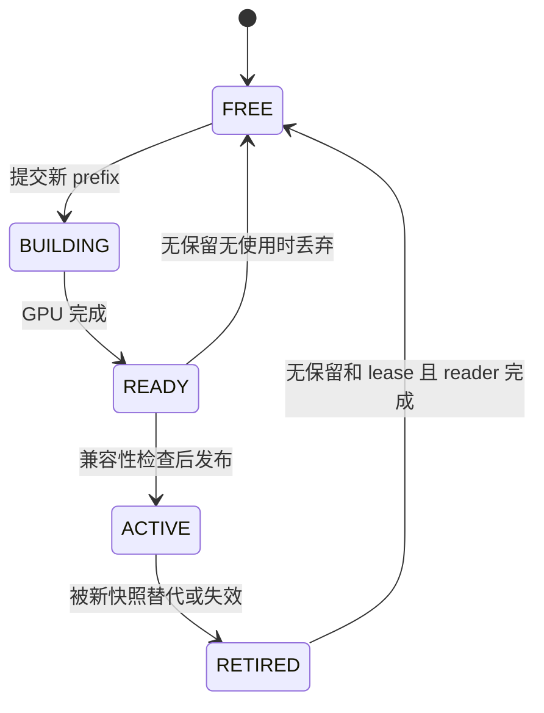

# idea2 探索性实验

主题：单 GPU 上 VLM 与 Action Expert 的模块级异步流水线  
日期：2026-10-20  
版本：v0.2，按独立探索性实验重新整理  
状态：实验设计与实施交接；尚未在目标 checkpoint 和 GPU 上完成测量。

## 0. 给 Coding Agent 的任务

本实验独立于用户的 draft–verify 研究。请直接使用原始 VLA 的正常动作生成路径，探索下面这个问题：

> 当前 Action Expert（AE）固定使用一份已经完整计算完成的 VLM prefix KV，从初始噪声经过原来的全部去噪步骤生成动作；与此同时，后台 VLM 为较新观测计算新的完整 KV。这样能否改善推理效率？条件变旧会造成多大动作偏差和任务性能损失？

**首版只做这个模块级流水线。** 不接入 draft model、verifier、接受阈值、推测动作前缀或验证失败后的 fallback。原始模型的完整动作生成就是参考基线。

实施目标是一个可以复现的最小实验，不要求先建设完整推理框架。复用现有 checkpoint、评测环境和控制器；先完成接口拆分、固定输入正确性检查与单卡微基准，再按资源做小规模闭环评估。

### 首版决定

- 单进程、单 GPU、两个 CUDA stream。
- 前台运行完整 AE 动作生成，后台运行完整 prefix prefill。
- 两个逻辑 KV 槽，先用 eager 和独立拥有的 tensor；没有空槽就推迟刷新。
- 每次动作生成固定一份 KV，全部去噪步骤结束前不更换。
- 保持模型权重、图像输入、state 路径、积分器、时间网格和去噪步数不变。
- 先测结果，不预设一定加速，也不要求预先达到某个成功率。

本文件的接口、配置和文件名都是待适配建议；不是目标仓库中已经存在的 API。

## 1. 三种架构与本实验的位置

OpenPI 的相关 π 模型中，AE 各层使用对应层的 VLM prefix K/V。公开 PyTorch 推理路径先计算 prefix cache，再让 AE 在后续去噪调用中读取它；并非只把 VLM 的最终 hidden state 传给动作头。[S1][S2]

| 架构 | AE 条件 | 调度关系 | 本实验 |
|---|---|---|---|
| 原始新条件串行 | 本次观测的完整新 KV | 本次 prefix 完成后，运行全部 AE 去噪步骤 | 保留作基线 |
| 模块级异步 | 生成开始时选定的完整已完成 KV，可能来自较早观测 | 当前完整 AE 生成与较新观测的完整 prefix 重叠 | **本次实现** |
| 层级流水线 | 同一观测相应层刚产生的 KV | VLM / AE 按层依赖交错推进 | 本次不实现 |

模块级异步让两个本来独立的计算任务有机会重叠，但使用的条件可能较旧。这既是系统调度问题，也涉及条件陈旧对策略的影响；两者要通过不同对照拆开。

首版也不增加历史动作输入、memory token 或新训练模块。缓存复用本身不会让模型获得新的历史推理能力。

### 数据流

实线表示模块处理与发布，虚线表示只读数据依赖。



## 2. 前台究竟计算什么

令 $O_j$ 为某次观测，完整 prefix 为：

$$
C_j=F_{\mathrm{prefix}}(O_j).
$$

一次生成请求 $i$ 选取已经完成的 $C_{s(i)}$，按原模型采样：

$$
x_{t_0}=\epsilon_i,\qquad
A_i=\operatorname{Generate}_{N}\bigl(C_{s(i)},S_i^{\mathrm{model}},\epsilon_i\bigr).
$$

这里：

- $\epsilon_i$ 是该次正常动作生成的初始高斯噪声。
- $N$ 是原配置的全部去噪 / 积分步骤数，不是验证分支数。
- $S_i^{\mathrm{model}}$ 表示 checkpoint 原本实际消费的 state；不存在这个输入时不能自行添加。
- 一次请求中的条件、suffix state、时间网格与输出 reference state 均按基线语义固定。

以 OpenPI 这里使用的 Euler 路径为例，时间由噪声端 $t=1$ 积分到动作端 $t=0$：

$$
x_{t_{k+1}}=x_{t_k}+(t_{k+1}-t_k)
v_\theta(x_{t_k},t_k\mid C_{s(i)},S_i^{\mathrm{model}}).
$$

实际实现必须复用目标代码的时间序列、符号、精度和循环终止条件，不凭上式另写一个近似采样器。[S1]

**整个 $N$ 步过程中都不切换 KV。** 即使后台在第 3 步完成了新 KV，第 4 步到第 $N$ 步也继续使用旧快照；新 KV 从下一次生成请求起才可选用。

**完整生成一个 horizon，不代表必须执行整个 horizon。** 每轮实际提交 / 执行多少个动作，沿用原控制器；分别记录生成长度、提交长度和实际执行长度。

## 3. 范围与实施前检查

### 3.1 保持不变的量

- 模型权重与完整层结构。
- vision encoder、图像分辨率、token 数、tokenizer、attention 语义。
- checkpoint 的 state 输入方式。
- 初始噪声分布、积分器、去噪步数、时间网格。
- 输入归一化、动作反归一化、动作坐标转换和正常 chunk 消费规则。

不要同时加入跳层、降分辨率、量化或减少去噪步数。它们会让结果无法归因于本实验。

如果目标仓库已有其他实验修改，应使用可识别的原始完整模型路径或独立配置，避免继承全局跳层开关、共享 forward monkeypatch 等行为。

### 3.2 最少审计项

| 项目 | 必须确认 |
|---|---|
| 基线身份 | 仓库 commit、checkpoint、模型变体、effective config |
| 输入输出 | 图像预处理、state、normalization stats、动作转换 |
| 采样 | horizon、实际执行长度、去噪步数、时间网格、显式噪声入口 |
| 推理环境 | GPU、显存、torch / CUDA / Transformers、attention backend、dtype、编译模式 |
| 模型接口 | prefix-only、AE 单步、完整生成、cache 是否只读 |
| 控制与时钟 | 请求触发、执行队列、episode reset、相机与 host 时间 |

优先用 `rg` 查找：

`sample_actions`、`embed_prefix`、`embed_suffix`、`denoise_step`、`past_key_values`、`use_cache`、`pi05`、`discrete_state_input`、`torch.compile` 和动作执行入口。

当前交接没有指定目标仓库、checkpoint 或可运行环境。Coding Agent 应在工作区定位；缺少 GPU 或 checkpoint 时，可以完成代码与配置，但相应模型、性能和策略结果必须标为未测量。

## 4. 接口拆分与模型边界

### 4.1 最少需要的接口

```python
prepare_observation(raw_observation) -> ObservationSnapshot

build_prefix(observation_snapshot) -> PrefixSnapshot

generate_from_prefix(
    prefix_snapshot,
    suffix_inputs,
    initial_noise,
    original_sampling_config,
) -> ActionChunk
```

其中 `generate_from_prefix` 运行原模型的**全部**去噪步骤。内部可以复用原 `denoise_step`，不要在其中再次调用 prefix prefill。

先证明：

```python
original_sample_actions(observation, noise)
    ≈ generate_from_prefix(
        build_prefix(observation),
        original_suffix_inputs(observation),
        noise,
        original_sampling_config,
    )
```

这个比较要覆盖模型输出和最终动作转换。

### 4.2 prefix KV 只读性

公开 OpenPI 路径为新 prefix 使用空 cache；其配套 Gemma replacement 在相应 `use_cache=False` 分支中读取 prefix，并与当前 suffix K/V 连接用于 attention，不写回 prefix。[S1][S3]

实施要求：

- 每次新观测从空 cache 计算完整 prefix；不能向上一帧 cache append。
- 核验目标安装确实使用预期的 cache/backend，不能泛化到所有 Transformers 版本。
- 完整 AE 生成前后，旧 KV 的层数、长度和内容不变。
- K/V、prefix mask、position offsets、batch 和 layout 元数据来自同一快照。
- 首版不默认每次 deepcopy 整份 cache；发现原地写入时先定位来源。

拆分后显式保留基线的 evaluation、`no_grad` / `inference_mode` 和 autocast 设置，避免丢失原入口装饰器而启用 autograd。依赖按项目锁定版本运行，不为本实验盲目升级。

### 4.3 π0 与 π0.5 的 state 差异

| 配置 | 公开实现的 state 路径 | 本实验需要注意 |
|---|---|---|
| π0 的相关实现 | 连续 state token 在 suffix | 按原规则提供请求 state，但旧视觉 + 新 state 的时间错配需要评估 |
| π0.5，启用 `discrete_state_input` | state 序列化进 prefix；π0.5 suffix 不嵌入该 state token | 旧 KV 可能连同模型消费的 state 一起旧 |
| 官方 `pi05_libero` | 明确 `discrete_state_input=False`，且 π0.5 suffix 不嵌入 state | 不能假定额外传入最新 state 会进入网络；动作转换仍可能使用 reference state |
| 自定义 checkpoint | 以 effective config 和 forward 为准 | 先检查再实现 |

依据为 OpenPI 模型、配置与 tokenizer。[S1][S4][S5][S6]

分别记录两种状态：

1. **模型实际消费的 state**：可能在 prefix、suffix 中，也可能不存在该输入。
2. **动作转换的 reference state**：用于 delta / absolute 等输出转换。

不要为补充新 state 修改模型 token 结构或配置。也不能只替换旧 cache 中少数 state token 的 KV，就声称整份 prefix 已更新；其他 token 的后续层表示可能与旧 state 耦合。

## 5. 最小缓存协议

### 5.1 快照内容

每份 `PrefixSnapshot` 至少包含：

- `snapshot_id = (episode_epoch, slot_id, generation)`。
- prefix 来源的观测 ID、每路图像时间、任务版本。
- 如果 state 属于 prefix，其 state ID 和时间。
- 完整所有层 K/V，以及匹配的 mask、位置和 layout 元数据。
- producer 的 `ready_event`。
- 保持相关存储存活所需的强引用。

每个生成请求记录当前观测、所选 snapshot、suffix state、reference state、初始噪声 ID、动作索引。保留输入所有权，直到 GPU 消费完毕；不能让相机线程覆盖正在读取的帧 buffer。

### 5.2 两个逻辑槽

首版用独立拥有的 eager tensor，限制同时存活的完整 prefix 快照最多两份，不要求一开始就实现固定物理地址。



当新 B 发布、旧 A 仍被完整 AE 生成读取时：

| 槽 A | 槽 B | 下一次刷新 |
|---|---|---|
| RETIRED，reader 未结束 | ACTIVE | 必须等 |
| FREE，reader 已结束 | ACTIVE | 可在 A 构建下一份 KV |

“A 仍被读 + B 已发布 + C 正在生成”需要第三份完整快照，首版不采用。

eager 复用 FREE 槽前释放其旧世代存储，再分配新 cache。若先生成一整份临时 KV 再复制到预分配目标槽，峰值可能额外多出一份 cache，不能算作严格两份。

### 5.3 必须满足的时序

1. **完整后发布：** Python forward 返回不表示 GPU 已结束；`ready_event` 完成后才能发布。
2. **请求开始时固定：** host 先取得 lease，再提交 AE；全部层和全部 $N$ 步只读该快照。
3. **全部读完再回收：** `reader_done` 覆盖完整生成和必要的输出保留操作，确认完成后再释放 lease。
4. **槽回收有条件：** 非 ACTIVE、非 BUILDING、无 build/job 保留者、无 lease、全部 reader 完成。
5. **世代有效：** event / callback 绑定 epoch + slot + generation，避免旧事件回收新数据。

`record_stream` 用于跨 stream 的 allocator 生命周期管理，不能代替输入 ready 依赖，也不能阻止自己的显式覆盖。长期 cache 可以结合强引用和 reader event 管理；其他跨 stream 临时 tensor 也要正确处理。[S7][S8][S9]

### 5.4 latest-only 观测

最多保留 1 个在途 prefix 和 1 个尚未启动的 pending 观测。新帧只替换 pending，不能修改已经开始计算的输入。

完成的新 prefix 若与当前 epoch / 任务兼容且版本顺序有效，就可以发布。不要因 pending 中已有更新帧而持续丢弃刚完成的结果，否则可能永远得不到刷新。

## 6. 调度流程

### 6.1 初始化

首次没有 cache，先同步完成一次正常 prefix 初始化。首次调用与稳态分别统计；需要端到端比较时，各组一致计入初始化成本。

如果 cache 因 episode / 任务改变而失效，排空相关已提交工作后重新初始化。这属于条件初始化 / 恢复，不引入新的策略判别机制。

### 6.2 主循环伪代码

以下表示语义，具体按已有控制循环适配：

```python
initialize_original_model_and_two_streams()
initialize_two_slot_pool()
bootstrap_prefix()

while running:
    apply_pending_episode_or_task_change()

    # 先处理完整动作生成的完成结果。
    if generation_job is not None and generation_job.done.query():
        job = generation_job
        actions = job.read_owned_output()
        if result_matches_current_episode_task_and_control_request(job):
            hand_to_original_controller(actions, job.action_metadata)
        release_lease_after_gpu_completion(job.lease)
        generation_job = None

    # 新 prefix 只能整份完成后发布。
    if prefix_job is not None and prefix_job.ready.query():
        snapshot = finish_prefix_job(prefix_job)
        prefix_job = None
        publish_or_discard_by_epoch_task_and_version(snapshot)

    reclaim_unretained_nonactive_completed_slots()
    update_latest_owned_observation_and_pending()

    if reset_or_bootstrap_pending():
        advance_drain_and_bootstrap()
        continue

    # 前台完整生成，每个请求仅选一次 cache。
    if generation_job is None and controller_requests_new_chunk():
        request = make_request_with_original_inputs_and_noise()
        snapshot = latest_completed_compatible_snapshot(request)
        if snapshot is None:
            request_condition_initialization(request)
            continue
        lease = acquire_host_lease(snapshot)
        generation_job = enqueue_original_N_step_generation(request, lease)
        # done 在全部生成及稳定输出复制后记录。

    # 后台完整刷新；没有 FREE 槽就推迟，不创建第三份。
    if refresh_is_due() and has_pending_observation():
        if prefix_job is None and has_free_slot():
            slot = reserve_free_slot_with_next_generation()
            obs = take_owned_pending_observation()
            prefix_job = enqueue_full_prefix(obs, slot)

    yield_host_if_no_progress_without_waiting_for_unrelated_background_work()
```

只有一个 host 调度者修改 cache pool 和提交状态；相机 / 执行线程可继续按原架构运行。实际实现应保证异常发生时，已提交 CUDA 工作引用的存储仍保留到完成。

不要在正常循环中每轮 `torch.cuda.synchronize()`；它会让等待当前动作结果的前台连后台一起等待。查清 `.cpu()`、`.item()`、日志和输入拷贝引入的同步。必要同步计入实际响应延迟。

两个 stream 可以提交独立工作，但能否重叠取决于硬件资源；单 host 的 Python kernel 提交开销也可能推迟另一模块启动。[S7][S11]

**完整多步生成的额外检查：** 若直接保留依赖 CUDA 标量的 Python `while` 条件，host 可能每一步都等待 GPU。OpenPI 所示采样循环包含这类时间条件；因此不能假定调用“提交完整生成”后立即返回。[S1]

对固定 $N$ 的首版，可在确认基线实际迭代次数后，用 CPU 上的固定次数循环组织提交，同时保留原 CUDA 时间张量、递推次序和积分运算，并通过 E0 检查等价性。不要简单用另一组 Python 浮点时刻替换原时间序列。若暂时保留阻塞 wrapper，需先提交独立后台任务再进入该 wrapper，或使用经过审计的 host 提交方式，并明确记录调度顺序；不能仍按前台先跑完、后台后启动，却声称形成了流水线。

### 6.3 输出与 reset

- 生成、提交、执行的动作索引分开记录，保留原 chunk 消费规则。
- 不重复执行旧动作，不覆盖已经提交给控制器的动作。
- 输出必须有稳定存储，不能引用马上会被下一次计算覆盖的静态 buffer。
- reset / 指令改变后，旧结果只清理，不提交到新任务。
- 清理 GPU 资源之前等本调度器已提交 reader / producer 完成；不要只清空 Python 容器。

## 7. 四个递进实验

### E0：拆分正确性

相同观测、噪声、state、采样配置和输出转换，对比原始 `sample_actions` 与 `build_prefix + generate_from_prefix`。

检查 AE velocity、最终归一化动作、实际输出动作、KV 长度、mask 和位置偏移。先确认拆分正确，再引入并发。

数值容差先依据 dtype / backend 的基线重复性设定，报告 max absolute error、RMSE 和动作尺度；不能事后不断放宽直到通过。

### E1：固定条件的两任务并发

固定一份已有 $C_a$、初始噪声、suffix state，以及另一个待计算观测 $O_b$：

- 串行：`Generate_N(C_a) → Prefill(O_b)`。
- 并发：两个 stream 分别运行同样的完整生成与 prefix。

两组使用相同计算任务、精度、batch、kernel 和编译配置。主要回答：

1. 后台刷新时，当前动作是否仍与相同 KV 下的串行结果一致？
2. 当前完整动作 chunk 何时可供 controller 使用？
3. 两个任务全部完成时间是否缩短？
4. 并发中的 AE / VLM 各自有多大资源竞争开销？

以 AE 优先的串行顺序作主要参考，避免把不必要的前置刷新等待算成并发收益。离线准备 $C_a$ 的成本两组一致处理；该微基准不等于端到端策略加速。

用少量关键时序覆盖：慢 reader A + 快 prefill B、两槽背压、pending 替换、reset 中的旧完成结果、输入 buffer 生命周期。

### E2：固定观测回放与条件陈旧影响

使用一段记录好的观测序列：

- 固定每个请求的初始噪声、采样配置、原路径的 suffix state（若模型消费它）以及输出 reference state。
- 编码在 prefix 中的 state 随所选快照保留并记录；其变旧属于条件陈旧的一部分，不得替换 token 或重构 cache 将其隐式更新。
- 先规定各请求应消费哪个 KV 版本，用串行 / 并发配对回放检查调度正确性。
- 再比较同一请求使用当前 KV 与较旧 KV 时，最终动作偏差如何随观测年龄变化。

记录动作差异、位置 / 旋转 / gripper 分量、KV 来源和观测年龄。动作差异只能表明输出变化，不能直接代替任务成功率。

第一轮使用少量明确的复用间隔，例如刷新资格每 1 / 2 / 4 个生成请求触发一次；同时记录实际完成和消费版本。不要把“请求编号差 2”直接当作固定毫秒数。

### E3：小规模闭环对照

| 模式 | prefix 选择 | 完整 AE 生成 | 目的 |
|---|---|---|---|
| `fresh_serial` | 本次观测重新计算新 KV | 原 $N$ 步，等待新 prefix 完成 | 原始新条件参考 |
| `serial_reuse` | 使用已完成 KV，固定刷新资格 | 原 $N$ 步，生成与刷新串行 | 看条件复用和调度等待 |
| `async_reuse` | 使用最近已完成 KV，相同刷新资格策略 | 原 $N$ 步，与后台刷新并发 | 看实际异步系统效果 |

串行复用组首版采用前台生成优先、随后处理到期刷新；不要在 AE 前强行等待一个它不会消费的新 prefix。

三组始终使用同一个完整动作生成算法。模型、去噪步数、任务集、初始场景、控制频率和执行长度保持一致，配对可复现的初始条件。

先用现有环境的一小组代表性任务探索，记录任务 ID、seed 和 episode 数；有信号后再扩大。小样本只作探索性结论，不宣称普适成功率或“无损”。

`serial_reuse` 与 `async_reuse` 即使刷新资格相同，实际完成频率和消费 KV 也可能不同。纯调度归因依靠 E1 和固定版本回放，E3 评估综合效果。

**实时边界：** 推理期间冻结的仿真可以评估条件复用下的策略表现，但不能证明真实反应速度改善。若要给实时结论，应让环境 / 执行时钟持续推进，或使用明确的事件驱动延迟模型，并记录动作实际执行时间。

## 8. 指标与最小日志

### 8.1 每个请求记录

| 类别 | 内容 |
|---|---|
| 身份 | run、episode、request、snapshot、slot、generation |
| 条件 | 当前观测 ID、prefix 来源 ID、每路图像采集时间 |
| state | 模型实际消费的 state ID / 时间；动作 reference state ID / 时间；无输入记 null |
| 采样 | 初始噪声 ID、去噪步数、时间网格配置、horizon |
| host 时间 | 请求开始、提交起止、观察到 KV ready、发布、完整动作结果可用、提交和执行 |
| GPU 时间 | 完整 prefix、完整 AE 生成、必要复制的 CUDA event duration |
| 输出 | 动作误差摘要（配对回放）、提交 / 执行长度、全局动作索引 |
| 调度资源 | 实际刷新次数、pending 替换、无空槽等待、活跃快照数、峰值显存 |

host 观察到 `ready_event` 完成的时间包含轮询延迟，应与 GPU event duration 分开。相机与 host 时钟需要同步或有明确转换，不能直接相减不同的时间域。

### 8.2 最重要的结果

1. **完整动作 chunk 的可用延迟**：从请求进入系统到 controller 可读取最终动作。
2. **相同任务集的全部完成时间**：同时统计后台刷新，测量窗口结束后计入在途工作。
3. **AE 与 VLM 的独立 / 并发耗时**：识别资源竞争。
4. **条件年龄**：生成开始、动作提交、实际执行时分别记录。
5. **显存**：live cache 数、allocated / reserved 峰值，以及并发激活和临时空间。
6. **闭环表现**：任务成功率、完成时间、失败类型、队列耗尽和 deadline miss。

第 $c$ 路图像的执行时年龄为：

$$
\operatorname{Age}_{c}^{\mathrm{exec}}
=u_{\mathrm{exec}}-u_{\mathrm{image},c}.
$$

报告各相机年龄及最大值；模型 state 与 reference state 的年龄另记。chunk 后部动作执行更晚，条件也更旧，至少记录其起止范围。

微基准做充分 warmup，报告样本数与 P50 / P95 / P99。少量 profiling 窗口用于证明 GPU 重叠，正常延迟另外测量。不得只用 Python enqueue 时间或未完成的异步调用估算推理速度。

原始模型串行总时间常可拆成 prefix 与 AE 两段，但真实并发时间不能直接假定为两段独立耗时的最大值；GPU 共享资源可能让两段都变慢。当前响应和全任务完成时间需要分别报告。

## 9. 首版配置示例

```yaml
idea2:
  enabled: false
  mode: async_reuse             # fresh_serial | serial_reuse | async_reuse
  device: cuda:0
  execution: eager
  cache_storage: eager_owned
  cache_slots: 2
  max_inflight_prefix: 1
  max_inflight_generation: 1
  pending_observation: latest_only
  snapshot_selection: latest_completed_compatible

  model:
    checkpoint: null           # 必填：目标已有 checkpoint
    denoising_steps: checkpoint_default
    time_grid: original
    state_policy: checkpoint_defined
    execution_chunk_length: original_controller

  refresh:
    trigger: generation_request_interval
    every_n_requests: 1         # 初轮少量比较 1 / 2 / 4
    max_age_ms: null            # 初轮记录年龄，不自行添加动态策略

  measurement:
    seed: 0
    warmup_requests: 50         # 起始值，确认分配与编译已稳定
    measured_requests: 1000     # 微基准样本数，不是闭环 episode 数
    record_cache_versions: true
    record_cuda_events: true
    account_pending_work_at_end: true
```

`checkpoint_default`、`original_controller` 等必须在运行时解析为实际数值并写入 run config，不能只保留占位符。

刷新间隔表示资格触发，不保证每 $n$ 次请求就有一份新 KV 完成。producer 忙、没有空槽或没有新观测时允许延后，记录实际情况。

`max_age_ms=null` 表示第一轮仅观察年龄分布，不代表任意陈旧程度都可接受。若后续加入 age gate 或自适应刷新，应单独作为实验因素。

## 10. 编译与显存边界

首轮 eager 足以回答接口和基本重叠问题；它不是最终优化版本。若 CPU dispatch 成为瓶颈，再分别编译 `build_prefix` 与 `generate_from_prefix`。

检查共享模型是否有调用中修改的 attention backend、模式或 buffer。参数可以只读共享，输入、中间结果和 cache 的写入目标必须隔离。

如后续尝试 CUDA Graph：

- graph replay 绑定捕获的地址，重新赋值 Python `active_cache` 不会自动改读新地址。
- 动态快照不能只是不同 Python 对象却指向同一个可覆写 graph 输出。
- 可做每个物理 cache 槽绑定的独立 graph；mask、输入和输出也要管理所有权。
- 所有捕获先 warmup，首个 graph 版本使用独立 private pool。
- 不并发仍不足以证明可以共享 pool；跨 replay 存活的 KV / 输出不能被覆盖。
- 执行队列要持有稳定动作结果，避免下一次 replay 改写。

这些地址和内存限制来自 PyTorch CUDA Graph 文档。[S7][S10]

24 GB 显存是否足够需实际测量。额外成本包括两份 cache、并发激活、attention 临时空间、输出副本和编译 / graph workspace；不一定需要两套模型权重。若改用其他 GPU，单列结果，不混合计算加速比。

## 11. 交付与完成标准

Coding Agent 最少交付：

1. 可开关的三种运行模式，以及实际修改文件。
2. E0 拆分结果、E1 两任务微基准、E2 固定回放结果；E3 若资源允许则完成。
3. 实际复现命令、checkpoint / 环境身份、配置、原始日志和代表性 trace。
4. 一张延迟 / 显存表；有闭环实验时增加成功率、条件年龄和失败说明。
5. 未执行项目与原因，以及是否值得继续做更细优化。

### 首版检查清单

- [ ] 原始完整模型基线可运行，state 和动作转换已核验。
- [ ] 拆分路径在相同输入与噪声下符合事先设定的数值标准。
- [ ] 一次完整生成全部 $N$ 步使用同一 KV，旧 cache 内容与长度不变。
- [ ] 新 KV 完成后发布，旧 reader 结束后回收，两槽上限成立。
- [ ] pending 不积压，reset 无跨 episode 输出，动作结果存储稳定。
- [ ] 串行 / 并发执行相同任务集，后台成本计入。
- [ ] 调度收益、条件陈旧影响和真实时间闭环结论分别表述。

不要求实验必须得到正加速。可以得出“正确但当前 GPU 上资源竞争抵消收益”“两槽背压明显”“动作偏差随年龄增长”等结果，再决定下一步。

本次优先解决可行性和收益归因。只有已有结果指出具体瓶颈时，再考虑第三槽、compile / graph、不同刷新间隔或层级流水线；不同时扩展多个算法因素。

## 12. 一手参考

OpenPI `main` 会变化，实际实验必须记录目标 commit。以下支撑模型接口与 CUDA 行为；两槽调度和实验矩阵是本实验设计。

**[S1] OpenPI π 模型 PyTorch 推理。**  
[pi0_pytorch.py](https://github.com/Physical-Intelligence/openpi/blob/main/src/openpi/models_pytorch/pi0_pytorch.py)  
`sample_actions`、`embed_prefix`、`embed_suffix`、`denoise_step` 和正常完整采样。

**[S2] OpenPI VLM / AE 调用分支。**  
[gemma_pytorch.py](https://github.com/Physical-Intelligence/openpi/blob/main/src/openpi/models_pytorch/gemma_pytorch.py)

**[S3] OpenPI 配套 Gemma cache 实现。**  
[modeling_gemma.py](https://github.com/Physical-Intelligence/openpi/blob/main/src/openpi/models_pytorch/transformers_replace/models/gemma/modeling_gemma.py)

**[S4] π 模型配置。**  
[pi0_config.py](https://github.com/Physical-Intelligence/openpi/blob/main/src/openpi/models/pi0_config.py)

**[S5] state 序列化。**  
[tokenizer.py](https://github.com/Physical-Intelligence/openpi/blob/main/src/openpi/models/tokenizer.py)

**[S6] 实际配置，包括 pi05_libero。**  
[training/config.py](https://github.com/Physical-Intelligence/openpi/blob/main/src/openpi/training/config.py)

**[S7] PyTorch CUDA 执行、stream 和 Graph 语义。**  
[CUDA semantics](https://docs.pytorch.org/docs/2.14/notes/cuda.html)

**[S8] 跨 stream tensor 生命周期。**  
[Tensor.record_stream](https://docs.pytorch.org/docs/2.14/generated/torch.Tensor.record_stream.html)

**[S9] CUDA 事件接口。**  
[torch.cuda.Event](https://docs.pytorch.org/docs/2.14/generated/torch.cuda.Event.html)

**[S10] CUDA Graph API。**  
[torch.cuda.CUDAGraph](https://docs.pytorch.org/docs/2.14/generated/torch.cuda.CUDAGraph.html)

**[S11] NVIDIA 异步执行。**  
[Asynchronous Execution](https://docs.nvidia.com/cuda/cuda-programming-guide/02-basics/asynchronous-execution.html)

文档版本仅用于参考；工程依赖继续遵循目标项目的锁定版本。

## 13. 2026-10-21补充：下一轮值得探索的方向

本节记录首轮实验后的研究判断和候选方向，尚未启动新实验。前文v0.2保留为首轮设计；本节中的新调度、动态Graph和层级流水线均为待验证内容。

### 13.1 已有证据与继续研究的判断

- eager双stream在本次Nsight回放中的实际kernel重叠约0.04%，尚未形成持续、有效的模块计算流水线。
- 同卡固定输入微基准中，匹配wrapper的串行eager／Graph全部完成P50为297.91／64.95ms。Graph主要体现提交开销优化，不能把这部分收益归为模块并行。
- Graph串行改双stream后，全部完成由64.95降至58.18ms，约1.12×；当前动作可读取时间却由27.64增至58.17ms。两个指标必须同时评价。
- 16个固定场景中，当前新KV为16/16成功；串行和异步复用在刷新间隔1／2／4下各为11/16、8/16、4/16。这是小样本探索结果，不是标准套件总体成功率。
- 当前每轮执行5个动作、控制频率20Hz；间隔1的稳态请求使用上一轮KV，生成时仿真年龄通常已约250ms。离线E2的间隔1使用当前KV作身份对照，与此不同。

判断：idea2仍值得做一轮小规模验证，优先解决条件陈旧和实际调度效率；暂不扩大原有“整轮旧KV＋双stream”方案的评测规模。

证据：[首轮最终报告](docs/experiments/idea2/idea2_exploratory_report.md)、[Nsight时间线与诊断边界](nsys/idea2_experiment/README.md)。

### 13.2 优先方向一：在动作执行期间刷新KV

核心问题：能否利用机器人执行当前动作chunk的时间计算下一次条件，减少下一轮等待，同时避免KV固定落后整整5个动作？该方向利用执行与推理重叠，不要求VLM和AE在同一GPU上持续同时运行。

- 保留H50、每轮执行5步，先沿用完整模型和D10。
- 允许在动作执行期间获取观测并计算prefix。先少量比较chunk前部／中部／接近末尾启动刷新，记录实际完成时刻，而非假定刷新一定及时。
- 初期可用明确的事件驱动延迟模型或持续推进的控制器；仿真推进和模型提交的时钟关系必须写清。暂停式LIBERO原流程不能直接证明真实执行等待降低。
- 若下一轮从最新可用KV开始生成，记录其真实来源及条件年龄。若提前生成动作，明确预测起点与实际执行起点；期间已承诺的动作必须纳入时间对齐设计，不能直接把过时chunk的前5步接到当前队列。
- 队列耗尽时明确等待／保持等策略，计入时间与失败统计；不得悄悄重复旧动作或采用不同组不一致的填充策略。

主要指标：实际动作等待P50／P95、队列耗尽、执行时条件年龄、同场景成功率与任务完成时间。观测、动作和条件的时间戳沿用第8节，区分host、仿真和相机时钟。

### 13.3 优先方向二：动态输入Graph与动作优先调度

核心问题：固定输入Graph收益能否安全迁移到真实动态观测，并在减少提交开销后进一步获得有效并行？这是方向一所需的系统准备，可先独立用小批量真实输入验证。

- 先实现动态图像、state、噪声和双KV槽轮换；验证捕获地址、读写生命周期、reset隔离及输出持有。沿用第10节的Graph内存边界。
- 同输入、同实际KV版本、同显式噪声下，对比原始入口、Graph串行和Graph并发的velocity／动作，并验证KV只读性。
- 小规模比较AE优先提交、后台prefix延后提交，以及分段后台提交等候选顺序；stream优先级仅作为待测因素，不假定能够抢占正在执行的kernel。
- 所有用于归因并行收益的组采用相同Graph／精度／模型配置。以优化后的串行组为主要性能参考，避免把eager提交开销混成流水线收益。
- 用少量Nsight窗口确认实际kernel重叠；正式延迟使用无profiler测量，计入复制、RPC和末尾后台排空。

主要指标：当前动作可用P50／P95、两任务全部完成、条件年龄、并发资源竞争与峰值显存。若只缩短全部完成时间、却显著推迟动作响应，应按控制器实际效果评价。

### 13.4 后续方向三：同一观测的逐层流水线

核心问题：能否在VLM某层KV就绪后启动对应AE层，保持同一观测条件，从结构上减少整轮旧KV引入的偏差？这是独立于完整快照复用的新实验分支。

- 先画清目标模型的真实逐层依赖：VLM层的K/V投影、该层其余计算、AE层输入，以及不同去噪迭代之间的动作更新依赖。
- 使用同一观测、同一噪声，对照完整串行路径；不混用不同观测的层级KV。
- 按层明确ready事件、临时激活和KV所有权；只有正确性通过、理论关键路径有空间时，再做最小实现与microbenchmark。

按当前D10依赖关系推断，VLM主要能与**第一次去噪的AE层计算**重叠；后续迭代需要前一次完整动作更新，此时第一轮所需VLM各层已经完成。因此不能预期把整个D10与VLM完全重叠，且vision编码仍是前置依赖。收益上限应根据实测分层耗时计算，不能把AE总耗时直接当作可隐藏时间。

该判断属于依赖分析，尚无层级实现和性能证据。若以后探索D2，单列采样配置及其串行对照。

### 13.5 次优先方向：自适应刷新与条件年龄上限

可探索平移时适度复用、接触或夹爪变化时要求更新条件，并设置最大条件年龄。先沿Full轨迹采集覆盖各阶段的同状态配对输入，比较当前／旧KV的前5步动作分量与夹爪差异，再决定触发指标。

首轮“失败最远进展”只能描述轨迹走到了哪里，不能证明精细阶段是致败点，也不能据此直接制定阶段路由。触发规则必须使用部署时可获得的量，并记录误触发、漏触发、额外刷新成本与等待；仿真真值可作诊断标签，不能冒充实际可用的触发信号。

### 13.6 执行顺序与继续推进的边界

1. 先用少量真实输入完成动态Graph正确性和调度microbenchmark，再验证动作执行期间刷新的控制流程；暂不重做大量旧方案对照。
2. 复用首轮16个固定场景作快速配对验证，逐suite汇报。样本小，仅用于判断方向；出现有希望的速度／质量权衡后，再补新场景验证。
3. 初期保持模型、D10、H50和执行5步不变；一次增加一个因素。逐层流水线、自适应刷新、跳层与D2分别建组。
4. 继续推进需同时看到：相对优化后串行基线有可复现的实际动作等待或任务时间收益，且成功率代价符合研究目标。若收益仍约10%而成功率明显下降，应收缩当前旧KV模块级方案；这不是对其他调度或层级流水线的不可行证明。

当前最优先的下一步是：**以Graph优化后的新条件串行为参考，验证动作执行期间刷新KV能否降低实际等待并保住成功率。** 本节仅登记方向，实施前仍需冻结具体调度、时间对齐规则、测量口径和可接受的成功率代价。
