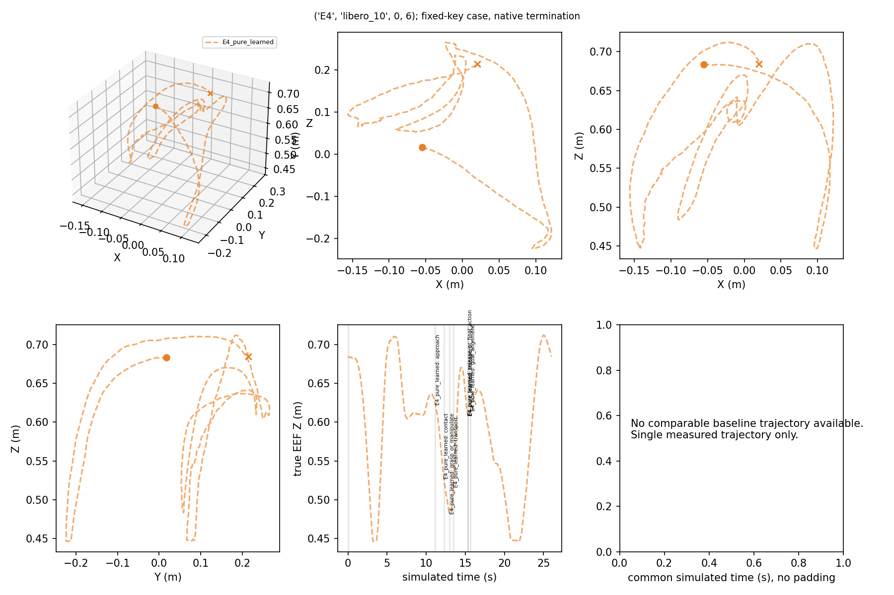
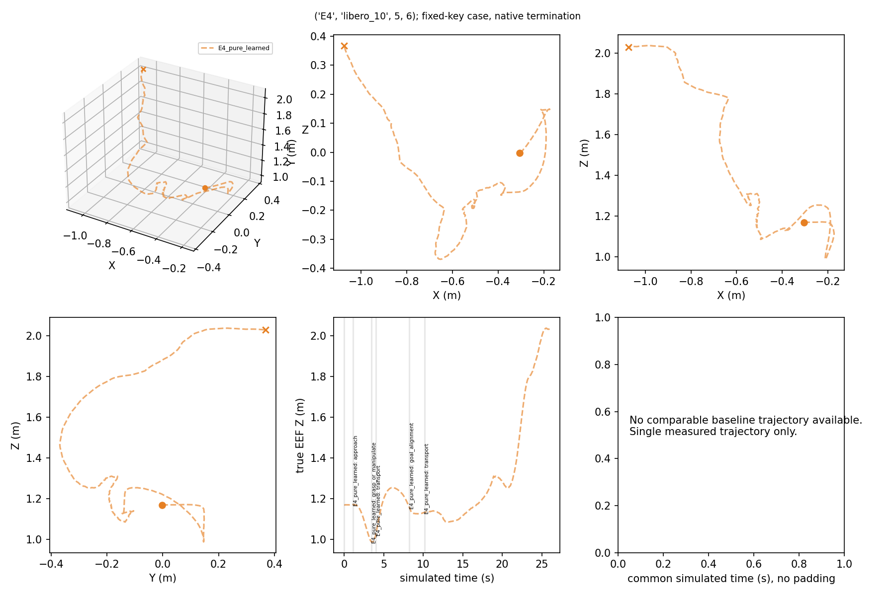
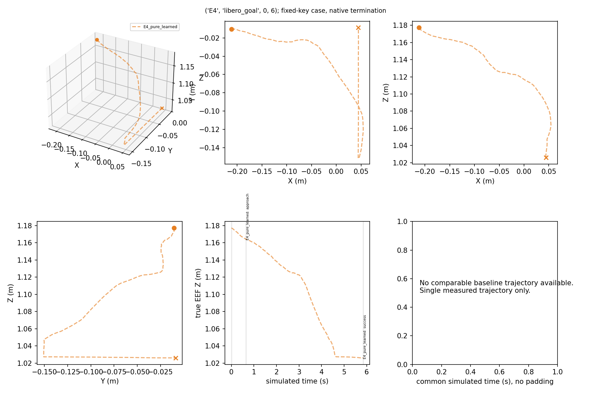
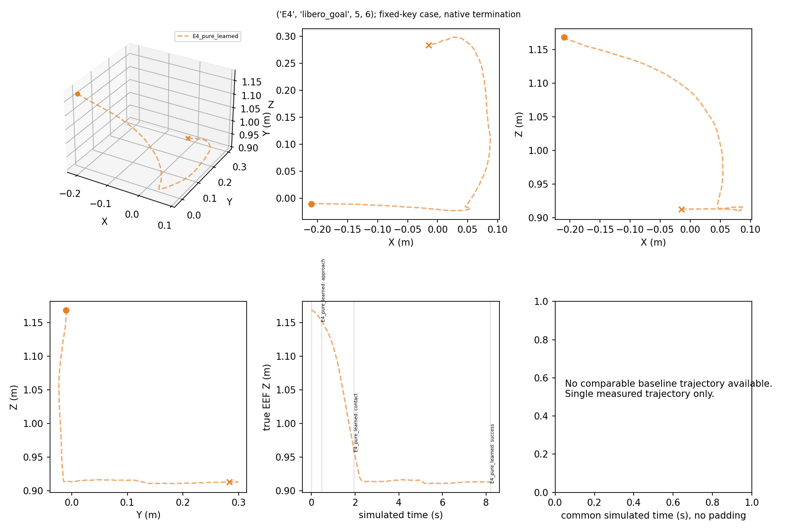
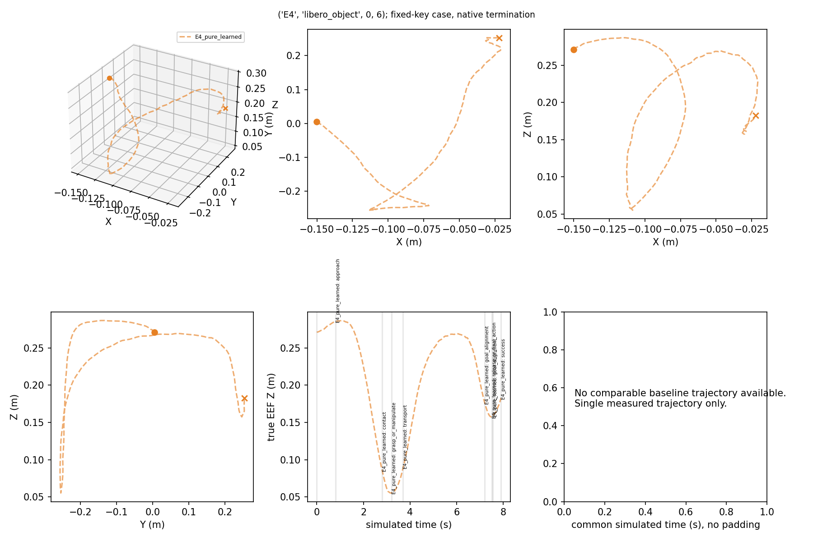
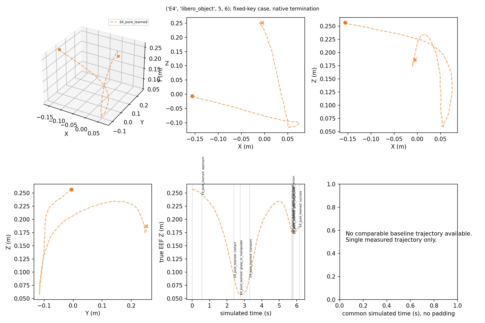
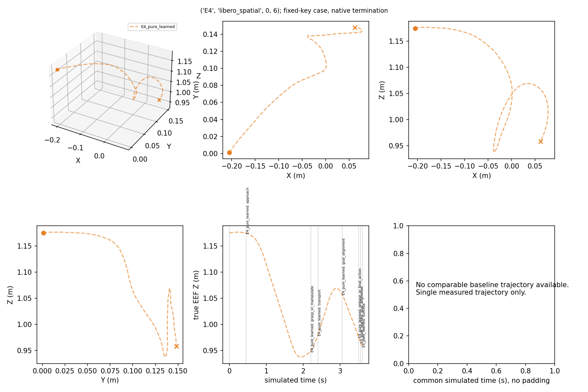
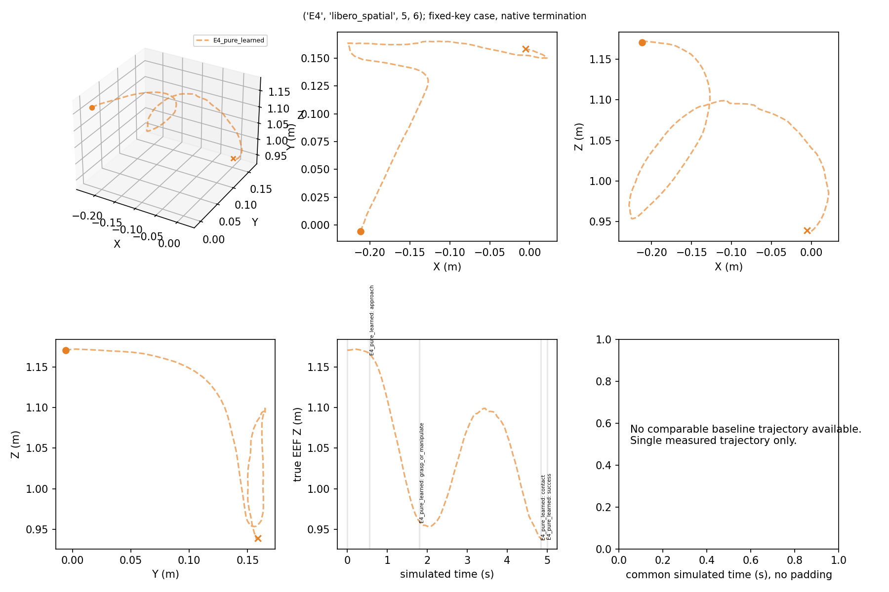

# True EEF XYZ

Fixed video keys only; circles=start, crosses=end. Blue=reference, orange=variant. Grey stage boundaries name their policy. Same-time distance combines path and speed differences.

