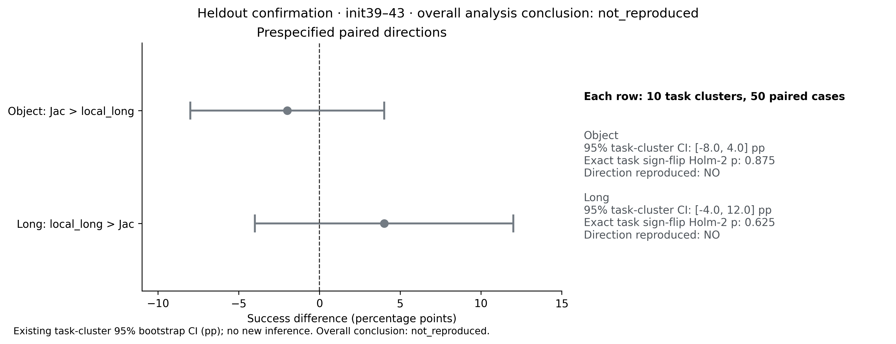

# Jac / local_long：独立复验未复现互补性

冻结的720条发现和600条独立复验均完整；后者使用init39–43，Full、Jac、local_long各200条。全量检查PASS，覆盖23,232次请求、115,093动作行；独立统计从600份原始receipt/result重建，与主分析零差异。所有有效策略失败保留。

| 条件 | Spatial | Object | Goal | Long | 总体 |
| --- | ---: | ---: | ---: | ---: | ---: |
| Full | 49/50 | 50/50 | 49/50 | 42/50 | 190/200 |
| Jac | 43/50 | 48/50 | 42/50 | 35/50 | 168/200 |
| local_long | 41/50 | 49/50 | 38/50 | 37/50 | 165/200 |

| 预定方向 | 发现差值 | 独立差值 | task-cluster 95% CI | exact task sign-flip Holm2 |
| --- | ---: | ---: | --- | ---: |
| Object：Jac > local_long | +10pp | −2pp | [−8,4]pp | 0.875 |
| Long：local_long > Jac | +16.7pp | +4pp | [−4,12]pp | 0.625 |

两方向均未达到冻结的复现标准；Object方向反转，Long方向区间跨0。两条路径通过本轮总体可用性资格门，但这不证明成功率非劣。阴性结果不证明路径等价，也不能被发现阶段的差值覆盖。没有测试在线选择或同任务内切换收益。

完整成功矩阵、PNG/PDF/SVG和CSV见[图表目录](../vlm_local_confirmation_figures/README.md)；报告与来源SHA见[evidence.json](evidence.json)、[600条全量检查](../vlm_local_search_runtime_acceptance/full_confirmation/audit.json)和[独立统计复算](../vlm_local_confirmation_statistics/audit.json)。接受的是数据和统计复算，不是互补性假设。

本有界分支按预定规则结束，整体研究目标仍未完成。下一分支正在准备同一LIBERO90 suite内按元数据划分的24任务对照，独立协议、来源和初态审查将单独冻结；其准备和后续结果不会改写本轮阴性结论。原GPU0/1会话和保留进程继续占用，旧任务记录及有效成功/失败没有重跑。
