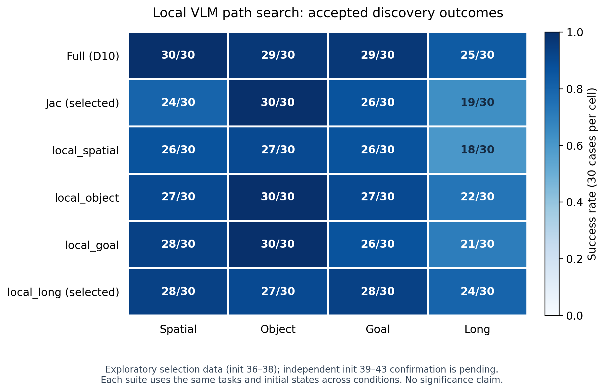

# 局部 fast path 搜索：发现完成，独立复验运行中

2026-11-05：冻结的六条件发现矩阵720条已独立检查通过，覆盖28,396次请求、140,775动作行及6个实际服务的保存数值门结果。无missing、invalid或unexpected；保留所有有效策略失败。检查的是导出的时间节点日程，后端没有导出内部actual NFE计数。

| 条件 | 成功/120 |
| --- | ---: |
| Full | 113 |
| Jac | 99 |
| local_spatial | 97 |
| local_object | 106 |
| local_goal | 105 |
| local_long | 107 |

预先冻结的规则选中Jac与local_long，两者都保留12/18 VLM层，AE、H50/R5、D10→D2→D2周期、残差补偿等预算一致；只改变跳过层集合的一处交换。候选名字表示校准来源，不预设任务侧重。

| 冻结方向 | 发现成功数 | 差值 | 正向task数 |
| --- | --- | ---: | ---: |
| Object：Jac > local_long | 30/30 对27/30 | +10pp | 3/10 |
| Long：local_long > Jac | 24/30 对19/30 | +16.7pp | 3/10 |

两方向去掉任一task后差值仍为正。这些数据参与了候选选择，不能作为独立显著性或可复现性的证据。候选相对Full的固定输入周期成本比约1.62，仅用于冻结的成本资格门槛，不等于闭环加速或成功率非劣。

Full、Jac、local_long各200条新初态39–43的600条复验已准备并启动，仍使用原冻结的单侧task-block sign-flip、两方向Holm校正、task聚类区间与LOO等确认规则。复验结束前不宣称第二条insight已成立。原Jac/MSE确认阴性结果保持不变。

完整路径、来源哈希、方向和检查统计见[evidence.json](evidence.json)，完整检查见[full_discovery/audit.json](../vlm_local_search_runtime_acceptance/full_discovery/audit.json)。GPU0/1保持由原sessions/keepers占用，任务切换与CPU准备期间未主动释放。

## 完整发现矩阵

每格30个相同task/init案例；图中的数据参与了候选选择，不表示独立复现。图由已接受的720条检查报告重建，没有读取运行中的复验结果。

[PDF](discovery_success_counts.pdf)、[SVG](discovery_success_counts.svg)、[CSV](discovery_success_counts.csv)及[输入与导出哈希](figure_evidence.json)可供复用。重建入口为`plot_discovery.py`。
