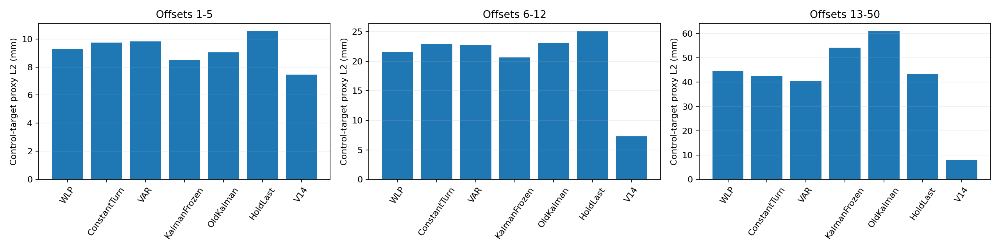
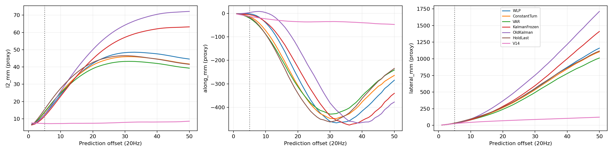
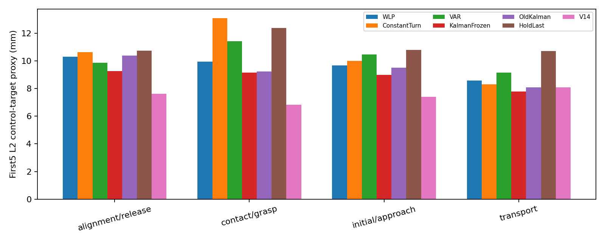

# v3.2 E3：历史命令外推 CPU 实验

这些误差是平移控制目标代理（normalized command × 50 mm），不是机械臂实际末端 EEF 误差，也不代表闭环任务成功率。

沿用 v2.1 同一批 Full 轨迹、同观测 V14：task0 的 20 episode / 634 重规划点用于校准；task1–9 的 180 episode / 6345 点用于评估。所有预测器只读取当前时间之前已执行的 XYZ 命令；Full/V14 未来 chunk 仅作评分标签。首次无历史返回零，短历史回退 HoldLast。

共 51 个预先冻结候选，按五个 official init 分折、优先首5步宏平均，要求每折首5步 L2 p95 和累计代理 lateral p95 均不超过旧 Kalman 的105%。每类保留最佳候选；未通过者明确标为探索候选。没有用评估集选参。总耗时 98.5s；环境步数和模型调用均为0。

| 方法 | 1–5步 mm（主指标） | 6–12步 mm | 13–50步 mm | 校准尾部准入 |
|---|---:|---:|---:|---|
| WLP | 9.276 | 21.544 | 44.701 | 未通过，仅探索 |
| ConstantTurn | 9.732 | 22.846 | 42.674 | 未通过，仅探索 |
| VAR | 9.831 | 22.645 | 40.323 | 未通过，仅探索 |
| KalmanFrozen | 8.478 | 20.630 | 54.136 | 冻结参考 |
| OldKalman | 9.030 | 23.078 | 61.154 | 冻结参考 |
| HoldLast | 10.576 | 25.134 | 43.342 | 冻结参考 |
| V14 | 7.446 | 7.264 | 7.903 | 冻结参考 |

宏平均按重规划→episode→task→suite逐层等权；首5步按真实剩余可执行前缀截断。6–50步是当前Full chunk的诊断，不能当作未来真实执行轨迹。

| 新方法 vs 冻结v2.1 Kalman | 首5步 Δmm | 任务簇配对bootstrap 95%区间 |
|---|---:|---|
| WLP | +0.798 | [+0.711, +0.879] |
| ConstantTurn | +1.254 | [+1.129, +1.375] |
| VAR | +1.353 | [+1.191, +1.497] |

区间按suite分层，重采样task并整簇保留init与replan，2000次，seed=3203；负数表示新方法误差更低。复用过往已分析数据，非盲测；本轮候选族与最优候选比较没有多重检验校正。

## 模型含义与边界

- WLP：近期命令序列加权多项式，最后观测锚定，阻尼外推。
- ConstantTurn：用近期命令方向的3D Kabsch旋转估计转向，保持最后命令幅值并阻尼角速度。这里旋转的是命令向量，不是将EEF历史位置作圆弧拟合；接触动力学与真实机器人运动未建模。
- VAR：近期命令向量短阶线性自回归，ridge向持久性先验收缩，并限制不稳定局部拟合。模型无全局未来标签训练。
- 保留冻结 Kalman 的 q_u=.0001、q_w=100、g=.5、beta=1、q_full 及原旧 Kalman 参数，均未重新调参。保存新预测器已观测的一步创新与冻结 Kalman 原始创新。
- along/lateral 是累计控制目标代理误差沿Full命令方向分解；低幅值与反向切换方向无定义时剔除。阶段标签沿用来源规则，仅作事后分组，未经独立人工认证。
- 时间偏移是事后oracle：固定Full第4–9步，预测位移−3..+3；不进入任何校正或预测。

## 数据与产物

本轮重新校验所有实际消费的 404 个预测/推理/telemetry日志SHA256，并检查原始Full、可执行前缀、时钟、ID、noise身份。图像与noise NPZ不进入预测器，继承v2.1完整验证收据，未重新读取。source_receipt.json中保留全部当前消费文件哈希及历史完整验证收据SHA256。

summary.csv / offsets.csv / stages.csv：窗口、逐offset、阶段的L2与along/lateral宏均值；paired_bootstrap.csv：与Kalman/HoldLast/V14配对区间；record_windows.csv：重规划明细；time_shift_oracle.csv：时间偏移诊断；predictions.npz、records.json：全部50步预测、元数据与创新；frozen_winners.json：评估前冻结参数。

