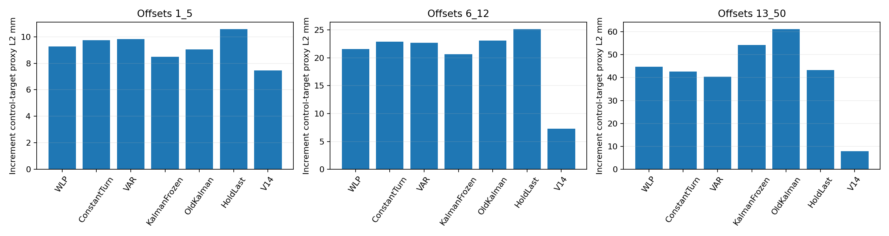
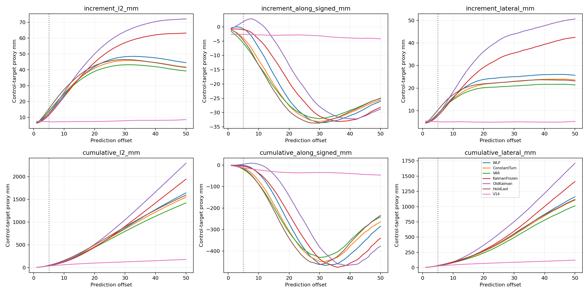

# v3.2 E3 最终分析（方向口径修订2）

本轮没有发现可替代冻结 v2.1 Kalman 的更好历史命令预测器。51个候选全部未通过预先固定的校准尾部约束；以下三类最佳候选均是探索性结果，不具部署准入资格。

指标全部是平移控制目标代理误差（normalized XYZ command ×50mm），不是实际末端 EEF 误差。increment 是单步命令差；cumulative 是从offset1累加到当前offset的命令差。两类向量分别计算自己的L2、along、lateral，不能混作同一向量分解。

沿用同一数据：task0 的20 episode /634重规划点校准；task1–9 的180 episode /6345点评估。每个预测仅可访问当前时间之前的已执行命令；Full/V14为同观测离线标签。固定51候选，按五个official init分折；每折首5步增量L2 p95与累计lateral p95均不得超过旧Kalman的105%。参数在评估前冻结，无评估调参。本次是复用已分析历史数据，非独立盲测。

| 方法 | 首1–5步 increment L2 mm | 6–12步 increment L2 mm | 13–50步 increment L2 mm | 校准准入 |
|---|---:|---:|---:|---|
| WLP | 9.276 | 21.544 | 44.701 | 未通过 |
| ConstantTurn | 9.732 | 22.846 | 42.674 | 未通过 |
| VAR | 9.831 | 22.645 | 40.323 | 未通过 |
| KalmanFrozen | 8.478 | 20.630 | 54.136 | 冻结参考 |
| OldKalman | 9.030 | 23.078 | 61.154 | 冻结参考 |
| HoldLast | 10.576 | 25.134 | 43.342 | 冻结参考 |
| V14 | 7.446 | 7.264 | 7.903 | 冻结参考 |

宏平均按replan→episode→task→suite逐级等权；首5步按真实剩余执行前缀截断。offset6–50只是当前Full chunk的诊断，不是未来真实执行标签。

| 方法 vs 冻结Kalman | 首5步增量 L2 Δmm | 配对95%区间 mm |
|---|---:|---|
| WLP | +0.798 | [+0.711, +0.879] |
| ConstantTurn | +1.254 | [+1.129, +1.375] |
| VAR | +1.353 | [+1.191, +1.497] |

区间按suite分层重采样task簇，保留全部init/replan，2000次、seed3203；负数表示更好。未校正候选搜索与多重比较。

## 单步命令向量方向分解（首5步）

| 方法 | increment L2 | increment abs(along) | increment lateral | 方向有效样本 |
|---|---:|---:|---:|---:|
| WLP | 9.276 | 5.293 | 6.365 | 31325 |
| ConstantTurn | 9.732 | 5.795 | 6.376 | 31325 |
| VAR | 9.831 | 5.992 | 6.363 | 31325 |
| KalmanFrozen | 8.478 | 4.733 | 5.813 | 31325 |
| OldKalman | 9.030 | 5.270 | 6.138 | 31325 |
| HoldLast | 10.576 | 5.857 | 7.250 | 31325 |
| V14 | 7.446 | 4.282 | 5.286 | 31325 |

## 累计控制目标代理向量分解（首5步各offset的均值）

| 方法 | cumulative L2 | cumulative abs(along) | cumulative lateral |
|---|---:|---:|---:|
| WLP | 24.057 | 13.829 | 16.673 |
| ConstantTurn | 24.412 | 14.080 | 16.645 |
| VAR | 24.449 | 15.016 | 16.017 |
| KalmanFrozen | 21.834 | 12.242 | 15.175 |
| OldKalman | 23.130 | 13.416 | 15.933 |
| HoldLast | 25.972 | 14.638 | 17.933 |
| V14 | 21.769 | 12.358 | 15.554 |

方向使用当前Full命令方向；Full幅值<1mm或相邻反向切换时方向量无定义并剔除，因此L2与方向分量覆盖数也不同。每个有效样本在各自向量空间均满足L2²=along²+lateral²，direction_identity_audit.json已审计；表中均值不要求满足平方关系。signed along另见CSV。

WLP采用加权局部多项式并锚定最后命令；ConstantTurn对近期命令方向做3D恒转向外推，保持最后命令幅值；VAR使用近期短阶线性自回归、ridge持久性先验和稳定性约束。这些模型拟合命令序列，未将EEF位置误当同类观测。局部拟合无未来标签；未使用未来协方差或阶段标签。

冻结Kalman保持q_u=.0001、q_w=100、g=.5、beta=1、q_full；旧Kalman参数及原创新完整保留。每类预测器创新是当前时刻已执行最后命令相对其先前一步预测的残差，不是未来Full标签残差。

阶段沿用来源启发式规则，仅作事后分组，未独立人工认证。时间偏移也是纯事后oracle：固定Full第4–9步，对比预测offset±3，并不用于推断或校正。完整阶段方向表见stages.csv，逐offset方向表见offsets.csv；父目录time_shift_summary.csv含分阶段时间诊断。

数据证据：父目录source_receipt.json记录404个当前消费原始日志哈希及v2.1历史完整验证收据；图像/noise NPZ未进入预测器，历史验证继承且未重新读取。父目录supplement_audit.json另独立重放四套件task1/init0完整episode的旧/冻结Kalman及HoldLast，逐点逐50步核对。

本修订仅重新分解既有冻结预测，未重选参数。receipt.json链接原predictions、records、frozen_winners及bootstrap的SHA256。父目录旧字段l2_mm对应increment_l2_mm，along_mm/lateral_mm对应cumulative方向量；最终报告以本修订显式名称为准。

