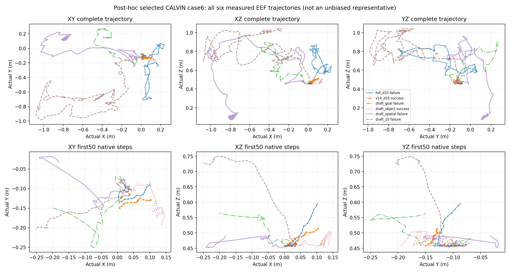

# E4 逐案例终止与真实轨迹审计

有效原生episode：108/108。此补充只读取既有记录，无模型调用、环境调用或冻结源码修改。

“零样本”指未在目标环境训练或微调模型权重、未按结果挑选head；跨环境观测与控制接口是在运行前明确设计并冻结的，不表示没有接口桥接。实际成功样例按原生判据如实保留，不能预设全部draft失败，也不能由少量失败证明模型只能用于LIBERO。

[逐案例：原生终止、实际步数、真实初末及范围XYZ/XY、源动作范围、两级裁剪和请求耗时](episode_outcomes.csv)

[全部尝试历史](attempt_history.csv)：138次尝试，包含30次技术失败；历史失败保留且不并入策略成功率分母。首轮PushT在第0步因本地源码搜索路径缺失退出，随后只补齐父进程PYTHONPATH并使用同一不可变manifest续跑。前78条有效机械臂结果全部跳过，原attempt000未覆盖。

[合并两个持久服务的分类路由计数](all_service_counters.csv)：重复原输入门控属于preflight，质量调用单独累计，并与选定有效episode的推理日志逐条件核对。

[各条件相同初始原始观测哈希核对](initial_input_agreement.csv)

XYZ来自原生环境的实测末端；PushT仅有原生XY像素，未补造Z。路径长度是测得位置差累加，不是模型命令累加。源动作裁剪只统计已执行命令，分别列出平移、旋转、夹爪和逐通道计数；夹爪接近±1时的小幅越界属于常见裁剪，七维汇总比例不能据此解释为不稳定或失败原因。另列Simpler原生physical action space的再次裁剪。耗时只限同一GPU分片、当前Triton实现，排除各episode首请求与记录的启动事件，不能与其他实验的JAX延迟混比。

| 环境 | Full成功/有效 | 解释边界 |
|---|---:|---|
| calvin | 0/8 | Current deployment inconclusive for capacity/generalization attribution |
| simpler | 0/5 | Current deployment inconclusive for capacity/generalization attribution |
| pusht | 0/5 | Current deployment inconclusive for capacity/generalization attribution |

审计检查异常数：0。完整细节、所有来源hash和原始冻结源码快照校验见[audit.json](audit.json)。

## 事后选取的成功对照样例

下图选择CALVIN case6（push_pink_block_right），因为运行后观察到V14和draft_object成功而Full失败；这是明确的事后选择，不是无偏代表样例。全部六条件、完整原生实测轨迹均保留，上排为全轨迹，下排统一展示前50个原生控制步以便辨认早期差异。没有重跑模型、环境或视频；预注册的case0图与18个视频仍是主报告固定索引。

