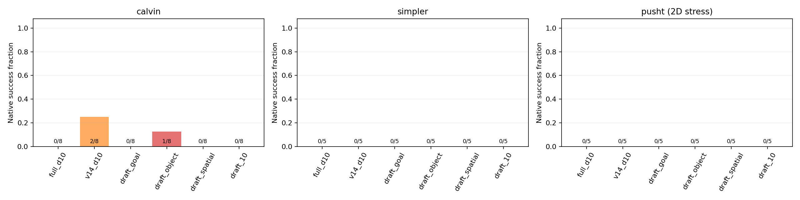
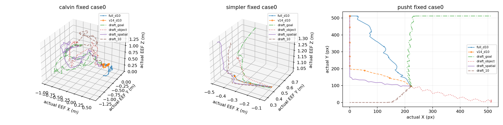

# v3.2 E4 零样本跨环境实验

以下条件固定使用原发布权重，无目标环境训练、适配或事后挑选head。分母只包含原生任务正常完成的有效episode；技术失败、未运行与不支持接口单列。PushT是二维投影压力测试，不与机械臂任务合并成功率。

| 环境 | 条件 | 成功/有效 | 成功率 | 技术失败 | 待运行 | 支持状态 |
|---|---|---:|---:|---:|---:|---|
| calvin | full_d10 | 0/8 | 0.0% | 0 | 0 | supported |
| calvin | v14_d10 | 2/8 | 25.0% | 0 | 0 | supported |
| calvin | draft_goal | 0/8 | 0.0% | 0 | 0 | supported |
| calvin | draft_object | 1/8 | 12.5% | 0 | 0 | supported |
| calvin | draft_spatial | 0/8 | 0.0% | 0 | 0 | supported |
| calvin | draft_10 | 0/8 | 0.0% | 0 | 0 | supported |
| simpler | full_d10 | 0/5 | 0.0% | 0 | 0 | supported |
| simpler | v14_d10 | 0/5 | 0.0% | 0 | 0 | supported |
| simpler | draft_goal | 0/5 | 0.0% | 0 | 0 | supported |
| simpler | draft_object | 0/5 | 0.0% | 0 | 0 | supported |
| simpler | draft_spatial | 0/5 | 0.0% | 0 | 0 | supported |
| simpler | draft_10 | 0/5 | 0.0% | 0 | 0 | supported |
| pusht | full_d10 | 0/5 | 0.0% | 0 | 0 | supported |
| pusht | v14_d10 | 0/5 | 0.0% | 0 | 0 | supported |
| pusht | draft_goal | 0/5 | 0.0% | 0 | 0 | supported |
| pusht | draft_object | 0/5 | 0.0% | 0 | 0 | supported |
| pusht | draft_spatial | 0/5 | 0.0% | 0 | 0 | supported |
| pusht | draft_10 | 0/5 | 0.0% | 0 | 0 | supported |

Full也是零样本桥接部署的控制组：若该环境Full有效样例全部失败，结果只能表明本冻结部署未成功，无法将draft失败归因于模型容量或泛化能力。原生控制频率、末端定义、视角和规范化分布差异均是保留的混杂因素。

CALVIN只覆盖8条debug语言段起始状态，不是正式长序列评测；Simpler固定pick coke can与5个seed；PushT固定5seed、512px↔0.6m人工平面，未执行Z/旋转/夹爪。源LIBERO为20Hz，CALVIN保留30Hz、Simpler保留Google原生3Hz、PushT保留10Hz；时间语义差异仍是混杂因素。六条件每个case始终同一物理卡，延迟只允许同GPU分片内比较，启动/编译不并入稳态速度。

[打开固定case0全部条件的视频索引与播放器](media_index.html)。视频使用相对路径，按预先指定case选择，不按成功或失败筛选。

原始清单与证据：manifest.json冻结源码、checkpoint元数据、语言证明、环境资产、坐标映射、native成功oracle和cap；本报告video_decode.json完整解码固定case0视频；trajectories.json保留实际XYZ/XY及来源hash。没有用命令累加冒充实际轨迹。

匹配有效episode 108/108；本快照未将缺项重新定义为策略0分。
