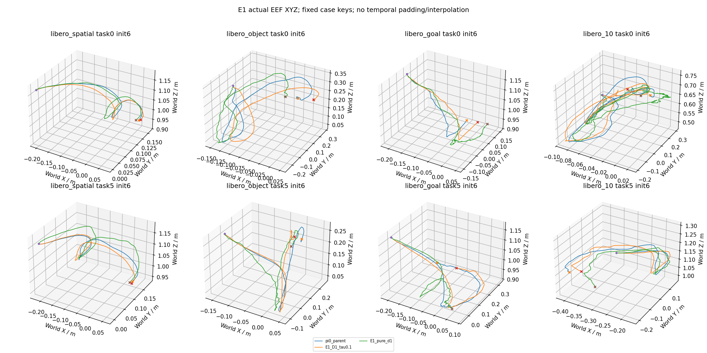

# idea1 v3.3 E1 实验报告

四个D1+verify候选均未达到预登记质量门槛，按协议停于各80条；单步Euler实现已通过原生数值等价门禁。

有效科学回合按原始官方案例键计数；探索初筛80条，入选后首80与新增220合成300。该结果不是官方50初态完整LIBERO基准。

整个研究从首真实episode到末科学complete的观察wall为4.231小时，聚合科学吞吐850.78 episode/小时，期间含400工程回合、校准等待及GPU租约变化；不构成配置加速比。初始准备/加载和最终CPU报告另计，完整范围见campaign_wall_receipt.json。

共同参考 `pi0_parent`：75/80。下表的每动作成本为完整策略推理wall累计/实际动作数，含拒绝与Full接管，排除单列padding诊断；它是不同闭环轨迹上的观测成本，不能充作同输入请求加速比。

| 条件 | 首80 | 新增220 | 全部 | Spatial/Object/Goal/Long | 每动作ms | task/suite等权成功率 |
|---|---:|---:|---:|---|---:|---:|
| E1_D1_tau0.1 | 72/80 | 0/0 | 72/80 | 19/20/20/20/18/20/15/20 | 34.533 | 90.00% |
| E1_D1_tau0.15 | 64/80 | 0/0 | 64/80 | 20/20/20/20/14/20/10/20 | 23.440 | 80.00% |
| E1_D1_tau0.25 | 63/80 | 0/0 | 63/80 | 20/20/20/20/11/20/12/20 | 19.286 | 78.75% |
| E1_D1_tau0.4 | 63/80 | 0/0 | 63/80 | 20/20/20/20/11/20/12/20 | 19.064 | 78.75% |
| E1_pure_d1 | 52/80 | 0/0 | 52/80 | 15/20/18/20/9/20/10/20 | 11.691 | 65.00% |

共同基线分别列示（不同D不混作同一Full）：

| 基线 | 成功 | 观测ms/action | episode/worker小时 |
|---|---:|---:|---:|
| pi0_full_d10 | 75/80 | 26.174 | 333.90 |
| pi0_full_d2 | 73/80 | 13.706 | 404.95 |
| pi0_pure_d2 | 55/80 | 14.488 | 334.51 |
| pi0_parent | 75/80 | 23.728 | 346.90 |

## 同卡成本晋级门禁

以上科学wall是原始观察值；原父基线存在旧EGL跨卡渲染重叠和首任务运行历史差异，不能直接作为同卡提速证据。独立工程对照不增加科学样本，保留完整wall主口径及统一首/次init、step0封顶和配对启动敏感性。GPU0父输入准备异常与热态结果冲突时成本不确定，禁止凭原始比率晋级。

额外工程预算为三卡π0父80×3加两卡Xiaomi pure80×2，共400有效工程回合；全部嵌套目录，不增加科学分母。Xiaomi候选逐物理卡匹配：τ=.8使用GPU2 pure，τ=1.6/其他GPU3条件使用GPU3 pure；legacy跨EGL或混合绑定不给速度资格。

GPU2工程父Long task04 init6曾一次技术OOM后按预声明上限重试，有效80才计主分母；invalid attempt完整保留。该次失败准备可能改变缓存/冷热历史，因此GPU2的21.5986ms/action参考与E2临界9.11%下降不作精确因果速度解释。

收据：[preliminary Pi screen](../cost_gate_pi0_screen.json)、[final cost gate](../cost_gate_final.json)、[工程逐GPU证据](../engineering_cost_rebaseline/)、[原始重叠时间线](../engineering_cost_rebaseline/legacy_timing_confound.json)。

| 条件 | 物理GPU | 匹配candidate/parent成本比 | 验证状态 | 速度门槛合格 |
|---|---:|---:|---|---|
| E1_D1_tau0.1 | 0 | — | quality_failed | False |
| E1_D1_tau0.15 | 2 | — | quality_failed | False |
| E1_D1_tau0.25 | 3 | — | quality_failed | False |
| E1_D1_tau0.4 | 0 | — | quality_failed | False |
| E1_pure_d1 | 2 | — | quality_failed | False |

## 选择与配对统计

冻结选择：`{"eligible": [], "selected": []}`。无合格候选时按规则停止扩样，不能把未扩样说成协议遗漏。

| 条件 vs 共同参考 | 配对n | 恢复 | 新失败 | task/suite等权Δ | 分层task簇bootstrap95% |
|---|---:|---:|---:|---:|---|
| E1_D1_tau0.1 | 80 | 3 | 6 | -3.75pp | [-8.75,+1.25]pp |
| E1_D1_tau0.15 | 80 | 1 | 12 | -13.75pp | [-21.25,-7.50]pp |
| E1_D1_tau0.25 | 80 | 0 | 12 | -15.00pp | [-21.25,-8.75]pp |
| E1_D1_tau0.4 | 80 | 0 | 12 | -15.00pp | [-21.25,-8.75]pp |
| E1_pure_d1 | 80 | 0 | 23 | -28.75pp | [-38.75,-18.75]pp |

必要消融直接配对（candidate减reference）：

| candidate / reference | 配对n | 恢复 | 新失败 | task/suite等权Δ | bootstrap95% |
|---|---:|---:|---:|---:|---|
| E1_D1_tau0.1 / E1_pure_d1 | 80 | 21 | 1 | +25.00pp | [+13.75,+36.25]pp |
| E1_D1_tau0.15 / E1_pure_d1 | 80 | 15 | 3 | +15.00pp | [+5.00,+25.00]pp |
| E1_D1_tau0.25 / E1_pure_d1 | 80 | 15 | 4 | +13.75pp | [+2.50,+25.00]pp |
| E1_D1_tau0.4 / E1_pure_d1 | 80 | 15 | 4 | +13.75pp | [+2.50,+25.00]pp |

bootstrap按suite分层重采样task簇，保留init，2000次seed3301；初筛和扩样共享首80，候选选择及多重比较未作校正。300条的偶数task多一个预定init，因此同时报告原始成功数和task/suite等权率。

## 路由与成本

| 条件 | 请求 | Full调用 | verify调用 | Kalman提案/实际执行请求 | 空间零接受 | 执行长度均值 |
|---|---:|---:|---:|---:|---:|---:|
| E1_D1_tau0.1 | 3615 | 2348 | 3162 | 0/0 | 1758 | 3.901 |
| E1_D1_tau0.15 | 3609 | 1623 | 2672 | 0/0 | 360 | 4.518 |
| E1_D1_tau0.25 | 3303 | 1326 | 2291 | 0/0 | 3 | 4.955 |
| E1_D1_tau0.4 | 3308 | 1334 | 2298 | 0/0 | 0 | 4.957 |
| E1_pure_d1 | 3730 | 0 | 0 | 0/0 | 0 | 4.975 |

逐模块累计毫秒和按物理GPU分层的wall/动作分母见routing.json；多卡300条不混成跨GPU速度比。每请求成本见requests.csv；完整评测吞吐按包含reset、仿真、RPC与落盘的episode wall报告。模块耗时、固定请求测速、闭环每动作成本和完整评测吞吐是不同指标，不互相替代。

| 条件 | requests/episode | wall ms/request | episode/worker小时 | mean actions | 有效超时失败 |
|---|---:|---:|---:|---:|---:|
| E1_D1_tau0.1 | 45.19 | 134.710 | 280.79 | 176.28 | 8 |
| E1_D1_tau0.15 | 45.11 | 105.893 | 305.25 | 203.80 | 16 |
| E1_D1_tau0.25 | 41.29 | 95.567 | 329.02 | 204.59 | 17 |
| E1_D1_tau0.4 | 41.35 | 94.506 | 329.48 | 204.99 | 17 |
| E1_pure_d1 | 46.62 | 58.159 | 351.94 | 231.95 | 28 |

## 辅助固定输入请求延迟

物理GPU0，B1，共100个保存的真实输入；同输入与seed，先暖各prompt/路径，模型加载30.20s、暖机21.69s另列。设备UUID、环境、bank/source及100项输入hash见[pi0_gpu0.json](../request_bank/pi0_gpu0.json)。

| 后端路径 | mean wall ms/input |
|---|---:|
| full_d10 | 109.166 |
| full_d2 | 52.872 |
| v14_d2 | 48.213 |
| v14_d1 | 41.441 |
| verify_same_input_draft2 | 10.443 |

每输入先统一建立prompt/runtime及Full输入，平均共同setup为461.764ms，单列且未算入任一路径，以免首路径独占准备成本。随后每条prepare+sample路径仍包含自身图像/状态变换、vision/VLM/sample；verify行使用该输入另建的Full KV及其draft，不模拟历史缓存年龄。该表没有环境、RPC、门控或Full接管，属于辅助同输入后端延迟；不能替代闭环主成本晋级，也不能称完整评测吞吐。首轮固定顺序混入准备偏差的结果保留在attempt1_fixed_order，已被本次口径替代。

原父与后续resident工程父的成功标签80/80相同，但完整raw/decoded/路由只有78/80逐位一致；Spatial task0 init6/7存在可观差异，同输入hash、seed/noise仍同。三GPU工程结果彼此一致，差异与首服务native probe/runtime构造历史分组相关，具体算子原因未知，不归因为硬件数值漂移。以下固定两例排除仅作质量敏感性，正式80/300均不删除：

| 条件（首80） | 固定排除后配对n | 恢复 | 新失败 | 正式80质量门槛 | 固定78诊断门槛 |
|---|---:|---:|---:|---|---|
| E1_D1_tau0.1 | 78 | 3 | 6 | False | False |
| E1_D1_tau0.15 | 78 | 1 | 12 | False | False |
| E1_D1_tau0.25 | 78 | 0 | 12 | False | False |
| E1_D1_tau0.4 | 78 | 0 | 12 | False | False |
| E1_pure_d1 | 78 | 0 | 23 | False | False |

固定78诊断沿用净少≤2的计数参照，仅展示结论敏感性；它不是新选型规则，不推翻正式80资格，也不将差异归因于算法。

D1为原生一次Euler更新1→0；额外真实输入数值门禁D1_native_euler_probe.json将adapter D1与released native.record(V14,num_steps=1)同obs/seed对比，raw与decoded逐位一致（最大差0），输入/源码/输出数组hash及既定atol/rtol均保存。E1质量不达门槛不能归因于未正确实现单步原语。verify时间仍为0.10/0.05，tau为normalized前六维RMS空间半径。Full原因、逐动作首次超限位置、超限数和连续超限段见routing.json/requests.csv。这些描述路由触发因素，不是任务失败的因果诊断。

## 真实XYZ与复现

固定每suite task0/5、π0 init6/Xiaomi init0；未按成败换样。曲线直接来自实际EEF观测，不是命令累加或预测动作误差，未补零/时间拉齐。所有逐步XYZ/姿态与动作可按episodes.csv进入原始telemetry。

复现入口：原始manifest.json、E2_manifest.json/E2_calibration.json、metadata_revision_r2.json、egl_revision.json及阶段manifest。GPU1于用户授权idea2租约后排除；EGL物理绑定修正通过初始RGB/状态逐位门禁，GPU2迁移后22个零draft案例与Full动作序列逐位一致，其余2个接受draft案例不作该比较。

服务模型加载与native probe在策略wall之外，分别保留worker协议和native probe收据；请求内prompt runtime重建仍计入原始策略wall，并在input_processing模块/冷热敏感性单列，不假称全程warm。环境创建、reset、RPC、仿真与落盘保留在bounded_profile.json及逐回合timing中。无全量视频。技术invalid/中断保留并不计成科学失败；有效超时按失败计入，不重试到成功。
