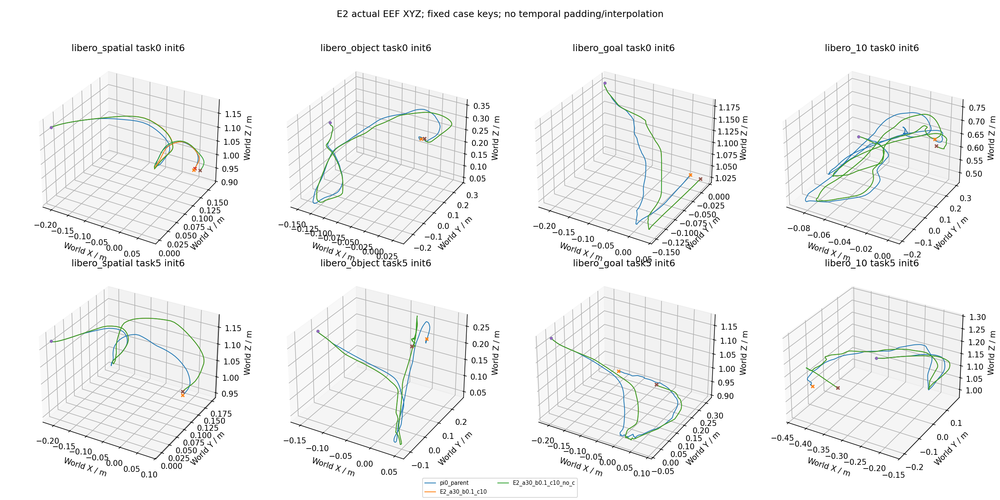

# idea1 v3.3 E2 实验报告

九个a/b/c主门控候选没有同时满足质量与可信至少10%降本门槛，未扩300；最终部署姿态阈值仍未确定。No-c消融的单例恢复与运行历史限制分别报告。

有效科学回合按原始官方案例键计数；探索初筛80条，入选后首80与新增220合成300。该结果不是官方50初态完整LIBERO基准。

整个研究从首真实episode到末科学complete的观察wall为4.231小时，聚合科学吞吐850.78 episode/小时，期间含400工程回合、校准等待及GPU租约变化；不构成配置加速比。初始准备/加载和最终CPU报告另计，完整范围见campaign_wall_receipt.json。

共同参考 `pi0_parent`：75/80。下表的每动作成本为完整策略推理wall累计/实际动作数，含拒绝与Full接管，排除单列padding诊断；它是不同闭环轨迹上的观测成本，不能充作同输入请求加速比。

| 条件 | 首80 | 新增220 | 全部 | Spatial/Object/Goal/Long | 每动作ms | task/suite等权成功率 |
|---|---:|---:|---:|---|---:|---:|
| E2_a10_b0.02_c2 | 74/80 | 0/0 | 74/80 | 20/20/19/20/17/20/18/20 | 22.977 | 92.50% |
| E2_a10_b0.02_c5 | 75/80 | 0/0 | 75/80 | 20/20/19/20/18/20/18/20 | 20.902 | 93.75% |
| E2_a10_b0.02_c10 | 77/80 | 0/0 | 77/80 | 20/20/19/20/18/20/20/20 | 22.692 | 96.25% |
| E2_a20_b0.05_c2 | 74/80 | 0/0 | 74/80 | 20/20/19/20/17/20/18/20 | 20.444 | 92.50% |
| E2_a20_b0.05_c5 | 75/80 | 0/0 | 75/80 | 20/20/19/20/17/20/19/20 | 24.510 | 93.75% |
| E2_a20_b0.05_c10 | 73/80 | 0/0 | 73/80 | 20/20/19/20/17/20/17/20 | 20.026 | 91.25% |
| E2_a30_b0.1_c2 | 76/80 | 0/0 | 76/80 | 20/20/20/20/18/20/18/20 | 23.509 | 95.00% |
| E2_a30_b0.1_c5 | 78/80 | 0/0 | 78/80 | 19/20/20/20/20/20/19/20 | 19.876 | 97.50% |
| E2_a30_b0.1_c10 | 78/80 | 0/0 | 78/80 | 19/20/20/20/19/20/20/20 | 19.632 | 97.50% |
| E2_alternate | 75/80 | 0/0 | 75/80 | 20/20/19/20/18/20/18/20 | 18.945 | 93.75% |
| E2_a30_b0.1_c10_no_c | 79/80 | 0/0 | 79/80 | 19/20/20/20/20/20/20/20 | 24.725 | 98.75% |

共同基线分别列示（不同D不混作同一Full）：

| 基线 | 成功 | 观测ms/action | episode/worker小时 |
|---|---:|---:|---:|
| pi0_full_d10 | 75/80 | 26.174 | 333.90 |
| pi0_full_d2 | 73/80 | 13.706 | 404.95 |
| pi0_pure_d2 | 55/80 | 14.488 | 334.51 |
| pi0_parent | 75/80 | 23.728 | 346.90 |

## 同卡成本晋级门禁

以上科学wall是原始观察值；原父基线存在旧EGL跨卡渲染重叠和首任务运行历史差异，不能直接作为同卡提速证据。独立工程对照不增加科学样本，保留完整wall主口径及统一首/次init、step0封顶和配对启动敏感性。GPU0父输入准备异常与热态结果冲突时成本不确定，禁止凭原始比率晋级。

额外工程预算为三卡π0父80×3加两卡Xiaomi pure80×2，共400有效工程回合；全部嵌套目录，不增加科学分母。Xiaomi候选逐物理卡匹配：τ=.8使用GPU2 pure，τ=1.6/其他GPU3条件使用GPU3 pure；legacy跨EGL或混合绑定不给速度资格。

GPU2工程父Long task04 init6曾一次技术OOM后按预声明上限重试，有效80才计主分母；invalid attempt完整保留。该次失败准备可能改变缓存/冷热历史，因此GPU2的21.5986ms/action参考与E2临界9.11%下降不作精确因果速度解释。

收据：[preliminary Pi screen](../cost_gate_pi0_screen.json)、[final cost gate](../cost_gate_final.json)、[工程逐GPU证据](../engineering_cost_rebaseline/)、[原始重叠时间线](../engineering_cost_rebaseline/legacy_timing_confound.json)。

| 条件 | 物理GPU | 匹配candidate/parent成本比 | 验证状态 | 速度门槛合格 |
|---|---:|---:|---|---|
| E2_a10_b0.02_c2 | 0 | 0.89916 | inconclusive | False |
| E2_a10_b0.02_c5 | 0 | 0.81793 | inconclusive | False |
| E2_a10_b0.02_c10 | 2 | 1.05062 | confirmed | False |
| E2_a20_b0.05_c2 | 0 | 0.80003 | inconclusive | False |
| E2_a20_b0.05_c5 | 3 | 1.12504 | confirmed | False |
| E2_a20_b0.05_c10 | 2 | 0.92718 | confirmed | False |
| E2_a30_b0.1_c2 | 0 | 0.91995 | inconclusive | False |
| E2_a30_b0.1_c5 | 3 | 0.91231 | confirmed | False |
| E2_a30_b0.1_c10 | 2 | 0.90894 | confirmed | False |
| E2_alternate | 3 | 0.86959 | confirmed | False |
| E2_a30_b0.1_c10_no_c | None | — | inconclusive | False |

## 选择与配对统计

冻结选择：`{"eligible": [], "selected": []}`。无合格候选时按规则停止扩样，不能把未扩样说成协议遗漏。

| 条件 vs 共同参考 | 配对n | 恢复 | 新失败 | task/suite等权Δ | 分层task簇bootstrap95% |
|---|---:|---:|---:|---:|---|
| E2_a10_b0.02_c2 | 80 | 1 | 2 | -1.25pp | [-3.75,+0.00]pp |
| E2_a10_b0.02_c5 | 80 | 2 | 2 | +0.00pp | [-3.75,+2.50]pp |
| E2_a10_b0.02_c10 | 80 | 3 | 1 | +2.50pp | [-1.25,+7.50]pp |
| E2_a20_b0.05_c2 | 80 | 1 | 2 | -1.25pp | [-5.00,+2.50]pp |
| E2_a20_b0.05_c5 | 80 | 3 | 3 | +0.00pp | [-6.25,+6.25]pp |
| E2_a20_b0.05_c10 | 80 | 2 | 4 | -2.50pp | [-7.50,+2.50]pp |
| E2_a30_b0.1_c2 | 80 | 3 | 2 | +1.25pp | [-3.75,+6.25]pp |
| E2_a30_b0.1_c5 | 80 | 4 | 1 | +3.75pp | [-1.25,+8.75]pp |
| E2_a30_b0.1_c10 | 80 | 4 | 1 | +3.75pp | [-1.25,+8.75]pp |
| E2_alternate | 80 | 3 | 3 | +0.00pp | [-6.25,+6.25]pp |
| E2_a30_b0.1_c10_no_c | 80 | 5 | 1 | +5.00pp | [+0.00,+10.00]pp |

必要消融直接配对（candidate减reference）：

| candidate / reference | 配对n | 恢复 | 新失败 | task/suite等权Δ | bootstrap95% |
|---|---:|---:|---:|---:|---|
| E2_a30_b0.1_c10_no_c / E2_a30_b0.1_c10 | 80 | 1 | 0 | +1.25pp | [+0.00,+3.75]pp |

bootstrap按suite分层重采样task簇，保留init，2000次seed3301；初筛和扩样共享首80，候选选择及多重比较未作校正。300条的偶数task多一个预定init，因此同时报告原始成功数和task/suite等权率。

## 路由与成本

| 条件 | 请求 | Full调用 | verify调用 | Kalman提案/实际执行请求 | 空间零接受 | 执行长度均值 |
|---|---:|---:|---:|---:|---:|---:|
| E2_a10_b0.02_c2 | 2912 | 1244 | 2116 | 59/57 | 241 | 4.930 |
| E2_a10_b0.02_c5 | 2872 | 1204 | 2079 | 72/69 | 231 | 4.927 |
| E2_a10_b0.02_c10 | 2817 | 1185 | 2041 | 83/80 | 224 | 4.927 |
| E2_a20_b0.05_c2 | 2849 | 1205 | 2071 | 327/299 | 250 | 4.928 |
| E2_a20_b0.05_c5 | 2802 | 1158 | 2031 | 406/366 | 241 | 4.929 |
| E2_a20_b0.05_c10 | 2857 | 1183 | 2078 | 462/415 | 253 | 4.930 |
| E2_a30_b0.1_c2 | 2834 | 1217 | 2109 | 683/528 | 343 | 4.919 |
| E2_a30_b0.1_c5 | 2719 | 1161 | 2021 | 803/620 | 337 | 4.922 |
| E2_a30_b0.1_c10 | 2723 | 1167 | 2030 | 842/656 | 341 | 4.923 |
| E2_alternate | 2825 | 1246 | 2100 | 1218/916 | 414 | 4.926 |
| E2_a30_b0.1_c10_no_c | 2701 | 1157 | 2016 | 835/650 | 339 | 4.921 |

逐模块累计毫秒和按物理GPU分层的wall/动作分母见routing.json；多卡300条不混成跨GPU速度比。每请求成本见requests.csv；完整评测吞吐按包含reset、仿真、RPC与落盘的episode wall报告。模块耗时、固定请求测速、闭环每动作成本和完整评测吞吐是不同指标，不互相替代。

| 条件 | requests/episode | wall ms/request | episode/worker小时 | mean actions | 有效超时失败 |
|---|---:|---:|---:|---:|---:|
| E2_a10_b0.02_c2 | 36.40 | 113.270 | 340.00 | 179.44 | 6 |
| E2_a10_b0.02_c5 | 35.90 | 102.987 | 355.67 | 176.89 | 5 |
| E2_a10_b0.02_c10 | 35.21 | 111.792 | 343.97 | 173.47 | 3 |
| E2_a20_b0.05_c2 | 35.61 | 100.749 | 358.30 | 175.50 | 6 |
| E2_a20_b0.05_c5 | 35.02 | 120.811 | 323.25 | 172.64 | 5 |
| E2_a20_b0.05_c10 | 35.71 | 98.720 | 360.57 | 176.05 | 7 |
| E2_a30_b0.1_c2 | 35.42 | 115.643 | 331.65 | 174.26 | 4 |
| E2_a30_b0.1_c5 | 33.99 | 97.837 | 375.84 | 167.30 | 2 |
| E2_a30_b0.1_c10 | 34.04 | 96.638 | 377.68 | 167.55 | 2 |
| E2_alternate | 35.31 | 93.331 | 373.81 | 173.96 | 5 |
| E2_a30_b0.1_c10_no_c | 33.76 | 121.665 | 321.22 | 166.14 | 1 |

## 辅助固定输入请求延迟

物理GPU0，B1，共100个保存的真实输入；同输入与seed，先暖各prompt/路径，模型加载30.20s、暖机21.69s另列。设备UUID、环境、bank/source及100项输入hash见[pi0_gpu0.json](../request_bank/pi0_gpu0.json)。

| 后端路径 | mean wall ms/input |
|---|---:|
| full_d10 | 109.166 |
| full_d2 | 52.872 |
| v14_d2 | 48.213 |
| v14_d1 | 41.441 |
| verify_same_input_draft2 | 10.443 |

每输入先统一建立prompt/runtime及Full输入，平均共同setup为461.764ms，单列且未算入任一路径，以免首路径独占准备成本。随后每条prepare+sample路径仍包含自身图像/状态变换、vision/VLM/sample；verify行使用该输入另建的Full KV及其draft，不模拟历史缓存年龄。该表没有环境、RPC、门控或Full接管，属于辅助同输入后端延迟；不能替代闭环主成本晋级，也不能称完整评测吞吐。首轮固定顺序混入准备偏差的结果保留在attempt1_fixed_order，已被本次口径替代。

原父与后续resident工程父的成功标签80/80相同，但完整raw/decoded/路由只有78/80逐位一致；Spatial task0 init6/7存在可观差异，同输入hash、seed/noise仍同。三GPU工程结果彼此一致，差异与首服务native probe/runtime构造历史分组相关，具体算子原因未知，不归因为硬件数值漂移。以下固定两例排除仅作质量敏感性，正式80/300均不删除：

| 条件（首80） | 固定排除后配对n | 恢复 | 新失败 | 正式80质量门槛 | 固定78诊断门槛 |
|---|---:|---:|---:|---|---|
| E2_a10_b0.02_c2 | 78 | 1 | 2 | True | True |
| E2_a10_b0.02_c5 | 78 | 2 | 2 | True | True |
| E2_a10_b0.02_c10 | 78 | 3 | 1 | True | True |
| E2_a20_b0.05_c2 | 78 | 1 | 2 | True | True |
| E2_a20_b0.05_c5 | 78 | 3 | 3 | True | True |
| E2_a20_b0.05_c10 | 78 | 2 | 4 | True | True |
| E2_a30_b0.1_c2 | 78 | 3 | 2 | True | True |
| E2_a30_b0.1_c5 | 78 | 4 | 1 | True | True |
| E2_a30_b0.1_c10 | 78 | 4 | 1 | True | True |
| E2_alternate | 78 | 3 | 3 | True | True |
| E2_a30_b0.1_c10_no_c | 78 | 5 | 1 | True | True |

固定78诊断沿用净少≤2的计数参照，仅展示结论敏感性；它不是新选型规则，不推翻正式80资格，也不将差异归因于算法。

c使用真实EEF世界xyzw四元数最近五个已完成控制步的最大两两最短弧角，与a/b及共同约束AND，严格小于候选θ_c才允许尝试Kalman。2°/5°/10°在父80状态/命令时点分布上冻结为探索候选，最终推荐阈值由闭环质量/成本决定；不称已知部署阈值。b为已解码环境控制命令的平移变化，既非模型normalized action也非真实EEF位移。

Kalman仅预测XYZ，旋转/夹爪保持最后实际命令，经当前decoder逆映射到raw32，padded25维零。首真实对照包含零padding/Full尾维诊断并将其额外verify时间与调用单列（E2_padding_diagnostic_receipt.json）；初筛3次诊断的前六维RMS最大变化约0.00150/0.00150/0.000764，包括后续NoC在内的全部诊断与排除wall见routing.json的padding_diagnostics。非模型metadata准备的vision/VLM调用实测为零。门控只是允许尝试，不证明可忽略视觉。

交替/移除c是预登记的控制与必要消融，不能因其出现成本阳性而升格为a/b/c主门控候选；未扩300不是遗漏。最终部署θ_c仍未确定，无主候选满足可信质量—成本联合门槛时不推荐部署阈值。

实际历史重放的门控审计如下；a/b/c总阻止可以重叠，不能把c总次数解释为其独立贡献。“仅c”只表示其他a/b/共同历史条件通过，尚未扣除禁连续Kalman，仍不是任务成败因果效应。

| 条件 | 决策点 | a阻止 | b阻止 | c阻止 | 仅c | gate全过 | 实际KF动作/全部动作 |
|---|---:|---:|---:|---:|---:|---:|---:|
| E2_a10_b0.02_c2 | 2116 | 563 | 1972 | 552 | 36 | 96 | 285/14355 (1.99%) |
| E2_a10_b0.02_c5 | 2079 | 546 | 1927 | 107 | 16 | 123 | 345/14151 (2.44%) |
| E2_a10_b0.02_c10 | 2041 | 522 | 1892 | 5 | 2 | 136 | 400/13878 (2.88%) |
| E2_a20_b0.05_c2 | 2071 | 266 | 1356 | 496 | 178 | 481 | 1468/14040 (10.46%) |
| E2_a20_b0.05_c5 | 2031 | 218 | 1304 | 122 | 71 | 615 | 1793/13811 (12.98%) |
| E2_a20_b0.05_c10 | 2078 | 213 | 1317 | 20 | 11 | 705 | 2030/14084 (14.41%) |
| E2_a30_b0.1_c2 | 2109 | 147 | 607 | 534 | 352 | 1038 | 2586/13941 (18.55%) |
| E2_a30_b0.1_c5 | 2021 | 139 | 556 | 98 | 87 | 1284 | 3035/13384 (22.68%) |
| E2_a30_b0.1_c10 | 2030 | 129 | 566 | 4 | 4 | 1365 | 3216/13404 (23.99%) |
| E2_alternate | 2100 | 0 | 0 | 0 | 0 | 2100 | 4492/13917 (32.28%) |
| E2_a30_b0.1_c10_no_c | 2016 | 130 | 561 | 0 | 0 | 1359 | 3186/13291 (23.97%) |

No-c shard1首次探针的Full/V14原生与metadata等价均通过，但其Task1→Task0重建历史与原父Task0-first历史不同，旧参考门禁阻止了两次技术attempt，尚无科学动作。恢复H1事先固定已冻结GPU2工程NEW参考，对同一次实际输出要求raw/decoded严格bitwise；旧父差异保留非fatal历史诊断，不放宽容差、不运行时选参考、不改变NoC科学配置。注册与执行收据为bounded_probe_history_h1*.json。

No-c原始完整80比较见必要消融表；其各shard首服务probe对应prompt案例固定并列在probe_prompt_history_receipt.json。本轮排除清单 `[["libero_spatial", 0, 6], ["libero_spatial", 0, 7], ["libero_spatial", 1, 6], ["libero_spatial", 1, 7]]` 仅作敏感性，剩余n=76，恢复1、新失败0，task/suite等权Δ=+1.25pp。两条件初始Full10 raw/decoded逐位一致78/80例，其余案例逐键保存，不扩大为全80一致。正式80不删，若差异集中于首prompt，不能把结果解释为c的独立因果作用。

唯一配对结局差异是Goal task9 init7：前7次整proposal与step0..35真实telemetry均逐位一致；replan7/step35输入hash、采样与验证seed相同，世界姿态窗角10.71237°。c10仅因c_pose走V14，NoC允许Kalman；后者159步成功，前者300步超时。E2_no_c_case_mechanism_receipt.json保存该事后挑出的单案例机制，不是预定代表曲线，不将单例外推为总体c因果或部署阈值。

## 真实XYZ与复现

固定每suite task0/5、π0 init6/Xiaomi init0；未按成败换样。曲线直接来自实际EEF观测，不是命令累加或预测动作误差，未补零/时间拉齐。所有逐步XYZ/姿态与动作可按episodes.csv进入原始telemetry。

复现入口：原始manifest.json、E2_manifest.json/E2_calibration.json、metadata_revision_r2.json、egl_revision.json及阶段manifest。GPU1于用户授权idea2租约后排除；EGL物理绑定修正通过初始RGB/状态逐位门禁，GPU2迁移后22个零draft案例与Full动作序列逐位一致，其余2个接受draft案例不作该比较。

服务模型加载与native probe在策略wall之外，分别保留worker协议和native probe收据；请求内prompt runtime重建仍计入原始策略wall，并在input_processing模块/冷热敏感性单列，不假称全程warm。环境创建、reset、RPC、仿真与落盘保留在bounded_profile.json及逐回合timing中。无全量视频。技术invalid/中断保留并不计成科学失败；有效超时按失败计入，不重试到成功。
