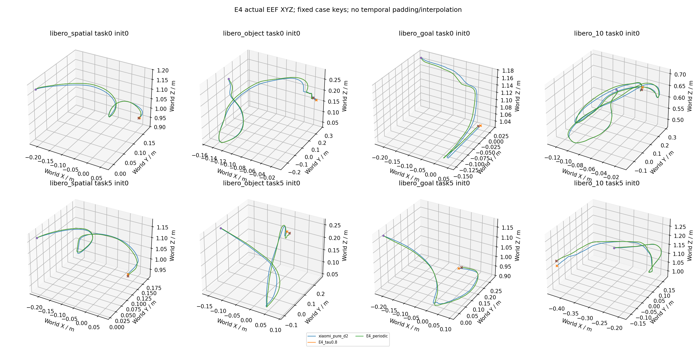

# idea1 v3.3 E4 实验报告

质量分支τ=.8为293/300，pure为282/300，Full-D2也为293/300，无verify周期对照为294/300。与周期对照实际执行前缀逐位一致299/300；未证实verifier额外成功增益，也不能把相对pure的改善唯一归因P2。成本不使用混卡300整体速度比。

有效科学回合按原始官方案例键计数；探索初筛80条，入选后首80与新增220合成300。该结果不是官方50初态完整LIBERO基准。

整个研究从首真实episode到末科学complete的观察wall为4.231小时，聚合科学吞吐850.78 episode/小时，期间含400工程回合、校准等待及GPU租约变化；不构成配置加速比。初始准备/加载和最终CPU报告另计，完整范围见campaign_wall_receipt.json。

共同参考 `xiaomi_pure_d2`：282/300。下表的每动作成本为完整策略推理wall累计/实际动作数，含拒绝与Full接管，排除单列padding诊断；它是不同闭环轨迹上的观测成本，不能充作同输入请求加速比。

| 条件 | 首80 | 新增220 | 全部 | Spatial/Object/Goal/Long | 每动作ms | task/suite等权成功率 |
|---|---:|---:|---:|---|---:|---:|
| E4_tau0.025 | 74/80 | 0/0 | 74/80 | 17/20/20/20/20/20/17/20 | 34.700 | 92.50% |
| E4_tau0.05 | 74/80 | 0/0 | 74/80 | 17/20/20/20/20/20/17/20 | 34.388 | 92.50% |
| E4_tau0.1 | 74/80 | 0/0 | 74/80 | 17/20/20/20/20/20/17/20 | 34.082 | 92.50% |
| E4_tau0.2 | 77/80 | 0/0 | 77/80 | 17/20/20/20/20/20/20/20 | 32.900 | 96.25% |
| E4_tau0.4 | 77/80 | 0/0 | 77/80 | 18/20/20/20/19/20/20/20 | 19.506 | 96.25% |
| E4_tau0.8 | 78/80 | 215/220 | 293/300 | 74/75/75/75/71/75/73/75 | 18.529 | 97.59% |
| E4_periodic | 78/80 | 216/220 | 294/300 | 74/75/75/75/72/75/73/75 | 15.355 | 97.95% |
| E4_tau1.6 | 78/80 | 0/0 | 78/80 | 19/20/20/20/19/20/20/20 | 19.438 | 97.50% |

共同基线分别列示（不同D不混作同一Full）：

| 基线 | 成功 | 观测ms/action | episode/worker小时 |
|---|---:|---:|---:|
| xiaomi_full_d2 | 293/300 | 16.299 | 444.88 |
| xiaomi_pure_d2 | 282/300 | 15.012 | 424.47 |

## 同卡成本晋级门禁

以上科学wall是原始观察值；原父基线存在旧EGL跨卡渲染重叠和首任务运行历史差异，不能直接作为同卡提速证据。独立工程对照不增加科学样本，保留完整wall主口径及统一首/次init、step0封顶和配对启动敏感性。GPU0父输入准备异常与热态结果冲突时成本不确定，禁止凭原始比率晋级。

额外工程预算为三卡π0父80×3加两卡Xiaomi pure80×2，共400有效工程回合；全部嵌套目录，不增加科学分母。Xiaomi候选逐物理卡匹配：τ=.8使用GPU2 pure，τ=1.6/其他GPU3条件使用GPU3 pure；legacy跨EGL或混合绑定不给速度资格。

GPU2工程父Long task04 init6曾一次技术OOM后按预声明上限重试，有效80才计主分母；invalid attempt完整保留。该次失败准备可能改变缓存/冷热历史，因此GPU2的21.5986ms/action参考与E2临界9.11%下降不作精确因果速度解释。

收据：[preliminary Pi screen](../cost_gate_pi0_screen.json)、[final cost gate](../cost_gate_final.json)、[工程逐GPU证据](../engineering_cost_rebaseline/)、[原始重叠时间线](../engineering_cost_rebaseline/legacy_timing_confound.json)。

| 条件 | 物理GPU | 匹配candidate/parent成本比 | 验证状态 | 速度门槛合格 |
|---|---:|---:|---|---|
| E4_tau0.025 | 3 | — | inconclusive | False |
| E4_tau0.05 | 2 | — | inconclusive | False |
| E4_tau0.1 | 3 | — | inconclusive | False |
| E4_tau0.2 | 2 | 2.13565 | confirmed | False |
| E4_tau0.4 | 3 | 1.20720 | confirmed | False |
| E4_tau0.8 | 2 | 1.16373 | confirmed | False |
| E4_periodic | 3 | 0.93647 | confirmed | False |
| E4_tau1.6 | 3 | 1.20300 | confirmed | False |

## 选择与配对统计

冻结选择：`{"quality_eligible": ["E4_tau0.2", "E4_tau0.4", "E4_tau0.8"], "cost_eligible": [], "selected": ["E4_tau0.8"], "behavioral_equivalence_classes": [{"members": ["E4_tau0.8", "E4_tau1.6"], "representative": "E4_tau0.8", "rule": "Exact all80 decoded actions, path/execution rhythm and outcomes; choose preregistered smaller tau, not wall-time noise"}]}`。无合格候选时按规则停止扩样，不能把未扩样说成协议遗漏。

| 条件 vs 共同参考 | 配对n | 恢复 | 新失败 | task/suite等权Δ | 分层task簇bootstrap95% |
|---|---:|---:|---:|---:|---|
| E4_tau0.025 | 80 | 3 | 4 | -1.25pp | [-7.50,+5.00]pp |
| E4_tau0.05 | 80 | 3 | 4 | -1.25pp | [-7.50,+5.00]pp |
| E4_tau0.1 | 80 | 3 | 4 | -1.25pp | [-7.50,+5.00]pp |
| E4_tau0.2 | 80 | 4 | 2 | +2.50pp | [-2.50,+8.75]pp |
| E4_tau0.4 | 80 | 3 | 1 | +2.50pp | [-1.25,+7.50]pp |
| E4_tau0.8 | 300 | 13 | 2 | +3.57pp | [+0.89,+6.56]pp |
| E4_periodic | 300 | 14 | 2 | +3.93pp | [+1.25,+6.88]pp |
| E4_tau1.6 | 80 | 4 | 1 | +3.75pp | [-1.25,+8.75]pp |

300条确认 `E4_tau0.8`：293/300 vs `xiaomi_pure_d2` 282/300，净成功+11；完整300=True，净少≤7计数门槛=True，成功数高于参考=True。这仍不是总体非劣或verifier因果收益的统计证明。

必要消融直接配对（candidate减reference）：

| candidate / reference | 配对n | 恢复 | 新失败 | task/suite等权Δ | bootstrap95% |
|---|---:|---:|---:|---:|---|
| E4_tau0.8 / E4_periodic | 300 | 0 | 1 | -0.36pp | [-1.07,+0.00]pp |
| E4_tau0.8 / xiaomi_full_d2 | 300 | 5 | 5 | -0.09pp | [-2.28,+2.19]pp |

bootstrap按suite分层重采样task簇，保留init，2000次seed3301；初筛和扩样共享首80，候选选择及多重比较未作校正。300条的偶数task多一个预定init，因此同时报告原始成功数和task/suite等权率。

## 路由与成本

| 条件 | 请求 | Full调用 | verify调用 | Kalman提案/实际执行请求 | 空间零接受 | 执行长度均值 |
|---|---:|---:|---:|---:|---:|---:|
| E4_tau0.025 | 1282 | 1282 | 1202 | 0/0 | 1202 | 9.751 |
| E4_tau0.05 | 1296 | 1281 | 1213 | 0/0 | 1198 | 9.650 |
| E4_tau0.1 | 1317 | 1246 | 1211 | 0/0 | 1140 | 9.493 |
| E4_tau0.2 | 1386 | 1135 | 1243 | 0/0 | 992 | 8.878 |
| E4_tau0.4 | 1335 | 491 | 878 | 0/0 | 34 | 9.446 |
| E4_tau0.8 | 4787 | 1705 | 3082 | 0/0 | 0 | 9.728 |
| E4_periodic | 4775 | 1701 | 0 | 0/0 | 0 | 9.725 |
| E4_tau1.6 | 1283 | 460 | 823 | 0/0 | 0 | 9.718 |

逐模块累计毫秒和按物理GPU分层的wall/动作分母见routing.json；多卡300条不混成跨GPU速度比。每请求成本见requests.csv；完整评测吞吐按包含reset、仿真、RPC与落盘的episode wall报告。模块耗时、固定请求测速、闭环每动作成本和完整评测吞吐是不同指标，不互相替代。

| 条件 | requests/episode | wall ms/request | episode/worker小时 | mean actions | 有效超时失败 |
|---|---:|---:|---:|---:|---:|
| E4_tau0.025 | 16.02 | 338.369 | 315.29 | 156.26 | 6 |
| E4_tau0.05 | 16.20 | 331.835 | 315.60 | 156.32 | 6 |
| E4_tau0.1 | 16.46 | 323.538 | 316.33 | 156.28 | 6 |
| E4_tau0.2 | 17.32 | 292.089 | 325.61 | 153.81 | 3 |
| E4_tau0.4 | 16.69 | 184.259 | 390.50 | 157.64 | 3 |
| E4_tau0.8 | 15.96 | 180.242 | 405.90 | 155.22 | 7 |
| E4_periodic | 15.92 | 149.327 | 440.91 | 154.79 | 6 |
| E4_tau1.6 | 16.04 | 188.894 | 354.20 | 155.85 | 2 |

## 辅助固定输入请求延迟

物理GPU2，B1，共100个保存的真实输入；同输入与seed，先暖各prompt/路径，模型加载22.48s、暖机6.03s另列。设备UUID、环境、bank/source及100项输入hash见[xiaomi_gpu2.json](../request_bank/xiaomi_gpu2.json)。

| 后端路径 | mean wall ms/input |
|---|---:|
| full_d2 | 162.149 |
| skip12_d2 | 149.642 |
| verify_same_input_draft2 | 45.954 |

每输入先统一建立prompt/runtime及Full输入，平均共同setup为114.242ms，单列且未算入任一路径，以免首路径独占准备成本。随后每条prepare+sample路径仍包含自身图像/状态变换、vision/VLM/sample；verify行使用该输入另建的Full KV及其draft，不模拟历史缓存年龄。该表没有环境、RPC、门控或Full接管，属于辅助同输入后端延迟；不能替代闭环主成本晋级，也不能称完整评测吞吐。首轮固定顺序混入准备偏差的结果保留在attempt1_fixed_order，已被本次口径替代。

所有Xiaomi条件均不启用夹爪保护；startup/periodic/空间零接受之外不因夹爪接管。P2只有累计两轮draft后才周期Full；拒绝后立即Full会重置draft轮数。

首80六阈值网格仅最高边界τ=.8位于观察前沿，按预登记规则追加一次τ=1.6的80条；最低边界未触发τ=.0125，未继续无界扩网格。此为有界探索触发，不把原始跨GPU前沿当成速度资格。

τ=.025首80与Full-D2全部80案例的每轮decoded动作及执行长度逐位相等（E4_tau0025_full_exact_receipt.json），构成Full动作路径加额外draft/verify开销。低τ的质量不能归因于充分混合使用；必须结合实际正接受与周期Full次数解读。Xiaomi normalized空间阈值不能与π0直接比较。

首80对照：τ=.8与无verify的periodic均78/80，80/80案例的动作、Full/draft节奏与成败完全相同（460 Full、823 draft）；823/823 verified draft均完整接受10。该批数据未显示verifier过滤的额外质量贡献，不把与pure的差异唯一归因P2或Full容量。τ=.8在GPU2、periodic在GPU3，wall差2.796ms/action（18.48%）仅跨卡观察，不能称同卡verifier净开销或外推300。τ=.8自身verify AE CUDA-event共35,904.8ms/12,468动作=2.880ms/action，已计policy wall；它不含全部CPU/同步开销，亦非总净策略开销。设备与范围见E4_timing_device_scope_receipt.json；首80动作事实见E4_tau08_periodic_exact_receipt.json，其早期因果措辞由E4_causal_interpretation_receipt.json更正。τ=.8/1.6边界等价见E4_tau08_tau16_exact_receipt.json。

全部已完成共有案例重新比较：n=300，完整proposal数组逐位相等299、实际执行前缀相等299、Full/draft节奏相等299、成功标签相等299；3082/3082个verified draft接受完整10动作。完整逐案hash与差异见E4_tau08_periodic_all_shared_comparison.json，扩样结论使用此实测结果，不从首80推断。

唯一差异为Goal task3 init6，同物理GPU0、同模型服务109338：input0与request0输入hash/seed/noise/raw/actions全相同，telemetry step0..10也逐位一致。但request1/step10的完整观测hash已经不同，seed/noise仍同，draft raw最大差0.015625；这是该episode第一次verify之前已生成的draft，之后仍全接受10。哪项未保存观测不同及其原因未知，不能把该例失败归因verifier接受机制，也不宣称300条完全等价或普遍无模型副作用。E4_single_case_difference_receipt.json保存首次分歧与服务/RNG来源。

全300中Full-D2与τ=.8均293成功，两者配对为5恢复/5新失败；periodic294、pure282。τ=.8相对pure净+11不能唯一归因P2，Full独立也达到同一总数，且有首80选型及多重比较偏差。当前没有显示verifier独立质量增益的证据；这不是普遍因果定理。完整边界见E4_causal_interpretation_receipt.json。

新增220的同初态、同物理model/render GPU闭环成本配对如下（原始首80跨卡/legacy绑定不混入；固定条件顺序与冷态历史仍是限制，不称同输入请求加速或完全识别的净开销）：

| τ=.8 vs reference | GPU | matched新案例n | candidate ms/action | reference ms/action | 比率 |
|---|---:|---:|---:|---:|---:|
| E4_periodic | 0 | 88 | 18.683 | 15.495 | 1.2057 |
| E4_periodic | 2 | 64 | 18.972 | 15.474 | 1.2260 |
| E4_periodic | 3 | 68 | 18.641 | 15.319 | 1.2168 |
| xiaomi_pure_d2 | 0 | 88 | 18.683 | 15.081 | 1.2389 |
| xiaomi_pure_d2 | 2 | 64 | 18.972 | 15.024 | 1.2628 |
| xiaomi_pure_d2 | 3 | 68 | 18.641 | 14.883 | 1.2525 |
| xiaomi_full_d2 | 0 | 88 | 18.683 | 16.397 | 1.1394 |
| xiaomi_full_d2 | 2 | 64 | 18.972 | 16.309 | 1.1633 |
| xiaomi_full_d2 | 3 | 68 | 18.641 | 16.167 | 1.1530 |

每组实际动作分母、逐case结果hash、排除绑定键及init≥3热态敏感性见matched_confirmation_costs.json；敏感性不改变正式300质量计数。

## 真实XYZ与复现

固定每suite task0/5、π0 init6/Xiaomi init0；未按成败换样。曲线直接来自实际EEF观测，不是命令累加或预测动作误差，未补零/时间拉齐。所有逐步XYZ/姿态与动作可按episodes.csv进入原始telemetry。

复现入口：原始manifest.json、E2_manifest.json/E2_calibration.json、metadata_revision_r2.json、egl_revision.json及阶段manifest。GPU1于用户授权idea2租约后排除；EGL物理绑定修正通过初始RGB/状态逐位门禁，GPU2迁移后22个零draft案例与Full动作序列逐位一致，其余2个接受draft案例不作该比较。

服务模型加载与native probe在策略wall之外，分别保留worker协议和native probe收据；请求内prompt runtime重建仍计入原始策略wall，并在input_processing模块/冷热敏感性单列，不假称全程warm。环境创建、reset、RPC、仿真与落盘保留在bounded_profile.json及逐回合timing中。无全量视频。技术invalid/中断保留并不计成科学失败；有效超时按失败计入，不重试到成功。
