# π0.5 LIBERO 表征探索实验报告

完成 120 条轨迹、2326 个所选真实观测。成功 117/120，该成绩只描述本轮采集轨迹。

每 task 使用 init0/1 训练诊断分类器，init2 留出评价。分类器不修改策略模型。PCA／标准化仅使用训练轨迹拟合。

## 首轮主要观察

以下分数均为 init2 留出轨迹上的 balanced accuracy，不是策略成功率。每 task 仅一条留出轨迹；阶段标签来自 trace 规则，结果属于探索性诊断。数值整理见 [findings.json](findings.json)。

### 1. 末层聚类混合，但 task 仍能读出

VLM 视觉池 H18 的 10-task 线性读出为 97%–100%；同一服务内的 5-task 对照为 95%–100%。与此同时，固定 k=10、seed=0/1/2 的高维 PCA 聚类与 task 的 ARI 接近 0：

| Suite | H18 task probe | k=10 task ARI，三个 seed 的范围 |
| --- | ---: | ---: |
| Spatial | 99.5% | 0.005–0.026 |
| Object | 97.0% | 0.002–0.009 |
| Goal | 100.0% | 0.027–0.029 |
| LIBERO-10 | 99.0% | -0.001–0.003 |

因此，本轮没有支持“VLM 末层任务信息消失”的证据。聚类几何与监督可读性呈现不同变化。两项诊断的度量也不同：probe 在原始 pooled 维度标准化后拟合，k-means 使用未标准化 pooled 特征的至多 64 维 PCA 坐标；这组结果本身还不能定位差异来自尺度、低方差方向还是 PCA 截断。

### 2. 语言 token 在融合观测后携带阶段线索

H0 语言池只含指令；其 task 读出已经是 100%，不能把这个分数当成深层形成任务理解的证据。在同一 task 内预测 phase 时，H0 与训练多数类基线相同，经过 VLM 后明显提高：

| Suite | H0／多数类基线 | H9 | H18 | 有效 task 数 |
| --- | ---: | ---: | ---: | ---: |
| Spatial | 20.0% | 65.4% | 60.8% | 10 |
| Object | 20.8% | 58.3% | 59.7% | 10 |
| Goal | 25.7% | 83.7% | 72.6% | 10 |
| LIBERO-10 | 17.2% | 61.8% | 54.9% | 10 |

表中先在每个 task 内训练和评价，再对十个 task 等权平均。跨 task 混合的 phase 分数会受任务与阶段组成相关性影响：例如 Goal 的 H0 语言池混合 phase 分数为 42.1%，但同 task 内仅为 25.7%，恰等于该条件的多数类基线。应优先结合条件对照判断阶段线索。

### 3. 阶段读出随层变化，没有统一的单调上升规律

比较预先指定的层：两路 Vision 的 H12 与 H27 相比，8 个“相机×suite”组合中有 7 个的同 task 内 phase 分数在 H27 更低；VLM 的 H9 与 H18 之间也因 suite、token 池而不同。下降描述当前均值池化和固定线性分类器的读出变化，不能推导完整 token 的信息消失或动作因果作用。

完整所选集的输入层／末层读出如下：

| 特征 | Suite | task：H0→末层 | phase：H0→末层 |
| --- | --- | ---: | ---: |
| 主相机 Vision（末层 H27） | Spatial | 41.5%→83.4% | 38.6%→79.1% |
| 主相机 Vision（末层 H27） | Object | 85.0%→100.0% | 31.9%→67.2% |
| 主相机 Vision（末层 H27） | Goal | 29.3%→59.1% | 43.0%→82.3% |
| 主相机 Vision（末层 H27） | LIBERO-10 | 70.0%→99.0% | 19.7%→44.2% |
| 腕部相机 Vision（末层 H27） | Spatial | 28.7%→71.5% | 45.4%→83.5% |
| 腕部相机 Vision（末层 H27） | Object | 26.0%→86.0% | 28.3%→65.5% |
| 腕部相机 Vision（末层 H27） | Goal | 36.6%→79.0% | 56.5%→84.5% |
| 腕部相机 Vision（末层 H27） | LIBERO-10 | 53.0%→88.5% | 23.6%→55.7% |
| VLM 视觉池（末层 H18） | Spatial | 81.5%→99.5% | 82.8%→83.9% |
| VLM 视觉池（末层 H18） | Object | 92.0%→97.0% | 61.5%→69.1% |
| VLM 视觉池（末层 H18） | Goal | 64.6%→100.0% | 85.0%→90.6% |
| VLM 视觉池（末层 H18） | LIBERO-10 | 96.0%→99.0% | 51.4%→56.7% |
| VLM 语言池（末层 H18） | Spatial | 100.0%→100.0% | 20.9%→70.5% |
| VLM 语言池（末层 H18） | Object | 100.0%→99.5% | 18.1%→57.3% |
| VLM 语言池（末层 H18） | Goal | 100.0%→100.0% | 42.1%→82.6% |
| VLM 语言池（末层 H18） | LIBERO-10 | 100.0%→100.0% | 20.9%→43.3% |

最初 12 个均匀点构成 1440 个样本。在这四组特征、四个 suite 的 16 个组合中，均匀子集的 phase 读出也均为末层高于 H0；具体增幅和层间排序不完全相同。均匀对照同时减少了训练和测试样本，不能把两者的差直接解释为选点方法的因果效果。

### 4. 残差更新提供位置线索，还不能回答动作重要性

已保存实际 gated attention／FFN 更新，并分别做 task／phase probe。残差热图显示 VLM 首块以及末几块具有较大的相对更新，视觉池的末块变化尤其明显；图中白色行表示该 suite 没有所选样本，不是零更新。不同热图分别使用色标，应读取各自 colorbar。

更新本身可以读出 task 或 phase，但这不等于该更新增加了多少信息，也不等于删除该更新会如何影响动作。本轮不做跳层干预；AE／flow 已采集，分析按方案留待后续。

### 覆盖与边界

- 120 条轨迹中 117 条成功、3 条有效失败，全部参与选点和分析；失败为 Object task2/init0、Goal task6/init0、LIBERO-10 task8/init2。最后一条属于固定留出集。
- unknown 共 37 点，phase 读出使用其余 2289 点；可标注覆盖率不代表标签准确率。释放／最终操作仅 13 点，其中留出 2 点，且仅出现在 LIBERO-10；其独立结论支持不足。
- 每个 task 只有三条轨迹，当前模型服务与 task 分片绑定；同服务对照已经给出，尚未验证跨服务或新 task 泛化。
- 1656 个聚类条件中 1644 个可估计；语言 H0 每 suite 只有 10 个不同训练向量，12 个 k=15 条件按预定规则标为不可估计。
- 静态 PCA 图的阶段图例补全为全部类别；仅重绘已保存坐标，PCA、分类器、聚类和样本均未重拟合。

## 结果入口

- [交互 PCA：二维／三维、前四维配对、task／phase 着色](pca_explorer.html)
- [逐层线性 probe 数值](linear_probes.csv)
- [同 task 内 phase／同 phase 内 task 的条件对照](conditional_probes.csv)
- [同一模型服务内的 5-task 读出对照](backend_control_probes.csv)
- [高维聚类及 k／seed 敏感性](clustering.csv)
- [样本规模、阶段分布及分析口径](summary.json)
- [输入／噪声／执行动作采集核验](../collection_audit.json)
- [全部特征归档及动作重放核验](../feature_audit.json)
- [最终输出与数据划分核验](../final_audit.json)

phase 来自 trace 的事后规则推断，不是人工或仿真阶段真值。本轮官方 pi05_libero 配置关闭离散状态输入，语言 token 池为有效指令 prompt token。

本轮描述可读出信息和残差更新，未通过受控跳层干预检验动作重要性；二维不可分也不等于高维不可分。

结构口径：本轮原生采样器将 VLM prefill 的逐层 KV 传给 AE，并忽略 prefill 的最终 hidden 输出。因此，末层 H18 的几何变化不能直接解释为动作影响；这是代码依赖关系的边界，不是可视化得出的因果结论。

PCA 与 probe 针对预先定义的均值池化向量，不代表完整 token 张量的信息量。各特征／层／suite 分别拟合 PCA，坐标轴与 cluster 编号不跨图对齐。uniform12 对照会在均匀训练子集上重新拟合分类器，因此训练和留出样本量均与完整所选集不同。

本轮 task 与持续模型服务的分片绑定，跨服务曾观察到 BF16 数值差。因此另报同一服务内的 5-task 读出，不能把合并后的 10-task 读出直接当作跨后端语义泛化证明。同 task 内的 phase 对照也保持在同一服务中。

## 所选观测的阶段支持量

| 推断阶段 | 训练 init0/1 | 留出 init2 | 合计 |
| --- | ---: | ---: | ---: |
| initial | 226 | 119 | 345 |
| approach | 512 | 259 | 771 |
| contact | 61 | 30 | 91 |
| grasp_or_manipulate | 215 | 107 | 322 |
| transport | 388 | 186 | 574 |
| goal_alignment | 117 | 56 | 173 |
| release_or_final_action | 11 | 2 | 13 |
| success | 0 | 0 | 0 |
| unknown | 26 | 11 | 37 |

表内比例描述所选观测，不是 rollout 的自然阶段时长比例。unknown 不参与 phase probe；样本很少的类别需结合留出类别覆盖读取，规则标签的可标注比例不代表正确率。

## 逐层读出曲线

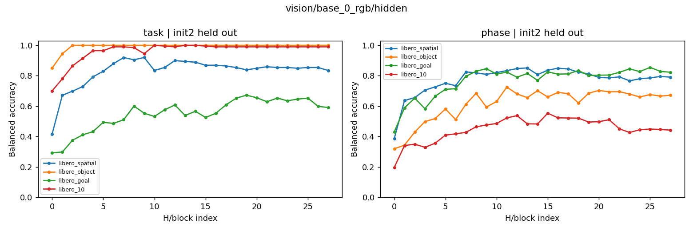

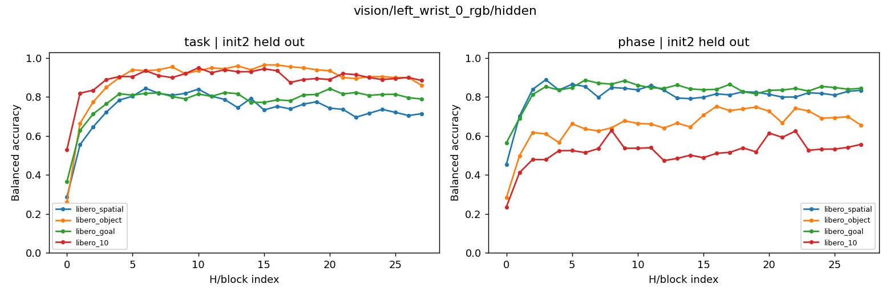

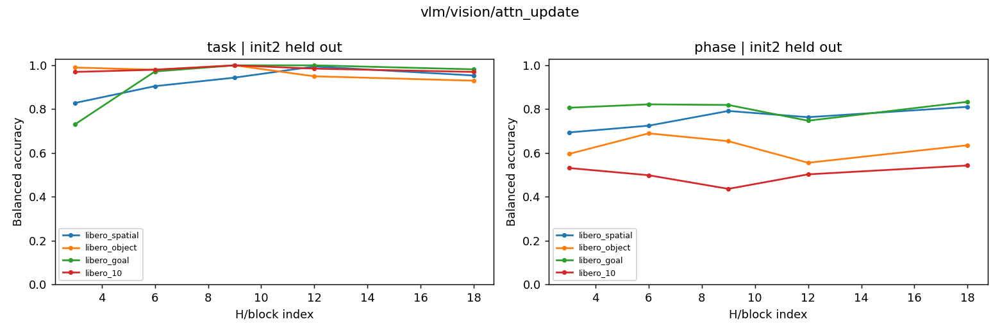

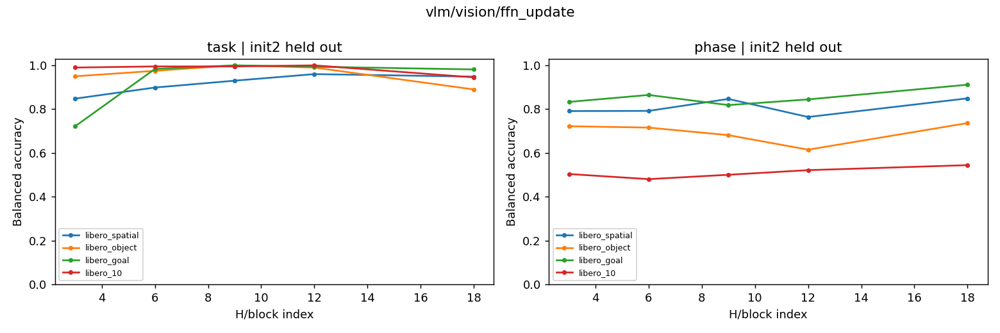

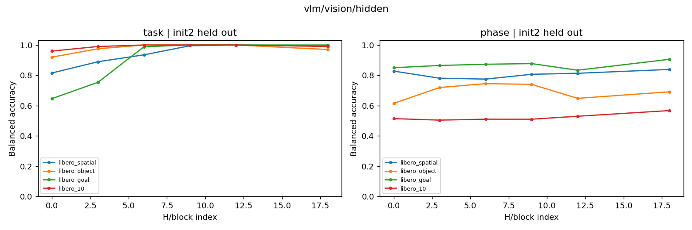

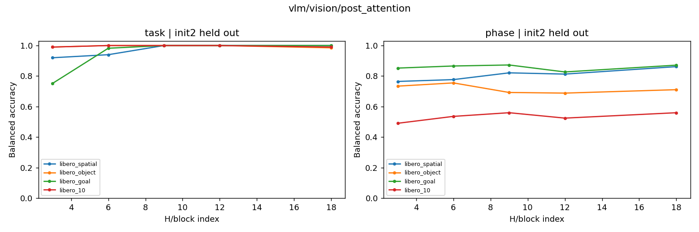

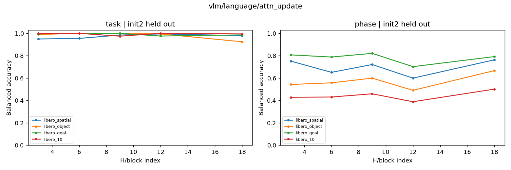

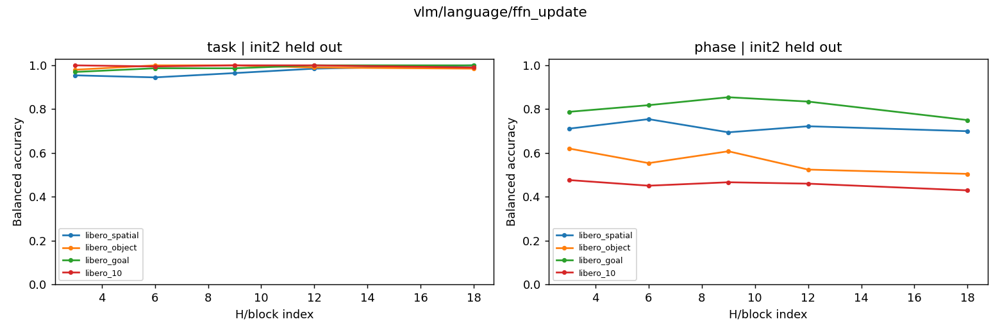

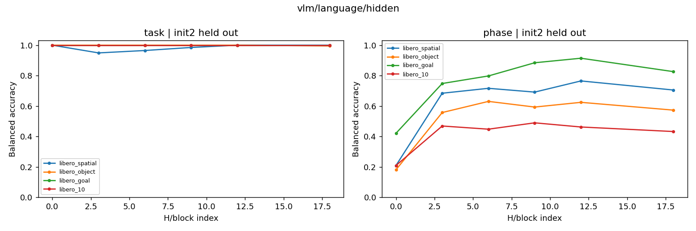

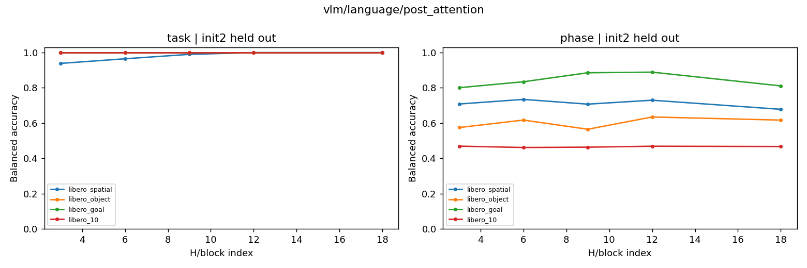

## 同 task 内 phase 的层间差异

每行仅一条 init2 留出轨迹；n 为有效留出观测数，K 为留出阶段数。颜色是相对训练多数类基线的诊断得分差，不是动作重要性；不同 task 的阶段组成不同。浅灰色表示接近基线，深灰色表示不足两个训练或留出阶段，需结合 conditional_probes.csv 的支持量读取。

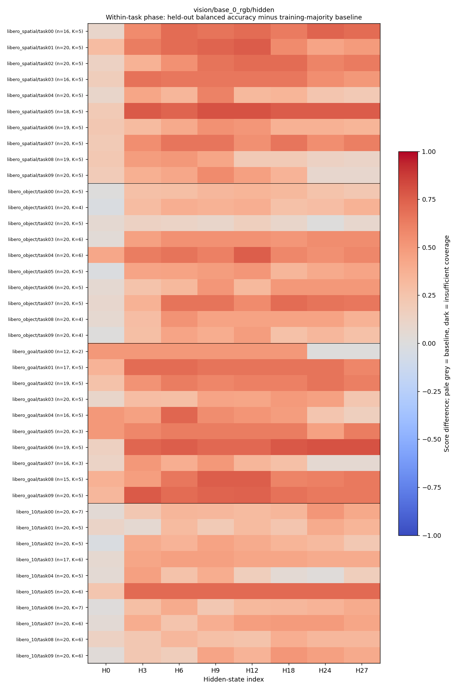

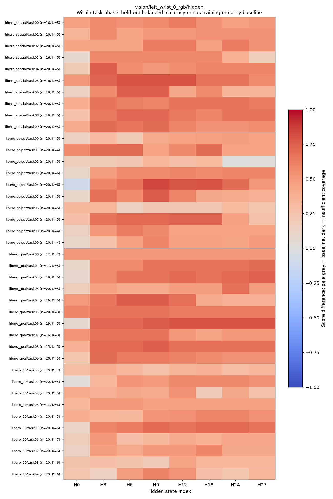

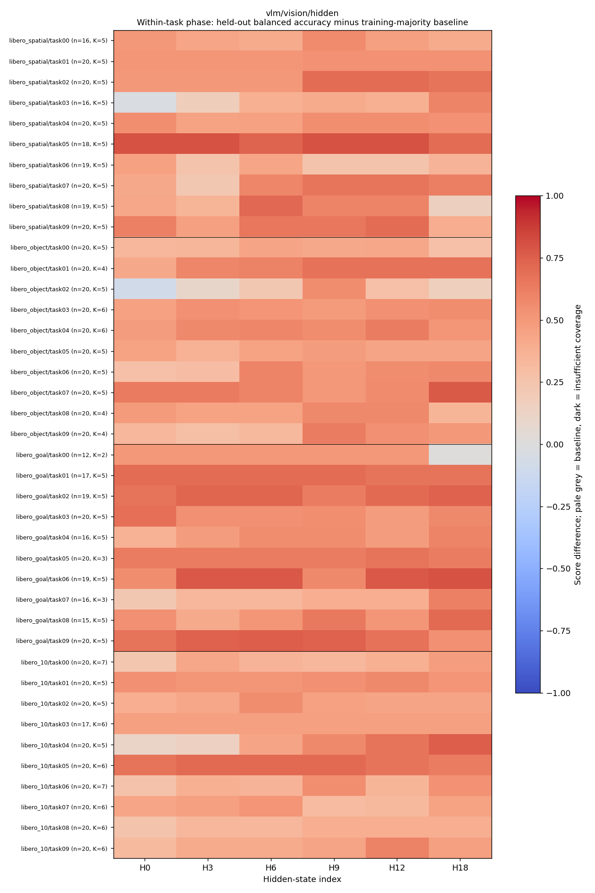

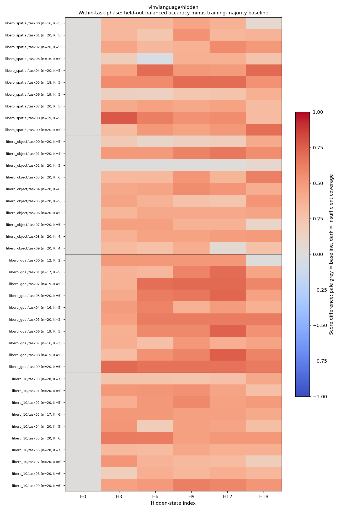

## 残差更新与阶段

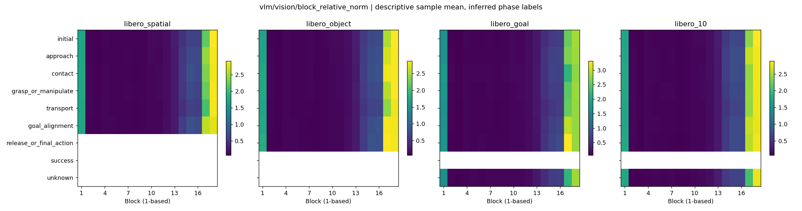

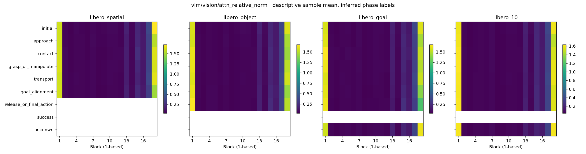

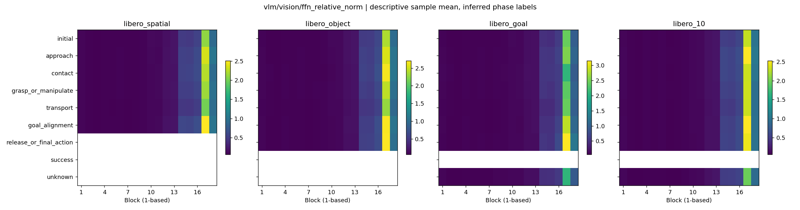

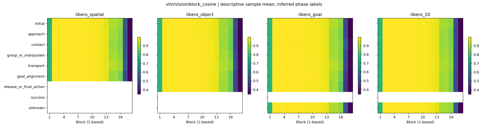

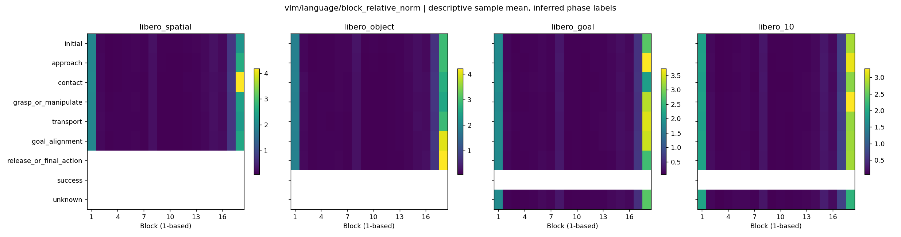

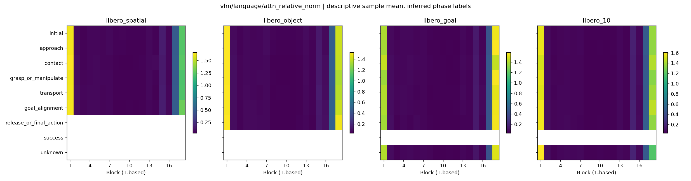

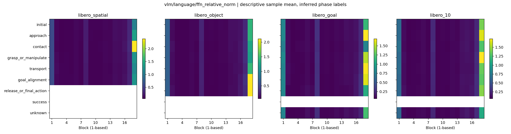

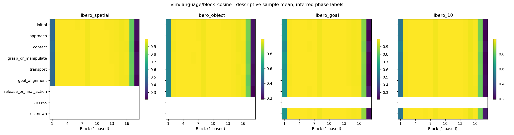

## PCA 静态图

- [pca_vision_base_0_rgb_hidden_layer00.png](figures/pca_vision_base_0_rgb_hidden_layer00.png)
- [pca_vision_base_0_rgb_hidden_layer03.png](figures/pca_vision_base_0_rgb_hidden_layer03.png)
- [pca_vision_base_0_rgb_hidden_layer06.png](figures/pca_vision_base_0_rgb_hidden_layer06.png)
- [pca_vision_base_0_rgb_hidden_layer09.png](figures/pca_vision_base_0_rgb_hidden_layer09.png)
- [pca_vision_base_0_rgb_hidden_layer12.png](figures/pca_vision_base_0_rgb_hidden_layer12.png)
- [pca_vision_base_0_rgb_hidden_layer18.png](figures/pca_vision_base_0_rgb_hidden_layer18.png)
- [pca_vision_base_0_rgb_hidden_layer24.png](figures/pca_vision_base_0_rgb_hidden_layer24.png)
- [pca_vision_base_0_rgb_hidden_layer27.png](figures/pca_vision_base_0_rgb_hidden_layer27.png)
- [pca_vision_left_wrist_0_rgb_hidden_layer00.png](figures/pca_vision_left_wrist_0_rgb_hidden_layer00.png)
- [pca_vision_left_wrist_0_rgb_hidden_layer03.png](figures/pca_vision_left_wrist_0_rgb_hidden_layer03.png)
- [pca_vision_left_wrist_0_rgb_hidden_layer06.png](figures/pca_vision_left_wrist_0_rgb_hidden_layer06.png)
- [pca_vision_left_wrist_0_rgb_hidden_layer09.png](figures/pca_vision_left_wrist_0_rgb_hidden_layer09.png)
- [pca_vision_left_wrist_0_rgb_hidden_layer12.png](figures/pca_vision_left_wrist_0_rgb_hidden_layer12.png)
- [pca_vision_left_wrist_0_rgb_hidden_layer18.png](figures/pca_vision_left_wrist_0_rgb_hidden_layer18.png)
- [pca_vision_left_wrist_0_rgb_hidden_layer24.png](figures/pca_vision_left_wrist_0_rgb_hidden_layer24.png)
- [pca_vision_left_wrist_0_rgb_hidden_layer27.png](figures/pca_vision_left_wrist_0_rgb_hidden_layer27.png)
- [pca_vlm_vision_attn_update_layer03.png](figures/pca_vlm_vision_attn_update_layer03.png)
- [pca_vlm_vision_attn_update_layer09.png](figures/pca_vlm_vision_attn_update_layer09.png)
- [pca_vlm_vision_attn_update_layer18.png](figures/pca_vlm_vision_attn_update_layer18.png)
- [pca_vlm_vision_ffn_update_layer03.png](figures/pca_vlm_vision_ffn_update_layer03.png)
- [pca_vlm_vision_ffn_update_layer09.png](figures/pca_vlm_vision_ffn_update_layer09.png)
- [pca_vlm_vision_ffn_update_layer18.png](figures/pca_vlm_vision_ffn_update_layer18.png)
- [pca_vlm_vision_hidden_layer00.png](figures/pca_vlm_vision_hidden_layer00.png)
- [pca_vlm_vision_hidden_layer03.png](figures/pca_vlm_vision_hidden_layer03.png)
- [pca_vlm_vision_hidden_layer06.png](figures/pca_vlm_vision_hidden_layer06.png)
- [pca_vlm_vision_hidden_layer09.png](figures/pca_vlm_vision_hidden_layer09.png)
- [pca_vlm_vision_hidden_layer12.png](figures/pca_vlm_vision_hidden_layer12.png)
- [pca_vlm_vision_hidden_layer18.png](figures/pca_vlm_vision_hidden_layer18.png)
- [pca_vlm_vision_post_attention_layer03.png](figures/pca_vlm_vision_post_attention_layer03.png)
- [pca_vlm_vision_post_attention_layer09.png](figures/pca_vlm_vision_post_attention_layer09.png)
- [pca_vlm_vision_post_attention_layer18.png](figures/pca_vlm_vision_post_attention_layer18.png)
- [pca_vlm_language_attn_update_layer03.png](figures/pca_vlm_language_attn_update_layer03.png)
- [pca_vlm_language_attn_update_layer09.png](figures/pca_vlm_language_attn_update_layer09.png)
- [pca_vlm_language_attn_update_layer18.png](figures/pca_vlm_language_attn_update_layer18.png)
- [pca_vlm_language_ffn_update_layer03.png](figures/pca_vlm_language_ffn_update_layer03.png)
- [pca_vlm_language_ffn_update_layer09.png](figures/pca_vlm_language_ffn_update_layer09.png)
- [pca_vlm_language_ffn_update_layer18.png](figures/pca_vlm_language_ffn_update_layer18.png)
- [pca_vlm_language_hidden_layer00.png](figures/pca_vlm_language_hidden_layer00.png)
- [pca_vlm_language_hidden_layer03.png](figures/pca_vlm_language_hidden_layer03.png)
- [pca_vlm_language_hidden_layer06.png](figures/pca_vlm_language_hidden_layer06.png)
- [pca_vlm_language_hidden_layer09.png](figures/pca_vlm_language_hidden_layer09.png)
- [pca_vlm_language_hidden_layer12.png](figures/pca_vlm_language_hidden_layer12.png)
- [pca_vlm_language_hidden_layer18.png](figures/pca_vlm_language_hidden_layer18.png)
- [pca_vlm_language_post_attention_layer03.png](figures/pca_vlm_language_post_attention_layer03.png)
- [pca_vlm_language_post_attention_layer09.png](figures/pca_vlm_language_post_attention_layer09.png)
- [pca_vlm_language_post_attention_layer18.png](figures/pca_vlm_language_post_attention_layer18.png)
