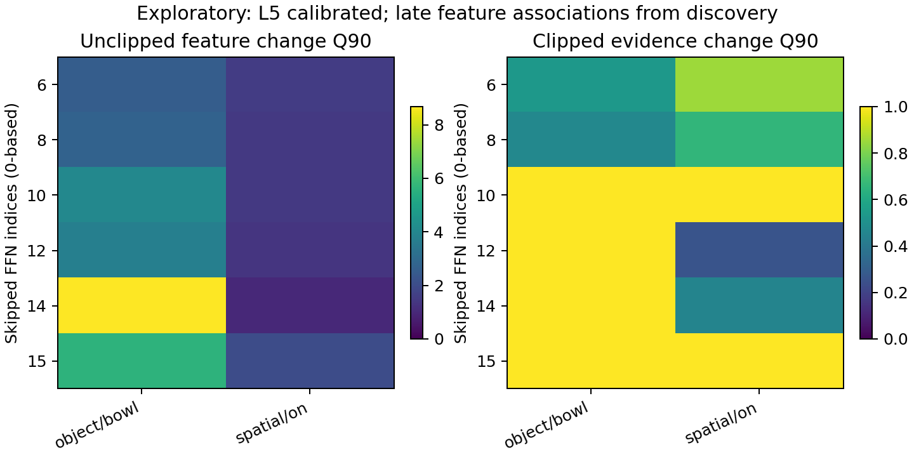

# π0.5 SAE 语义与 FFN：首轮真实前向结果

更新：2026-11-06（离线组合验证与完整动作接入完成）

已完成 64 个本地真实观测的两层读出、两版六个候选 FFN 单模块矩阵，以及三个双 FFN 组合的发现/校准验证。已有完整动作路径接入检查，尚未验证完整策略质量或 RTX 4090 上的净加速。

## 数据与资产复用

- 固定当前 π0.5-LIBERO PyTorch checkpoint，保持 BF16/FP32、H10、原预处理；没有训练 SAE 或更新 VLA 权重。
- 使用 Action Atlas L5/L16 权重与原样官方 loader，并复用公开概念索引、网站说明、原始激活、已有层统计和消融索引。
- 本地数据复用 32 条已有完整 π0.5 baseline 轨迹：12 个发现任务、4 个校准任务、每任务 2 个 init，先取每 episode 首尾两个真实观测，共 48 个发现观测及 16 个校准观测。另 8 个预留任务未进行当前策略评测。
- 模块干预只运行共同 L5 起点后的 VLM 尾段，不执行 Action Expert、flow matching 或环境 step；每次干预同时得到所有候选特征的读出。

## 早期语义读出

在同一完整 64 观测上，直接沿用公开候选池未获得稳健的两层规则。保持同一 SAE 字典、只在发现集重新关联 feature ID，并改为读取指令 token 后，L5 出现以下校准触发：

| 标签 | 正确触发 / 总触发 | 校准覆盖率 | 误触发率 |
|---|---:|---:|---:|
| object/bowl | 4 / 4 | 0.500 | 0.000 |
| object/stove | 2 / 2 | 0.500 | 0.000 |
| spatial/on | 4 / 4 | 0.500 | 0.000 |

这些是 16 个校准观测上的经验值，不是部署正确率，更不是跳过后的成功概率。当前标签来自任务指令，不能当作操作阶段标签。bowl/on 的这一版本共享 L5 特征 12997 和触发群体，因此不是两份独立的语义证据。

## 六个 FFN 的候选响应

下表是第一次真实干预：12 个观测、5 个发现任务、10 个 episode、每观测 6 个单 FFN，共 72 次尾段前向。D 是逐特征未截断归一化激活变化的加权 Q90；E 是对应截断证据变化。

| 跳过的 FFN（0-based） | bowl 候选 D | on 候选 D | bowl E | on E |
|---|---:|---:|---:|---:|
| 6 | 2.553 | 1.558 | 0.532 | 0.854 |
| 8 | 2.738 | 1.433 | 0.468 | 0.659 |
| 10 | 4.057 | 1.433 | 1.000 | 1.000 |
| 12 | 3.747 | 1.325 | 1.000 | 0.261 |
| 14 | 8.678 | 0.997 | 1.000 | 0.452 |
| 15 | 5.627 | 2.021 | 1.000 | 1.000 |

在各自归一化方向中，L14 对 bowl 候选的影响最大、对 on 候选最小；这说明不能用一个统一层重要性排序替代所有读出方向。**但两个条件的观测群完全相同**，而晚期候选方向不同，这张图本身不能证明独立语义条件需要不同模块。它首先建立的是方向相关的 FFN 响应。

一些条目的 E 很小是因为两条路径都处于分数饱和区，或晚期基线根本没有正证据。因而同时保留未截断 D 和晚期基线证据覆盖，不把 E=0 直接解释为语义不受影响。

## 晚期读出的稳定性与条件支持

完整数据上重新按 R 排名得到的 L16 候选没有复现阶段性校准表现。固定较早从 36 个发现观测选出的 feature ID、归一化和阈值，再对完整 64 观测复核时，原 47 个观测的评分全部复现，说明这一步没有偷偷改系数。冻结版本的晚期 bowl/on 在全局校准上均为 6 次正确触发、2 次误触发；它们并不是可靠的第二个全局分类器。

原方案只在 L5 判断当前语义，L16 是离线响应探针。按真实 L5 触发区域检查，冻结版本的晚期基线证据跨两个 episode 存在。接续研究据此进行条件影响统计，并保留所有 L5 选中样本；不会删除晚期弱证据样本，也不会把全无晚期证据的群体当作零影响。

## 冻结读出后的有限验证

冻结版本的 L5 bowl 使用 5783，on 使用 12997；校准分别为 2/2、4/4 正确触发，覆盖率为 0.25、0.50。两者的晚期方向都使用 L16 特征 554，但概念尺度与 L5 条件群不同。第二版矩阵中，对 bowl 较小的单模块为 15/12，对 on 为 12/15；FFN8 在两个群体中的相对位置也不同。这是条件响应线索，群体中的任务、场景和时间仍同时变化，不能称为单独改变概念造成的模块分工。

实际运行最多三个 pair，校准结果如下。bowl 条目含 2 个观测、2 个 episode；on 含 4 个观测、2 个 episode。全部 L5 选中观测均计入，包括晚期弱证据样本。

| pair（0-based） | bowl D | on D | bowl E | on E |
|---|---:|---:|---:|---:|
| 12,15 | 0.514 | 2.707 | 0.514 | 0.807 |
| 6,15 | 0.803 | 1.161 | 0.295 | 0.689 |
| 12,14 | 1.417 | 1.745 | 0.894 | 1.000 |

默认 `delta=0.1` 没有可跳过规则，0.25/0.5 同样为空。阈值 1.0 虽有 bowl 的 mask 条目，但校准观测常同时触发 on，实际可路由数仍为零。因此不能把“有条目”当作“有覆盖”。这些结果只说明当前特征及尺度下，小变化阈值不支持跳过。

另存相对影响先验：`[6,15]`、阈值 1.1613027445。它是离线校准中能产生非刷新触发的最低代价配置，未使用测试 SR，不覆盖原来的小阈值负结果。固定对照使用相同 pair；周期 3、offset 0，校准固定观测上双方各有两个非刷新跳过机会。真实闭环中的覆盖与预算仍须实测。这一版本不能声称保持语义激活或动作质量。

已有物理干预缓存保存全字典的汇总分数，不保存庞大的全 token 稠密字典输出；重换读出方向或 token 子集无需重复相同模型前向。

总计保存 138 个不同观测/mask 的物理干预结果。完整 CPU 动作接入另做两项固定噪声检查：只读 SAE 与原始动作逐位一致；实际在线 mask 与直接指定相同 mask 的动作逐位一致。两项都不是闭环质量测试。现有 LIBERO 评测器已接入，24 条小批配置已准备，当前等待可用 GPU，尚无本版闭环或 GPU 加速结果。

## 可复核入口

- [公开资产分析](public_analysis/public_analysis.md)
- [同一64观测的读出对照](semantic_variant_comparison.md)
- [首次单模块数据](module_matrix_instruction_exploratory/concept_ffn_matrix.csv)
- [观测群与特征重合](module_matrix_instruction_exploratory/cohort_dependence.json)
- [冻结读出复核](semantic_dictionary_instruction_frozen36/semantic_selection_summary.json)
- [三个组合研究状态](mask_study_frozen36_diverse/study_status.json)
- [组合校准实测](mask_study_frozen36_diverse/combination_calibration/concept_ffn_matrix.csv)
- [相对影响探索候选](quality_candidate_relative_prior.json)
- [CPU 完整动作路径检查](runtime_check_cpu/runtime_check.json)
- [数据与版本](run_manifest.json)
