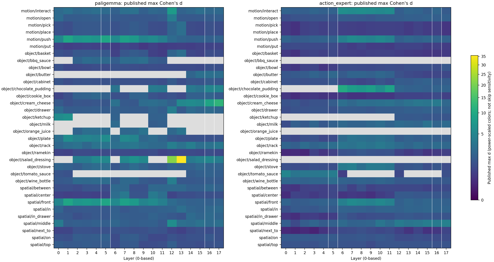

# π0.5 SAE 语义—层关系：公开资产复用首轮结果

本轮直接重分析 Action Atlas 发布的概念索引、网站数据和已有层统计；没有重新训练 SAE 或重复采集轨迹。
本地 checkpoint 迁移检查和 FFN 跳过干预仍待实测，以下结果不作为跳过安全性结论。

覆盖 36 个 pathway/layer、1118 条概念—层索引，L5/L16 共有 27 个候选概念。

## L5/L16 候选概念

按两端 max d 的较小值排序，作为本地复核候选；这不是逐特征排名，也不是对所有候选的语义正确率估计。

| 概念 | L5 max d | L16 max d |
|---|---:|---:|
| object/salad_dressing | 5.236 | 5.204 |
| object/rack | 3.170 | 3.136 |
| motion/interact | 2.551 | 2.358 |
| object/stove | 2.742 | 1.949 |
| object/cookie_box | 1.955 | 1.948 |
| motion/push | 9.490 | 1.835 |
| spatial/front | 9.490 | 1.835 |
| spatial/middle | 1.807 | 2.590 |
| object/drawer | 1.641 | 2.464 |
| object/wine_bottle | 2.680 | 1.640 |

## 对后续实验的直接帮助

- L5 与 L16 已有公共概念候选，可直接复用两层各自的 feature ID 池；不需要从零发现概念或训练字典。
- 使用公开层分布选择需要本地检查的概念；ID 仅在相应层的 SAE 内有意义。
- 概念索引只提供候选 ID、数量和 max d，没有逐特征 d/激活频率。网站自动描述可用于检索线索；缺失的逐特征统计需继续查原始结果或在小批激活上计算，不能编造排名。
- 原始激活、统计与本地观测分开记来源；公开激活可先验证官方 SAE 编码和重构，本地观测用于检查迁移后是否仍有语义区分。

## 概念重叠与解释

- `motion/pick` 与 `motion/place`：18 层的平均同层候选集合 Jaccard=1.000，其中 18 层完全相同。
- `motion/push` 与 `spatial/front`：18 层的平均同层候选集合 Jaccard=1.000，其中 18 层完全相同。

这些重叠可能反映任务标签共现，不能当作发现了彼此独立的语义机制；选少量概念时优先覆盖不同标签组合。

## 已有消融结果

已整理 `ablation_index.json` 中 48265 条记录，其中 11661 条带 success 字段。逐 suite/layer/concept 的覆盖量及可评分成功数见 `public_ablation_counts.csv`；其余成功率留空，不记为失败。
这些是发布表中的记录计数；缺失 pathway 标为 unspecified，不推断归属，也不把视频索引视为完整随机采样实验。
SAE feature 消融与跳过 FFN 是不同干预；这里的结果用于寻找线索，不能替代计划中的 Concept–FFN 实测矩阵。

## 数据口径

- 灰色格表示索引缺失；未发布概念不记为零。max d 是发布摘要，不保证跨不同 SAE、任务组成和样本池完全可比。
- feature_indices 是截断候选池，数量不是全字典中该概念的神经元总数；strong/very_strong 原样保存，不自行解释为校准置信度。
- 既有层激活方差和时间变化保存于 `public_activation_statistics.csv`；激活幅度不直接代表控制重要性。
- 三个 Hugging Face 仓库均固定 revision；原文件 SHA256 和引用入口保存于 manifests。
